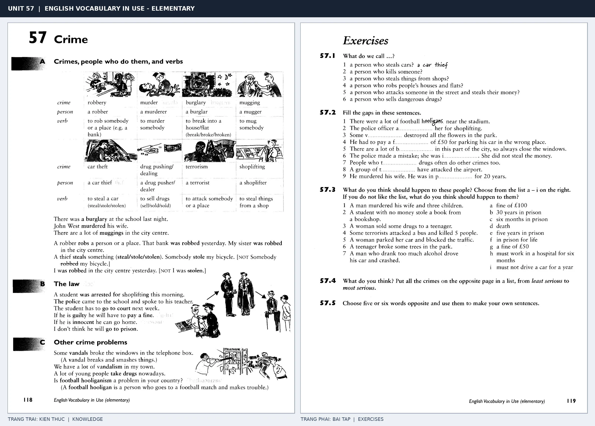

# Unit 57 — Crime: Từ vựng về tội phạm

*Trang trái cung cấp kiến thức và ví dụ; trang phải là phần Exercises của Unit tương ứng. Có thể phóng to ảnh để làm bài tập gốc.*

> **Module 09:** Vấn đề xã hội  
> **Phạm vi:** English Vocabulary in Use — Elementary, Unit 57; trang in 118–119 (PDF trang 121–122).  
> **Hình thức:** Tự học từ vựng A1–A2 · Giảng giải tiếng Việt · Luyện câu và bài tập.

## 1. Tóm tắt và mục tiêu

Phân biệt crime (vụ phạm tội), criminal/person (người) và verb (hành vi): rob/robber/robbery. Steal something là lấy trộm thứ gì; rob somebody/place là cướp của ai hoặc ở đâu.

Sau bài này, bạn có thể:

- Giải thích nghĩa và cách sử dụng những từ, cụm từ cốt lõi của chủ đề **từ vựng về tội phạm**.
- Chọn đúng cách diễn đạt trong câu tiếng Anh đơn giản thay vì dịch máy móc từng từ.
- Tự đặt ít nhất ba câu thực tế và hoàn thành phần Exercises ở trang sách bên phải.

## 2. Kiến thức và từ vựng cốt lõi

Đọc kỹ từng mục. Với từ nhiều nghĩa, nghĩa ghi trong bảng được giới hạn ở cách dùng cần cho bài học này.

| Từ/cụm từ tiếng Anh | Nghĩa tiếng Việt |
| --- | --- |
| **crime** | tội phạm |
| **robbery** | vụ cướp |
| **murder** | án mạng |
| **burglary** | vụ trộm đột nhập |
| **mugging** | vụ cướp đường phố |
| **robber** | kẻ cướp |
| **murderer** | kẻ giết người |
| **burglar** | kẻ trộm đột nhập |
| **thief** | kẻ trộm |
| **steal** | ăn cắp |
| **arrest** | bắt giữ |
| **police** | cảnh sát |
| **prison** | nhà tù |
| **break into** | đột nhập |

### 2.1. Ghi nhớ theo nhóm và ngữ cảnh

**Nhóm từ thứ nhất:** crime (tội phạm), robbery (vụ cướp), murder (án mạng).

**Nhóm từ thứ hai:** robber (kẻ cướp), murderer (kẻ giết người), burglar (kẻ trộm đột nhập).

Hãy ghép từ với tình huống sử dụng thực tế. Khi gặp cụm từ có nhiều thành phần, ưu tiên ghi cả cụm kèm một câu ví dụ trong sổ từ vựng.

### 2.2. Mẫu câu song ngữ

**Ví dụ 1.** The police arrested the robber.

→ Cảnh sát đã bắt kẻ cướp.

**Ví dụ 2.** Someone stole my bike.

→ Ai đó đã ăn trộm xe đạp của tôi.

Đọc từng câu thành tiếng, che phần dịch tiếng Việt và thử nói lại ý bằng lời của mình. Sau đó thay một chi tiết trong câu để tạo ví dụ mới.

## 3. Luyện tập ứng dụng

**Bài A — Nhớ từ trong ngữ cảnh.** Không nhìn bảng, hãy viết tiếng Anh tương ứng với các ý sau:

1. Tội phạm: __________
2. Vụ trộm đột nhập: __________
3. Kẻ trộm đột nhập: __________

**Bài B — Dịch và biến đổi câu.** Dịch hai câu dưới đây sang tiếng Anh trước khi nhìn mẫu câu ở trên:

1. Cảnh sát đã bắt kẻ cướp.
2. Ai đó đã ăn trộm xe đạp của tôi.

**Bài C — Viết cho bản thân.** Viết ba câu mới về cuộc sống của bạn, mỗi câu sử dụng một từ/cụm từ khác nhau trong bảng. Đọc lại để kiểm tra giới từ, cách chia động từ và trật tự từ.

**Bài D — Thực hành theo sách.** Quan sát phần **Exercises (trang phải)** trong ảnh ghép: giải bài tập trên giấy hoặc một file riêng, sau đó so sánh với các ví dụ ở trang trái. Những bài yêu cầu thông tin cá nhân không nhất thiết có một đáp án cố định.

## 4. Câu hỏi ôn tập trắc nghiệm

*Mỗi câu có một đáp án phù hợp nhất. Hãy tự trả lời trước khi đọc phần giải thích.*

### Câu 1

Bạn muốn diễn đạt **“vụ cướp”** bằng tiếng Anh. Chọn cách nói phù hợp nhất.

A. murder

B. arrest

C. crime

D. robbery

**Đáp án:** D. **Giải thích:** “robbery” diễn đạt “vụ cướp” trong chủ đề này.

### Câu 2

Cụm từ **“robber”** có nghĩa nào trong bài học?

A. tội phạm

B. kẻ trộm đột nhập

C. nhà tù

D. kẻ cướp

**Đáp án:** D. **Giải thích:** “robber” được dùng với nghĩa “kẻ cướp”.

### Câu 3

Khi cần nói **“kẻ trộm”**, chọn từ/cụm từ nào?

A. thief

B. break into

C. arrest

D. steal

**Đáp án:** A. **Giải thích:** Cách dùng đúng trong bài là “thief”.

### Câu 4

Chọn câu tiếng Anh diễn đạt đúng nhất: **“Cảnh sát đã bắt kẻ cướp.”**

A. I've lost my keys.

B. The police arrested the robber.

C. The news is on TV at six.

D. I read the newspaper every morning.

**Đáp án:** B. **Giải thích:** “The police arrested the robber.” là câu tương ứng với tình huống đã nêu.

### Câu 5

Ý nghĩa phù hợp nhất của câu **“Someone stole my bike.”** là gì?

A. Tôi làm mất chìa khóa.

B. Tôi đọc báo mỗi sáng.

C. Ai đó đã ăn trộm xe đạp của tôi.

D. Năm ngoái đã xảy ra một trận lũ.

**Đáp án:** C. **Giải thích:** “Someone stole my bike.” có nghĩa là “Ai đó đã ăn trộm xe đạp của tôi.”.

## 5. Tổng kết và kiểm tra hoàn thành

Bài **Someone stole my bike.** giúp bạn sử dụng vốn từ về **ai đó đã ăn trộm xe đạp của tôi.** trong câu tiếng Anh thực tế. Giá trị quan trọng nhất không chỉ là biết nghĩa, mà là nhớ **cách kết hợp từ và ngữ cảnh sử dụng**.

- [ ] Tôi đã học bảng từ/cụm từ và đọc thành tiếng các ví dụ.
- [ ] Tôi đã hoàn thành ba phần luyện tập A, B, C.
- [ ] Tôi đã làm trang Exercises trong ảnh ghép và 5 câu trắc nghiệm.
- [ ] Tôi đã ghi các từ dễ nhầm vào sổ để ôn lại sau 1–3 ngày.

---

[← Unit 56: Giải trí tại nhà](../08-leisure/56-leisure-at-home.md) · [Unit 58: Truyền thông →](58-the-media.md)

[↑ Trở về mục lục khóa học](../../MUC_LUC.md)
