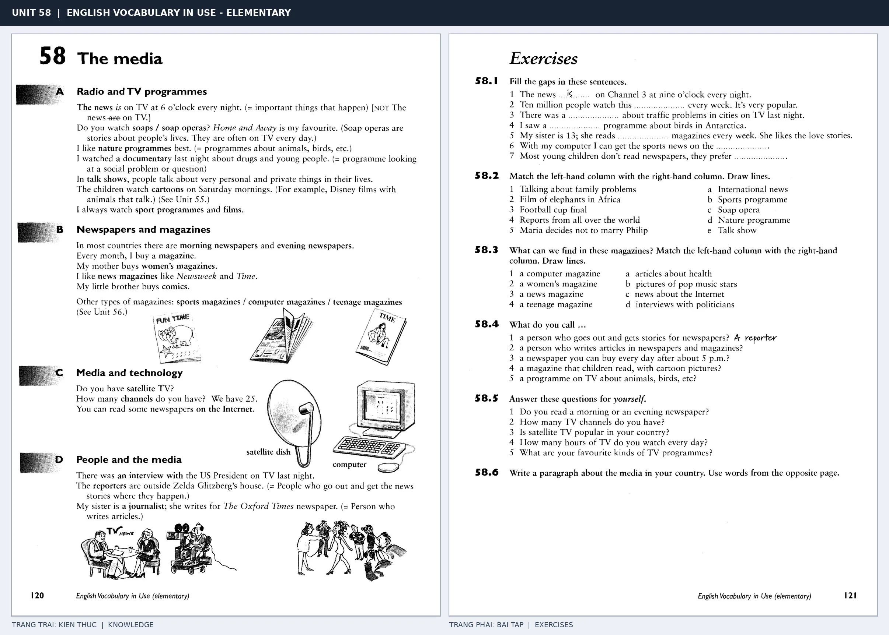

# Unit 58 — The media: Truyền thông

*Trang trái cung cấp kiến thức và ví dụ; trang phải là phần Exercises của Unit tương ứng. Có thể phóng to ảnh để làm bài tập gốc.*

> **Module 09:** Vấn đề xã hội  
> **Phạm vi:** English Vocabulary in Use — Elementary, Unit 58; trang in 120–121 (PDF trang 123–124).  
> **Hình thức:** Tự học từ vựng A1–A2 · Giảng giải tiếng Việt · Luyện câu và bài tập.

## 1. Tóm tắt và mục tiêu

News mang hình thức số nhiều nhưng thường là danh từ không đếm được, dùng với động từ số ít: the news is. Gắn từng loại media với động từ read, watch, listen to để diễn đạt thói quen.

Sau bài này, bạn có thể:

- Giải thích nghĩa và cách sử dụng những từ, cụm từ cốt lõi của chủ đề **truyền thông**.
- Chọn đúng cách diễn đạt trong câu tiếng Anh đơn giản thay vì dịch máy móc từng từ.
- Tự đặt ít nhất ba câu thực tế và hoàn thành phần Exercises ở trang sách bên phải.

## 2. Kiến thức và từ vựng cốt lõi

Đọc kỹ từng mục. Với từ nhiều nghĩa, nghĩa ghi trong bảng được giới hạn ở cách dùng cần cho bài học này.

| Từ/cụm từ tiếng Anh | Nghĩa tiếng Việt |
| --- | --- |
| **news** | tin tức |
| **newspaper** | báo in |
| **magazine** | tạp chí |
| **TV channel** | kênh truyền hình |
| **radio station** | đài phát thanh |
| **programme** | chương trình |
| **soap opera** | phim truyền hình dài tập |
| **interview** | cuộc phỏng vấn |
| **reporter** | phóng viên |
| **advertisement** | quảng cáo |
| **headline** | tiêu đề tin |
| **article** | bài báo |
| **weather forecast** | dự báo thời tiết |

### 2.1. Ghi nhớ theo nhóm và ngữ cảnh

**Nhóm từ thứ nhất:** news (tin tức), newspaper (báo in), magazine (tạp chí).

**Nhóm từ thứ hai:** programme (chương trình), soap opera (phim truyền hình dài tập), interview (cuộc phỏng vấn).

Hãy ghép từ với tình huống sử dụng thực tế. Khi gặp cụm từ có nhiều thành phần, ưu tiên ghi cả cụm kèm một câu ví dụ trong sổ từ vựng.

### 2.2. Mẫu câu song ngữ

**Ví dụ 1.** The news is on TV at six.

→ Bản tin phát trên tivi lúc sáu giờ.

**Ví dụ 2.** I read the newspaper every morning.

→ Tôi đọc báo mỗi sáng.

Đọc từng câu thành tiếng, che phần dịch tiếng Việt và thử nói lại ý bằng lời của mình. Sau đó thay một chi tiết trong câu để tạo ví dụ mới.

## 3. Luyện tập ứng dụng

**Bài A — Nhớ từ trong ngữ cảnh.** Không nhìn bảng, hãy viết tiếng Anh tương ứng với các ý sau:

1. Tin tức: __________
2. Kênh truyền hình: __________
3. Cuộc phỏng vấn: __________

**Bài B — Dịch và biến đổi câu.** Dịch hai câu dưới đây sang tiếng Anh trước khi nhìn mẫu câu ở trên:

1. Bản tin phát trên tivi lúc sáu giờ.
2. Tôi đọc báo mỗi sáng.

**Bài C — Viết cho bản thân.** Viết ba câu mới về cuộc sống của bạn, mỗi câu sử dụng một từ/cụm từ khác nhau trong bảng. Đọc lại để kiểm tra giới từ, cách chia động từ và trật tự từ.

**Bài D — Thực hành theo sách.** Quan sát phần **Exercises (trang phải)** trong ảnh ghép: giải bài tập trên giấy hoặc một file riêng, sau đó so sánh với các ví dụ ở trang trái. Những bài yêu cầu thông tin cá nhân không nhất thiết có một đáp án cố định.

## 4. Câu hỏi ôn tập trắc nghiệm

*Mỗi câu có một đáp án phù hợp nhất. Hãy tự trả lời trước khi đọc phần giải thích.*

### Câu 1

Bạn muốn diễn đạt **“báo in”** bằng tiếng Anh. Chọn cách nói phù hợp nhất.

A. reporter

B. article

C. weather forecast

D. newspaper

**Đáp án:** D. **Giải thích:** “newspaper” diễn đạt “báo in” trong chủ đề này.

### Câu 2

Cụm từ **“programme”** có nghĩa nào trong bài học?

A. tạp chí

B. đài phát thanh

C. chương trình

D. bài báo

**Đáp án:** C. **Giải thích:** “programme” được dùng với nghĩa “chương trình”.

### Câu 3

Khi cần nói **“phóng viên”**, chọn từ/cụm từ nào?

A. advertisement

B. article

C. reporter

D. weather forecast

**Đáp án:** C. **Giải thích:** Cách dùng đúng trong bài là “reporter”.

### Câu 4

Chọn câu tiếng Anh diễn đạt đúng nhất: **“Bản tin phát trên tivi lúc sáu giờ.”**

A. The news is on TV at six.

B. Someone stole my bike.

C. The police arrested the robber.

D. The washing machine is broken.

**Đáp án:** A. **Giải thích:** “The news is on TV at six.” là câu tương ứng với tình huống đã nêu.

### Câu 5

Ý nghĩa phù hợp nhất của câu **“I read the newspaper every morning.”** là gì?

A. Tôi làm mất chìa khóa.

B. Tôi đọc báo mỗi sáng.

C. Nhiều người mất nhà sau trận động đất.

D. Máy giặt bị hỏng.

**Đáp án:** B. **Giải thích:** “I read the newspaper every morning.” có nghĩa là “Tôi đọc báo mỗi sáng.”.

## 5. Tổng kết và kiểm tra hoàn thành

Bài **I read the newspaper every morning.** giúp bạn sử dụng vốn từ về **tôi đọc báo mỗi sáng.** trong câu tiếng Anh thực tế. Giá trị quan trọng nhất không chỉ là biết nghĩa, mà là nhớ **cách kết hợp từ và ngữ cảnh sử dụng**.

- [ ] Tôi đã học bảng từ/cụm từ và đọc thành tiếng các ví dụ.
- [ ] Tôi đã hoàn thành ba phần luyện tập A, B, C.
- [ ] Tôi đã làm trang Exercises trong ảnh ghép và 5 câu trắc nghiệm.
- [ ] Tôi đã ghi các từ dễ nhầm vào sổ để ôn lại sau 1–3 ngày.

---

[← Unit 57: Từ vựng về tội phạm](57-crime.md) · [Unit 59: Những rắc rối thường ngày →](59-everyday-problems.md)

[↑ Trở về mục lục khóa học](../../MUC_LUC.md)
