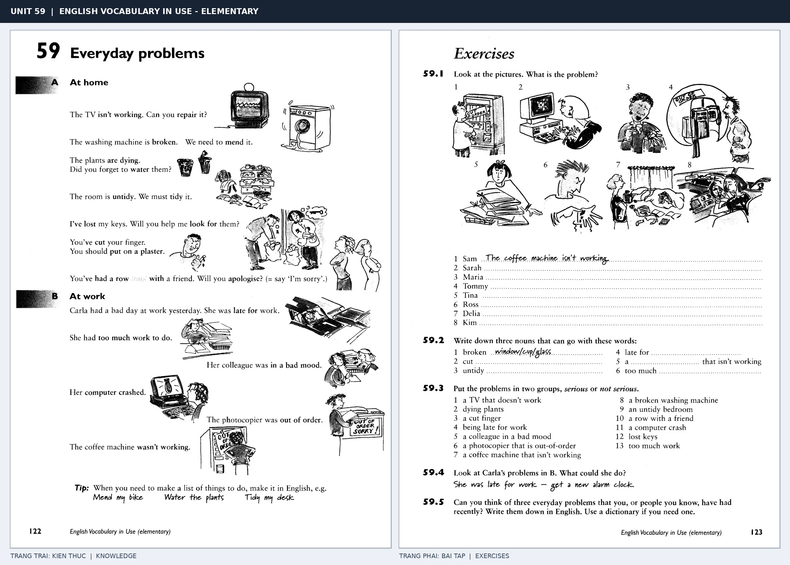

# Unit 59 — Everyday problems: Những rắc rối thường ngày

*Trang trái cung cấp kiến thức và ví dụ; trang phải là phần Exercises của Unit tương ứng. Có thể phóng to ảnh để làm bài tập gốc.*

> **Module 09:** Vấn đề xã hội  
> **Phạm vi:** English Vocabulary in Use — Elementary, Unit 59; trang in 122–123 (PDF trang 125–126).  
> **Hình thức:** Tự học từ vựng A1–A2 · Giảng giải tiếng Việt · Luyện câu và bài tập.

## 1. Tóm tắt và mục tiêu

Diễn đạt vấn đề bằng be broken, not work, lose, forget, miss; sau đó dùng repair, tidy, look for để nói giải pháp. Phân biệt lose (đánh mất) và miss (lỡ chuyến, lỡ dịp).

Sau bài này, bạn có thể:

- Giải thích nghĩa và cách sử dụng những từ, cụm từ cốt lõi của chủ đề **những rắc rối thường ngày**.
- Chọn đúng cách diễn đạt trong câu tiếng Anh đơn giản thay vì dịch máy móc từng từ.
- Tự đặt ít nhất ba câu thực tế và hoàn thành phần Exercises ở trang sách bên phải.

## 2. Kiến thức và từ vựng cốt lõi

Đọc kỹ từng mục. Với từ nhiều nghĩa, nghĩa ghi trong bảng được giới hạn ở cách dùng cần cho bài học này.

| Từ/cụm từ tiếng Anh | Nghĩa tiếng Việt |
| --- | --- |
| **broken** | bị hỏng |
| **repair** | sửa chữa |
| **mend** | vá hoặc sửa |
| **untidy** | bừa bộn |
| **tidy up** | dọn gọn |
| **lose** | đánh mất |
| **look for** | tìm kiếm |
| **forget** | quên |
| **late** | muộn |
| **miss** | lỡ hoặc bỏ lỡ |
| **noise** | tiếng ồn |
| **in a bad mood** | tâm trạng xấu |
| **wrong** | sai |
| **problem** | vấn đề |

### 2.1. Ghi nhớ theo nhóm và ngữ cảnh

**Nhóm từ thứ nhất:** broken (bị hỏng), repair (sửa chữa), mend (vá hoặc sửa).

**Nhóm từ thứ hai:** lose (đánh mất), look for (tìm kiếm), forget (quên).

Hãy ghép từ với tình huống sử dụng thực tế. Khi gặp cụm từ có nhiều thành phần, ưu tiên ghi cả cụm kèm một câu ví dụ trong sổ từ vựng.

### 2.2. Mẫu câu song ngữ

**Ví dụ 1.** The washing machine is broken.

→ Máy giặt bị hỏng.

**Ví dụ 2.** I've lost my keys.

→ Tôi làm mất chìa khóa.

Đọc từng câu thành tiếng, che phần dịch tiếng Việt và thử nói lại ý bằng lời của mình. Sau đó thay một chi tiết trong câu để tạo ví dụ mới.

## 3. Luyện tập ứng dụng

**Bài A — Nhớ từ trong ngữ cảnh.** Không nhìn bảng, hãy viết tiếng Anh tương ứng với các ý sau:

1. Bị hỏng: __________
2. Bừa bộn: __________
3. Quên: __________

**Bài B — Dịch và biến đổi câu.** Dịch hai câu dưới đây sang tiếng Anh trước khi nhìn mẫu câu ở trên:

1. Máy giặt bị hỏng.
2. Tôi làm mất chìa khóa.

**Bài C — Viết cho bản thân.** Viết ba câu mới về cuộc sống của bạn, mỗi câu sử dụng một từ/cụm từ khác nhau trong bảng. Đọc lại để kiểm tra giới từ, cách chia động từ và trật tự từ.

**Bài D — Thực hành theo sách.** Quan sát phần **Exercises (trang phải)** trong ảnh ghép: giải bài tập trên giấy hoặc một file riêng, sau đó so sánh với các ví dụ ở trang trái. Những bài yêu cầu thông tin cá nhân không nhất thiết có một đáp án cố định.

## 4. Câu hỏi ôn tập trắc nghiệm

*Mỗi câu có một đáp án phù hợp nhất. Hãy tự trả lời trước khi đọc phần giải thích.*

### Câu 1

Bạn muốn diễn đạt **“sửa chữa”** bằng tiếng Anh. Chọn cách nói phù hợp nhất.

A. late

B. lose

C. repair

D. mend

**Đáp án:** C. **Giải thích:** “repair” diễn đạt “sửa chữa” trong chủ đề này.

### Câu 2

Cụm từ **“lose”** có nghĩa nào trong bài học?

A. bị hỏng

B. đánh mất

C. muộn

D. quên

**Đáp án:** B. **Giải thích:** “lose” được dùng với nghĩa “đánh mất”.

### Câu 3

Khi cần nói **“muộn”**, chọn từ/cụm từ nào?

A. late

B. lose

C. look for

D. wrong

**Đáp án:** A. **Giải thích:** Cách dùng đúng trong bài là “late”.

### Câu 4

Chọn câu tiếng Anh diễn đạt đúng nhất: **“Máy giặt bị hỏng.”**

A. The police arrested the robber.

B. The news is on TV at six.

C. I read the newspaper every morning.

D. The washing machine is broken.

**Đáp án:** D. **Giải thích:** “The washing machine is broken.” là câu tương ứng với tình huống đã nêu.

### Câu 5

Ý nghĩa phù hợp nhất của câu **“I've lost my keys.”** là gì?

A. Tôi đọc báo mỗi sáng.

B. Tôi làm mất chìa khóa.

C. Nhiều người mất nhà sau trận động đất.

D. Ai đó đã ăn trộm xe đạp của tôi.

**Đáp án:** B. **Giải thích:** “I've lost my keys.” có nghĩa là “Tôi làm mất chìa khóa.”.

## 5. Tổng kết và kiểm tra hoàn thành

Bài **I've lost my keys.** giúp bạn sử dụng vốn từ về **tôi làm mất chìa khóa.** trong câu tiếng Anh thực tế. Giá trị quan trọng nhất không chỉ là biết nghĩa, mà là nhớ **cách kết hợp từ và ngữ cảnh sử dụng**.

- [ ] Tôi đã học bảng từ/cụm từ và đọc thành tiếng các ví dụ.
- [ ] Tôi đã hoàn thành ba phần luyện tập A, B, C.
- [ ] Tôi đã làm trang Exercises trong ảnh ghép và 5 câu trắc nghiệm.
- [ ] Tôi đã ghi các từ dễ nhầm vào sổ để ôn lại sau 1–3 ngày.

---

[← Unit 58: Truyền thông](58-the-media.md) · [Unit 60: Các vấn đề toàn cầu →](60-global-problems.md)

[↑ Trở về mục lục khóa học](../../MUC_LUC.md)
