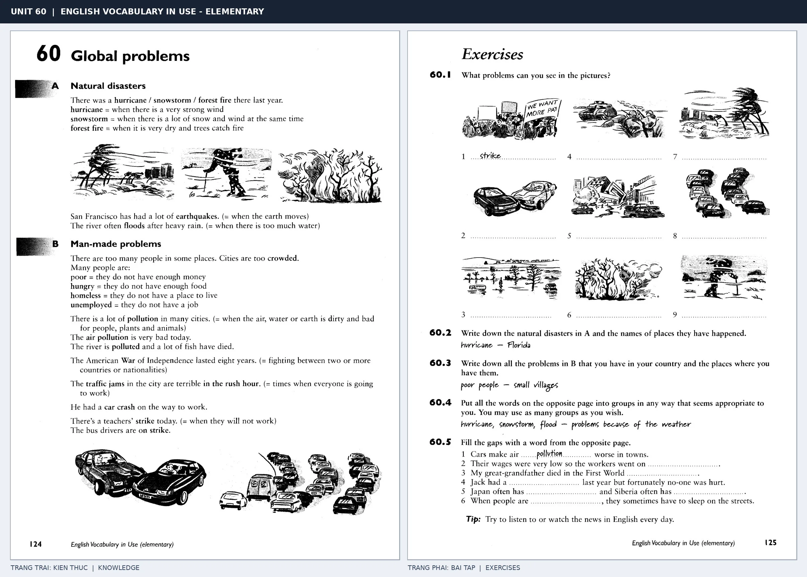

# Unit 60 — Global problems: Các vấn đề toàn cầu

*Trang trái cung cấp kiến thức và ví dụ; trang phải là phần Exercises của Unit tương ứng. Có thể phóng to ảnh để làm bài tập gốc.*

> **Module 09:** Vấn đề xã hội  
> **Phạm vi:** English Vocabulary in Use — Elementary, Unit 60; trang in 124–125 (PDF trang 127–128).  
> **Hình thức:** Tự học từ vựng A1–A2 · Giảng giải tiếng Việt · Luyện câu và bài tập.

## 1. Tóm tắt và mục tiêu

Từ vựng mô tả thiên tai, xung đột, khó khăn xã hội và môi trường. Học mô tả sự kiện bằng There was/were, what happened, where it happened và tác động đến người dân.

Sau bài này, bạn có thể:

- Giải thích nghĩa và cách sử dụng những từ, cụm từ cốt lõi của chủ đề **các vấn đề toàn cầu**.
- Chọn đúng cách diễn đạt trong câu tiếng Anh đơn giản thay vì dịch máy móc từng từ.
- Tự đặt ít nhất ba câu thực tế và hoàn thành phần Exercises ở trang sách bên phải.

## 2. Kiến thức và từ vựng cốt lõi

Đọc kỹ từng mục. Với từ nhiều nghĩa, nghĩa ghi trong bảng được giới hạn ở cách dùng cần cho bài học này.

| Từ/cụm từ tiếng Anh | Nghĩa tiếng Việt |
| --- | --- |
| **hurricane** | bão lớn |
| **snowstorm** | bão tuyết |
| **forest fire** | cháy rừng |
| **earthquake** | động đất |
| **flood** | lũ lụt |
| **war** | chiến tranh |
| **strike** | đình công |
| **unemployed** | thất nghiệp |
| **homeless** | vô gia cư |
| **pollution** | ô nhiễm |
| **environment** | môi trường |
| **disaster** | thảm họa |
| **refugee** | người tị nạn |
| **drought** | hạn hán |

### 2.1. Ghi nhớ theo nhóm và ngữ cảnh

**Nhóm từ thứ nhất:** hurricane (bão lớn), snowstorm (bão tuyết), forest fire (cháy rừng).

**Nhóm từ thứ hai:** war (chiến tranh), strike (đình công), unemployed (thất nghiệp).

Hãy ghép từ với tình huống sử dụng thực tế. Khi gặp cụm từ có nhiều thành phần, ưu tiên ghi cả cụm kèm một câu ví dụ trong sổ từ vựng.

### 2.2. Mẫu câu song ngữ

**Ví dụ 1.** There was a flood last year.

→ Năm ngoái đã xảy ra một trận lũ.

**Ví dụ 2.** Many people lost their homes after the earthquake.

→ Nhiều người mất nhà sau trận động đất.

Đọc từng câu thành tiếng, che phần dịch tiếng Việt và thử nói lại ý bằng lời của mình. Sau đó thay một chi tiết trong câu để tạo ví dụ mới.

## 3. Luyện tập ứng dụng

**Bài A — Nhớ từ trong ngữ cảnh.** Không nhìn bảng, hãy viết tiếng Anh tương ứng với các ý sau:

1. Bão lớn: __________
2. Động đất: __________
3. Thất nghiệp: __________

**Bài B — Dịch và biến đổi câu.** Dịch hai câu dưới đây sang tiếng Anh trước khi nhìn mẫu câu ở trên:

1. Năm ngoái đã xảy ra một trận lũ.
2. Nhiều người mất nhà sau trận động đất.

**Bài C — Viết cho bản thân.** Viết ba câu mới về cuộc sống của bạn, mỗi câu sử dụng một từ/cụm từ khác nhau trong bảng. Đọc lại để kiểm tra giới từ, cách chia động từ và trật tự từ.

**Bài D — Thực hành theo sách.** Quan sát phần **Exercises (trang phải)** trong ảnh ghép: giải bài tập trên giấy hoặc một file riêng, sau đó so sánh với các ví dụ ở trang trái. Những bài yêu cầu thông tin cá nhân không nhất thiết có một đáp án cố định.

## 4. Câu hỏi ôn tập trắc nghiệm

*Mỗi câu có một đáp án phù hợp nhất. Hãy tự trả lời trước khi đọc phần giải thích.*

### Câu 1

Bạn muốn diễn đạt **“bão tuyết”** bằng tiếng Anh. Chọn cách nói phù hợp nhất.

A. pollution

B. snowstorm

C. forest fire

D. refugee

**Đáp án:** B. **Giải thích:** “snowstorm” diễn đạt “bão tuyết” trong chủ đề này.

### Câu 2

Cụm từ **“war”** có nghĩa nào trong bài học?

A. môi trường

B. đình công

C. cháy rừng

D. chiến tranh

**Đáp án:** D. **Giải thích:** “war” được dùng với nghĩa “chiến tranh”.

### Câu 3

Khi cần nói **“vô gia cư”**, chọn từ/cụm từ nào?

A. disaster

B. earthquake

C. homeless

D. war

**Đáp án:** C. **Giải thích:** Cách dùng đúng trong bài là “homeless”.

### Câu 4

Chọn câu tiếng Anh diễn đạt đúng nhất: **“Năm ngoái đã xảy ra một trận lũ.”**

A. The police arrested the robber.

B. I read the newspaper every morning.

C. The news is on TV at six.

D. There was a flood last year.

**Đáp án:** D. **Giải thích:** “There was a flood last year.” là câu tương ứng với tình huống đã nêu.

### Câu 5

Ý nghĩa phù hợp nhất của câu **“Many people lost their homes after the earthquake.”** là gì?

A. Nhiều người mất nhà sau trận động đất.

B. Tôi đọc báo mỗi sáng.

C. Máy giặt bị hỏng.

D. Ai đó đã ăn trộm xe đạp của tôi.

**Đáp án:** A. **Giải thích:** “Many people lost their homes after the earthquake.” có nghĩa là “Nhiều người mất nhà sau trận động đất.”.

## 5. Tổng kết và kiểm tra hoàn thành

Bài **Many people lost their homes after the earthquake.** giúp bạn sử dụng vốn từ về **nhiều người mất nhà sau trận động đất.** trong câu tiếng Anh thực tế. Giá trị quan trọng nhất không chỉ là biết nghĩa, mà là nhớ **cách kết hợp từ và ngữ cảnh sử dụng**.

- [ ] Tôi đã học bảng từ/cụm từ và đọc thành tiếng các ví dụ.
- [ ] Tôi đã hoàn thành ba phần luyện tập A, B, C.
- [ ] Tôi đã làm trang Exercises trong ảnh ghép và 5 câu trắc nghiệm.
- [ ] Tôi đã ghi các từ dễ nhầm vào sổ để ôn lại sau 1–3 ngày.

---

[← Unit 59: Những rắc rối thường ngày](59-everyday-problems.md)

[↑ Trở về mục lục khóa học](../../MUC_LUC.md)
