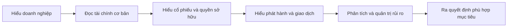

# Làm quen với khóa học đầu tư cổ phiếu (Introduction)

> [!SUMMARY] Một câu tóm tắt
> Bài này giúp bạn định hướng lộ trình từ hiểu doanh nghiệp đến hiểu thị trường và công cụ đầu tư, đồng thời đặt kỳ vọng học tập thực tế.

## 1. Tổng quan

Người mới thường bắt đầu bằng câu hỏi nên mua cổ phiếu nào, nhưng việc hiểu một cổ phiếu đòi hỏi nhiều nền tảng hơn một mã giao dịch. Trước hết cần biết doanh nghiệp tạo ra giá trị, sử dụng vốn và ghi nhận kết quả ra sao. Tiếp đó, ta tìm hiểu cổ phiếu, thị trường phát hành và giao dịch, rồi mới đi sâu vào phân tích và chiến lược. Bài mở đầu này phác họa lộ trình học và cách dùng kiến thức một cách có trách nhiệm.

## 2. Mục tiêu học tập

- [ ] Mô tả các chặng kiến thức chính trong khóa học.
- [ ] Nêu được vai trò của kế toán doanh nghiệp trong việc hiểu cổ phiếu.
- [ ] Phân biệt kiến thức giáo dục với lời khuyên cá nhân hóa.

## 3. Kiến thức cần chuẩn bị

- Không cần bài học trước. Chỉ cần sẵn sàng làm quen với các khái niệm doanh nghiệp, vốn, rủi ro và thị trường.

## 4. Thử đoán trước

1. Vì sao biết giá một cổ phiếu chưa đủ để hiểu doanh nghiệp đứng sau nó?
2. Theo bạn, nên học gì trước: cách đặt lệnh hay cách doanh nghiệp sử dụng vốn?

## 5. Kiến thức cốt lõi

### 5.1. Lộ trình từ doanh nghiệp đến quyết định

Đầu tư cổ phiếu là sở hữu một phần doanh nghiệp thông qua chứng khoán vốn. Vì vậy, một lộ trình hợp lý đi từ hoạt động kinh doanh và báo cáo tài chính, qua quyền sở hữu và cơ chế thị trường, đến cách phân tích và quản trị rủi ro.

### 5.2. Các lớp kiến thức bổ trợ nhau

| Lớp kiến thức | Câu hỏi được trả lời | Ví dụ nội dung |
|---|---|---|
| Doanh nghiệp | Công ty tạo và sử dụng nguồn lực thế nào? | Tài sản, nợ, vốn chủ sở hữu |
| Thị trường | Cổ phiếu được phát hành và mua bán ra sao? | IPO, thị trường thứ cấp, lệnh mua bán |
| Phân tích | Giá và kết quả kinh doanh được đánh giá thế nào? | Báo cáo, định giá, phân tích kỹ thuật |
| Rủi ro | Điều gì có thể làm kết quả khác dự tính? | Biến động, thanh khoản, đòn bẩy |

### 5.3. Học để hiểu, không học thuộc tín hiệu

Một thuật ngữ hoặc chỉ báo không tự động tạo ra quyết định tốt. Người học cần hiểu giả định, dữ liệu đầu vào và giới hạn của mỗi phương pháp; kết quả quá khứ không đảm bảo kết quả tương lai.

## 6. Giải thích chi tiết

Khóa học có thể đi qua cả đầu tư dài hạn lẫn giao dịch ngắn hạn. Hai cách tiếp cận có thời gian nắm giữ và tiêu chí ra quyết định khác nhau, nhưng đều cần nhận diện rủi ro. Bắt đầu từ nguyên lý doanh nghiệp giúp người học tránh coi cổ phiếu chỉ là con số nhấp nháy trên màn hình.

Hãy học theo thứ tự, ghi lại định nghĩa bằng lời của mình và tự tính lại các ví dụ. Với mỗi phương pháp, hãy hỏi: thông tin nào cần có, kết luận nào được hỗ trợ, và điều gì vẫn chưa biết?

> [!NOTE]
> Tài liệu trong khóa học là nội dung giáo dục chung. Hoàn cảnh tài chính, mục tiêu và mức chịu đựng rủi ro khác nhau giữa mỗi người.

## 7. Ví dụ minh họa

**Tình huống giả định:** Mai thấy một cổ phiếu giảm từ 50 xuống 40 đơn vị tiền tệ và muốn biết liệu nó có “rẻ” hay không.

1. Chỉ quan sát giá cho biết mức giá đã thay đổi, nhưng không giải thích doanh nghiệp có lãi hay nợ ra sao.
2. Mai cần tìm hiểu hoạt động, tài sản, nghĩa vụ và số cổ phần để có bức tranh cơ bản.
3. Sau đó, cô mới cân nhắc cách giá thị trường hình thành và những bất định còn lại.

Lý do: mức giá đơn lẻ không cho biết giá trị kinh tế, sức khỏe tài chính hoặc phù hợp với mục tiêu cá nhân hay không.

## 8. Thực hành

Chọn một doanh nghiệp quen thuộc và viết ba câu hỏi bạn muốn trả lời trước khi tìm hiểu cổ phiếu của doanh nghiệp đó.

- [ ] Tôi đã nêu một câu hỏi về hoạt động kinh doanh.
- [ ] Tôi đã nêu một câu hỏi về tài chính hoặc vốn.
- [ ] Tôi đã nêu một câu hỏi về rủi ro hoặc thị trường.

Xem lời giải sau khi đã tự làm

Ví dụ: Doanh nghiệp bán sản phẩm hoặc dịch vụ gì? Doanh thu và nghĩa vụ nợ được thể hiện ở đâu? Cổ phiếu được giao dịch trong điều kiện thanh khoản và biến động như thế nào? Đây là câu hỏi định hướng, không phải kết luận mua bán.

## 9. Những lỗi thường gặp

- **Chạy ngay theo mã cổ phiếu được nhắc đến** — hãy quay lại kiểm tra doanh nghiệp, dữ liệu và rủi ro.
- **Coi khóa học là công thức chắc thắng** — xem mỗi phương pháp như một công cụ có giả định và giới hạn.
- **Bỏ qua nền tảng kế toán** — học tài sản, nợ và vốn chủ sở hữu trước khi suy luận về quyền sở hữu.
- **Đồng nhất học đầu tư với nhận lời khuyên cá nhân** — tự đối chiếu kiến thức với mục tiêu và hoàn cảnh của mình.

## 10. Giải thích bằng lời của bạn

- Khái niệm: Cổ phiếu đại diện cho điều gì?
- Vì sao: Tại sao học doanh nghiệp trước khi học giao dịch?
- Ví dụ của tôi: Một doanh nghiệp tôi muốn tìm hiểu là gì?
- Chỗ chưa chắc: Khái niệm nào tôi muốn tra cứu thêm?

## 11. Câu hỏi ôn tập

### Câu 1

Vì sao người mới nên tìm hiểu doanh nghiệp trước khi chỉ nhìn biến động giá cổ phiếu?

A. Vì giá cổ phiếu không bao giờ thay đổi.
B. Vì hiểu doanh nghiệp cung cấp bối cảnh về tài sản, nghĩa vụ và hoạt động đứng sau cổ phiếu.
C. Vì mọi doanh nghiệp đều có cùng mức rủi ro.
D. Vì tìm hiểu doanh nghiệp đảm bảo có lợi nhuận.

**Đáp án:** B. **Giải thích:** B cung cấp bối cảnh cần thiết. A sai vì giá thay đổi; C sai vì doanh nghiệp khác nhau; D sai vì phân tích không đảm bảo lợi nhuận.

### Câu 2

Điều nào mô tả đúng mục tiêu của một khóa học đầu tư cơ bản?

A. Đưa ra lợi nhuận chắc chắn cho mọi người học.
B. Chọn thay người học mọi giao dịch.
C. Cung cấp khái niệm và công cụ để người học hiểu các quyết định và rủi ro.
D. Loại bỏ hoàn toàn khả năng thua lỗ.

**Đáp án:** C. **Giải thích:** Khóa học có thể xây dựng hiểu biết nhưng không thể bảo đảm kết quả hoặc loại bỏ rủi ro; A, B và D đều phóng đại vai trò của giáo dục.

### Câu 3

Những cách học nào giúp đánh giá một phương pháp đầu tư có trách nhiệm? (Chọn nhiều)

A. Tìm hiểu giả định và dữ liệu phương pháp sử dụng.
B. Tin rằng kết quả quá khứ bảo đảm tương lai.
C. Ghi nhận giới hạn và rủi ro của phương pháp.
D. Bỏ qua mục tiêu cá nhân vì mọi nhà đầu tư giống nhau.

**Đáp án:** A, C. **Giải thích:** Cần hiểu đầu vào và giới hạn. B nhầm tương quan quá khứ với bảo đảm tương lai; D bỏ qua sự khác biệt về mục tiêu và khả năng chịu rủi ro.

### Câu 4

Phát biểu sau đúng hay sai: “Biết giá hiện tại của cổ phiếu là đủ để kết luận doanh nghiệp có giá trị tốt.”

A. Đúng
B. Sai

**Đáp án:** B. **Giải thích:** Giá là một dữ kiện thị trường, chưa thay thế việc xem xét doanh nghiệp, tài chính, triển vọng và rủi ro.

## 12. Tóm tắt kiến thức

- Bắt đầu bằng hoạt động doanh nghiệp và tài chính cơ bản để hiểu cổ phiếu.
- Kiến thức thị trường, phân tích và quản trị rủi ro bổ trợ cho nhau.
- Phương pháp đầu tư có giả định và giới hạn; không có kết quả nào được bảo đảm.
- Nội dung giáo dục chung không thay thế đánh giá hoàn cảnh cá nhân.

## 13. Tài liệu tham khảo

1. Investor.gov, tài liệu giáo dục nhà đầu tư về cổ phiếu và thị trường chứng khoán.
2. Benjamin Graham, *The Intelligent Investor* — tư duy nền tảng về đầu tư và biên an toàn.

## 14. Bài học tiếp theo

[Tuyên bố miễn trừ rủi ro (Risk Disclaimer)](./02-risk-disclaimer.md) — bài tiếp theo làm rõ những rủi ro cần hiểu trước khi áp dụng kiến thức vào quyết định tài chính.
