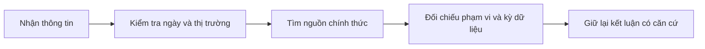

# Cập nhật mới nhất về khóa học (Latest Update on the course)

> [!SUMMARY] Một câu tóm tắt
> Hãy kiểm tra ngày, phạm vi và nguồn của thông tin tài chính vì dữ liệu thị trường có thể đổi nhanh, còn nguyên lý nền tảng thường bền hơn.

## 1. Tổng quan

Khóa học đầu tư thường chứa cả khái niệm nền tảng lẫn thông tin phụ thuộc thời điểm. Định nghĩa tài sản hay quyền sở hữu có thể ổn định trong thời gian dài, nhưng quy định, giờ giao dịch, mức phí, dữ liệu giá và điều kiện thị trường có thể đổi. Bài này giới thiệu cách phân biệt hai nhóm thông tin và cách tự xác minh nội dung mới. Kỹ năng này giúp tiếp tục học an toàn ngay cả khi tài liệu được xuất bản trước đó.

## 2. Mục tiêu học tập

- [ ] Xác định được thông tin nào cần kiểm tra ngày cập nhật.
- [ ] Phân biệt nguyên lý ổn định với dữ liệu hoặc quy định biến động.
- [ ] Mô tả được cách xác minh thông tin qua nguồn đáng tin cậy.

## 3. Kiến thức cần chuẩn bị

- Bài trước: [Tuyên bố miễn trừ rủi ro](./02-risk-disclaimer.md) — thông tin chung có giới hạn và cần đánh giá theo hoàn cảnh.

## 4. Thử đoán trước

1. Một khái niệm kế toán cơ bản và một mức phí giao dịch có thể khác nhau thế nào về tốc độ thay đổi?
2. Nếu hai trang web đưa số liệu khác nhau, bạn sẽ kiểm tra điều gì đầu tiên?

## 5. Kiến thức cốt lõi

### 5.1. Kiểm tra tính thời điểm

Khi đọc một nhận định, hãy xác định ngày xuất bản, thị trường được đề cập, kỳ dữ liệu và liệu quy định liên quan còn hiệu lực hay không. Con số đúng ở một giai đoạn hoặc quốc gia không nhất thiết đúng cho thời điểm và địa điểm khác.

### 5.2. Hai loại thông tin

| Loại | Ví dụ | Cách học |
|---|---|---|
| Nguyên lý tương đối ổn định | Tài sản được tài trợ bởi nợ và vốn chủ sở hữu | Hiểu bản chất và quan hệ giữa khái niệm |
| Thông tin phụ thuộc thời điểm | Giá, lãi suất, phí, giờ giao dịch, quy định | Kiểm tra nguồn chính thức và ngày hiệu lực |

### 5.3. Quy trình xác minh

## 6. Giải thích chi tiết

Một bài học có thể giải thích đúng một cơ chế nhưng không phải bảng tra cứu theo thời gian thực. Chẳng hạn, công thức tính chênh lệch giá mua bán vẫn có ý nghĩa, trong khi spread cụ thể của một mã thay đổi liên tục. Tương tự, quy định áp dụng cần được xác minh theo thẩm quyền, sản phẩm và thời điểm.

Ưu tiên cơ quan quản lý, sở giao dịch, doanh nghiệp công bố thông tin hoặc tài liệu gốc khi cần dữ liệu hiện hành. Ghi rõ nguồn và ngày kiểm tra để người khác biết kết luận dựa trên thông tin nào.

> [!TIP]
> Với mỗi con số, hãy hỏi: “Con số này thuộc thị trường nào, kỳ nào và được công bố vào ngày nào?”

## 7. Ví dụ minh họa

**Tình huống giả định:** Bình đọc một bài viết từ năm trước nói phí giao dịch cổ phiếu là 0,15%.

1. Bình ghi nhận đây là một mức phí có ngày tham chiếu, không mặc nhiên coi là hiện hành.
2. Anh kiểm tra biểu phí mới của công ty chứng khoán và ngày áp dụng.
3. Anh đối chiếu loại giao dịch, thị trường và các khoản thuế/phí khác có thể liên quan.

Kết quả: chỉ dùng mức phí sau khi xác nhận phạm vi và thời điểm; không khái quát một biểu phí thành quy tắc chung.

## 8. Thực hành

Chọn một con số tài chính được nhắc trong một bài viết và ghi thông tin cần kiểm tra trước khi sử dụng.

- [ ] Tôi ghi ngày xuất bản hoặc ngày dữ liệu.
- [ ] Tôi ghi thị trường và kỳ dữ liệu.
- [ ] Tôi tìm được nguồn gốc hoặc nguồn chính thức để đối chiếu.

Xem lời giải sau khi đã tự làm

Ví dụ với mức lãi suất: xác định ngân hàng trung ương và loại lãi suất, thời điểm công bố, kỳ áp dụng và thông cáo chính thức. Không dùng một con số rời khỏi bối cảnh của nó.

## 9. Những lỗi thường gặp

- **Dùng số liệu cũ như dữ liệu hiện tại** — kiểm tra ngày công bố và ngày hiệu lực.
- **Trộn quy định của nhiều thị trường** — ghi rõ quốc gia, sản phẩm và cơ quan quản lý.
- **Chỉ dựa vào trích dẫn thứ cấp** — lần về báo cáo, thông báo hoặc dữ liệu gốc.
- **Cho rằng mọi nội dung cũ đều vô giá trị** — phân biệt nguyên lý ổn định với thông tin thay đổi.

## 10. Giải thích bằng lời của bạn

- Khái niệm: Tính thời điểm của dữ liệu nghĩa là gì?
- Vì sao: Vì sao cần xác định thị trường và kỳ dữ liệu?
- Ví dụ của tôi: Một chỉ số nào tôi sẽ kiểm tra nguồn?
- Chỗ chưa chắc: Tôi chưa biết tìm nguồn chính thức nào?

## 11. Câu hỏi ôn tập

### Câu 1

Khi gặp một mức phí giao dịch trong bài viết cũ, bước phù hợp nhất là gì?

A. Coi mức phí đó áp dụng ở mọi nơi.
B. Nhân mức phí lên để dự phòng.
C. Kiểm tra biểu phí chính thức, thị trường và ngày áp dụng.
D. Bỏ qua mọi thông tin về phí.

**Đáp án:** C. **Giải thích:** Phí phụ thuộc đơn vị và thời điểm. A khái quát sai, B không xác minh, D bỏ qua một chi phí liên quan.

### Câu 2

Thông tin nào thường cần xác minh thời điểm thường xuyên hơn?

A. Mức giá hiện tại của một cổ phiếu.
B. Ý nghĩa tổng quát của tài sản doanh nghiệp.
C. Khái niệm vốn chủ sở hữu.
D. Phép cộng tài sản với nợ phải trả.

**Đáp án:** A. **Giải thích:** Giá thị trường thay đổi liên tục; các khái niệm nền tảng còn lại ổn định hơn, dù cách trình bày có thể khác.

### Câu 3

Những thông tin nào nên ghi khi trích dẫn một dữ liệu thị trường? (Chọn nhiều)

A. Ngày hoặc kỳ dữ liệu.
B. Thị trường và phạm vi áp dụng.
C. Nguồn công bố.
D. Dự đoán cá nhân thay cho nguồn dữ liệu.

**Đáp án:** A, B, C. **Giải thích:** Ngày, phạm vi và nguồn giúp kiểm chứng dữ liệu; dự đoán cá nhân không phải dữ liệu gốc.

### Câu 4

Phát biểu sau đúng hay sai: “Một nguyên lý nền tảng và một mức giá thị trường có tốc độ thay đổi giống nhau.”

A. Đúng
B. Sai

**Đáp án:** B. **Giải thích:** Mức giá có thể biến đổi liên tục; nguyên lý cơ bản như quan hệ kế toán thường ổn định hơn.

## 12. Tóm tắt kiến thức

- Xem xét ngày xuất bản, thị trường và kỳ dữ liệu.
- Phân biệt nguyên lý bền vững với giá, phí và quy định có thể thay đổi.
- Dùng nguồn chính thức hoặc dữ liệu gốc để xác minh thông tin hiện hành.

## 13. Tài liệu tham khảo

1. Investor.gov, tài liệu giáo dục nhà đầu tư và liên kết tới cơ quan quản lý chứng khoán.
2. Ủy ban Chứng khoán Nhà nước Việt Nam (SSC), thông báo và văn bản phổ biến kiến thức chính thức.

## 14. Bài học tiếp theo

[Kế toán một doanh nghiệp đơn giản (Accounting a Simple Business)](./04-accounting-a-simple-business.md) — bài tiếp theo dùng một ví dụ cụ thể để xây nền tảng tài chính doanh nghiệp.
