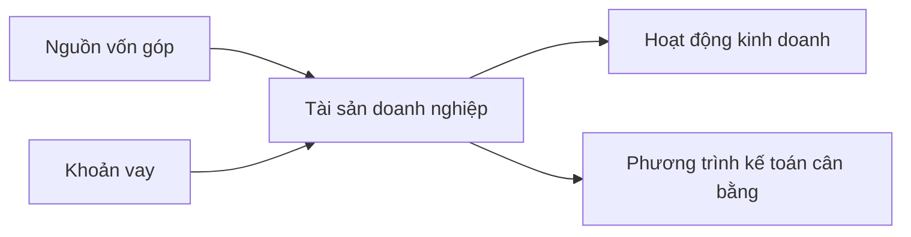

# Kế toán một doanh nghiệp đơn giản (Accounting a Simple Business)

> [!SUMMARY] Một câu tóm tắt
> Phương trình tài sản bằng nợ phải trả cộng vốn chủ sở hữu cho thấy doanh nghiệp được tài trợ ra sao và giúp làm rõ cổ phần đại diện cho phần quyền lợi nào.

## 1. Tổng quan

Để hiểu cổ phiếu, trước tiên cần hiểu doanh nghiệp sở hữu gì và nguồn tiền đến từ đâu. Kế toán ghi nhận các nguồn lực, nghĩa vụ và phần quyền lợi còn lại của chủ sở hữu. Bài này dùng ví dụ một cơ sở kinh doanh nhỏ để lập bảng cân đối đơn giản và xem khoản vay làm thay đổi các con số thế nào. Đây là bước nền trước khi tìm hiểu cổ phiếu như một phần quyền sở hữu.

## 2. Mục tiêu học tập

- [ ] Phân loại tài sản, nợ phải trả và vốn chủ sở hữu trong ví dụ.
- [ ] Tính vốn chủ sở hữu bằng phương trình kế toán.
- [ ] Giải thích tác động ban đầu của một khoản vay lên bảng cân đối.
- [ ] Nêu được vì sao tổng tài sản không đồng nghĩa với giá trị thuộc về chủ sở hữu.

## 3. Kiến thức cần chuẩn bị

- Bài trước: [Cập nhật mới nhất về khóa học](./03-latest-update-on-the-course.md) — phân biệt khái niệm nền tảng với dữ liệu phụ thuộc thời điểm.
- Cần nhớ: doanh nghiệp dùng vốn để mua nguồn lực phục vụ hoạt động.

## 4. Thử đoán trước

1. Nếu doanh nghiệp có tài sản 15.000 USD và nợ 4.000 USD, vốn chủ sở hữu là bao nhiêu?
2. Khi doanh nghiệp vay tiền và giữ toàn bộ tiền vay trong tài khoản, điều gì thay đổi?

## 5. Kiến thức cốt lõi

### 5.1. Ba thành phần của bảng cân đối

**Tài sản** (*assets*) là nguồn lực doanh nghiệp sở hữu hoặc kiểm soát, như tiền mặt, hàng tồn kho, thiết bị và nhà xưởng. **Nợ phải trả** (*liabilities*) là nghĩa vụ với bên khác, như khoản vay và tiền phải trả nhà cung cấp. **Vốn chủ sở hữu** (*equity*) là phần còn lại sau khi trừ nghĩa vụ khỏi tài sản.

$$
\text{Tài sản} = \text{Nợ phải trả} + \text{Vốn chủ sở hữu}
$$

Suy ra:

$$
\text{Vốn chủ sở hữu} = \text{Tài sản} - \text{Nợ phải trả}
$$

### 5.2. Ví dụ vốn ban đầu

Chủ doanh nghiệp góp 10.000 USD. Công ty dùng 3.000 USD mua nhà xưởng, 3.000 USD mua máy móc và giữ 4.000 USD tiền mặt.

| Khoản mục | Giá trị |
|---|---:|
| Nhà xưởng | 3.000 USD |
| Máy móc | 3.000 USD |
| Tiền mặt | 4.000 USD |
| **Tổng tài sản** | **10.000 USD** |
| Nợ phải trả | 0 USD |
| **Vốn chủ sở hữu** | **10.000 USD** |

### 5.3. Khi doanh nghiệp vay

Nếu doanh nghiệp vay thêm 5.000 USD và nhận tiền vào tài khoản, tiền mặt tăng 5.000 USD đồng thời nghĩa vụ nợ tăng 5.000 USD. Tại thời điểm nhận khoản vay, vốn chủ sở hữu chưa tự động tăng.

## 6. Giải thích chi tiết

Bảng cân đối kế toán là ảnh chụp tài chính tại một thời điểm. Nó không phải danh sách toàn bộ giá trị mà cổ đông có thể lập tức nhận bằng tiền. Tài sản có thể khó bán, giá trị ghi sổ không nhất thiết bằng giá thị trường, và doanh nghiệp phải thanh toán nghĩa vụ trước khi phần còn lại thuộc về chủ sở hữu theo các quy tắc liên quan.

Vay vốn có thể giúp doanh nghiệp mua tài sản hoặc duy trì hoạt động, nhưng đồng thời tạo nghĩa vụ trả gốc và thường cả lãi. Nếu doanh nghiệp dùng tiền vay để mua thiết bị, tiền mặt giảm và thiết bị tăng; tổng tài sản có thể không đổi ngay lúc mua, còn nợ vẫn tồn tại.

> [!NOTE]
> Phương trình kế toán phải cân bằng, nhưng một bảng cân đối đơn giản chưa mô tả đầy đủ doanh thu, chi phí, dòng tiền hay khả năng sinh lời.

## 7. Ví dụ minh họa

**Tình huống giả định:** Cửa hàng Lan có 10.000 USD tài sản do chủ góp vốn. Sau đó cửa hàng vay 5.000 USD, nhận tiền và chưa sử dụng.

1. Sau khi góp vốn: tài sản = 10.000 USD, nợ = 0; vốn chủ sở hữu = 10.000 − 0 = 10.000 USD.
2. Nhận khoản vay: tài sản tiền mặt tăng lên 15.000 USD; nợ phải trả là 5.000 USD.
3. Tính lại vốn chủ sở hữu: 15.000 − 5.000 = 10.000 USD.

Vốn chủ sở hữu chưa tăng vì khoản tiền mới đi kèm nghĩa vụ hoàn trả tương ứng.

## 8. Thực hành

Một doanh nghiệp nhỏ có tiền mặt 2.000 USD, thiết bị 6.000 USD, hàng tồn kho 3.000 USD và khoản vay 4.000 USD. Tính tổng tài sản và vốn chủ sở hữu.

- [ ] Cộng các khoản tài sản.
- [ ] Ghi riêng khoản vay vào nợ phải trả.
- [ ] Lấy tài sản trừ nợ để tìm vốn chủ sở hữu.

Xem lời giải sau khi đã tự làm

Tổng tài sản = 2.000 + 6.000 + 3.000 = 11.000 USD. Nợ phải trả = 4.000 USD. Vốn chủ sở hữu = 11.000 − 4.000 = 7.000 USD. Kiểm tra: 11.000 = 4.000 + 7.000.

## 9. Những lỗi thường gặp

- **Coi khoản vay là vốn chủ sở hữu** — khoản vay tạo nghĩa vụ phải trả nên được ghi là nợ.
- **Cộng nợ vào phần thuộc về chủ sở hữu** — tính vốn chủ sở hữu bằng tài sản trừ nợ.
- **Cho rằng tài sản lớn đồng nghĩa doanh nghiệp giàu hơn** — xem cả cách tài sản được tài trợ.
- **Coi giá trị ghi sổ là giá bán chắc chắn** — giá trị thực hiện có thể khác và tài sản có thể khó thanh lý.

## 10. Giải thích bằng lời của bạn

- Khái niệm: Vốn chủ sở hữu là gì trong phương trình kế toán?
- Vì sao: Vì sao khoản vay làm tăng cả tiền mặt và nợ?
- Ví dụ của tôi: Một tài sản và một nghĩa vụ của doanh nghiệp quen thuộc là gì?
- Chỗ chưa chắc: Tôi muốn hiểu thêm khác biệt nào giữa lợi nhuận và dòng tiền?

## 11. Câu hỏi ôn tập

### Câu 1

Một doanh nghiệp có tài sản 18.000 USD và nợ phải trả 7.000 USD. Vốn chủ sở hữu bằng bao nhiêu?

A. 25.000 USD
B. 11.000 USD
C. 7.000 USD
D. 18.000 USD

**Đáp án:** B. **Giải thích:** Vốn chủ sở hữu = 18.000 − 7.000 = 11.000 USD. A cộng nhầm, C là nợ, D là tổng tài sản.

### Câu 2

Doanh nghiệp nhận khoản vay 2.000 USD và giữ số tiền trong tài khoản. Ảnh hưởng ban đầu phù hợp nhất là gì?

A. Tài sản tăng 2.000 USD, nợ tăng 2.000 USD.
B. Vốn chủ sở hữu tăng 2.000 USD, nợ không đổi.
C. Tài sản giảm 2.000 USD, vốn chủ sở hữu tăng.
D. Không khoản mục nào thay đổi.

**Đáp án:** A. **Giải thích:** Tiền mặt là tài sản và khoản vay là nghĩa vụ nợ. B nhầm khoản vay với vốn góp; C và D trái với giao dịch.

### Câu 3

Những khoản nào thường được phân loại là tài sản của doanh nghiệp? (Chọn nhiều)

A. Tiền mặt trong tài khoản doanh nghiệp.
B. Khoản vay ngân hàng chưa trả.
C. Thiết bị doanh nghiệp sử dụng.
D. Hàng tồn kho của doanh nghiệp.

**Đáp án:** A, C, D. **Giải thích:** Tiền, thiết bị và hàng tồn kho là nguồn lực doanh nghiệp kiểm soát. Khoản vay là nghĩa vụ nợ.

### Câu 4

Phát biểu sau đúng hay sai: “Tổng tài sản của doanh nghiệp luôn bằng phần vốn thuộc về chủ sở hữu.”

A. Đúng
B. Sai

**Đáp án:** B. **Giải thích:** Tài sản được tài trợ bởi cả nợ và vốn chủ sở hữu; vốn chủ sở hữu bằng tài sản trừ nợ.

## 12. Tóm tắt kiến thức

- Phương trình cơ bản: tài sản = nợ phải trả + vốn chủ sở hữu.
- Vốn chủ sở hữu là phần còn lại sau khi trừ nghĩa vụ khỏi tài sản.
- Khoản vay thường làm tăng tài sản và nợ khi tiền được nhận, không tự động làm tăng vốn chủ sở hữu.
- Bảng cân đối tại một thời điểm không phản ánh toàn bộ giá trị thị trường hay dòng tiền.

## 13. Tài liệu tham khảo

1. CFA Institute, tài liệu nhập môn về báo cáo tài chính và bảng cân đối kế toán.
2. U.S. Securities and Exchange Commission (SEC), *Beginners' Guide to Financial Statements*.
3. Benjamin Graham, *The Intelligent Investor* — bối cảnh doanh nghiệp và quyền lợi cổ đông.

## 14. Bài học tiếp theo

[Cổ phiếu là gì? (What is Stock)](./05-what-is-stock.md) — bài tiếp theo nối vốn chủ sở hữu trong kế toán với cổ phần và quyền sở hữu doanh nghiệp.
