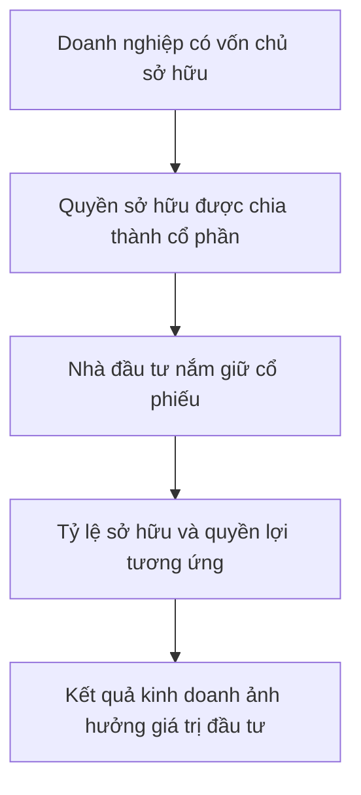

# Cổ phiếu là gì? (What is Stock)

> [!SUMMARY] Một câu tóm tắt
> Cổ phiếu biểu thị một phần quyền sở hữu trong công ty cổ phần; số lượng cổ phần giúp xác định tỷ lệ sở hữu và một số quyền lợi, nhưng không đảm bảo khoản tiền mặt cố định.

## 1. Tổng quan

Bài trước giới thiệu phương trình tài sản bằng nợ phải trả cộng vốn chủ sở hữu. Bài này nối phần vốn chủ sở hữu với cổ phần mà nhà đầu tư có thể nắm giữ. Hiểu đúng bản chất đó giúp tránh xem cổ phiếu chỉ như một mã giá lên xuống trên màn hình. Đây cũng là nền tảng để tìm hiểu thị trường và cách cổ phần được phát hành ở các bài sau.

## 2. Mục tiêu học tập

- [ ] Giải thích cổ phiếu đại diện cho phần quyền sở hữu nào trong doanh nghiệp.
- [ ] Tính tỷ lệ sở hữu từ số cổ phần nắm giữ và tổng cổ phần lưu hành.
- [ ] Phân biệt cổ đông với chủ nợ và quyền lợi kinh tế với cổ tức đã nhận.
- [ ] Nêu hai giới hạn của cách hiểu cổ phiếu như một tỷ lệ sở hữu đơn giản.

## 3. Kiến thức cần chuẩn bị

- Bài trước: [Kế toán một doanh nghiệp đơn giản](./04-accounting-a-simple-business.md) — nhớ phương trình tài sản = nợ phải trả + vốn chủ sở hữu.
- Khái niệm cần nhớ: **vốn chủ sở hữu** (*equity*) là phần giá trị còn lại thuộc về chủ sở hữu sau khi xét các nghĩa vụ nợ; **cổ phần** (*share*) là một đơn vị biểu thị quyền sở hữu.

## 4. Thử đoán trước

1. Nếu một công ty có 1.000 cổ phần và bạn sở hữu 10 cổ phần, tỷ lệ sở hữu của bạn là bao nhiêu?
2. Sở hữu cổ phần có đồng nghĩa mỗi năm chắc chắn nhận tiền mặt không?

## 5. Kiến thức cốt lõi

### 5.1. Từ quyền sở hữu đến cổ phiếu

Một công ty cổ phần chia quyền sở hữu thành nhiều đơn vị. Mỗi đơn vị là một cổ phần; chứng khoán ghi nhận hoặc đại diện cho những cổ phần đó thường được gọi là **cổ phiếu** (*stock*). Người nắm giữ cổ phiếu là **cổ đông** (*shareholder*). Nói giản lược, cổ đông có quyền lợi gắn với phần vốn chủ sở hữu của công ty theo loại cổ phần và quy định áp dụng.

### 5.2. Tính tỷ lệ sở hữu

Cách tính cơ bản là lấy số cổ phần nhà đầu tư nắm giữ chia cho tổng số cổ phần đang lưu hành, rồi nhân 100%.

$$
\text{Tỷ lệ sở hữu} = \frac{\text{Số cổ phần nắm giữ}}{\text{Tổng cổ phần đang lưu hành}} \times 100\%
$$

Đây là tỷ lệ theo số cổ phần trong ví dụ đơn giản. Một số công ty có nhiều loại cổ phần với quyền biểu quyết hoặc quyền kinh tế khác nhau, nên tỷ lệ cổ phần không phải lúc nào cũng phản ánh toàn bộ quyền kiểm soát.

### 5.3. Cổ đông và chủ nợ

| Tiêu chí | Cổ đông | Chủ nợ |
|---|---|---|
| Mối quan hệ | Sở hữu một phần vốn chủ sở hữu | Cho doanh nghiệp vay hoặc cung cấp tín dụng |
| Khoản nhận | Có thể hưởng cổ tức nếu được thông qua; giá trị cổ phần biến động | Có quyền đòi khoản nợ theo điều khoản |
| Rủi ro | Chịu biến động và có thể mất phần lớn hoặc toàn bộ vốn | Chịu rủi ro doanh nghiệp không trả được nợ |
| Quyền biểu quyết | Có thể có, tùy loại cổ phần và quy định | Thông thường không có quyền biểu quyết như cổ đông |

## 6. Giải thích chi tiết

Cổ đông không sở hữu trực tiếp từng chiếc máy hay từng khoản tiền trong tài khoản công ty. Tài sản thuộc về pháp nhân doanh nghiệp; cổ đông sở hữu cổ phần, tức quyền lợi trong công ty theo quy chế, luật và loại cổ phần. Nếu công ty hoạt động tốt, lợi nhuận có thể được giữ lại để phát triển hoặc phân phối một phần cho cổ đông. Cổ tức không tự động phát sinh theo tỷ lệ lợi nhuận: việc chi trả phụ thuộc vào quyết định phù hợp, tình hình tài chính và quy định.

> [!NOTE]
> Cổ đông là chủ sở hữu còn lại sau nghĩa vụ của công ty, nhưng không có quyền lấy tùy ý tài sản công ty làm tài sản cá nhân.

Giá cổ phiếu trên thị trường có thể tăng hoặc giảm, nên giá trị khoản đầu tư không cố định. Tỷ lệ sở hữu cũng có thể thay đổi nếu công ty phát hành thêm cổ phần hoặc mua lại cổ phần. Việc chuyển nhượng cổ phần giúp quyền sở hữu đổi chủ mà không cần chuyển giao riêng từng tài sản hoạt động.

## 7. Ví dụ minh họa

**Ví dụ giả định:** Công ty An Bình có 500.000 cổ phần phổ thông đang lưu hành. Minh nắm 7.500 cổ phần.

1. Xác định tử số: Minh sở hữu 7.500 cổ phần.
2. Xác định mẫu số: công ty có 500.000 cổ phần lưu hành.
3. Tính tỷ lệ: $7.500 / 500.000 \times 100\% = 1,5\%$.

Minh có tỷ lệ sở hữu 1,5% theo số cổ phần phổ thông trong giả định. Điều đó không có nghĩa Minh được nhận 1,5% lợi nhuận bằng tiền mặt mỗi năm; cổ tức cần có quyết định phân phối và công ty có thể giữ lại lợi nhuận.

## 8. Thực hành

**Bài tự làm:** Công ty B có 240.000 cổ phần đang lưu hành. Lan sở hữu 3.600 cổ phần. Tính tỷ lệ sở hữu và nêu một điều tỷ lệ này không đảm bảo.

- [ ] Xác định số cổ phần Lan nắm giữ và tổng cổ phần.
- [ ] Chia hai số và nhân với 100%.
- [ ] Nêu vì sao tỷ lệ đó không đồng nghĩa cổ tức chắc chắn.

Xem lời giải sau khi đã tự làm

$3.600 / 240.000 \times 100\% = 1,5\%$. Đây là tỷ lệ sở hữu theo số cổ phần trong giả định. Nó không đảm bảo Lan nhận 1,5% lợi nhuận bằng tiền; cổ tức phụ thuộc quyết định phân phối và điều kiện liên quan.

## 9. Những lỗi thường gặp

- **Coi cổ phiếu là một khoản nợ của công ty** — cổ phiếu biểu thị quyền sở hữu; khoản vay mới tạo quan hệ chủ nợ.
- **Cho rằng cổ đông sở hữu trực tiếp một phần từng tài sản** — tài sản thuộc công ty; cổ đông nắm quyền lợi thông qua cổ phần.
- **Đồng nhất tỷ lệ sở hữu với tỷ lệ cổ tức chắc chắn** — phân biệt quyền lợi kinh tế với quyết định chi trả thực tế.
- **Bỏ qua khả năng pha loãng** — theo dõi số cổ phần mới và tổng cổ phần sau phát hành.

## 10. Giải thích bằng lời của bạn

- Khái niệm: Cổ phiếu và cổ phần là gì?
- Vì sao: Vì sao cổ đông không thể tùy ý lấy tài sản của công ty?
- Ví dụ của tôi: Tính tỷ lệ sở hữu cho một công ty giả định.
- Chỗ chưa chắc: Điều gì có thể làm thay đổi tỷ lệ hoặc quyền lợi cổ đông?

## 11. Câu hỏi ôn tập

### Câu 1

Một công ty có 800.000 cổ phần đang lưu hành. Nhà đầu tư sở hữu 20.000 cổ phần. Tỷ lệ sở hữu theo số cổ phần là bao nhiêu?

A. 0,25%  
B. 2,5%  
C. 4%  
D. 25%

**Đáp án:** B. **Giải thích:** $20.000/800.000=0,025=2,5\%$. A thấp hơn mười lần; C và D cao hơn kết quả tính.

### Câu 2

Phát biểu nào mô tả đúng nhất cổ phiếu phổ thông?

A. Là khoản tiền gửi được bảo đảm bởi doanh nghiệp.  
B. Là giấy cam kết luôn trả cổ tức cố định.  
C. Đại diện cho quyền lợi sở hữu trong công ty theo điều kiện của loại cổ phần.  
D. Là quyền sở hữu trực tiếp từng tài sản của công ty.

**Đáp án:** C. **Giải thích:** Cổ phiếu biểu thị quyền lợi sở hữu. Tiền gửi và khoản nợ khác cổ phần; cổ tức không được bảo đảm cố định; tài sản thuộc pháp nhân công ty.

### Câu 3

Những phát biểu nào đúng về cổ đông? (Chọn nhiều.)

A. Có thể có quyền biểu quyết tùy loại cổ phần và quy định.  
B. Luôn nhận tiền mặt bằng tỷ lệ lợi nhuận tương ứng mỗi năm.  
C. Có quyền lợi kinh tế gắn với kết quả của doanh nghiệp.  
D. Là chủ nợ đối với mọi khoản vay của công ty.

**Đáp án:** A, C. **Giải thích:** Quyền biểu quyết phụ thuộc loại cổ phần; quyền lợi kinh tế gắn với công ty. Cổ tức không tự động, và cổ đông không vì thế trở thành chủ nợ.

### Câu 4

Phát biểu sau đúng hay sai: “Nếu một nhà đầu tư sở hữu 2% cổ phần, công ty bắt buộc trả cho người đó 2% lợi nhuận hằng năm bằng tiền mặt.”

A. Đúng  
B. Sai

**Đáp án:** B. **Giải thích:** Tỷ lệ sở hữu không tạo nghĩa vụ tự động phân phối lợi nhuận; cổ tức còn phụ thuộc quyết định và điều kiện của công ty.

## 12. Tóm tắt kiến thức

- Cổ phiếu biểu thị quyền lợi sở hữu trong công ty cổ phần.
- Tỷ lệ sở hữu cơ bản bằng cổ phần nắm giữ chia tổng cổ phần lưu hành.
- Cổ đông khác chủ nợ và không sở hữu trực tiếp từng tài sản công ty.
- Quyền sở hữu không đảm bảo cổ tức hoặc mức giá đầu tư.

## 13. Tài liệu tham khảo

1. Investor.gov — *Stocks* — khái niệm cổ phiếu và quyền cổ đông.
2. Investopedia — *Stock* — thuật ngữ cổ phiếu và quyền lợi liên quan.
3. CFA Institute — *Equity Investments* — nền tảng về vốn cổ phần.

## 14. Bài học tiếp theo

[Thị trường chứng khoán và các bên tham gia](./06-lecture-3-stock-market-stock-market-participants.md) — tìm hiểu hệ thống và những nhóm giúp cổ phiếu được phát hành, giao dịch.
