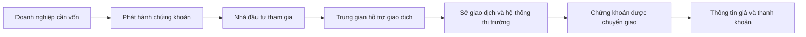

# Thị trường chứng khoán và các bên tham gia (Lecture 3 Stock Market & Stock Market Participants)

> [!SUMMARY] Một câu tóm tắt
> Thị trường cổ phiếu là mạng lưới quy tắc, tổ chức và người tham gia giúp doanh nghiệp huy động vốn, còn nhà đầu tư mua bán quyền sở hữu.

## 1. Tổng quan

Khi hiểu cổ phiếu là quyền lợi sở hữu, câu hỏi tiếp theo là cổ phần được đưa đến nhà đầu tư và giao dịch ra sao. Thị trường chứng khoán kết nối doanh nghiệp, nhà đầu tư, trung gian và hạ tầng giao dịch. Mỗi bên có vai trò khác nhau, vì vậy phân biệt đúng giúp hiểu dòng tiền và trách nhiệm. Bài này chuẩn bị cho phần tìm hiểu sâu về thị trường sơ cấp.

## 2. Mục tiêu học tập

- [ ] Mô tả chức năng cơ bản của thị trường cổ phiếu.
- [ ] Phân biệt nhà đầu tư cá nhân, tổ chức phát hành và nhà đầu tư tổ chức.
- [ ] Nêu vai trò của sở giao dịch, công ty chứng khoán và cơ quan quản lý.
- [ ] Phân biệt giao dịch sơ cấp với giao dịch giữa nhà đầu tư.

## 3. Kiến thức cần chuẩn bị

- Bài trước: [Cổ phiếu là gì?](./05-what-is-stock.md) — nhớ rằng cổ phiếu đại diện quyền lợi sở hữu.
- Khái niệm cần nhớ: nhà đầu tư mua hoặc bán chứng khoán; công ty phát hành chứng khoán để huy động vốn.

## 4. Thử đoán trước

1. Khi nhà đầu tư mua cổ phiếu mới phát hành, tiền có thể đi tới ai?
2. Sở giao dịch có trực tiếp quyết định mọi người phải mua cổ phiếu nào không?

## 5. Kiến thức cốt lõi

### 5.1. Thị trường làm nhiệm vụ gì?

**Thị trường cổ phiếu** (*stock market*) tạo điều kiện phát hành, mua bán và chuyển giao cổ phần theo quy định. Thị trường sơ cấp hỗ trợ doanh nghiệp hoặc cổ đông bán chứng khoán trong đợt phát hành; thị trường thứ cấp tạo nơi nhà đầu tư giao dịch chứng khoán đã phát hành. Thị trường có thể vận hành chủ yếu bằng hệ thống điện tử, không cần tất cả người mua và bán gặp nhau trực tiếp.

### 5.2. Các nhóm tham gia

| Nhóm | Vai trò khái quát | Ví dụ hoạt động |
|---|---|---|
| Tổ chức phát hành | Tạo và phát hành chứng khoán để huy động vốn hoặc đáp ứng mục tiêu hợp pháp | Công ty cổ phần chào bán cổ phần |
| Nhà đầu tư cá nhân (*retail investor*) | Cá nhân tự quyết định đầu tư qua tài khoản và trung gian phù hợp | Mua cổ phiếu bằng tiền tiết kiệm |
| Nhà đầu tư tổ chức (*institutional investor*) | Tổ chức quản lý vốn của chính mình hoặc khách hàng theo nhiệm vụ | Quỹ tương hỗ, quỹ hưu trí, công ty bảo hiểm |
| Công ty chứng khoán / môi giới (*broker*) | Cung cấp dịch vụ tiếp cận thị trường, nhận và chuyển lệnh theo quy định | Mở tài khoản, định tuyến lệnh |
| Sở giao dịch (*stock exchange*) | Cung cấp địa điểm/hệ thống và quy tắc giao dịch, niêm yết | Ghép lệnh theo quy chế |
| Cơ quan quản lý | Đặt và giám sát tuân thủ quy định bảo vệ thị trường, nhà đầu tư | Giám sát công bố thông tin |

## 6. Giải thích chi tiết

Nhà đầu tư cá nhân và tổ chức khác nhau về quy mô, cấu trúc và cách quản lý, nhưng cả hai đều có thể đặt lệnh mua bán. Nhà đầu tư tổ chức có thể tập hợp vốn từ nhiều khách hàng và hoạt động theo chính sách đầu tư; điều đó không đảm bảo họ luôn quyết định đúng. Cá nhân cũng có thể dùng nhiều cách phân tích khác nhau.

Công ty chứng khoán tạo cầu nối giữa khách hàng và hệ thống giao dịch, đồng thời có thể cung cấp lưu ký hoặc dịch vụ khác tùy thị trường. Sở giao dịch vận hành hạ tầng và quy tắc; thông thường giá giao dịch hình thành qua cung cầu và cơ chế khớp lệnh thay vì một nhân viên sàn chọn giá tùy ý. Cơ quan quản lý giám sát việc tuân thủ luật và yêu cầu công bố thông tin. Vai trò và tên gọi cụ thể khác nhau giữa quốc gia.

> [!TIP] Mẹo
> Khi gặp một giao dịch, hãy hỏi ba điều: ai phát hành, ai đang bán, và tiền đi về đâu? Câu trả lời thường xác định giao dịch thuộc sơ cấp hay thứ cấp.

## 7. Ví dụ minh họa

**Ví dụ giả định:** Công ty M phát hành 100.000 cổ phiếu mới. Quỹ A và nhiều cá nhân đăng ký mua; công ty chứng khoán phân phối hồ sơ và nhận đăng ký; sở giao dịch và cơ quan quản lý đảm nhiệm các chức năng theo quy định của thị trường.

1. Công ty M là tổ chức phát hành vì tạo cổ phiếu mới.
2. Quỹ A là nhà đầu tư tổ chức; người mua bằng tài khoản cá nhân là nhà đầu tư cá nhân.
3. Công ty chứng khoán là trung gian hỗ trợ quy trình, không phải chủ sở hữu mặc định số vốn huy động.
4. Nếu cổ phiếu sau đó được nhà đầu tư A bán cho nhà đầu tư B, đó là giao dịch giữa nhà đầu tư trên thị trường thứ cấp.

## 8. Thực hành

**Bài tự làm:** Một cá nhân đặt lệnh mua cổ phiếu đã niêm yết qua công ty chứng khoán. Hãy xác định người mua, trung gian, nơi giao dịch và người nhận tiền trong giao dịch thứ cấp thông thường.

- [ ] Phân vai từng bên.
- [ ] Xác định cổ phiếu là mới phát hành hay đã tồn tại.
- [ ] Xác định dòng tiền chính.

Xem lời giải sau khi đã tự làm

Cá nhân là nhà đầu tư; công ty chứng khoán làm trung gian nhận/chuyển lệnh; giao dịch diễn ra trên hệ thống thị trường thứ cấp. Trong giao dịch thứ cấp thông thường, tiền mua chuyển tới nhà đầu tư bán cổ phiếu (sau phí và quy trình thanh toán), không phải khoản vốn phát hành mới của công ty.

## 9. Những lỗi thường gặp

- **Coi sở giao dịch là người quyết định giá tùy ý** — giá thường phản ánh các lệnh mua bán theo quy tắc khớp lệnh.
- **Cho rằng nhà đầu tư tổ chức luôn đúng hơn** — quy mô và nguồn lực không loại bỏ rủi ro hoặc sai lầm.
- **Nhầm công ty chứng khoán với tổ chức phát hành** — một bên hỗ trợ tiếp cận giao dịch; bên kia phát hành cổ phần.
- **Nghĩ công ty luôn nhận tiền khi cổ phiếu đổi chủ** — ở giao dịch thứ cấp, người bán thường nhận tiền.

## 10. Giải thích bằng lời của bạn

- Khái niệm: Thị trường cổ phiếu làm gì?
- Vì sao: Vì sao cần trung gian và hạ tầng giao dịch?
- Ví dụ của tôi: Phân vai trong một giao dịch cổ phiếu.
- Chỗ chưa chắc: Vai trò nào thay đổi theo quy định từng nước?

## 11. Câu hỏi ôn tập

### Câu 1

Vai trò cốt lõi của công ty chứng khoán trong giao dịch của khách hàng thường là gì?

A. Bảo đảm khách hàng có lãi.  
B. Phát hành mọi cổ phiếu niêm yết.  
C. Cung cấp dịch vụ trung gian để khách hàng tiếp cận và gửi lệnh theo quy định.  
D. Quyết định mức giá cuối cùng cho toàn thị trường.

**Đáp án:** C. **Giải thích:** Công ty chứng khoán cung cấp trung gian và dịch vụ liên quan; không bảo đảm lợi nhuận, không phải mọi công ty đều là tổ chức phát hành, và giá không do một môi giới ấn định cho cả thị trường.

### Câu 2

Ai là nhà đầu tư tổ chức?

A. Một quỹ hưu trí quản lý danh mục cổ phiếu.  
B. Một doanh nghiệp đang chào bán cổ phần mới.  
C. Một sở giao dịch đang vận hành hệ thống.  
D. Một cơ quan quản lý đang giám sát công bố thông tin.

**Đáp án:** A. **Giải thích:** Quỹ hưu trí đầu tư vốn theo nhiệm vụ tổ chức. Các phương án khác lần lượt là tổ chức phát hành, hạ tầng thị trường và cơ quan quản lý.

### Câu 3

Những phát biểu nào đúng về các bên tham gia thị trường? (Chọn nhiều.)

A. Cơ quan quản lý có thể giám sát việc tuân thủ quy định.  
B. Sở giao dịch có thể cung cấp hạ tầng và quy tắc giao dịch.  
C. Mọi nhà đầu tư tổ chức đều là cơ quan nhà nước.  
D. Công ty chứng khoán luôn là người mua cuối cùng của lệnh khách hàng.

**Đáp án:** A, B. **Giải thích:** Cơ quan quản lý và sở giao dịch có những chức năng trên. Tổ chức đầu tư có thể là đơn vị tư nhân; môi giới không mặc định là đối tác cuối cùng của mọi lệnh.

### Câu 4

Phát biểu sau đúng hay sai: “Khi một nhà đầu tư mua cổ phiếu đã lưu hành từ nhà đầu tư khác, doanh nghiệp phát hành thường nhận trực tiếp tiền của giao dịch đó.”

A. Đúng  
B. Sai

**Đáp án:** B. **Giải thích:** Đó là giao dịch thứ cấp; dòng tiền thường chuyển giữa người mua và người bán.

## 12. Tóm tắt kiến thức

- Thị trường cổ phiếu hỗ trợ phát hành và chuyển giao quyền sở hữu.
- Nhà đầu tư cá nhân, tổ chức phát hành, nhà đầu tư tổ chức và trung gian có vai trò khác nhau.
- Sở giao dịch cung cấp hạ tầng/quy tắc; cơ quan quản lý giám sát tuân thủ.
- Trong giao dịch thứ cấp, tiền thường chuyển giữa nhà đầu tư.

## 13. Tài liệu tham khảo

1. Investor.gov — *How Stock Markets Work* — chức năng thị trường và giao dịch.
2. U.S. Securities and Exchange Commission — *Introduction to the Securities Markets*.
3. Sở Giao dịch Chứng khoán Việt Nam — tài liệu giới thiệu thị trường chứng khoán Việt Nam.

## 14. Bài học tiếp theo

[Thị trường sơ cấp là gì?](./07-understanding-primary-market.md) — tìm hiểu nơi chứng khoán được phát hành và dòng vốn đến tổ chức phát hành.
