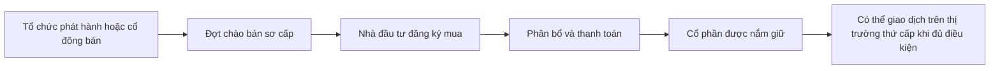

# Tìm hiểu thị trường sơ cấp (Understanding Primary Market)

> [!SUMMARY] Một câu tóm tắt
> Thị trường sơ cấp là nơi chứng khoán được chào bán lần đầu hoặc phát hành thêm; phân biệt cổ phần mới với cổ phần cũ cho biết tiền đi vào công ty hay tới cổ đông bán.

## 1. Tổng quan

Bài trước đã nhận diện tổ chức phát hành, nhà đầu tư và trung gian. Giờ ta xem kỹ quá trình chứng khoán được bán để huy động vốn. Thị trường sơ cấp rất quan trọng vì đây là nơi một đợt phát hành có thể đưa nguồn vốn mới vào doanh nghiệp. Tuy nhiên, không phải mọi cổ phần bán trong đợt chào bán đều là cổ phần mới, nên cần theo dõi người bán và dòng tiền.

## 2. Mục tiêu học tập

- [ ] Định nghĩa thị trường sơ cấp và phân biệt với thị trường thứ cấp.
- [ ] Theo dõi dòng tiền trong phát hành mới và bán cổ phần hiện hữu.
- [ ] Giải thích khi nào phát hành mới có thể làm pha loãng tỷ lệ sở hữu.
- [ ] Nhận biết vai trò của tổ chức phát hành và trung gian trong đợt chào bán.

## 3. Kiến thức cần chuẩn bị

- Bài trước: [Thị trường chứng khoán và các bên tham gia](./06-lecture-3-stock-market-stock-market-participants.md) — nhớ phân biệt tổ chức phát hành, nhà đầu tư và trung gian.
- Khái niệm cần nhớ: cổ phần mới chưa nằm trong số cổ phần lưu hành trước khi phát hành; cổ phần hiện hữu đã thuộc về một cổ đông.

## 4. Thử đoán trước

1. Công ty phát hành cổ phần mới thì ai có thể nhận tiền mua cổ phần?
2. Nếu người sáng lập bán cổ phần hiện hữu, tổng số cổ phần có nhất thiết tăng không?

## 5. Kiến thức cốt lõi

### 5.1. Khái niệm thị trường sơ cấp

**Thị trường sơ cấp** (*primary market*) là quá trình chứng khoán được tổ chức phát hành chào bán tới nhà đầu tư. Công ty có thể huy động vốn bằng cổ phần mới hoặc chứng khoán khác; một số đợt chào bán cũng bao gồm cổ phần hiện hữu do cổ đông bán. Các đợt chào bán tuân theo quy định về hồ sơ, công bố thông tin, phân phối và thanh toán của từng thị trường.

### 5.2. Hai nguồn cổ phần và dòng tiền

| Thành phần | Cổ phần mới (*fresh issue*) | Bán cổ phần hiện hữu (*offer for sale*) |
|---|---|---|
| Ai bán? | Công ty phát hành | Cổ đông hiện hữu |
| Cổ phần mới được tạo? | Có | Không; cổ phần đã tồn tại |
| Tiền bán chủ yếu đến đâu? | Công ty, sau chi phí phát hành | Cổ đông bán |
| Tổng cổ phần lưu hành | Có thể tăng | Không tăng chỉ vì chuyển nhượng |
| Pha loãng? | Có thể làm giảm tỷ lệ nếu cổ đông không mua thêm | Không do tăng số cổ phần trong giao dịch đó |

### 5.3. Thị trường sơ cấp và thứ cấp

Thị trường thứ cấp là nơi nhà đầu tư giao dịch chứng khoán đã phát hành với nhau. Giao dịch thứ cấp có thể tăng thanh khoản và giúp hình thành giá thị trường, nhưng công ty phát hành không nhận trực tiếp giá trị từng giao dịch thông thường.

$$
\text{Tỷ lệ sở hữu} = \frac{\text{Cổ phần nhà đầu tư nắm giữ}}{\text{Tổng cổ phần lưu hành}} \times 100\%
$$

Nếu mẫu số tăng vì phát hành mới mà tử số không đổi, tỷ lệ sở hữu giảm.

## 6. Giải thích chi tiết

Thị trường sơ cấp không nhất thiết là một tòa nhà hoặc một sàn riêng. Đó là khâu phát hành và phân phối chứng khoán theo cơ chế pháp lý của từng đợt. Doanh nghiệp có thể dùng vốn mới cho hoạt động, đầu tư, trả nợ hoặc mục tiêu được công bố. Nhà đầu tư cần đọc thông tin về mục đích sử dụng vốn, rủi ro, số cổ phần và điều kiện phân phối.

Một đợt chào bán có thể kết hợp phát hành mới và cổ đông hiện hữu bán ra. Vì vậy, tổng số tiền huy động không đồng nghĩa toàn bộ tiền thuộc về công ty. Cũng cần phân biệt phát hành mới với chuyển nhượng: chỉ việc tạo thêm cổ phần làm tăng tổng số cổ phần, còn giao dịch chuyển nhượng cổ phần đã tồn tại thường chỉ đổi người sở hữu.

> [!WARNING] Lưu ý
> Phát hành thêm có thể làm giảm tỷ lệ sở hữu tương đối của cổ đông không mua thêm. Tác động kinh tế cuối cùng còn phụ thuộc giá phát hành, mục đích sử dụng vốn và kết quả tạo ra từ nguồn vốn mới.

## 7. Ví dụ minh họa

**Ví dụ giả định:** Công ty Sao Mai có 1.000.000 cổ phần. Công ty phát hành mới 200.000 cổ phần với giá 10.000 đồng/cổ phần; cổ đông Hà đang sở hữu 50.000 cổ phần và không mua thêm.

1. Trước phát hành, Hà sở hữu $50.000/1.000.000=5\%$.
2. Sau phát hành, tổng cổ phần là 1.200.000; Hà vẫn sở hữu 50.000.
3. Tỷ lệ mới là $50.000/1.200.000\times100\%=4,17\%$ (xấp xỉ).
4. Công ty nhận 2 tỷ đồng trước chi phí phát hành từ phần phát hành mới; Hà không bán nên không nhận tiền.

Sự giảm tỷ lệ là pha loãng về tỷ lệ sở hữu. Điều đó không tự nó kết luận giá trị đầu tư giảm: vốn huy động có thể tạo giá trị hoặc không, tùy cách sử dụng và kết quả.

## 8. Thực hành

**Bài tự làm:** Công ty có 600.000 cổ phần. Cổ đông Bình có 30.000. Công ty phát hành thêm 150.000 cổ phần mới. Tính tỷ lệ của Bình trước và sau phát hành; xác định ai nhận tiền phát hành mới.

- [ ] Tính tỷ lệ ban đầu.
- [ ] Cộng cổ phần mới vào mẫu số.
- [ ] Tính tỷ lệ mới và giải thích dòng tiền.

Xem lời giải sau khi đã tự làm

Trước: $30.000/600.000=5\%$. Sau: $30.000/750.000=4\%$. Trong giả định phát hành mới, công ty nhận tiền mua cổ phần (trước chi phí); tỷ lệ Bình giảm nếu không mua thêm.

## 9. Những lỗi thường gặp

- **Cho rằng mọi đợt chào bán đều đưa tiền vào công ty** — kiểm tra phần nào là phát hành mới, phần nào do cổ đông bán.
- **Nhầm chuyển nhượng cũ với phát hành mới** — cổ phần cũ đổi chủ không tự làm tổng số cổ phần tăng.
- **Coi pha loãng là kết luận đầy đủ về giá trị** — tỷ lệ có thể giảm, nhưng cần xem công ty dùng vốn thế nào.
- **Nghĩ sơ cấp đồng nghĩa với IPO** — phát hành sơ cấp còn có thể gồm nhiều hình thức và đợt tiếp theo.

## 10. Giải thích bằng lời của bạn

- Khái niệm: Thị trường sơ cấp là gì?
- Vì sao: Vì sao cần phân biệt cổ phần mới và cổ phần hiện hữu?
- Ví dụ của tôi: Theo dõi dòng tiền trong một đợt chào bán giả định.
- Chỗ chưa chắc: Phát hành mới ảnh hưởng tỷ lệ sở hữu thế nào?

## 11. Câu hỏi ôn tập

### Câu 1

Trong phát hành cổ phần mới, tiền mua cổ phần thường được chuyển tới ai?

A. Công ty phát hành, sau các chi phí liên quan.  
B. Tất cả nhà đầu tư trên thị trường.  
C. Sở giao dịch như doanh thu của sàn.  
D. Cơ quan quản lý.

**Đáp án:** A. **Giải thích:** Công ty phát hành cổ phần mới để huy động vốn và thường nhận tiền bán; các phương án còn lại không phải bên nhận vốn phát hành.

### Câu 2

Một cổ đông bán cổ phần hiện hữu cho nhà đầu tư khác trong đợt chào bán. Điều gì đúng?

A. Công ty luôn tạo số cổ phần mới bằng đúng lượng bán.  
B. Tổng cổ phần giảm một nửa.  
C. Cổ đông bán thường nhận tiền từ phần bán của mình.  
D. Không có nhà đầu tư nào mua cổ phần.

**Đáp án:** C. **Giải thích:** Đây là cổ phần đã tồn tại, tiền bán thuộc người bán. Chuyển nhượng không tự tạo hoặc xóa cổ phần.

### Câu 3

Những phát biểu nào đúng về phát hành mới? (Chọn nhiều.)

A. Tổng số cổ phần có thể tăng.  
B. Tỷ lệ cổ đông không mua thêm có thể giảm.  
C. Tiền phát hành mới nhất thiết thuộc về cổ đông bán cũ.  
D. Pha loãng có nghĩa doanh nghiệp chắc chắn phá sản.

**Đáp án:** A, B. **Giải thích:** Phát hành mới tăng mẫu số và có thể làm giảm tỷ lệ nếu tử số giữ nguyên. Tiền thường đi tới công ty; pha loãng không đồng nghĩa phá sản.

### Câu 4

Phát biểu sau đúng hay sai: “Mọi giao dịch mua bán cổ phiếu đều là giao dịch trên thị trường sơ cấp.”

A. Đúng  
B. Sai

**Đáp án:** B. **Giải thích:** Nhà đầu tư mua bán cổ phiếu đã phát hành với nhau thuộc thị trường thứ cấp.

## 12. Tóm tắt kiến thức

- Thị trường sơ cấp liên quan đến phát hành và phân phối chứng khoán.
- Phát hành mới có thể đưa vốn vào công ty và làm tăng tổng cổ phần.
- Cổ đông bán cổ phần hiện hữu thường nhận tiền; số cổ phần không tự tăng.
- Phát hành mới có thể pha loãng tỷ lệ sở hữu nếu cổ đông không mua thêm.

## 13. Tài liệu tham khảo

1. Investor.gov — *Initial Public Offerings (IPOs)* — khái quát quy trình chào bán.
2. U.S. Securities and Exchange Commission — tài liệu hướng dẫn phát hành chứng khoán và công bố thông tin.
3. Ủy ban Chứng khoán Nhà nước Việt Nam — thông tin về chào bán chứng khoán ra công chúng.

## 14. Bài học tiếp theo

[Tìm hiểu IPO và FPO](./08-understanding-ipo-fpo.md) — học cách phân biệt hai loại chào bán công khai theo thời điểm và cấu trúc.
