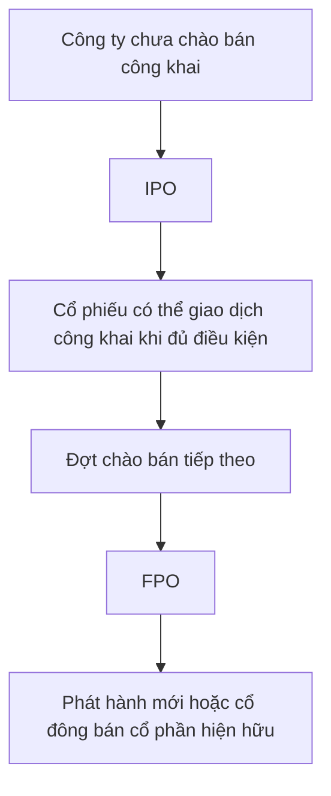

# Tìm hiểu IPO và FPO (Understanding IPO & FPO)

> [!SUMMARY] Một câu tóm tắt
> IPO là đợt chào bán ra công chúng đầu tiên của công ty; FPO là đợt tiếp theo sau khi công ty đã trở thành công ty đại chúng/đã IPO.

## 1. Tổng quan

Thị trường sơ cấp bao gồm các đợt chứng khoán được phân phối tới nhà đầu tư. Hai thuật ngữ phổ biến là IPO và FPO, phân biệt chủ yếu theo thời điểm công ty lần đầu hoặc tiếp tục chào bán ra công chúng. Cấu trúc đợt chào bán cũng quan trọng: cổ phần mới có thể huy động vốn cho công ty, còn cổ phần hiện hữu được bán có thể đưa tiền tới cổ đông. Bài này giới thiệu cơ chế cơ bản, không phải hướng dẫn tham gia một đợt cụ thể.

## 2. Mục tiêu học tập

- [ ] Giải thích IPO và FPO theo thời điểm chào bán công khai.
- [ ] Phân biệt phát hành mới với cổ đông hiện hữu bán cổ phần.
- [ ] Mô tả fixed-price và book-building ở mức khái niệm.
- [ ] Tính tác động pha loãng đơn giản của cổ phần mới.

## 3. Kiến thức cần chuẩn bị

- Bài trước: [Tìm hiểu thị trường sơ cấp](./07-understanding-primary-market.md) — nhớ dòng tiền của phát hành mới khác chuyển nhượng cổ phần cũ.
- Khái niệm cần nhớ: cổ phần mới có thể làm tăng tổng cổ phần; cổ phần hiện hữu đã thuộc về cổ đông trước đợt chào bán.

## 4. Thử đoán trước

1. Công ty đã có cổ phiếu giao dịch công khai muốn chào bán thêm ra công chúng thì gọi là IPO hay FPO?
2. IPO có nhất thiết khiến toàn bộ tiền mua đi vào công ty không?

## 5. Kiến thức cốt lõi

### 5.1. IPO và FPO

**IPO** (*Initial Public Offering* — chào bán cổ phiếu lần đầu ra công chúng) là lần đầu công ty chào bán cổ phần tới công chúng theo quy trình áp dụng, thường gắn với việc trở thành công ty đại chúng và niêm yết nếu đáp ứng điều kiện. **FPO** (*Follow-on Public Offering* — chào bán tiếp theo ra công chúng) diễn ra sau IPO khi một công ty đã đại chúng chào bán thêm cổ phần.

| Tiêu chí | IPO | FPO |
|---|---|---|
| Thời điểm | Lần chào bán công khai đầu tiên | Sau khi công ty đã IPO |
| Công ty đã có lịch sử giao dịch công khai? | Chưa có lịch sử giao dịch công khai như công ty niêm yết | Thường đã có thông tin và giá tham chiếu trên thị trường |
| Có thể gồm cổ phần mới? | Có | Có |
| Có thể gồm cổ phần hiện hữu? | Có thể, tùy cấu trúc | Có thể, tùy cấu trúc |
| Rủi ro | Thông tin lịch sử công khai có thể hạn chế hơn | Giá chịu ảnh hưởng từ diễn biến và thông tin thị trường hiện có |

### 5.2. Cách chào bán và xác định giá

Với **fixed-price issue** (chào bán giá cố định), mức giá được công bố trước để nhà đầu tư cân nhắc đăng ký. Với **book-building** (dựng sổ lệnh/ghi nhận nhu cầu), nhà đầu tư có thể gửi mức giá và khối lượng quan tâm trong một khoảng giá; bên phát hành và đơn vị bảo lãnh phát hành xem xét nhu cầu để xác định giá chào bán theo quy trình.

### 5.3. Phát hành mới và pha loãng

Nếu công ty tạo cổ phần mới, tổng số cổ phần tăng. Tỷ lệ của cổ đông giữ nguyên số cổ phần có thể giảm:

$$
\text{Tỷ lệ sở hữu mới} = \frac{\text{Cổ phần cổ đông nắm giữ}}{\text{Tổng cổ phần sau phát hành}} \times 100\%
$$

Nếu cổ đông hiện hữu bán cổ phần của mình, đây là chuyển nhượng; số cổ phần chỉ đổi chủ và không tăng chỉ vì giao dịch đó.

## 6. Giải thích chi tiết

IPO thường là bước chuyển đổi lớn về công bố thông tin, quy mô nhà đầu tư và trách nhiệm tuân thủ. FPO cho phép công ty đã đại chúng tiếp tục huy động vốn bằng cổ phần mới; một cổ đông lớn cũng có thể bán một phần cổ phần hiện hữu trong đợt chào bán. Cần đọc tài liệu của từng đợt để biết chính xác cấu trúc, mục đích sử dụng vốn, quyền lợi, giá và rủi ro.

Book-building thu thập biểu hiện nhu cầu ở các mức giá và khối lượng khác nhau; nó không đảm bảo giá cuối cùng là “giá trị đúng” hay cổ phiếu sẽ tăng sau niêm yết. Fixed-price cũng không có nghĩa giá đó được bảo đảm phù hợp với mọi nhà đầu tư. Sau khi giao dịch công khai bắt đầu, cung cầu và thông tin mới có thể làm giá biến động.

> [!WARNING] Cảnh báo
> Cổ phiếu có thể mất giá và phân bổ IPO/FPO không bảo đảm lợi nhuận. Không nên xem giá chào bán, mức đăng ký vượt cung hoặc lời quảng bá như cam kết về hiệu quả đầu tư.

## 7. Ví dụ minh họa

**Ví dụ giả định:** Công ty X có 4.000.000 cổ phần trước FPO. Công ty phát hành mới 800.000 cổ phần ở mức giá 25.000 đồng; cổ đông Hạnh đang giữ 200.000 cổ phần và không mua thêm.

1. Trước đợt phát hành, tỷ lệ Hạnh là $200.000/4.000.000=5\%$.
2. Sau phát hành, tổng số cổ phần là 4.800.000.
3. Tỷ lệ sau phát hành là $200.000/4.800.000\times100\%=4,17\%$ (xấp xỉ).
4. Phần phát hành mới huy động danh nghĩa $800.000\times25.000=20$ tỷ đồng trước chi phí. Nếu đợt chào bán có thêm cổ đông bán cổ phần hiện hữu, số tiền của phần đó sẽ thuộc người bán.

## 8. Thực hành

**Bài tự làm:** Một công ty đã IPO có 2.000.000 cổ phần. Trong FPO phát hành 400.000 cổ phần mới. Nhà đầu tư đang giữ 100.000 cổ phần và không mua thêm. Tính tỷ lệ trước và sau, rồi xác định IPO hay FPO.

- [ ] Xác định công ty đã chào bán công khai lần đầu chưa.
- [ ] Tính tỷ lệ ban đầu.
- [ ] Tăng mẫu số theo số cổ phần mới và tính lại.

Xem lời giải sau khi đã tự làm

Đây là FPO vì công ty đã IPO. Tỷ lệ ban đầu là $100.000/2.000.000=5\%$. Sau phát hành, tổng số là 2.400.000; tỷ lệ mới là $100.000/2.400.000=4,17\%$ (xấp xỉ). Tỷ lệ giảm vì cổ đông không mua thêm cổ phần mới.

## 9. Những lỗi thường gặp

- **Gọi mọi đợt chào bán là IPO** — IPO là lần đầu; các đợt sau có thể là FPO.
- **Cho rằng IPO luôn tạo toàn bộ cổ phần mới** — xem có cổ đông hiện hữu bán hay không.
- **Nghĩ book-building dự báo chắc chắn giá sau niêm yết** — đó là cách thu thập nhu cầu cho đợt phát hành, không phải bảo đảm hiệu suất.
- **Bỏ qua pha loãng** — tính lại tổng cổ phần và tỷ lệ sau phát hành.

## 10. Giải thích bằng lời của bạn

- Khái niệm: IPO khác FPO ở điểm nào?
- Vì sao: Vì sao cần biết ai bán cổ phần?
- Ví dụ của tôi: Tính tỷ lệ sở hữu qua một FPO giả định.
- Chỗ chưa chắc: Fixed-price và book-building khác nhau thế nào?

## 11. Câu hỏi ôn tập

### Câu 1

Một công ty chưa từng chào bán cổ phần công khai và nay thực hiện đợt đầu tiên. Tên gọi phổ biến của đợt này là gì?

A. FPO  
B. IPO  
C. Giao dịch thứ cấp  
D. Mua lại cổ phiếu

**Đáp án:** B. **Giải thích:** IPO là chào bán công khai lần đầu. FPO là đợt tiếp theo; giao dịch thứ cấp là chuyển nhượng giữa nhà đầu tư; mua lại là giao dịch theo chiều công ty mua cổ phần.

### Câu 2

Trong cơ chế book-building, thông tin nào thường được thu thập từ nhà đầu tư?

A. Mức giá và khối lượng họ quan tâm trong khoảng giá chào bán.  
B. Cam kết rằng giá cổ phiếu sẽ tăng.  
C. Quyền chọn thay thế toàn bộ quy định phát hành.  
D. Lệnh buộc công ty mua lại cổ phiếu.

**Đáp án:** A. **Giải thích:** Book-building thu nhận biểu hiện nhu cầu ở các mức giá và lượng khác nhau. Nó không bảo đảm tăng giá, không thay thế quy định, và không phải cơ chế mua lại.

### Câu 3

Những phát biểu nào đúng về IPO và FPO? (Chọn nhiều.)

A. FPO diễn ra sau IPO.  
B. IPO luôn chỉ gồm cổ phần mới.  
C. Một đợt FPO có thể gồm cổ phần mới hoặc cổ phần hiện hữu tùy cấu trúc.  
D. Mọi IPO đều bảo đảm lợi nhuận cho người đăng ký.

**Đáp án:** A, C. **Giải thích:** FPO là đợt sau IPO; cấu trúc chào bán có thể khác nhau. IPO không nhất thiết chỉ có cổ phần mới và không bảo đảm lợi nhuận.

### Câu 4

Phát biểu sau đúng hay sai: “Nếu một cổ đông bán cổ phần hiện hữu trong đợt chào bán, tổng cổ phần công ty nhất thiết tăng.”

A. Đúng  
B. Sai

**Đáp án:** B. **Giải thích:** Cổ phần hiện hữu đã tồn tại; việc chuyển nhượng đổi chủ nhưng không tự làm tăng tổng số cổ phần.

## 12. Tóm tắt kiến thức

- IPO là chào bán công khai lần đầu; FPO là chào bán tiếp theo.
- Một đợt có thể gồm phát hành mới, cổ đông bán cổ phần hiện hữu, hoặc kết hợp.
- Phát hành mới có thể làm tăng số cổ phần và pha loãng tỷ lệ nếu không mua thêm.
- Fixed-price và book-building là các cơ chế chào bán; không cơ chế nào bảo đảm hiệu quả đầu tư.

## 13. Tài liệu tham khảo

1. Investor.gov — *Initial Public Offerings (IPOs)* — khái niệm và rủi ro IPO.
2. U.S. Securities and Exchange Commission — *Investor Bulletin: Investing in an IPO*.
3. Investopedia — *Follow-on Offering* — thuật ngữ chào bán tiếp theo.

## 14. Bài học tiếp theo

[Thị trường thứ cấp](./09-secondary-markets.md) — tiếp tục tìm hiểu nơi cổ phiếu đã phát hành được giao dịch giữa nhà đầu tư.
