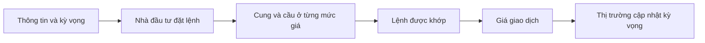

# Thị trường thứ cấp (Secondary Markets)

> [!SUMMARY] Một câu tóm tắt
> Thị trường thứ cấp cho phép nhà đầu tư mua bán cổ phiếu đã phát hành với nhau, tạo thanh khoản và giúp giá được khám phá qua các lệnh mua bán.

## 1. Tổng quan

Sau IPO hoặc một đợt phát hành khác, cổ phiếu có thể tiếp tục đổi chủ trên thị trường thứ cấp (*secondary market*). Đây là phần giúp nhà đầu tư tìm người mua hoặc người bán mà không cần doanh nghiệp phát hành lại cổ phiếu mỗi lần có giao dịch. Bài này nối tiếp kiến thức về IPO/FPO bằng cách làm rõ dòng tiền, thanh khoản và cơ chế cơ bản của sổ lệnh. Các mức giá quan sát được phản ánh giao dịch và lệnh hiện hữu tại thời điểm đó, không phải lời bảo đảm về giá trị lâu dài.

## 2. Mục tiêu học tập

- [ ] Phân biệt thị trường thứ cấp và sơ cấp theo bên nhận tiền.
- [ ] Giải thích thanh khoản và price discovery.
- [ ] Xác định bid, ask và spread từ dữ liệu sổ lệnh.
- [ ] Mô tả cách một lệnh mua có thể khớp với lệnh bán.

## 3. Kiến thức cần chuẩn bị

- Bài trước: [Understanding IPO & FPO](./08-understanding-ipo-fpo.md) — nhớ phân biệt phát hành cổ phần mới và cổ phần hiện hữu được bán.
- Khái niệm cần nhớ: cổ phiếu đại diện cho phần sở hữu; một đợt phát hành có thể đưa cổ phiếu mới đến nhà đầu tư.

## 4. Thử đoán trước

1. Khi bạn mua cổ phiếu đã phát hành từ một nhà đầu tư khác, tiền có mặc nhiên đi vào công ty không?
2. Vì sao một nhà đầu tư có thể mua được cổ phiếu dễ dàng hơn cổ phiếu khác?

## 5. Kiến thức cốt lõi

### 5.1. Giao dịch giữa nhà đầu tư

Trên thị trường thứ cấp, người sở hữu bán cổ phiếu cho người mua mới. Trong giao dịch thông thường, tiền chuyển cho người bán; công ty phát hành không nhận vốn mới từ giao dịch đó. Điều này khác với phát hành mới trên thị trường sơ cấp, nơi công ty có thể nhận tiền bán cổ phần mới.

| Tiêu chí | Thị trường sơ cấp | Thị trường thứ cấp |
|---|---|---|
| Chứng khoán | Được phát hành/phân phối | Đã được phát hành |
| Bên bán thường gặp | Công ty hoặc bên chào bán | Nhà đầu tư hiện hữu |
| Dòng tiền chính | Có thể vào công ty | Từ người mua sang người bán |
| Tác dụng | Huy động hoặc phân phối vốn | Chuyển quyền sở hữu, tạo thanh khoản |

### 5.2. Thanh khoản và khám phá giá

**Thanh khoản** (*liquidity*) mô tả mức độ dễ mua hoặc bán tài sản mà không phải chờ lâu hay chấp nhận thay đổi giá lớn. Thị trường có nhiều người tham gia và nhiều lệnh thường giúp việc tìm đối tác thuận lợi hơn, nhưng thanh khoản không được bảo đảm mọi lúc.

**Khám phá giá** (*price discovery*) là quá trình giá giao dịch hình thành từ các mức giá và khối lượng mà người mua, người bán chấp nhận. Thông tin, kỳ vọng, nhu cầu tiền mặt và khẩu vị rủi ro khác nhau khiến lệnh của họ không giống nhau.

### 5.3. Bid, ask và spread

**Bid** là mức giá mua cao nhất đang được người mua chào; **ask** (*giá chào bán*) là mức giá bán thấp nhất đang được người bán chào. **Bid–ask spread** là khoảng chênh lệch giữa hai mức tốt nhất:

$$
\text{Spread}=\text{Best Ask}-\text{Best Bid}
$$

Sổ lệnh thường liệt kê nhiều mức bid/ask cùng khối lượng. Một lệnh mua chấp nhận ask có thể khớp với bên bán; lệnh giới hạn ở mức thấp hơn có thể phải chờ.

## 6. Giải thích chi tiết

Giá gần nhất là kết quả của một giao dịch đã khớp, còn bid và ask biểu thị mức chào hiện tại. Chúng có thể khác nhau: nếu người mua chưa chấp nhận ask và người bán chưa chấp nhận bid, chưa có giao dịch mới. Spread là một phần chi phí giao dịch tiềm tàng, nhất là khi nhà đầu tư cần mua rồi bán nhanh.

Thanh khoản không chỉ là số lượng cổ phiếu giao dịch. Chiều sâu sổ lệnh và mức spread cũng quan trọng: mã có khối lượng giao dịch cao nhưng lệnh tập trung ở vài mức giá vẫn có thể biến động mạnh khi có lệnh lớn. Thị trường thứ cấp giúp chuyển nhượng quyền sở hữu; nó không tạo lợi nhuận chắc chắn và cũng không loại bỏ khả năng giá giảm.

> [!NOTE]
> Cơ chế khớp lệnh, giờ giao dịch, bước giá, thuế và phí khác nhau theo thị trường và sở giao dịch. Ví dụ ở đây chỉ minh họa nguyên lý chung.

## 7. Ví dụ minh họa

**Ví dụ giả định:** sổ lệnh một cổ phiếu có bid tốt nhất 49,90 USD và ask tốt nhất 50,05 USD.

1. Tính spread: $50{,}05-49{,}90=0{,}15$ USD mỗi cổ phiếu. Chênh lệch dương vì bên mua muốn trả thấp hơn mức bên bán đang chào.
2. Nhà đầu tư đặt lệnh giới hạn mua ở 49,90 USD. Lệnh chỉ khớp nếu có người bán chấp nhận mức đó hoặc thấp hơn theo quy tắc của sàn.
3. Nếu người mua đặt lệnh chấp nhận giá bán hiện có, họ có thể khớp ở 50,05 USD, tùy khối lượng sẵn có. Giao dịch chuyển tiền cho người bán hiện hữu, không phải tự động cho công ty.

## 8. Thực hành

**Bài tự làm:** Sổ lệnh giả định có bid 24,80 USD và ask 25,00 USD. Người mua muốn mua 100 cổ phiếu ngay ở ask.

- [ ] Tính spread.
- [ ] Nêu tiền trong giao dịch thứ cấp thường chuyển cho ai.
- [ ] Nêu điều gì có thể xảy ra nếu chỉ có 40 cổ phiếu được chào ở ask đó.

Xem lời giải sau khi đã tự làm

Spread là $25{,}00-24{,}80=0{,}20$ USD. Tiền chuyển cho người bán cổ phiếu. Nếu chỉ có 40 cổ phiếu ở ask 25,00 USD, 40 cổ phiếu có thể khớp ở mức đó; phần còn lại có thể cần khớp ở mức ask kế tiếp hoặc chưa khớp, tùy lệnh và quy tắc sàn.

## 9. Những lỗi thường gặp

- **Cho rằng mọi giao dịch đều cấp vốn cho công ty** — kiểm tra xem cổ phiếu mới được phát hành hay chỉ chuyển từ người sở hữu này sang người khác.
- **Đồng nhất giá gần nhất với giá chắc chắn có thể giao dịch** — xem bid/ask và khối lượng hiện tại.
- **Xem thanh khoản là bảo đảm bán ngay** — thanh khoản có thể giảm khi thị trường căng thẳng.
- **Bỏ qua spread** — tính chênh lệch giữa ask tốt nhất và bid tốt nhất trước khi đánh giá chi phí.

## 10. Giải thích bằng lời của bạn

- Khái niệm: Thị trường thứ cấp là gì?
- Vì sao: Thanh khoản giúp ích cho nhà đầu tư thế nào?
- Ví dụ của tôi: Hãy tự đặt một cặp bid/ask và tính spread.
- Chỗ chưa chắc: Khái niệm nào về khớp lệnh bạn muốn xem lại?

## 11. Câu hỏi ôn tập

### Câu 1

Trong một giao dịch thông thường trên thị trường thứ cấp, ai nhận tiền bán cổ phiếu?

A. Công ty phát hành trong mọi trường hợp  
B. Nhà đầu tư đang bán cổ phiếu  
C. Sở giao dịch  
D. Cơ quan quản lý

**Đáp án:** B. **Giải thích:** Người mua trả người bán hiện hữu. Công ty chỉ có thể nhận vốn khi có giao dịch phát hành phù hợp; sàn và cơ quan quản lý không phải người bán cổ phần trong giao dịch này.

### Câu 2

Best bid là mức nào?

A. Giá bán thấp nhất đang chào  
B. Giá giao dịch đầu tiên trong ngày  
C. Giá mua cao nhất đang chào  
D. Giá trị sổ sách trên mỗi cổ phần

**Đáp án:** C. **Giải thích:** Best bid là mức mua cao nhất. Giá bán thấp nhất là best ask; giá mở cửa và giá trị sổ sách là khái niệm khác.

### Câu 3

Những phát biểu nào đúng về thị trường thứ cấp? (Chọn nhiều)

A. Nó giúp nhà đầu tư chuyển quyền sở hữu cổ phiếu đã phát hành.  
B. Mỗi giao dịch đều làm công ty phát hành thêm cổ phiếu.  
C. Thanh khoản phản ánh mức độ thuận lợi khi mua hoặc bán.  
D. Giá giao dịch bảo đảm phản ánh giá trị nội tại chính xác.

**Đáp án:** A, C. **Giải thích:** Thị trường hỗ trợ chuyển nhượng và thanh khoản. Giao dịch thứ cấp không tự tạo cổ phiếu mới, còn giá thị trường không phải phép đo chắc chắn về giá trị nội tại.

### Câu 4

Một cổ phiếu có best bid 18,40 USD và best ask 18,55 USD. Spread là bao nhiêu?

A. 0,15 USD  
B. 0,95 USD  
C. 18,40 USD  
D. 36,95 USD

**Đáp án:** A. **Giải thích:** Lấy ask trừ bid: 18,55 − 18,40 = 0,15. Các lựa chọn khác không phải hiệu hai mức giá.

## 12. Tóm tắt kiến thức

- Thị trường thứ cấp chuyển cổ phiếu đã phát hành giữa các nhà đầu tư.
- Thanh khoản giúp tìm đối tác mua bán; mức thanh khoản có thể thay đổi.
- Bid là giá mua cao nhất, ask là giá bán thấp nhất đang chào.
- Spread bằng best ask trừ best bid; lệnh được khớp khi có mức giá tương thích.

## 13. Tài liệu tham khảo

1. Investor.gov — tài liệu nhập môn về thị trường chứng khoán và giao dịch.
2. Investopedia — mục “Secondary Market” và “Bid-Ask Spread”.
3. CFA Institute — tài liệu nhập môn về cấu trúc thị trường và thanh khoản.

## 14. Bài học tiếp theo

[Who sets the price in the stock market](./10-who-sets-the-price-in-the-stock-market.md) — bài tiếp theo đi sâu vào cách cung cầu và kỳ vọng của nhiều người tham gia cùng tạo nên giá.