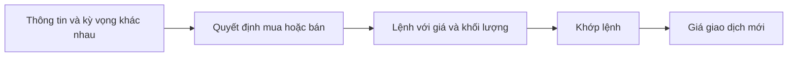

# Ai quyết định giá trên thị trường chứng khoán? (Who sets the price in the stock market)

> [!SUMMARY] Một câu tóm tắt
> Không có một người duy nhất ấn định giá liên tục trên thị trường thứ cấp; giá giao dịch xuất hiện khi lệnh mua và bán của nhiều người tham gia gặp nhau.

## 1. Tổng quan

Ở bài trước, ta đã phân biệt thị trường thứ cấp và đọc được bid, ask, spread. Câu hỏi tiếp theo là: ai quyết định giá cổ phiếu trên màn hình? Câu trả lời nằm trong cách các lệnh gặp nhau, chứ không phải ở một cá nhân hay một mức “giá đúng” do sở giao dịch tuyên bố. Bài ngắn này xây dựng nền tảng để hiểu vì sao giá biến động khi thông tin và kỳ vọng đổi khác.

## 2. Mục tiêu học tập

- [ ] Giải thích vai trò tổng hợp của người mua và người bán trong hình thành giá.
- [ ] Mô tả cách một giao dịch khớp có thể tạo mức giá mới.
- [ ] Phân biệt giá thị trường quan sát được với giá trị chắc chắn của doanh nghiệp.

## 3. Kiến thức cần chuẩn bị

- Bài trước: [Secondary Markets](./09-secondary-markets.md) — ôn bid, ask, spread và khớp lệnh.
- Khái niệm cần nhớ: giá gần nhất là giá của giao dịch khớp gần nhất; bid và ask là các mức chào hiện hữu.

## 4. Thử đoán trước

1. Nếu nhiều người muốn mua nhưng người bán chỉ sẵn sàng bán ở mức cao hơn, giá giao dịch có thể đi theo hướng nào?
2. Liệu mọi nhà đầu tư có cùng một cách đánh giá doanh nghiệp không?

## 5. Kiến thức cốt lõi

### 5.1. Giá là kết quả của tương tác

Nhà đầu tư cá nhân, tổ chức, nhà giao dịch ngắn hạn, nhà đầu tư dài hạn và nhà tạo lập thị trường có thể tham gia với mục tiêu và thông tin khác nhau. Họ đặt lệnh ở những mức giá họ chấp nhận. Khi một bên chấp nhận mức giá của bên kia và lệnh khớp, giao dịch ghi nhận một mức giá cụ thể.

### 5.2. Cung cầu hoạt động qua từng mức giá

Cung cầu không chỉ là số người muốn mua hay bán. Cần hỏi họ muốn giao dịch bao nhiêu và ở mức giá nào. Nếu người mua chấp nhận các ask đang có, lượng bán ở mức thấp nhất có thể được mua hết và giao dịch tiếp theo có thể xảy ra ở ask cao hơn. Nếu người bán chấp nhận bid thấp hơn, giá giao dịch có thể giảm.

## 6. Giải thích chi tiết

Sở giao dịch cung cấp quy tắc và hạ tầng nhận, sắp xếp, khớp lệnh; thông thường không chọn một mức giá duy nhất rồi áp cho mọi nhà đầu tư. Công ty phát hành cũng không trực tiếp đặt từng giá khớp trên thị trường thứ cấp. Giá phản ánh nơi người mua và người bán đã đồng ý giao dịch tại thời điểm cụ thể.

Một tin tức tích cực không bắt buộc giá phải tăng: có thể thông tin đã được kỳ vọng, hoặc người mua không sẵn sàng trả cao hơn. Tương tự, giá giảm không có nghĩa hoàn toàn không có người mua; họ có thể chỉ đặt mua ở mức thấp. Giá thị trường là tín hiệu về giao dịch và kỳ vọng, nhưng có thể biến động, sai lệch hoặc không đại diện cho giá trị dài hạn.

> [!WARNING]
> Không nên diễn giải một phiên tăng hoặc giảm như bằng chứng chắc chắn rằng doanh nghiệp có giá trị tương ứng. Giá phản ánh cung cầu và kỳ vọng tại thời điểm giao dịch, còn đánh giá doanh nghiệp cần thêm dữ liệu và thời gian.

## 7. Ví dụ minh họa

**Ví dụ giả định:** sổ lệnh có 100 cổ phiếu chào bán ở 30,00 USD, 200 ở 30,10 USD và 300 ở 30,20 USD. Một người mua muốn mua 250 cổ phiếu ngay, chấp nhận giá bán hiện có.

1. 100 cổ phiếu đầu có thể khớp tại 30,00 USD.
2. Còn thiếu 150 cổ phiếu; 150 cổ phiếu tiếp theo có thể khớp tại 30,10 USD.
3. Lệnh mua đã hấp thụ lượng bán thấp hơn, nên giao dịch cuối có thể ghi nhận 30,10 USD. Không ai đơn phương “ra lệnh” cho toàn thị trường rằng giá phải là 30,10 USD; mức đó phát sinh từ các lệnh tương thích.

## 8. Thực hành

**Bài tự làm:** Có 50 cổ phiếu được chào bán ở 12,00 USD và 100 ở 12,05 USD. Người mua chấp nhận giá hiện có, muốn mua 80 cổ phiếu.

- [ ] Xác định khối lượng có thể khớp ở 12,00 USD.
- [ ] Tính số cổ phiếu còn cần mua ở mức tiếp theo.
- [ ] Giải thích vì sao không phải một cá nhân đặt ra giá giao dịch đó.

Xem lời giải sau khi đã tự làm

Có thể khớp 50 cổ phiếu ở 12,00 USD. Còn 30 cổ phiếu, có thể khớp ở 12,05 USD nếu lượng chào bán vẫn còn và quy tắc lệnh cho phép. Giá phát sinh từ việc lệnh mua chấp nhận các mức ask của người bán.

## 9. Những lỗi thường gặp

- **Cho rằng sàn tự chọn giá** — phân biệt vai trò vận hành, quy tắc của sàn với lệnh giao dịch của nhà đầu tư.
- **Nghĩ tin tốt luôn làm giá tăng** — xem xét kỳ vọng đã có trong giá và mức sẵn lòng giao dịch.
- **Coi một mức giá là giá trị tuyệt đối** — nhớ rằng đó là giá giao dịch tại một thời điểm.

## 10. Giải thích bằng lời của bạn

- Khái niệm: Ai “đặt” giá trên thị trường thứ cấp?
- Vì sao: Cung cầu phải gắn với mức giá và khối lượng như thế nào?
- Ví dụ của tôi: Tự tạo hai mức ask và mô tả một lệnh mua.
- Chỗ chưa chắc: Vai trò nào của sở giao dịch bạn muốn tìm hiểu thêm?

## 11. Câu hỏi ôn tập

### Câu 1

Một cổ phiếu vừa khớp giao dịch ở 42 USD. Cách giải thích nào chính xác nhất về con số này?

A. Công ty tuyên bố đó là giá trị nội tại.  
B. Sở giao dịch bảo đảm mọi người phải mua ở mức đó.  
C. Một giao dịch giữa các lệnh tương thích đã được ghi nhận ở mức đó.  
D. Cơ quan quản lý chọn giá thay cho nhà đầu tư.

**Đáp án:** C. **Giải thích:** Giá giao dịch là kết quả khớp lệnh. Công ty, sàn và cơ quan quản lý có vai trò khác nhưng không chọn từng mức giá giao dịch theo cách mô tả ở các phương án kia.

### Câu 2

Những yếu tố nào có thể ảnh hưởng đến quyết định đặt lệnh? (Chọn nhiều)

A. Kỳ vọng lợi nhuận tương lai  
B. Thông tin mới  
C. Mục tiêu và thời hạn của nhà đầu tư  
D. Một giá trị chắc chắn giống nhau mà mọi người đều phải chấp nhận

**Đáp án:** A, B, C. **Giải thích:** Kỳ vọng, thông tin và mục tiêu khác nhau có thể ảnh hưởng lệnh. Thị trường không buộc mọi người có cùng đánh giá.

### Câu 3

Phát biểu sau đúng hay sai: “Nếu giá cổ phiếu giảm thì trên thị trường hoàn toàn không còn người mua.”

A. Đúng  
B. Sai

**Đáp án:** B. **Giải thích:** Người mua vẫn có thể đặt lệnh, nhưng ở mức giá thấp hơn mức người bán muốn nhận; khi người bán chấp nhận mức thấp hơn, giao dịch có thể khớp.

### Câu 4

Một người mua chấp nhận giá bán tốt nhất hiện có. Điều gì có thể xảy ra nếu khối lượng ở mức đó không đủ?

A. Lệnh có thể khớp tiếp ở các mức ask cao hơn.  
B. Công ty tự động giảm số cổ phần đang lưu hành.  
C. Giá bắt buộc quay về giá IPO.  
D. Mọi lệnh bán bị hủy.

**Đáp án:** A. **Giải thích:** Lệnh đủ lớn có thể hấp thụ nhiều mức chào bán nếu điều kiện lệnh và quy tắc giao dịch cho phép; các phương án khác không theo cơ chế sổ lệnh.

## 12. Tóm tắt kiến thức

- Giá giao dịch được hình thành khi lệnh mua và bán tương thích khớp nhau.
- Nhiều nhóm tham gia có kỳ vọng, mục tiêu và mức giá chấp nhận khác nhau.
- Cung cầu thể hiện qua giá và khối lượng ở từng mức trong sổ lệnh.
- Giá quan sát được không đồng nghĩa giá trị nội tại chắc chắn.

## 13. Tài liệu tham khảo

1. Investor.gov — tài liệu nhập môn về cách thị trường chứng khoán hoạt động.
2. Investopedia — mục “Price Discovery” và “Order Book”.
3. CFA Institute — tài liệu nhập môn về cấu trúc thị trường.

## 14. Bài học tiếp theo

[How an IPO is priced](./11-how-an-ipo-is-priced.md) — bài tiếp theo giải thích cách xác định giá phát hành trước khi cổ phiếu giao dịch thứ cấp.