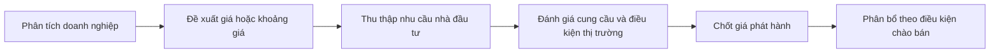

# Giá IPO được xác định như thế nào? (How an IPO is priced)

> [!SUMMARY] Một câu tóm tắt
> Giá IPO được xây dựng qua định giá doanh nghiệp và quá trình chào bán, trong đó điều kiện thị trường và nhu cầu nhà đầu tư có vai trò; mức giá đó không bảo đảm là giá trị đúng tuyệt đối.

## 1. Tổng quan

Trên thị trường thứ cấp, giá hình thành khi lệnh mua và bán khớp nhau. Nhưng trước khi cổ phiếu lần đầu được chào bán công khai, chưa có lịch sử giao dịch công khai để dùng làm mức giá trực tiếp. Bài này giới thiệu cách doanh nghiệp và đơn vị tư vấn xem xét giá phát hành, cùng vai trò của nhu cầu nhà đầu tư. Cuối cùng ta phân biệt giá IPO với giá sau khi cổ phiếu bắt đầu giao dịch.

## 2. Mục tiêu học tập

- [ ] Nêu ít nhất ba đầu vào thường được cân nhắc khi định giá IPO.
- [ ] Phân biệt fixed-price và book-building.
- [ ] Diễn giải vì sao giá sau IPO có thể khác giá phát hành.
- [ ] Tính số tiền thu được từ phần cổ phần mới trong ví dụ giả định.

## 3. Kiến thức cần chuẩn bị

- Bài trước: [Who sets the price in the stock market](./10-who-sets-the-price-in-the-stock-market.md) — ôn vai trò của cung cầu và lệnh.
- Khái niệm cần nhớ: IPO là đợt chào bán công khai đầu tiên; cần phân biệt phát hành cổ phần mới với cổ đông hiện hữu bán cổ phần.

## 4. Thử đoán trước

1. Nếu một công ty chưa có giá giao dịch công khai, những thông tin nào có thể giúp ước tính mức giá chào bán?
2. Giá cổ phiếu có bắt buộc giữ nguyên sau khi IPO kết thúc không?

## 5. Kiến thức cốt lõi

### 5.1. Các đầu vào cho định giá

Định giá IPO thường kết hợp nhiều yếu tố: doanh thu, lợi nhuận và dòng tiền; triển vọng tăng trưởng; rủi ro kinh doanh; doanh nghiệp tương đồng; quy mô cổ phần chào bán; mức độ quan tâm của nhà đầu tư; và điều kiện thị trường. Kết quả phụ thuộc giả định, nên có thể có nhiều ước tính hợp lý thay vì một con số duy nhất.

### 5.2. Fixed-price và book-building

Trong **fixed-price issue** (*chào bán giá cố định*), mức giá được công bố để nhà đầu tư cân nhắc mua. Trong **book-building** (*dựng sổ nhu cầu*), tổ chức phát hành thường công bố khoảng giá hoặc mức tham chiếu, nhận chỉ báo về giá và khối lượng mà nhà đầu tư muốn mua, rồi dùng thông tin cầu để hỗ trợ chốt giá và phân bổ theo quy định của đợt chào bán.

### 5.3. Tiền từ phát hành mới và tiền từ cổ đông bán

Nếu công ty phát hành cổ phần mới, phần tiền bán tương ứng có thể đi vào công ty trước các chi phí của đợt phát hành. Nếu cổ đông hiện hữu bán cổ phần, tiền thuộc về cổ đông bán. Vì vậy, khi xem một IPO, hãy đọc tỷ lệ giữa phát hành mới và phần chào bán của cổ đông hiện hữu.

## 6. Giải thích chi tiết

Book-building không phải đấu giá theo một mẫu duy nhất ở mọi quốc gia. Quy định về khoảng giá, đối tượng mua, phân bổ, công bố thông tin và vai trò của tổ chức trung gian khác nhau theo khu vực pháp lý. Đây là mô tả khái quát, không thay thế bản cáo bạch hoặc quy định tại thị trường cụ thể.

Giá IPO là giá dùng trong đợt phân phối ban đầu. Khi cổ phiếu bắt đầu giao dịch, các lệnh mua bán trên thị trường thứ cấp tiếp tục xác định giá. Giá mới có thể cao hơn hoặc thấp hơn giá IPO do cung cầu, thông tin mới, kỳ vọng và mức giá mà nhà đầu tư thực sự chấp nhận. Không có kết quả định giá nào bảo đảm cổ phiếu sẽ tăng giá sau khi niêm yết.

> [!WARNING]
> IPO là một hình thức đầu tư cổ phiếu và có thể gây mất vốn. Giá phát hành, mức độ quan tâm cao hay việc doanh nghiệp được nhắc đến rộng rãi không bảo đảm kết quả đầu tư; cần đọc công bố rủi ro và cân nhắc khả năng chịu lỗ.

## 7. Ví dụ minh họa

**Ví dụ giả định:** Công ty chào bán 2 triệu cổ phần mới ở mức 25.000 đồng/cổ phần. Ngoài ra, cổ đông sáng lập bán 500.000 cổ phần hiện hữu ở cùng mức giá.

1. Tiền gộp từ phần phát hành mới: $2.000.000\times25.000=50.000.000.000$ đồng (50 tỷ đồng), trước chi phí.
2. Tiền gộp từ cổ phần hiện hữu: $500.000\times25.000=12.500.000.000$ đồng (12,5 tỷ đồng), thuộc về cổ đông bán, trước thuế/phí liên quan.
3. Tổng số cổ phần được chào là 2,5 triệu, nhưng chỉ 2 triệu là cổ phần mới. Giá giao dịch sau IPO vẫn có thể khác 25.000 đồng.

## 8. Thực hành

**Bài tự làm:** Trong một đợt IPO giả định, công ty phát hành 800.000 cổ phần mới ở mức 32.000 đồng; một cổ đông bán thêm 200.000 cổ phần hiện hữu cùng giá.

- [ ] Tính tiền gộp từ cổ phần mới.
- [ ] Tính tiền gộp thuộc về cổ đông bán.
- [ ] Nêu hai lý do giá sau khi cổ phiếu bắt đầu giao dịch có thể khác 32.000 đồng.

Xem lời giải sau khi đã tự làm

Phần công ty phát hành mới: $800.000\times32.000=25.600.000.000$ đồng (25,6 tỷ đồng), trước chi phí. Phần cổ đông bán: $200.000\times32.000=6.400.000.000$ đồng (6,4 tỷ đồng), trước chi phí/thuế áp dụng. Giá thứ cấp có thể khác vì cung cầu mới, thông tin hoặc kỳ vọng thay đổi, và mức sẵn lòng mua bán của các nhà đầu tư khác.

## 9. Những lỗi thường gặp

- **Coi giá IPO là giá trị đúng tuyệt đối** — xem nó như kết quả định giá ở một thời điểm dựa trên giả định.
- **Cho rằng mọi tiền IPO vào công ty** — tách cổ phần mới khỏi cổ phần cổ đông hiện hữu bán.
- **Nghĩ giá sau IPO phải bằng giá phát hành** — thị trường thứ cấp tiếp tục khám phá giá.
- **Coi book-building là bảo đảm thành công** — nhu cầu đăng ký không loại bỏ rủi ro giá và rủi ro doanh nghiệp.

## 10. Giải thích bằng lời của bạn

- Khái niệm: Giá IPO là gì?
- Vì sao: Tại sao nhu cầu nhà đầu tư có thể tham gia quá trình chốt giá?
- Ví dụ của tôi: Tự tính số tiền từ phát hành mới và phần cổ đông bán.
- Chỗ chưa chắc: Điểm nào giữa fixed-price và book-building cần đọc lại?

## 11. Câu hỏi ôn tập

### Câu 1

Yếu tố nào thường có thể được xem xét khi xây dựng mức giá IPO?

A. Chỉ số lượng nhân viên của sở giao dịch  
B. Doanh nghiệp tương đồng, triển vọng kinh doanh và nhu cầu nhà đầu tư  
C. Giá cổ phiếu tương lai đã biết chắc  
D. Mức giá do một người mua bất kỳ chọn

**Đáp án:** B. **Giải thích:** Định giá kết hợp dữ liệu doanh nghiệp, so sánh và điều kiện cầu. Giá tương lai không được biết chắc; các lựa chọn còn lại không đủ cơ sở.

### Câu 2

Trong book-building, thông tin nào thường được thu thập từ nhà đầu tư?

A. Giá và khối lượng họ quan tâm mua  
B. Quyết định bổ nhiệm giám đốc  
C. Giá đóng cửa của mọi cổ phiếu trong tương lai  
D. Cam kết rằng cổ phiếu không giảm

**Đáp án:** A. **Giải thích:** Nhu cầu theo mức giá và khối lượng giúp đánh giá cầu. Các thông tin khác không phải dữ liệu đặt mua và không thể bảo đảm giá.

### Câu 3

Những phát biểu nào đúng? (Chọn nhiều)

A. Cổ phần mới phát hành có thể đem vốn vào công ty.  
B. Tiền bán cổ phần hiện hữu luôn thuộc về công ty phát hành.  
C. Giá thứ cấp sau IPO có thể khác giá phát hành.  
D. Giá IPO bảo đảm cổ phiếu không giảm dưới mức đó.

**Đáp án:** A, C. **Giải thích:** Công ty có thể nhận tiền từ cổ phần mới; tiền cổ phần hiện hữu thuộc cổ đông bán. Giá thứ cấp biến động và không được bảo đảm giữ mức IPO.

### Câu 4

Một công ty phát hành 1,2 triệu cổ phần mới ở giá 10.000 đồng/cổ phần. Tiền gộp trước chi phí là bao nhiêu?

A. 1,2 tỷ đồng  
B. 12 triệu đồng  
C. 120 tỷ đồng  
D. 12 tỷ đồng

**Đáp án:** D. **Giải thích:** $1.200.000\times10.000=12.000.000.000$ đồng. Các lựa chọn khác sai bậc độ lớn.

## 12. Tóm tắt kiến thức

- Định giá IPO cân nhắc dữ liệu doanh nghiệp, triển vọng, so sánh, điều kiện thị trường và cầu.
- Fixed-price công bố mức giá; book-building thu thập nhu cầu theo giá/khối lượng để hỗ trợ xác định giá.
- Tiền từ cổ phần mới có thể vào công ty; tiền từ cổ phần hiện hữu bán thuộc về cổ đông bán.
- Giá giao dịch sau IPO do thị trường thứ cấp tiếp tục hình thành, có thể khác giá phát hành.

## 13. Tài liệu tham khảo

1. Investor.gov — hướng dẫn nhà đầu tư về IPO và bản cáo bạch.
2. U.S. Securities and Exchange Commission — thông tin công khai về đăng ký chào bán chứng khoán.
3. Investopedia — mục “Initial Public Offering (IPO)” và “Book Building”.

## 14. Bài học tiếp theo

[Stock Market Basics Quiz](./12-quiz-stock-market-basics-quiz.md) — quiz giúp củng cố các khái niệm về doanh nghiệp, cổ phiếu, thị trường sơ cấp và thứ cấp.