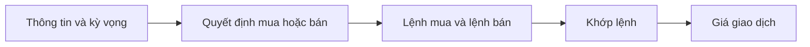

# Bài tập thực hành: Nền tảng thị trường chứng khoán (Stock Market Basics Exercise)

> [!SUMMARY] Một câu tóm tắt
> Hãy áp dụng các khái niệm về vốn chủ sở hữu, phát hành cổ phần, tỷ lệ sở hữu và khớp lệnh để giải các tình huống có số liệu.

## 1. Tổng quan

Bài tập này tổng hợp những ý nền tảng của module: doanh nghiệp có tài sản được tài trợ bằng nợ và vốn chủ sở hữu; cổ phiếu biểu thị quyền sở hữu; công ty có thể phát hành chứng khoán trên thị trường sơ cấp; nhà đầu tư có thể giao dịch lại trên thị trường thứ cấp. Bạn sẽ làm các phép tính đơn giản và theo dõi tiền cùng cổ phần đi đâu trong từng tình huống. Mỗi tình huống là giả định để luyện cách suy luận, không phải khuyến nghị đầu tư. Hãy tự giải trước khi mở lời giải.

## 2. Mục tiêu học tập

Sau bài tập, bạn có thể:

- [ ] Tính tỷ lệ sở hữu từ số cổ phần của một cổ đông và tổng số cổ phần.
- [ ] Phân biệt phát hành mới với việc chuyển nhượng cổ phần đã tồn tại.
- [ ] Tính bid–ask spread và nhận diện mức giá khớp lệnh trong ví dụ.
- [ ] Trình bày được vì sao giá thị trường có thể thay đổi khi cung cầu hoặc kỳ vọng đổi khác.

## 3. Kiến thức cần chuẩn bị

- Bài trước: [Quiz: Nền tảng thị trường chứng khoán](./12-quiz-stock-market-basics-quiz.md) — ôn lại cổ phiếu, IPO/FPO, thị trường sơ cấp và thứ cấp.
- Nhớ phương trình kế toán: tài sản = nợ phải trả + vốn chủ sở hữu.
- Tỷ lệ sở hữu = số cổ phần của cổ đông / tổng số cổ phần × 100%.
- Bid là giá mua cao nhất; ask là giá bán thấp nhất đang chào. Spread = ask − bid.

## 4. Thử đoán trước

1. Nếu công ty tăng tổng số cổ phần nhưng một cổ đông không mua thêm, tỷ lệ sở hữu của người đó sẽ thay đổi thế nào?
2. Khi một nhà đầu tư mua cổ phiếu từ nhà đầu tư khác trên sàn, công ty có nhận tiền giao dịch đó không?

## 5. Kiến thức cốt lõi

### 5.1. Tỷ lệ sở hữu và phát hành mới

Tỷ lệ sở hữu phụ thuộc vào cả số cổ phần của cá nhân lẫn tổng số cổ phần. Khi công ty phát hành cổ phần mới, mẫu số có thể tăng; nếu số cổ phần cá nhân giữ nguyên, tỷ lệ của họ có thể giảm. Việc cổ đông hiện hữu bán cổ phần cho người khác tự nó chỉ chuyển quyền sở hữu, không làm tăng tổng số cổ phần.

$$
\text{Tỷ lệ sở hữu} = \frac{\text{Cổ phần của cổ đông}}{\text{Tổng số cổ phần}} \times 100\%
$$

### 5.2. Theo dõi dòng tiền

| Tình huống | Người mua trả tiền cho | Công ty nhận vốn mới? | Tổng số cổ phần thay đổi do giao dịch? |
|---|---|---|---|
| Công ty phát hành cổ phần mới | Công ty phát hành | Có thể có | Tăng |
| Cổ đông bán cổ phần hiện hữu | Cổ đông bán | Không trực tiếp | Không |
| Hai nhà đầu tư giao dịch thứ cấp | Nhà đầu tư bán | Không trực tiếp | Không |

### 5.3. Spread và giá khớp

*Bid price* là giá mua cao nhất; *ask price* là giá bán thấp nhất. Chênh lệch giữa hai mức là *bid–ask spread*. Khi lệnh mua có thể khớp với lệnh bán đang chờ, giao dịch hoàn tất tại mức giá phù hợp theo quy tắc khớp lệnh của thị trường.

$$
\text{Spread} = \text{Ask} - \text{Bid}
$$



## 6. Giải thích chi tiết

Khi tính tỷ lệ sở hữu, hãy xác định đúng tổng số cổ phần tại thời điểm đang xét. Phát hành mới làm tổng số cổ phần tăng; bán cổ phần cũ giữa các nhà đầu tư chỉ đổi người sở hữu. Với IPO hoặc FPO, cần xem đợt chào bán gồm phần phát hành mới (*fresh issue*), phần cổ đông hiện hữu bán (*offer for sale*), hay cả hai. Tiền từ cổ phần mới có thể vào công ty; tiền từ bán cổ phần hiện hữu thường thuộc về cổ đông bán.

Trên thị trường thứ cấp, giao dịch tạo điều kiện chuyển nhượng và góp phần khám phá giá (*price discovery*), nhưng thông thường không cấp vốn trực tiếp cho doanh nghiệp. Giá thay đổi khi người mua và người bán điều chỉnh mức giá họ chấp nhận, dựa trên thông tin, kỳ vọng, nhu cầu thanh khoản và nhiều yếu tố khác. Một spread lớn có thể phản ánh thanh khoản thấp hoặc khác biệt lớn giữa mức giá hai phía, nhưng không tự nó cho biết giá trị nội tại của doanh nghiệp.

> [!WARNING] Lưu ý
> Các phép tính này chỉ mô tả cơ chế cơ bản. Giá cổ phiếu và tỷ lệ sở hữu không cho biết đầy đủ chất lượng doanh nghiệp hay mức độ phù hợp của khoản đầu tư.

## 7. Ví dụ minh họa

**Ví dụ giả định:** Công ty có 2.000.000 cổ phần. Một cổ đông giữ 160.000 cổ phần. Công ty phát hành thêm 500.000 cổ phần mới; cổ đông này không mua thêm.

1. Trước phát hành, tỷ lệ là 160.000 / 2.000.000 × 100% = 8%.
2. Sau phát hành, tổng số là 2.500.000 cổ phần.
3. Tỷ lệ mới là 160.000 / 2.500.000 × 100% = 6,4%.

Tỷ lệ giảm vì tổng số cổ phần tăng trong khi cổ phần của cá nhân không đổi. Cổ đông có cùng số cổ phần như trước, nhưng sở hữu phần nhỏ hơn trong tổng số cổ phần.

## 8. Bài tập thực hành

### Bài 1 — Bảng cân đối đơn giản

Một cửa hàng có tài sản trị giá 18.000 USD và nợ phải trả 6.500 USD. Tính vốn chủ sở hữu theo phương trình kế toán.

<details>
<summary>Xem lời giải sau khi đã tự làm</summary>

Tài sản = nợ phải trả + vốn chủ sở hữu, nên vốn chủ sở hữu = 18.000 − 6.500 = **11.500 USD**. Kiểm tra: 18.000 = 6.500 + 11.500.

</details>

### Bài 2 — Phát hành mới và tỷ lệ sở hữu

Một công ty có 4.000.000 cổ phần. Linh sở hữu 240.000 cổ phần. Công ty phát hành mới 1.000.000 cổ phần; Linh không mua thêm. Tính tỷ lệ sở hữu của Linh trước và sau phát hành.

<details>
<summary>Xem lời giải sau khi đã tự làm</summary>

Trước phát hành: 240.000 / 4.000.000 × 100% = **6%**. Sau phát hành, tổng số là 5.000.000; tỷ lệ là 240.000 / 5.000.000 × 100% = **4,8%**. Mức giảm phát sinh do tổng số cổ phần tăng.

</details>

### Bài 3 — Theo dõi tiền trong một đợt chào bán

Trong một đợt chào bán giả định, công ty phát hành 300.000 cổ phần mới và cổ đông sáng lập bán 100.000 cổ phần hiện hữu. Nhà đầu tư trả tổng cộng 800.000 USD cho phần cổ phần mới và 250.000 USD cho phần cổ phần hiện hữu. Xác định ai nhận từng khoản tiền và phần nào làm tăng tổng số cổ phần.

<details>
<summary>Xem lời giải sau khi đã tự làm</summary>

Khoản **800.000 USD** gắn với cổ phần phát hành mới được trả cho công ty theo cấu trúc giả định; 300.000 cổ phần mới làm tổng số cổ phần tăng. Khoản **250.000 USD** từ việc mua cổ phần hiện hữu thuộc về cổ đông sáng lập bán cổ phần; giao dịch đó không tự làm tăng tổng số cổ phần.

</details>

### Bài 4 — Spread và giá khớp

Sổ lệnh giả định có bid tốt nhất là 24,60 USD và ask tốt nhất là 24,75 USD. Tính spread. Nếu người mua chấp nhận mua ngay tại ask tốt nhất cho một cổ phiếu và lượng chào bán đủ, mức giá nào có thể khớp?

<details>
<summary>Xem lời giải sau khi đã tự làm</summary>

Spread = 24,75 − 24,60 = **0,15 USD**. Nếu lệnh mua khớp với lượng đang chào tại ask tốt nhất và đủ điều kiện khớp, giá giao dịch ví dụ là **24,75 USD**. Giá thực tế phụ thuộc vào sổ lệnh và quy tắc của thị trường.

</details>

## 9. Những lỗi thường gặp

- **Dùng số cổ phần trước phát hành làm mẫu số sau phát hành** — cập nhật tổng số cổ phần ở từng thời điểm.
- **Cho rằng mọi khoản tiền trong IPO đều vào công ty** — phân biệt phát hành mới với cổ phần hiện hữu được bán.
- **Nhầm chuyển nhượng với phát hành mới** — hỏi tổng số cổ phần có được tạo thêm hay chỉ đổi chủ.
- **Tính spread theo bid trừ ask** — lấy ask trừ bid vì ask thường cao hơn bid tốt nhất.
- **Xem spread là giá trị doanh nghiệp** — spread mô tả khoảng cách giá chào, không phải định giá cơ bản.

## 10. Giải thích bằng lời của bạn

Tóm tắt bài tập bằng lời của bạn:

- Khái niệm: tỷ lệ sở hữu thay đổi như thế nào khi tổng số cổ phần thay đổi?
- Vì sao: tiền của giao dịch sơ cấp và thứ cấp có thể đến những chủ thể khác nhau ra sao?
- Ví dụ của tôi: tự tạo một tình huống tính tỷ lệ sở hữu hoặc spread.
- Chỗ chưa chắc: ghi lại điểm bạn muốn xem lại.

## 11. Câu hỏi ôn tập

### Câu 1

Một công ty có 3.000.000 cổ phần. Một nhà đầu tư sở hữu 150.000 cổ phần. Tỷ lệ sở hữu của người này là bao nhiêu?

A. 2%
B. 5%
C. 10%
D. 20%

**Đáp án:** B. **Giải thích:** 150.000 / 3.000.000 × 100% = 5%. Các mức khác không bằng tỷ lệ tính được.

### Câu 2

Công ty phát hành 200.000 cổ phần mới. Nếu một cổ đông giữ nguyên số cổ phần, phát biểu nào đúng?

A. Tổng số cổ phần không đổi.
B. Tỷ lệ sở hữu của cổ đông chắc chắn tăng.
C. Tỷ lệ sở hữu có thể giảm vì tổng số cổ phần tăng.
D. Cổ đông tự động nhận tiền từ đợt phát hành.

**Đáp án:** C. **Giải thích:** Phát hành mới tăng tổng số cổ phần; nếu cổ phần của cổ đông không tăng thì tỷ lệ có thể giảm. A sai vì tổng số tăng; B sai vì tỷ lệ không tự tăng; D sai vì tiền phát hành thuộc về công ty theo cấu trúc giả định, không tự động trả cho cổ đông.

### Câu 3

Trong giao dịch thứ cấp thông thường, ai nhận tiền của người mua cổ phiếu?

A. Công ty phát hành trong mọi trường hợp.
B. Sở giao dịch chứng khoán.
C. Cơ quan quản lý.
D. Nhà đầu tư đang bán cổ phiếu.

**Đáp án:** D. **Giải thích:** Giao dịch thứ cấp chuyển tiền từ người mua sang người bán và chuyển cổ phiếu theo chiều ngược lại. Công ty không nhận vốn trực tiếp từ giao dịch đó; các đáp án khác mô tả sai bên nhận tiền.

### Câu 4

Bid tốt nhất là 31,20 USD và ask tốt nhất là 31,38 USD. Spread là bao nhiêu?

A. 0,18 USD
B. 0,08 USD
C. 31,20 USD
D. 62,58 USD

**Đáp án:** A. **Giải thích:** 31,38 − 31,20 = 0,18 USD. B là phép trừ sai; C và D không phải chênh lệch giữa hai mức giá.

### Câu 5

Những phát biểu nào đúng về phát hành mới và giao dịch thứ cấp? (Chọn nhiều.)

A. Phát hành cổ phần mới có thể đưa vốn vào công ty.
B. Mỗi lần nhà đầu tư mua bán trên sàn đều làm tổng số cổ phần tăng.
C. Bán cổ phần hiện hữu chuyển tiền cho cổ đông bán.
D. Giao dịch thứ cấp thông thường cấp vốn trực tiếp cho công ty.

**Đáp án:** A, C. **Giải thích:** Phát hành mới có thể huy động vốn cho công ty; bán cổ phần hiện hữu trả tiền cho cổ đông bán. Giao dịch thứ cấp không làm tăng tổng số cổ phần chỉ vì đổi chủ và thông thường không cấp vốn trực tiếp cho công ty.

### Câu 6

Phát biểu sau đúng hay sai: “Giá cổ phiếu trên thị trường thứ cấp có thể thay đổi khi kỳ vọng và cung cầu của nhà đầu tư thay đổi.”

A. Đúng
B. Sai

**Đáp án:** A. **Giải thích:** Lệnh mua và bán phản ánh mức giá các bên chấp nhận. Khi thông tin hoặc kỳ vọng đổi khác, cung cầu và giá giao dịch có thể đổi theo; giá không bị cố định chỉ bởi giá phát hành ban đầu.

## Luyện thêm

```quiz
title: Luyện thêm
questions:
  - type: fill_blank
    prompt: "Một cổ đông có 50.000 cổ phần trong tổng số 1.000.000 cổ phần, tương ứng ___% sở hữu."
    blanks: [["5", "5%"]]
    explanation: "50.000 / 1.000.000 × 100% = 5%."
  - type: ordering
    prompt: "Sắp xếp quá trình từ phát hành cổ phần mới đến khi nhà đầu tư giao dịch lại trên thị trường thứ cấp."
    items: ["Công ty phát hành cổ phần mới", "Nhà đầu tư nhận cổ phần", "Cổ phần được giao dịch giữa nhà đầu tư", "Tiền mua cổ phần mới được chuyển cho công ty"]
  - type: matching
    prompt: "Ghép khái niệm với mô tả phù hợp."
    pairs:
      - { left: "Bid", right: "Giá mua cao nhất đang chào" }
      - { left: "Ask", right: "Giá bán thấp nhất đang chào" }
      - { left: "Thị trường thứ cấp", right: "Nơi nhà đầu tư giao dịch chứng khoán đã phát hành" }
```

## 12. Tóm tắt kiến thức

- Vốn chủ sở hữu bằng tài sản trừ nợ phải trả trong phương trình kế toán cơ bản.
- Tỷ lệ sở hữu được tính bằng cổ phần cá nhân chia tổng cổ phần, nhân 100%; phát hành mới có thể làm giảm tỷ lệ nếu cá nhân không mua thêm.
- Phát hành mới có thể đưa vốn vào công ty; mua bán cổ phần hiện hữu chuyển tiền cho cổ đông bán.
- Thị trường thứ cấp hỗ trợ thanh khoản và khám phá giá; bid và ask là giá chào mua cao nhất và giá chào bán thấp nhất.
- Giá giao dịch biến động theo lệnh, cung cầu, thông tin và kỳ vọng, không phải do một bên đơn lẻ quyết định mọi lúc.

## 13. Tài liệu tham khảo

1. Investor.gov (U.S. Securities and Exchange Commission), tài liệu giáo dục về cổ phiếu và thị trường chứng khoán.
2. CFA Institute, tài liệu nhập môn về thị trường vốn và giao dịch chứng khoán.
3. Investopedia, mục từ “Bid” và “Ask” — tham khảo cách hiểu giá chào mua và giá chào bán.

## 14. Bài học tiếp theo

[Stock Exchanges](../02-exchanges-intermediaries-index/01-stock-exchanges.md) — bài tiếp theo giới thiệu sở giao dịch, nơi hỗ trợ tổ chức và vận hành giao dịch chứng khoán.
