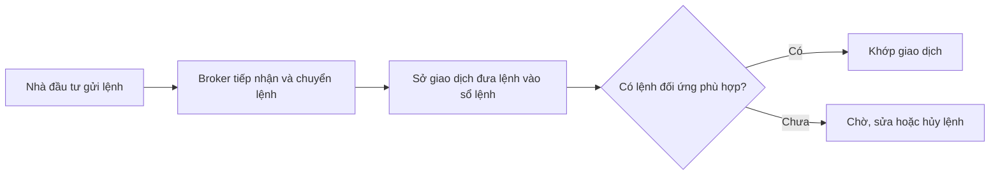

# Sở giao dịch chứng khoán (Stock Exchanges)

> [!SUMMARY] Một câu tóm tắt
> Sở giao dịch tổ chức một thị trường có quy tắc để lệnh mua và bán gặp nhau, hỗ trợ hình thành giá và giao dịch có trật tự.

## 1. Tổng quan

Ở bài trước, bạn đã làm quen với thị trường chứng khoán và việc nhà đầu tư có thể mua bán cổ phiếu. Bài này tập trung vào nơi và cơ chế tổ chức giao dịch đó: sở giao dịch chứng khoán (*stock exchange*). Sở giao dịch không phải là công ty phát hành cổ phiếu, cũng không nhất thiết là nơi nhà đầu tư cá nhân gửi lệnh trực tiếp. Bài tiếp theo sẽ giới thiệu các trung gian giúp lệnh đi từ nhà đầu tư tới hạ tầng thị trường.

## 2. Mục tiêu học tập

- [ ] Mô tả được chức năng của sở giao dịch.
- [ ] Phân biệt được sở giao dịch, broker và cơ quan quản lý.
- [ ] Diễn giải được một tình huống khớp lệnh đơn giản.
- [ ] Nhận diện được giới hạn của giá niêm yết và thanh khoản.

## 3. Kiến thức cần chuẩn bị

- Bài trước: [Bài tập: Thị trường chứng khoán](../01-stocks-stock-market-basics/13-exercise-stock-market-basics-exercise.md).
- Nhớ rằng cổ phiếu là quyền sở hữu trong doanh nghiệp; thị trường thứ cấp cho phép nhà đầu tư mua bán cổ phiếu đã phát hành.

## 4. Thử đoán trước

1. Nếu bạn đặt lệnh mua nhưng không có người bán ở mức giá đó, chuyện gì có thể xảy ra?
2. Sở giao dịch có tự quyết định rằng một cổ phiếu đáng giá bao nhiêu không?

## 5. Kiến thức cốt lõi

### 5.1. Sở giao dịch tổ chức thị trường

Sở giao dịch là hạ tầng nơi các lệnh được đưa vào theo quy tắc chung. Các chức năng thường gồm vận hành hệ thống khớp lệnh, công bố dữ liệu, đặt yêu cầu đối với thành viên và hỗ trợ duy trì giao dịch công bằng, trật tự. Ví dụ quen thuộc gồm NYSE và Nasdaq tại Mỹ, NSE và BSE tại Ấn Độ, HOSE và HNX tại Việt Nam; cấu trúc, quy tắc và sản phẩm cụ thể khác nhau theo quốc gia.

### 5.2. Lệnh gặp nhau qua sổ lệnh

*Sổ lệnh* (*order book*) ghi lại lệnh mua và bán đang chờ. *Bid price* là giá mua cao nhất đang chờ; *ask price* là giá bán thấp nhất đang chờ. Nếu giá mua chấp nhận được bằng hoặc cao hơn giá bán tương ứng, hệ thống có thể khớp theo quy tắc ưu tiên giá và thời gian của thị trường. Lệnh chưa khớp có thể tiếp tục chờ, bị hủy hoặc hết hiệu lực tùy loại lệnh.

### 5.3. Giá và tính thanh khoản

*Thanh khoản* (*liquidity*) mô tả mức độ dễ mua bán với khối lượng mong muốn mà không làm giá biến động quá nhiều. Nhiều lệnh đối ứng thường giúp giao dịch thuận tiện hơn, nhưng không bảo đảm mọi lệnh đều khớp ngay hoặc đúng giá kỳ vọng. Sở giao dịch cung cấp cơ chế giao dịch; cung cầu của người tham gia và quy tắc thị trường góp phần hình thành mức giá.

## 6. Giải thích chi tiết

Nhà đầu tư thường tiếp cận sàn qua broker, tức công ty chứng khoán hoặc nhà môi giới. Sở giao dịch vận hành nơi lệnh đủ điều kiện được so khớp; cơ quan quản lý nhà nước giám sát khuôn khổ pháp lý và hành vi thị trường. Những vai trò này có thể phối hợp nhưng không đồng nhất. Sau khi khớp, giao dịch còn cần bù trừ và thanh toán; thông báo khớp lệnh chưa có nghĩa mọi chuyển giao tiền và chứng khoán đã hoàn tất.

> [!NOTE]
> Một số giao dịch chứng khoán có thể diễn ra ngoài sở giao dịch tập trung, tùy quy định và loại tài sản. Vì vậy “thị trường chứng khoán” rộng hơn một sàn cụ thể.

> [!WARNING] Lưu ý
> Giá cuối cùng được khớp không bảo đảm có thể mua hoặc bán toàn bộ số lượng ở đúng mức giá đó. Giá chào mua/bán, độ sâu sổ lệnh và thời điểm đặt lệnh đều quan trọng.

## 7. Ví dụ minh họa

**Ví dụ giả định:** Cổ phiếu ABC có lệnh mua 100 cổ phiếu ở 49.900 đồng và lệnh bán 100 cổ phiếu ở 50.000 đồng. Chưa có giao dịch vì giá mua thấp hơn giá bán.

1. Một nhà đầu tư đặt lệnh mua 100 cổ phiếu với mức tối đa 50.000 đồng.
2. Lệnh mua mới có thể khớp với lệnh bán đang chờ ở 50.000 đồng, theo quy tắc của sàn.
3. Giao dịch được ghi nhận ở mức giá khớp; nếu nhà đầu tư chỉ đặt tối đa 49.900 đồng, lệnh có thể tiếp tục chờ.

Lý do: hệ thống so khớp các điều kiện lệnh; người mua không cần biết danh tính người bán.

## 8. Thực hành

**Bài tự làm:** Sổ lệnh giả định có người mua 200 cổ phiếu ở 24.500 đồng và người bán 150 cổ phiếu ở 24.600 đồng. Một lệnh mua mới chấp nhận tối đa 24.600 đồng cho 100 cổ phiếu. Xác định khả năng khớp và số lượng còn lại của lệnh bán.

- [ ] So sánh giá mua mới với giá bán thấp nhất.
- [ ] Xác định số lượng có thể khớp.
- [ ] Nêu một lý do phần lệnh bán còn lại vẫn có thể chờ.

Xem lời giải sau khi đã tự làm

Giá mua tối đa 24.600 đồng bằng giá bán thấp nhất nên 100 cổ phiếu có thể khớp, giả sử các điều kiện khác đều hợp lệ. Lệnh bán còn 50 cổ phiếu. Phần này tiếp tục chờ vì lệnh mua mới chỉ yêu cầu 100 cổ phiếu.

## 9. Những lỗi thường gặp

- **Cho rằng sở giao dịch là broker** — broker nhận lệnh khách hàng; sở vận hành cơ chế giao dịch.
- **Nghĩ sàn tự định giá cổ phiếu** — giá hình thành từ lệnh và giao dịch theo quy tắc.
- **Coi giá gần nhất là giá chắc chắn giao dịch được** — kiểm tra bid, ask và khối lượng khả dụng.
- **Cho rằng khớp lệnh là hoàn tất mọi bước** — sau khớp còn bù trừ và thanh toán.

## 10. Giải thích bằng lời của bạn

- Khái niệm: Sở giao dịch làm nhiệm vụ gì?
- Vì sao: Vì sao sổ lệnh giúp người mua và người bán gặp nhau?
- Ví dụ của tôi: Hãy tự đặt một mức bid và ask có thể khớp.
- Chỗ chưa chắc: Bạn còn nhầm vai trò nào giữa broker, sở và cơ quan quản lý?

## 11. Câu hỏi ôn tập

### Câu 1

Vai trò nào phù hợp nhất với sở giao dịch chứng khoán?

A. Tổ chức hạ tầng và quy tắc để các lệnh đủ điều kiện được so khớp.  
B. Bảo đảm mọi nhà đầu tư có lợi nhuận.  
C. Quyết định giá trị nội tại của từng doanh nghiệp.  
D. Cấp vốn trực tiếp cho mọi nhà đầu tư cá nhân.

**Đáp án:** A. **Giải thích:** Sở tổ chức thị trường và khớp lệnh. Nó không bảo đảm lợi nhuận, định giá nội tại thay nhà đầu tư hay cấp vốn cho mọi người mua.

### Câu 2

Một lệnh mua giới hạn ở 10.000 đồng gặp lệnh bán thấp nhất ở 10.100 đồng. Điều gì thường xảy ra?

A. Giao dịch chắc chắn khớp ở 10.000 đồng.  
B. Người bán buộc phải hạ giá.  
C. Lệnh mua có thể tiếp tục chờ vì chưa đạt điều kiện giá.  
D. Sở giao dịch tự mua cổ phiếu đó.

**Đáp án:** C. **Giải thích:** Giá mua tối đa thấp hơn giá bán thấp nhất nên chưa khớp. Các phương án khác gán cho sàn quyền bảo đảm hoặc ép giá không có.

### Câu 3

Phát biểu nào đúng về thanh khoản? (Chọn nhiều)

A. Thanh khoản liên quan đến khả năng giao dịch tương đối dễ dàng.  
B. Thanh khoản cao bảo đảm không thể bị lỗ.  
C. Sổ lệnh dày có thể giúp hấp thụ lệnh lớn hơn với ít tác động giá hơn.  
D. Mọi cổ phiếu niêm yết có thanh khoản như nhau.

**Đáp án:** A, C. **Giải thích:** Thanh khoản nói về khả năng giao dịch và tác động giá; nó không bảo vệ khỏi thua lỗ và khác nhau giữa chứng khoán.

### Câu 4

Phát biểu sau đúng hay sai: “Sở giao dịch, broker và cơ quan quản lý luôn là cùng một tổ chức.”

A. Đúng  
B. Sai

**Đáp án:** B. **Giải thích:** Đây là các vai trò khác nhau: vận hành giao dịch, trung gian nhận lệnh, và giám sát quy định.

## 12. Tóm tắt kiến thức

- Sở giao dịch cung cấp hạ tầng và quy tắc chung để lệnh được so khớp.
- Bid và ask mô tả các mức giá mua, bán đang chờ.
- Thanh khoản không đồng nghĩa với chắc chắn khớp lệnh hoặc không có rủi ro.
- Khớp lệnh là một giai đoạn; việc chuyển tiền và chứng khoán diễn ra sau đó.

## 13. Tài liệu tham khảo

1. Investor.gov, tài liệu hướng dẫn về thị trường chứng khoán và cách giao dịch.
2. U.S. Securities and Exchange Commission (SEC), *Investor Bulletin: Understanding Order Types*.
3. Sở Giao dịch Chứng khoán Việt Nam (VNX), thông tin công khai về thị trường và các sở thành viên.

## 14. Bài học tiếp theo

[Trung gian tài chính trong giao dịch cổ phiếu (Financial Intermediaries in Stock Trading)](02-financial-intermediaries-in-stock-trading.md) — tiếp theo, ta theo dõi cách broker và các tổ chức sau giao dịch phối hợp để hoàn tất giao dịch.
