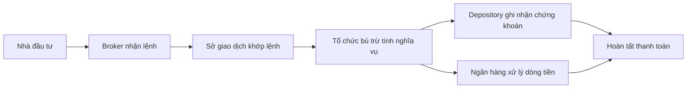

# Trung gian tài chính trong giao dịch cổ phiếu (Financial Intermediaries in Stock Trading)

> [!SUMMARY] Một câu tóm tắt
> Broker đưa lệnh của khách hàng vào thị trường; các trung gian sau giao dịch giúp xác định nghĩa vụ, ghi nhận quyền sở hữu và chuyển tiền, chứng khoán.

## 1. Tổng quan

Bài trước giải thích sở giao dịch tổ chức nơi các lệnh được so khớp. Một giao dịch hoàn chỉnh còn cần nhiều tổ chức đảm nhiệm các bước khác nhau. Bài này lần theo vòng đời giao dịch từ lệnh của nhà đầu tư đến lúc tiền và chứng khoán được chuyển giao. Cấu trúc cụ thể khác nhau giữa quốc gia, nhưng các khái niệm trading, clearing và settlement hữu ích ở mọi thị trường.

## 2. Mục tiêu học tập

- [ ] Vẽ được đường đi khái quát của lệnh.
- [ ] Phân biệt được trading, clearing và settlement.
- [ ] Ghép đúng chức năng của broker, depository và clearing institution.
- [ ] Nêu được tiêu chí cơ bản khi đánh giá broker.

## 3. Kiến thức cần chuẩn bị

- Bài trước: [Sở giao dịch chứng khoán](01-stock-exchanges.md) — nơi lệnh đủ điều kiện được đưa vào hệ thống so khớp.
- Nhớ rằng khớp lệnh xác lập giao dịch, nhưng chuyển giao tài sản có thể diễn ra sau đó.

## 4. Thử đoán trước

1. Sau khi một lệnh mua được khớp, ai xác định số tiền và số cổ phiếu mỗi bên phải giao?
2. Vì sao tiền và chứng khoán không nhất thiết chuyển ngay cùng lúc lệnh khớp?

## 5. Kiến thức cốt lõi

### 5.1. Broker — đầu mối của nhà đầu tư

*Broker* (nhà môi giới/công ty chứng khoán) nhận lệnh, kiểm tra điều kiện tài khoản, chuyển lệnh vào thị trường và cung cấp thông tin giao dịch. Broker có thể cung cấp thêm nghiên cứu, nền tảng, dịch vụ lưu ký hoặc hỗ trợ khách hàng, nhưng mức dịch vụ tùy tổ chức và pháp luật từng nơi.

### 5.2. Ba giai đoạn hậu trường

- *Trading* (giao dịch): lệnh mua bán được so khớp và giao dịch được xác lập.
- *Clearing* (bù trừ): xác định nghĩa vụ ròng, bên nào giao/nhận bao nhiêu chứng khoán và tiền.
- *Settlement* (thanh toán): thực hiện chuyển tiền và chứng khoán theo nghĩa vụ đã xác định.

### 5.3. Các trung gian sau giao dịch

*Tổ chức bù trừ* (*clearing institution*) xác định nghĩa vụ và có thể áp dụng biện pháp quản lý rủi ro. *Depository* (hệ thống lưu ký trung tâm) ghi nhận chứng khoán ở dạng điện tử và thay đổi quyền sở hữu theo quy trình. *Clearing bank* hoặc ngân hàng thanh toán xử lý phần tiền giữa các thành viên. *Custodian* (tổ chức lưu ký tài sản) thường bảo quản và quản trị tài sản cho khách hàng tổ chức; vai trò này không đồng nhất với broker.

## 6. Giải thích chi tiết

Bù trừ có thể tổng hợp nhiều giao dịch để xác định nghĩa vụ ròng, nhờ đó không phải chuyển riêng từng khoản gộp trong mọi trường hợp. Cơ chế cụ thể phụ thuộc vào hệ thống quốc gia. Một số thị trường dùng đối tác bù trừ trung tâm làm bên đứng giữa giao dịch theo quy tắc; điều đó giúp quản trị rủi ro nhưng không xóa bỏ mọi rủi ro vận hành hay thanh toán.

> [!WARNING] Lưu ý
> Ngày thanh toán, cách giữ tiền/chứng khoán và nghĩa vụ của từng bên phụ thuộc thị trường và loại sản phẩm. Không suy ra lịch thanh toán ở một quốc gia từ quy tắc ở quốc gia khác.

Khi chọn broker, nên xem giấy phép và tư cách thành viên, độ ổn định hệ thống, phí và thuế, bảo mật, cách chăm sóc khách hàng, sản phẩm hỗ trợ và cách tài sản khách hàng được lưu ký. Phí thấp là một yếu tố, không phải bằng chứng duy nhất về chất lượng.

## 7. Ví dụ minh họa

**Ví dụ giả định:** Lan mua 100 cổ phiếu XYZ với giá 20.000 đồng/cổ phiếu.

1. Lan gửi lệnh qua broker; broker kiểm tra tài khoản và chuyển lệnh.
2. Sở giao dịch khớp lệnh với một lệnh bán phù hợp. Đây là trading; giá trị giao dịch trước phí là $100 \times 20.000 = 2.000.000$ đồng.
3. Tổ chức bù trừ ghi nhận nghĩa vụ: phía mua phải trả tiền, phía bán phải giao 100 cổ phiếu.
4. Khi settlement hoàn tất, hệ thống tiền ghi nhận khoản thanh toán và depository cập nhật quyền sở hữu theo quy trình.

Mỗi tổ chức thực hiện một phần, nên trạng thái “đã khớp” và “đã thanh toán” có thể là hai mốc khác nhau.

## 8. Thực hành

**Bài tự làm:** Minh bán 50 cổ phiếu QRS ở 30.000 đồng/cổ phiếu. Hãy ghép ba việc sau với trading, clearing hoặc settlement: xác nhận giao dịch khớp; tính nghĩa vụ tiền và chứng khoán; chuyển tiền và ghi nhận chuyển giao chứng khoán.

- [ ] Phân loại từng việc.
- [ ] Tính giá trị giao dịch trước phí.
- [ ] Nêu tổ chức có thể quản lý hồ sơ sở hữu điện tử.

Xem lời giải sau khi đã tự làm

Khớp giao dịch là trading; tính nghĩa vụ là clearing; thực chuyển tiền và chứng khoán là settlement. Giá trị trước phí là $50 \times 30.000 = 1.500.000$ đồng. Depository ghi nhận chứng khoán điện tử theo quy trình thị trường.

## 9. Những lỗi thường gặp

- **Đồng nhất broker với sở giao dịch** — broker nhận lệnh khách hàng; sở vận hành thị trường.
- **Coi khớp lệnh là thanh toán xong** — phân biệt rõ ba giai đoạn.
- **Nghĩ depository giữ tiền mặt** — depository tập trung ghi nhận chứng khoán; dòng tiền có thể qua ngân hàng.
- **Chọn broker chỉ theo phí** — đánh giá cả giấy phép, bảo mật, vận hành và dịch vụ.

## 10. Giải thích bằng lời của bạn

- Khái niệm: Clearing khác settlement ở đâu?
- Vì sao: Vì sao thị trường cần trung gian sau khi khớp lệnh?
- Ví dụ của tôi: Mô tả giao dịch mua cổ phiếu bằng ba giai đoạn.
- Chỗ chưa chắc: Bạn còn phân vân vai trò nào giữa custodian và broker?

## 11. Câu hỏi ôn tập

### Câu 1

Tổ chức nào thường là đầu mối nhận và chuyển lệnh của nhà đầu tư cá nhân?

A. Depository.  
B. Clearing bank.  
C. Cơ quan quản lý.  
D. Broker.

**Đáp án:** D. **Giải thích:** Broker tiếp xúc trực tiếp với khách hàng và chuyển lệnh. Depository ghi nhận chứng khoán, ngân hàng xử lý dòng tiền; cơ quan quản lý giám sát.

### Câu 2

Hoạt động nào mô tả đúng clearing?

A. Tính toán nghĩa vụ tiền và chứng khoán sau giao dịch.  
B. Nhà đầu tư đọc báo cáo doanh nghiệp.  
C. Sở niêm yết doanh nghiệp mới.  
D. Chuyển quyền sở hữu đã hoàn tất sang nhà đầu tư.

**Đáp án:** A. **Giải thích:** Clearing xác định nghĩa vụ. Chuyển giao thực tế thuộc settlement; các lựa chọn còn lại không phải chức năng cốt lõi của bù trừ.

### Câu 3

Những phát biểu nào đúng về trung gian? (Chọn nhiều)

A. Depository ghi nhận và quản lý chứng khoán theo hệ thống lưu ký.  
B. Clearing bank luôn quyết định giá khớp.  
C. Custodian có thể quản trị tài sản cho khách hàng tổ chức.  
D. Broker bảo đảm mọi lệnh đều có đối tác.

**Đáp án:** A, C. **Giải thích:** Depository và custodian có các vai trò nêu trên. Ngân hàng không quyết định giá khớp; broker không bảo đảm luôn có lệnh đối ứng.

### Câu 4

Phát biểu sau đúng hay sai: “Settlement là giai đoạn thực hiện chuyển tiền và chứng khoán theo nghĩa vụ đã xác định.”

A. Đúng  
B. Sai

**Đáp án:** A. **Giải thích:** Settlement thực hiện việc chuyển giao; clearing xác định trước nghĩa vụ cần thực hiện.

## 12. Tóm tắt kiến thức

- Broker kết nối nhà đầu tư với hạ tầng giao dịch.
- Trading xác lập giao dịch, clearing tính nghĩa vụ, settlement chuyển giao.
- Depository tập trung ghi nhận chứng khoán; ngân hàng thường hỗ trợ luồng tiền.
- Chọn broker cần cân nhắc an toàn, vận hành, dịch vụ và chi phí.

## 13. Tài liệu tham khảo

1. Investor.gov, *How Stock Markets Work* và tài liệu về clearing and settlement.
2. U.S. Securities and Exchange Commission (SEC), tài liệu nhà đầu tư về broker-dealers.
3. Ủy ban Chứng khoán Nhà nước Việt Nam (SSC/UBCKNN), thông tin phổ biến kiến thức và quản lý thị trường.

## 14. Bài học tiếp theo

[Chứng khoán (Securities)](03-securities.md) — tiếp theo, ta mở rộng từ cổ phiếu sang các loại công cụ tài chính khác được giao dịch và đầu tư.
