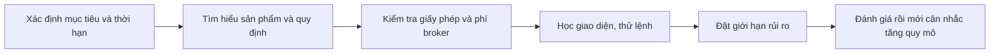

# Bắt đầu giao dịch trên thị trường chứng khoán (How can I start trading in the stock market)

> [!SUMMARY] Một câu tóm tắt
> Bắt đầu giao dịch an toàn hơn bằng cách xác định mục tiêu, tìm hiểu sản phẩm và nhà môi giới, rồi thử quy trình với quy mô nhỏ trước khi tăng vốn.

## 1. Tổng quan

Muốn đặt lệnh, trước hết cần hiểu mình đang mua bán sản phẩm gì và thông qua đơn vị nào. Giao dịch không chỉ là chọn mã cổ phiếu: phí, cách khớp lệnh, quy định tài khoản và khả năng chịu lỗ đều ảnh hưởng kết quả. Bài này mở đầu module về các câu hỏi thực tế khi giao dịch, trước khi đi sâu vào giá mua/bán và loại lệnh. Các bước dưới đây là khung học tập, không phải khuyến nghị mua chứng khoán.

## 2. Mục tiêu học tập

- [ ] Liệt kê các bước chuẩn bị trước lệnh đầu tiên.
- [ ] Phân biệt tiền dành cho mục tiêu dài hạn với vốn có thể chịu biến động.
- [ ] So sánh broker theo tiêu chí có thể kiểm tra.
- [ ] Tạo checklist thử nghiệm quy trình trước khi tăng quy mô.

## 3. Kiến thức cần chuẩn bị

- Bài trước: [Quiz về sở giao dịch chứng khoán](../02-exchanges-intermediaries-index/05-quiz-stock-exchange-quiz.md) — ôn lại vai trò của sở giao dịch và trung gian.
- Cần hiểu rằng giá chứng khoán có thể giảm và việc bán ra không đảm bảo thu hồi đủ vốn.

## 4. Thử đoán trước

1. Vì sao mở tài khoản và nạp tiền chưa đủ để sẵn sàng giao dịch?
2. Tiêu chí nào quan trọng hơn một chương trình tặng thưởng khi chọn broker?

## 5. Kiến thức cốt lõi

### 5.1. Chuẩn bị theo trình tự

Trước tiên, xác định mục tiêu và thời hạn: giao dịch ngắn hạn có nhịp ra quyết định, chi phí và rủi ro khác đầu tư dài hạn. Tiếp theo, tìm hiểu sản phẩm, giờ giao dịch, quy định và thuế tại thị trường mình tham gia. Sau đó chọn broker được cơ quan có thẩm quyền cấp phép, đọc biểu phí và điều khoản bảo vệ tài sản. Cuối cùng, học giao diện, cách đặt/hủy lệnh và lập quy tắc rủi ro trước khi sử dụng số tiền đáng kể.

### 5.2. Chọn broker bằng tiêu chí kiểm chứng được

**Broker** (nhà môi giới) nhận và chuyển lệnh của khách hàng tới thị trường, đồng thời có thể cung cấp sao kê, dữ liệu và công cụ. Hãy kiểm tra giấy phép, cách tách biệt tài sản khách hàng, biểu phí, lãi vay ký quỹ, phí dữ liệu, độ ổn định nền tảng, loại lệnh và hỗ trợ khi có sự cố. Cơ chế bảo vệ khác nhau theo quốc gia; không nên suy ra rằng mọi tài khoản đều được bảo hiểm như tiền gửi ngân hàng.

| Tiêu chí | Câu hỏi cần kiểm tra |
|---|---|
| Pháp lý | Đơn vị có trong danh sách cấp phép của cơ quan quản lý không? |
| Chi phí | Có phí giao dịch, lưu ký, dữ liệu, chuyển tiền hay lãi margin nào? |
| Thực thi | Broker công bố cách định tuyến lệnh, báo giá và xử lý gián đoạn ra sao? |
| Công cụ | Có sao kê rõ, xác thực an toàn, loại lệnh cần thiết và hỗ trợ phù hợp không? |

## 6. Giải thích chi tiết

Đừng chọn broker chỉ theo mức phí quảng cáo: tổng chi phí có thể gồm nhiều khoản, còn chất lượng báo giá và dịch vụ ảnh hưởng trải nghiệm thực tế. Hãy đọc tài liệu chính thức, thử quy trình nạp/rút và xem cách lấy sao kê. Nếu có tài khoản mô phỏng, có thể dùng để học giao diện; lệnh mô phỏng không tái hiện đầy đủ thanh khoản, cảm xúc hay trượt giá ngoài thị trường.

> [!WARNING] Cảnh báo
> Không dùng tiền cần cho chi phí thiết yếu hoặc quỹ khẩn cấp để thử giao dịch. Tài khoản ký quỹ có thể làm khoản lỗ lớn hơn số tiền dự định rủi ro; hiểu điều khoản trước khi bật tính năng này.

## 7. Ví dụ minh họa

**Ví dụ giả định:** Lan định tìm hiểu giao dịch cổ phiếu với một khoản tiền nhỏ.

1. Lan ghi rõ khoản tiền này không cần dùng cho chi phí sinh hoạt trong ngắn hạn; mục tiêu là học cách đặt lệnh, không đặt lợi nhuận kỳ vọng.
2. Lan xác minh broker trong danh sách cơ quan quản lý và đối chiếu phí giao dịch, phí dữ liệu, phí rút tiền.
3. Lan dùng tài khoản mô phỏng để thử xem báo giá, nhập khối lượng, xác nhận lệnh và hủy lệnh ở đâu.
4. Trước lệnh thật, Lan đọc lại chi tiết lệnh và xác định trước mức lỗ tối đa có thể chấp nhận. Kết quả là quy trình có thể kiểm tra, nhưng không đảm bảo giao dịch có lãi.

## 8. Thực hành

**Bài tự làm:** Soạn checklist chọn một broker giả định và chuẩn bị cho lệnh đầu tiên.

- [ ] Xác định mục tiêu và thời hạn sử dụng vốn.
- [ ] Tìm giấy phép và biểu phí từ nguồn chính thức.
- [ ] Viết ra ba chức năng cần học trên nền tảng.
- [ ] Nêu một giới hạn rủi ro trước khi đặt lệnh.

Xem lời giải sau khi đã tự làm

Một câu trả lời hợp lý nêu mục tiêu học tập, chỉ dùng vốn không cần cho chi phí thiết yếu, xác minh giấy phép, tính tổng phí và tập thao tác đặt/hủy lệnh. Cần ghi rõ giới hạn rủi ro; không có checklist nào bảo đảm lợi nhuận.

## 9. Những lỗi thường gặp

- **Chọn broker chỉ vì quà tặng** — đối chiếu giấy phép, phí thường xuyên và điều kiện rút tiền.
- **Nạp tiền trước khi hiểu sản phẩm** — đọc giờ giao dịch, quy tắc thanh toán và biến động giá.
- **Bỏ qua phí nhỏ** — lập tổng chi phí cho quy mô và tần suất dự kiến.
- **Thử ngay với vị thế lớn** — học quy trình bằng mô phỏng hoặc quy mô nhỏ có giới hạn.

## 10. Giải thích bằng lời của bạn

- Khái niệm: broker làm nhiệm vụ gì trong một giao dịch?
- Vì sao: tại sao giấy phép và biểu phí cần được xác minh?
- Ví dụ của tôi: tôi sẽ kiểm tra những mục nào trước khi mở tài khoản?
- Chỗ tôi chưa chắc: quy định nào tại thị trường tôi định tham gia cần tìm hiểu thêm?

## 11. Câu hỏi ôn tập

### Câu 1

Bước nào hợp lý trước khi nạp vốn đáng kể vào tài khoản giao dịch?

A. Chọn cổ phiếu đang tăng mạnh nhất  
B. Xác minh broker, đọc phí và học quy trình lệnh  
C. Bật vay ký quỹ để có thêm sức mua  
D. Dựa vào quà tặng để quyết định

**Đáp án:** B. **Giải thích:** Xác minh đơn vị, chi phí và cách dùng nền tảng giúp giảm rủi ro vận hành. A không xác định mức phù hợp; C làm tăng rủi ro; D bỏ qua tiêu chí pháp lý và phí.

### Câu 2

Những yếu tố nào nên được so sánh khi chọn broker? (chọn nhiều)

A. Giấy phép và cơ chế bảo vệ tài sản  
B. Màu sắc ứng dụng  
C. Tổng phí, gồm phí dữ liệu hoặc lãi margin nếu có  
D. Độ ổn định, loại lệnh và chất lượng sao kê

**Đáp án:** A, C, D. **Giải thích:** Đây là các yếu tố tác động đến pháp lý, chi phí và khả năng sử dụng. Màu giao diện có thể là sở thích nhưng không thay thế thẩm định.

### Câu 3

Phát biểu sau đúng hay sai: Tài khoản mô phỏng có thể giúp học giao diện nhưng không tái hiện đầy đủ mọi điều kiện khớp lệnh thật.

A. Đúng  
B. Sai

**Đáp án:** A. **Giải thích:** Mô phỏng hữu ích để tập thao tác, nhưng thanh khoản, trượt giá và tâm lý giao dịch thật có thể khác.

### Câu 4

Vì sao không nên dùng quỹ khẩn cấp để học giao dịch?

A. Vì quỹ khẩn cấp luôn bị broker từ chối  
B. Vì cổ phiếu không thể bán được  
C. Vì giao dịch có thể thua lỗ đúng lúc số tiền đó cần cho chi phí thiết yếu  
D. Vì mọi khoản tiền đầu tư đều phải khóa trong nhiều năm

**Đáp án:** C. **Giải thích:** Tổn thất hoặc biến động có thể khiến tiền không còn sẵn sàng khi cần. A và D không đúng phổ quát; B sai vì cổ phiếu thường có thể bán nhưng giá và khả năng khớp không được bảo đảm.

## 12. Tóm tắt kiến thức

- Xác định mục tiêu, thời hạn và khả năng chịu lỗ trước khi giao dịch.
- Xác minh broker, đọc tổng phí và hiểu cách nền tảng thực thi lệnh.
- Dùng mô phỏng hoặc quy mô nhỏ để học quy trình, không xem đó là bảo đảm thành công.
- Bài tiếp theo phân biệt giá bid và offer trong sổ lệnh.

## 13. Tài liệu tham khảo

1. Investor.gov, tài liệu về lựa chọn chuyên gia tài chính và kiểm tra đăng ký của đơn vị cung cấp dịch vụ.
2. U.S. Securities and Exchange Commission (SEC), *Investor Bulletin: How to Open a Brokerage Account*.
3. Ủy ban Chứng khoán Nhà nước Việt Nam (SSC/UBCKNN), thông tin công khai về thành viên và tổ chức kinh doanh chứng khoán.

## 14. Bài học tiếp theo

[Giá Bid và Offer (Bid Price & Offer Price)](02-bid-price-offer-price.md) — nhận biết hai phía báo giá giúp hiểu mức giá mà lệnh có thể tương tác.
