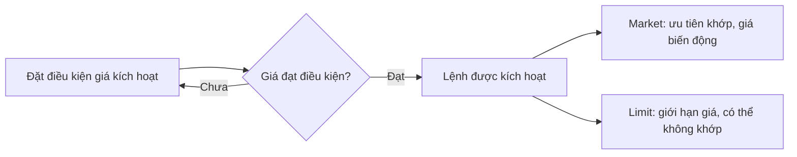

# Lệnh dừng lỗ và cách kết hợp (Stop Loss Order Combinations)

> [!SUMMARY] Một câu tóm tắt
> Lệnh dừng được kích hoạt khi giá chạm điều kiện, nhưng mức dừng không bảo đảm mức giá thực hiện hay giới hạn khoản lỗ.

## 1. Tổng quan

Sau khi hiểu market và limit order, ta có thể xem một họ lệnh dựa trên mức kích hoạt. **Stop order** thường được dùng để gửi lệnh khi giá đạt một ngưỡng định trước; cách kích hoạt và loại lệnh sau đó phụ thuộc quy tắc broker/thị trường. Lệnh dừng có thể hỗ trợ kỷ luật thoát vị thế, song không loại bỏ rủi ro biến động hoặc khoảng trống giá. Bài này kết thúc phần đầu của module trước quiz tổng hợp về thao tác giao dịch.

## 2. Mục tiêu học tập

- [ ] Giải thích mức stop và thời điểm lệnh được kích hoạt.
- [ ] So sánh stop-market với stop-limit.
- [ ] Tính mức lỗ danh nghĩa từ giá vào, giá stop và số cổ phiếu.
- [ ] Nêu hai tình huống khiến giá thực hiện khác xa mức stop.

## 3. Kiến thức cần chuẩn bị

- Bài trước: [Lệnh thị trường và lệnh giới hạn](03-market-order-limit-order.md) — cần hiểu cách market và limit được thực hiện.
- Nhớ rằng giá chứng khoán có thể nhảy qua một mức giá giữa hai lần giao dịch.

## 4. Thử đoán trước

1. Nếu giá mở cửa thấp hơn mức stop của lệnh bán, lệnh có thể thực hiện đúng giá stop không?
2. Lệnh nào đặt một khoảng giá chấp nhận sau khi mức kích hoạt được chạm?

## 5. Kiến thức cốt lõi

### 5.1. Cơ chế lệnh dừng

**Stop price** (giá kích hoạt) là ngưỡng dùng để kích hoạt lệnh theo quy tắc của thị trường. Với vị thế mua, một stop bán thường đặt thấp hơn giá hiện tại để yêu cầu thoát khi giá giảm tới ngưỡng. Khi được kích hoạt, stop có thể chuyển thành market order hoặc limit order; tên gọi và cơ chế cụ thể cần xác minh trong tài liệu broker.

### 5.2. Stop-market và stop-limit

**Stop-market** sau khi kích hoạt gửi lệnh thị trường: thường tăng cơ hội thoát, nhưng giá thực hiện có thể khác mức stop. **Stop-limit** sau khi kích hoạt gửi lệnh giới hạn: kiểm soát mức giá thấp nhất chấp nhận bán (hoặc cao nhất chấp nhận mua), nhưng có thể không khớp nếu thị trường đi xuyên qua giới hạn.

| Kết hợp | Sau khi kích hoạt | Đánh đổi chính |
|---|---|---|
| Stop-market | Market order | Khả năng thực hiện cao hơn, giá không đảm bảo |
| Stop-limit | Limit order | Có giới hạn giá, có nguy cơ không khớp |

## 6. Giải thích chi tiết

Stop không phải là lời hứa rằng khoản lỗ sẽ được chặn chính xác tại ngưỡng. Nếu giá giảm mạnh, mở cửa thấp hơn mức dừng hoặc thanh khoản cạn, stop-market có thể khớp thấp hơn đáng kể. Stop-limit có thể nằm chờ trong khi giá tiếp tục giảm. Một số thị trường/broker dùng giá giao dịch, giá bid/ask hoặc tiêu chí khác để kích hoạt; cần kiểm tra cách tính và thời hạn lệnh. Lệnh dừng cũng có thể bị kích hoạt bởi biến động ngắn hạn rồi giá hồi lại.

> [!WARNING] Cảnh báo
> Ước tính rủi ro bằng giá stop chỉ là phép tính giả định. Gap giá, trượt giá, phí, thuế và thanh khoản có thể khiến khoản lỗ thực tế lớn hơn.

## 7. Ví dụ minh họa

**Ví dụ giả định:** Nhà đầu tư mua 100 cổ phiếu ở 50.000 đồng và đặt stop bán ở 47.000 đồng.

1. Khoảng cách từ giá mua tới stop là 3.000 đồng/cổ phiếu.
2. Mức lỗ danh nghĩa nếu bán đúng stop là 100 × 3.000 = 300.000 đồng, chưa tính phí và thuế.
3. Nếu dùng stop-market nhưng thị trường giảm nhanh và lệnh khớp ở 46.500 đồng, khoản lỗ giá là 100 × 3.500 = 350.000 đồng.
4. Nếu dùng stop-limit với giới hạn bán 46.800 đồng và giá thị trường nhảy xuống 46.500, lệnh có thể chưa khớp. Lúc đó vị thế vẫn còn rủi ro.

## 8. Thực hành

**Bài tự làm:** Một vị thế giả định gồm 80 cổ phiếu mua ở 120. Stop bán kích hoạt tại 114; nhà đầu tư cân nhắc stop-market hoặc stop-limit có giới hạn 113.

- [ ] Tính mức lỗ danh nghĩa nếu bán đúng giá kích hoạt, chưa tính phí.
- [ ] Nêu ưu điểm chính của stop-market.
- [ ] Nêu rủi ro chính của stop-limit nếu giá rơi nhanh xuống 112.

Xem lời giải sau khi đã tự làm

Mức lỗ danh nghĩa = 80 × (120 − 114) = 480 đơn vị tiền. Stop-market thường ưu tiên gửi lệnh bán khi kích hoạt nhưng giá có thể thấp hơn 114. Với stop-limit giới hạn bán 113, khi giá đang ở 112 lệnh có thể không khớp; vị thế vẫn mở và có thể lỗ thêm.

## 9. Những lỗi thường gặp

- **Coi stop là mức lỗ tối đa chắc chắn** — tính đến gap, trượt giá và phí.
- **Nhầm giá kích hoạt với giá khớp** — xác minh stop chuyển thành market hay limit.
- **Đặt stop-limit quá chặt** — có thể không thoát khi giá đi nhanh qua giới hạn.
- **Không kiểm tra cách broker kích hoạt stop** — đọc rõ tiêu chí giá và thời hạn lệnh.

## 10. Giải thích bằng lời của bạn

- Khái niệm: stop price có vai trò gì?
- Vì sao: stop-market và stop-limit có đánh đổi khác nhau thế nào?
- Ví dụ của tôi: tính mức lỗ danh nghĩa cho một số lượng và khoảng cách stop.
- Chỗ tôi chưa chắc: broker áp dụng giá nào để kích hoạt lệnh dừng?

## 11. Câu hỏi ôn tập

### Câu 1

Điều nào thường xảy ra khi stop-market được kích hoạt?

A. Lệnh chuyển thành lệnh thị trường theo quy tắc áp dụng  
B. Lệnh chỉ khớp đúng bằng stop price  
C. Lệnh tự hủy ngay lập tức  
D. Lệnh đảm bảo không có lỗ

**Đáp án:** A. **Giải thích:** Stop-market gửi lệnh thị trường khi điều kiện kích hoạt xảy ra. B và D nhầm ngưỡng kích hoạt với bảo đảm giá/kết quả; C không phải cơ chế chung.

### Câu 2

Khác biệt chính của stop-limit so với stop-market là gì?

A. Stop-limit không có mức kích hoạt  
B. Stop-limit giới hạn giá sau kích hoạt nhưng có thể không khớp  
C. Stop-limit luôn thoát vị thế nhanh hơn  
D. Stop-limit loại bỏ rủi ro gap giá

**Đáp án:** B. **Giải thích:** Sau kích hoạt, stop-limit đặt lệnh giới hạn, nên bảo vệ điều kiện giá nhưng có thể không thực hiện. A, C, D đều khẳng định sai.

### Câu 3

Những yếu tố nào có thể làm khoản lỗ thực tế vượt ước tính tại stop? (chọn nhiều)

A. Gap giá qua mức dừng  
B. Trượt giá do thanh khoản mỏng  
C. Phí và thuế  
D. Mức stop tự động bảo đảm giá khớp

**Đáp án:** A, B, C. **Giải thích:** Gap, trượt giá và chi phí làm kết quả khác phép tính đơn giản. Stop không đảm bảo giá khớp nên D sai.

### Câu 4

Phát biểu sau đúng hay sai: Stop-limit có thể không khớp nếu giá đi nhanh qua giới hạn sau khi kích hoạt.

A. Đúng  
B. Sai

**Đáp án:** A. **Giải thích:** Lệnh limit chỉ thực hiện trong giới hạn chấp nhận; nếu thị trường ở ngoài mức đó, lệnh có thể chờ. Vì vậy B sai.

## 12. Tóm tắt kiến thức

- Stop price kích hoạt lệnh theo quy tắc của broker/thị trường.
- Stop-market ưu tiên thực hiện nhưng không bảo đảm giá.
- Stop-limit giới hạn giá nhưng có thể không thoát được vị thế.
- Gap, thanh khoản, phí và thuế có thể làm lỗ vượt ước tính tại stop.

## 13. Tài liệu tham khảo

1. Investor.gov, “Types of Orders” — phần stop, stop-limit và giới hạn thực thi.
2. FINRA, tài liệu nhà đầu tư về stop orders và biến động thị trường.
3. U.S. Securities and Exchange Commission (SEC), tài liệu giáo dục về loại lệnh và rủi ro thực thi.

## 14. Bài học tiếp theo

[Quiz giao dịch chứng khoán 1](05-quiz-stock-market-trading-quiz-1.md) — quiz giúp tự kiểm tra bid–offer, market/limit và cơ chế lệnh dừng.
