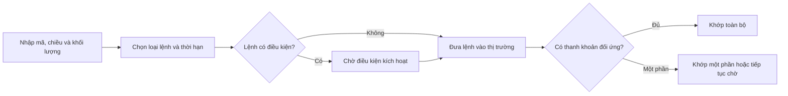

# Hiểu các lựa chọn thực thi giao dịch của broker (Understanding practical trade execution options provided by brokers)

> [!SUMMARY] Một câu tóm tắt
> Khi dùng nền tảng môi giới, hãy chọn cách thực thi phù hợp với ưu tiên về giá, tốc độ và khả năng khớp, rồi kiểm tra lại các điều kiện của lệnh.

## 1. Tổng quan

Sau khi hiểu bid–ask và market, limit, stop, bước tiếp theo là nhìn cách các lệnh này xuất hiện trong giao diện thực tế. Tên gọi có thể khác giữa broker và thị trường, nhưng quyết định cốt lõi vẫn là chấp nhận giá nào, thời hạn nào và điều gì kích hoạt lệnh. Bài này giúp bạn đọc các tùy chọn thực thi như một tập hợp điều kiện, thay vì bấm theo tên quen thuộc. Ví dụ chỉ mang tính giáo dục; quy định, đơn vị lô và quy trình khớp khác nhau theo thị trường.

## 2. Mục tiêu học tập

- [ ] Phân biệt lựa chọn ưu tiên tốc độ với lựa chọn kiểm soát giá.
- [ ] Nêu các trường cần rà soát trước khi gửi lệnh.
- [ ] Giải thích vì sao lệnh có thể khớp một phần hoặc không khớp.
- [ ] Nhận diện rủi ro trượt giá trong điều kiện thị trường thay đổi.

## 3. Kiến thức cần chuẩn bị

- Bài trước: [Quiz: Kiểm tra giao dịch chứng khoán 1](./05-quiz-stock-market-trading-quiz-1.md) — ôn bid, offer, market, limit và stop.
- Khái niệm cần nhớ: giá bid là mức mua chờ cao nhất; offer/ask là mức bán chờ thấp nhất; spread là chênh lệch giữa chúng.

## 4. Thử đoán trước

1. Một lệnh mua market lớn hơn lượng cổ phiếu đang chào bán ở mức tốt nhất có thể được khớp ở bao nhiêu mức giá?
2. Vì sao một lệnh limit có thể chưa khớp dù giá giao dịch gần đây đã chạm mức bạn đặt?

## 5. Kiến thức cốt lõi

### 5.1. Chọn giữa tốc độ và giới hạn giá

**Thực thi lệnh** là quá trình lệnh được chuyển tới nơi khớp và ghép với lệnh đối ứng. Market thường ưu tiên tốc độ/khả năng khớp. Limit đặt ranh giới giá, nhưng mức giá đó có thể không có đủ khối lượng đối ứng.

### 5.2. Các trường cần xem trước khi gửi

| Trường | Câu hỏi cần tự kiểm tra | Tác động có thể có |
|---|---|---|
| Mã và chiều lệnh | Đúng tài sản, mua hay bán? | Tránh giao dịch nhầm |
| Khối lượng | Lô và số lượng có hợp lệ? | Ảnh hưởng quy mô và khả năng khớp |
| Loại lệnh/giá | Market, limit hay điều kiện? | Quyết định đánh đổi giá và khớp |
| Hiệu lực | Trong ngày hay đến khi hủy? | Xác định lệnh còn tồn tại bao lâu |
| Điều kiện kích hoạt | Giá nào, nguồn giá nào? | Quyết định lúc lệnh được gửi ra |

### 5.3. Luồng xử lý đơn giản

### 5.4. Khớp một phần, thời hạn và trượt giá

Lệnh có thể khớp một phần nếu chỉ có một phần khối lượng đối ứng. Lệnh còn lại có thể tiếp tục chờ hoặc bị hủy theo hiệu lực đã chọn. *Slippage* (trượt giá) là chênh lệch giữa giá dự kiến và giá thực tế; thường tăng khi sổ lệnh mỏng, biến động mạnh hoặc lệnh lớn so với thanh khoản.

## 6. Giải thích chi tiết

Broker thường cho chọn loại lệnh, giá, khối lượng, thời hạn hiệu lực và đôi khi điều kiện kích hoạt. Các lựa chọn này không đồng nghĩa với cam kết thực thi. Nơi chuyển lệnh, ưu tiên hàng đợi, quy tắc phiên giao dịch và điều kiện sản phẩm có thể quyết định kết quả.

> [!NOTE]
> Một số nền tảng cung cấp “fill or kill” (khớp toàn bộ hoặc hủy) hoặc “immediate or cancel” (khớp ngay phần có thể, hủy phần còn lại). Tên gọi và hỗ trợ thực tế cần kiểm tra trong tài liệu broker.

Với lệnh market, khớp nhanh không có nghĩa là khớp đúng mức giá đang hiển thị; báo giá có thể thay đổi trước khi lệnh đến nơi. Với limit, giá là ranh giới chấp nhận, không phải lời hứa sẽ được khớp. Điều kiện stop cũng cần xem broker kích hoạt theo giá khớp, bid/ask hay tiêu chí khác, và lệnh sau kích hoạt trở thành market hay limit.

> [!TIP] Trước khi xác nhận
> Đọc màn hình xem trước: mã, mua/bán, số lượng, loại lệnh, giá/điều kiện, hiệu lực và ước tính chi phí. Sau khi gửi, kiểm tra trạng thái “đã nhận”, “một phần”, “khớp” hoặc “bị từ chối”.

## 7. Ví dụ minh họa

**Ví dụ giả định:** Sổ lệnh có offer 100,00 với 300 cổ phiếu và offer kế tiếp 100,20 với 500 cổ phiếu. Một người gửi market buy 500 cổ phiếu.

1. Có 300 cổ phiếu bán ở 100,00 nên phần đầu có thể khớp tại mức đó.
2. Còn 200 cổ phiếu cần khớp; nếu thanh khoản không đổi, phần này có thể khớp ở 100,20.
3. Giá bình quân xấp xỉ $(300×100+200×100,20)/500=100,08$.
4. Giá này cao hơn offer ban đầu vì lệnh đã tiêu thụ thanh khoản ở hai mức. Đây là minh họa đơn giản; sổ lệnh thực tế thay đổi liên tục.

## 8. Thực hành

**Bài tự làm:** Offer tốt nhất là 25,00 cho 100 cổ phiếu; mức kế tiếp là 25,10. Bạn định mua 150 cổ phiếu. Nếu gửi market order, ước tính giá bình quân trong giả định sổ lệnh không đổi là bao nhiêu?

- [ ] Tính giá trị 100 cổ phiếu ở 25,00.
- [ ] Tính giá trị 50 cổ phiếu ở 25,10.
- [ ] Chia tổng giá trị cho 150 và nêu một giới hạn của phép tính.

Xem lời giải sau khi đã tự làm

Tổng giá trị là $100×25+50×25,10=3.755$. Giá bình quân là $3.755/150≈25,033$. Đây chỉ là ước tính vì báo giá và khối lượng có thể đổi trước khi lệnh được khớp.

## 9. Những lỗi thường gặp

- **Cho rằng market bảo đảm giá đang nhìn thấy** — giá có thể thay đổi và lệnh có thể đi qua nhiều mức; kiểm tra thanh khoản và quy mô.
- **Nghĩ limit chắc chắn được khớp** — limit chỉ đặt ranh giới giá; cân nhắc thời gian chờ và khả năng bỏ lỡ giao dịch.
- **Bỏ qua hiệu lực lệnh** — lệnh có thể còn tồn tại sau phiên; xác nhận thời hạn trước khi gửi.
- **Không kiểm tra trạng thái sau đặt lệnh** — lệnh có thể bị từ chối hoặc khớp một phần; mở trang trạng thái/khớp lệnh để đối chiếu.

## 10. Giải thích bằng lời của bạn

- Khái niệm: thực thi lệnh có nghĩa là gì?
- Vì sao: vì sao giá hiển thị không luôn là giá khớp?
- Ví dụ của tôi: tôi sẽ chọn market hay limit trong tình huống nào, và vì sao?
- Chỗ chưa chắc: trường nào trên giao diện broker tôi cần tra cứu thêm?

## 11. Câu hỏi ôn tập

### Câu 1

Một lệnh market buy vượt quá lượng bán đang chờ ở offer tốt nhất. Điều gì có thể xảy ra?

A. Toàn bộ lệnh tự động bị hủy  
B. Phần còn lại có thể khớp ở mức giá bán cao hơn kế tiếp  
C. Broker phải bán toàn bộ đúng offer ban đầu  
D. Lệnh đổi thành limit order

**Đáp án:** B. **Giải thích:** Khi lượng ở mức tốt nhất không đủ, phần còn lại có thể tiêu thụ thanh khoản ở các mức cao hơn. Lệnh không tự hủy hay tự biến thành limit trừ khi có điều kiện riêng; broker không bảo đảm giá ban đầu.

### Câu 2

Lệnh limit buy đặt 40,00 nhưng hiện chỉ có người bán ở 40,20. Kết quả hợp lý nhất là gì?

A. Khớp ở 40,20 vì market đang cao hơn  
B. Khớp chắc chắn ở 40,00  
C. Chờ hoặc không khớp nếu không có người bán ở 40,00 trở xuống  
D. Tự chuyển thành stop order

**Đáp án:** C. **Giải thích:** Limit buy không cho phép mua cao hơn giá giới hạn nên chờ thanh khoản phù hợp hoặc hết hiệu lực. Các lựa chọn kia trái với chức năng giới hạn giá.

### Câu 3

Trường nào giúp xác định lệnh có tiếp tục tồn tại sau khi phiên giao dịch kết thúc hay không?

A. Hiệu lực lệnh  
B. Mã chứng khoán  
C. Chiều mua/bán  
D. Giá đóng cửa hôm trước

**Đáp án:** A. **Giải thích:** Thời hạn/hiệu lực quy định khoảng thời gian lệnh được duy trì. Các trường còn lại quan trọng nhưng không xác định thời hạn.

### Câu 4

Những yếu tố nào có thể làm giá khớp market lệch khỏi báo giá tốt nhất vừa quan sát? (Chọn nhiều.)

A. Lượng đối ứng ở mức tốt nhất không đủ  
B. Giá và thanh khoản thay đổi khi lệnh đang được chuyển  
C. Lệnh lớn so với độ sâu sổ lệnh  
D. Việc đặt tên tài khoản bằng chữ in hoa

**Đáp án:** A, B, C. **Giải thích:** Thiếu thanh khoản, biến động khi chuyển lệnh và quy mô lớn đều có thể dẫn đến trượt giá. Tên tài khoản không ảnh hưởng cơ chế khớp.

### Câu 5

Phát biểu sau đúng hay sai: “Một lệnh limit có thể khớp một phần và phần chưa khớp phụ thuộc vào hiệu lực cũng như quy tắc của lệnh.”

A. Đúng  
B. Sai

**Đáp án:** A. **Giải thích:** Nếu chỉ một phần khối lượng đối ứng khả dụng, lệnh có thể khớp một phần. Phần còn lại có thể tiếp tục chờ hoặc bị hủy theo điều kiện; vì vậy B sai.

### Câu 6

Trước khi xác nhận lệnh, tổ hợp nào cần kiểm tra nhất?

A. Mã, chiều, khối lượng, loại lệnh, giá/điều kiện và hiệu lực  
B. Màu giao diện, kích cỡ chữ và ảnh đại diện  
C. Chỉ giá cổ phiếu hôm qua  
D. Chỉ số lượng người dùng broker

**Đáp án:** A. **Giải thích:** Các trường đó quyết định giao dịch nào được gửi và theo điều kiện gì. Những thông tin còn lại không thay thế việc xác minh lệnh.

## 12. Tóm tắt kiến thức

- Market thường ưu tiên khớp; limit kiểm soát ranh giới giá nhưng có thể không khớp.
- Lệnh có thể khớp một phần hoặc qua nhiều mức giá.
- Thời hạn và điều kiện kích hoạt ảnh hưởng đến vòng đời lệnh.
- Rà soát lệnh và trạng thái sau khi gửi giúp phát hiện sai sót sớm.

## 13. Tài liệu tham khảo

1. Investor.gov — tài liệu giáo dục nhà đầu tư về cách đặt lệnh chứng khoán.
2. U.S. Securities and Exchange Commission (SEC) — Investor Bulletin: Understanding Order Types.
3. FINRA — tài liệu giáo dục về market, limit và stop orders.

## 14. Bài học tiếp theo

[Options to execute trade Part 2](./07-options-to-execute-trade-part-2.md) — bài tiếp theo xem xét thêm các tùy chọn thực thi và cách chọn chúng theo nhu cầu giao dịch.
