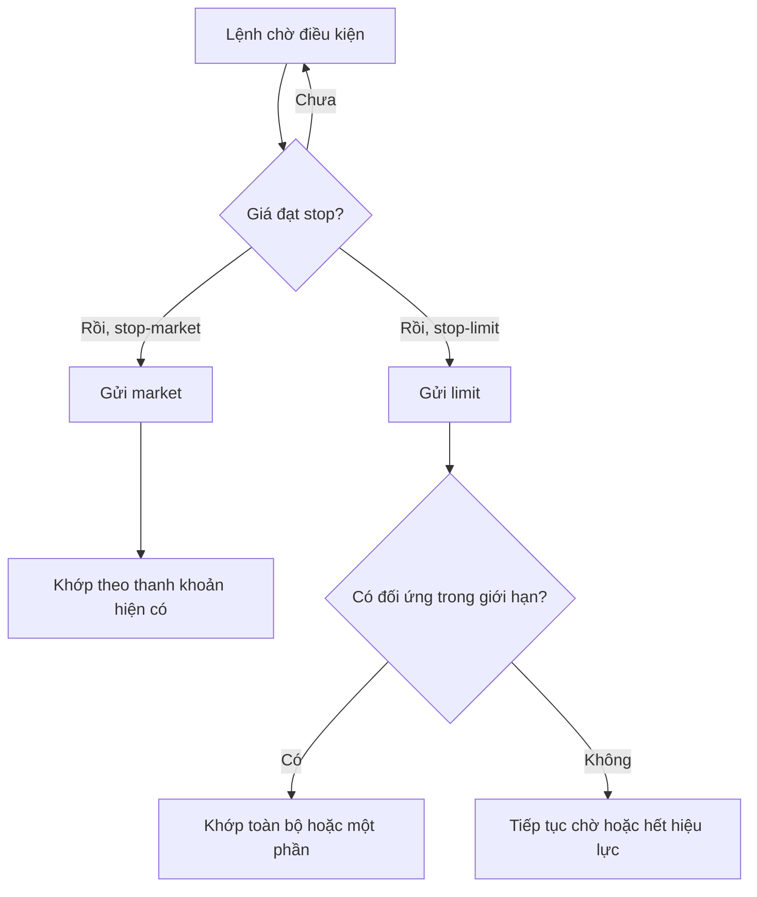

# Các lựa chọn thực thi giao dịch, phần 2 (Options to execute trade Part 2)

> [!SUMMARY] Một câu tóm tắt
> Lệnh điều kiện tự động hóa thời điểm gửi lệnh, nhưng stop price chỉ kích hoạt cơ chế tiếp theo và không tự bảo đảm giá khớp.

## 1. Tổng quan

Bài trước xem xét cách lệnh đi vào thị trường, khớp toàn bộ hay một phần và chịu ảnh hưởng của thanh khoản. Bài này đi sâu vào cách kết hợp mức kích hoạt với kiểu lệnh sau kích hoạt, cùng thời hạn tồn tại của lệnh. Các thuật ngữ trên nền tảng có thể khác nhau, nên cần hiểu cơ chế chứ không chỉ ghi nhớ tên. Những ví dụ dưới đây là giả định để học cách đọc điều kiện, không phải khuyến nghị đặt lệnh.

## 2. Mục tiêu học tập

- [ ] So sánh stop-market và stop-limit.
- [ ] Mô tả vai trò của mức kích hoạt và mức giới hạn.
- [ ] Xác định cách hiệu lực ảnh hưởng lệnh chưa khớp.
- [ ] Nêu giới hạn của lệnh stop trong thị trường biến động.

## 3. Kiến thức cần chuẩn bị

- Bài trước: [Hiểu các lựa chọn thực thi giao dịch của broker](./06-understanding-practical-trade-execution-options-provided-by.md) — ôn khớp một phần, hiệu lực và trượt giá.
- Khái niệm cần nhớ: stop price là mức điều kiện; limit price là ranh giới giá cho lệnh limit.

## 4. Thử đoán trước

1. Nếu giá giảm xuyên qua stop price của một stop-limit sell, vì sao lệnh vẫn có thể chưa bán được?
2. Khi lệnh “trong ngày” hết phiên mà chưa khớp, điều gì thường xảy ra?

## 5. Kiến thức cốt lõi

### 5.1. Stop-market và stop-limit

**Stop-market** chuyển thành lệnh market khi điều kiện stop xảy ra. Nó ưu tiên khả năng thoát/khớp nhưng không bảo đảm mức giá. **Stop-limit** chuyển thành limit khi được kích hoạt; giới hạn giá rõ hơn nhưng có thể không khớp nếu thị trường đi qua mức đó quá nhanh.

| Đặc điểm | Stop-market | Stop-limit |
|---|---|---|
| Khi kích hoạt | Gửi lệnh market | Gửi lệnh limit |
| Ưu tiên | Khả năng khớp | Kiểm soát ranh giới giá |
| Rủi ro nổi bật | Trượt giá | Không khớp khi giá chạy qua limit |
| Giá được bảo đảm? | Không | Không bảo đảm khớp; nếu khớp thì theo giá giới hạn hoặc tốt hơn |

### 5.2. Hai mức giá có vai trò khác nhau

Trong stop-limit thường có hai mức: stop price để kích hoạt và limit price để giới hạn giá thực hiện. Khi đặt lệnh bán, limit thường bằng hoặc thấp hơn stop; với lệnh mua, limit thường bằng hoặc cao hơn stop để lệnh có cơ hội khớp sau kích hoạt. Quy tắc cụ thể tùy nền tảng.

### 5.3. Điều kiện và hiệu lực

Lệnh “day” thường hết hiệu lực cuối ngày giao dịch nếu chưa khớp. Lệnh “good till canceled” (GTC) có thể duy trì nhiều phiên đến khi khớp hoặc bị hủy, nhưng thời hạn tối đa và cách xử lý sự kiện doanh nghiệp tùy broker/sở giao dịch.

## 6. Giải thích chi tiết

Stop là cơ chế kích hoạt, không phải cam kết thoát tại một giá cụ thể. Nếu giá mở cửa tạo khoảng trống qua stop, stop-market có thể khớp xa mức kích hoạt. Stop-limit tránh khớp ngoài giới hạn nhưng có thể nằm chờ trong khi khoản lỗ tiếp tục tăng. Vì vậy, không có một kiểu lệnh tốt nhất cho mọi điều kiện; cần biết bạn ưu tiên khả năng thực hiện hay ranh giới giá.

> [!WARNING] Rủi ro khi thị trường nhảy giá
> Lệnh stop không loại bỏ rủi ro mất mát, và stop-limit không bảo đảm vị thế sẽ đóng. Cổ phiếu kém thanh khoản, tin bất ngờ, ngoài giờ giao dịch và khoảng trống giá đều có thể làm kết quả khác xa dự kiến.

Các kết hợp như bracket/OCO (one-cancels-the-other, một lệnh hủy lệnh kia) có thể ghép mục tiêu chốt lời và mức dừng lỗ. Tuy nhiên, cần xác minh broker hỗ trợ loại lệnh nào, điều kiện kích hoạt dựa trên giá nào, và các nhánh có thực sự liên kết/hủy lẫn nhau hay chỉ được đặt riêng. Không gửi nhiều lệnh bán độc lập nếu điều đó có thể vô tình tạo vị thế bán vượt quá số cổ phiếu đang nắm.

## 7. Ví dụ minh họa

**Ví dụ giả định:** Một nhà đầu tư nắm cổ phiếu đang ở 52. Họ muốn lệnh bán được kích hoạt nếu giá giảm đến 48.

1. Với stop-market sell ở 48, khi điều kiện được chạm, lệnh market được gửi. Nếu giá giảm nhanh xuống 46, khớp có thể xảy ra gần 46 hoặc mức thanh khoản kế tiếp.
2. Với stop-limit sell, stop ở 48 và limit ở 47,50, lệnh chỉ được bán ở 47,50 trở lên sau kích hoạt.
3. Nếu giá nhảy thẳng từ 49 xuống 46, không có người mua ở 47,50 trở lên, lệnh limit có thể chưa khớp.
4. Một cách có thể ưu tiên khớp hơn; cách còn lại kiểm soát giá chặt hơn nhưng có nguy cơ còn vị thế. Đây là đánh đổi cần hiểu trước khi gửi.

## 8. Thực hành

**Bài tự làm:** Bạn đặt stop-limit sell với stop 30,00 và limit 29,70. Giá giảm nhanh từ 30,10 xuống 29,40. Nêu điều kiện kích hoạt đã xảy ra chưa và liệu lệnh có nhất thiết khớp không.

- [ ] Xác định vai trò của 30,00.
- [ ] Xác định ranh giới giá của 29,70.
- [ ] Nêu một lý do lệnh có thể còn chờ.

Xem lời giải sau khi đã tự làm

Stop 30,00 đã bị chạm/vượt nên điều kiện kích hoạt có thể xảy ra theo quy tắc giá của broker. Sau đó lệnh limit sell chỉ chấp nhận 29,70 trở lên. Nếu thị trường đã ở 29,40 và không có người mua ở 29,70 trở lên, lệnh không nhất thiết khớp; nó có thể tiếp tục chờ đến khi hết hiệu lực hoặc bị hủy.

## 9. Những lỗi thường gặp

- **Coi stop price là giá khớp chắc chắn** — đó là mức kích hoạt; xem lệnh sau kích hoạt là market hay limit.
- **Dùng stop-limit mà không tính nguy cơ còn vị thế** — kiểm tra kịch bản giá nhảy qua giới hạn.
- **Quên hiệu lực lệnh** — xác nhận lệnh còn tồn tại trong bao lâu và khi nào phải đặt lại.
- **Đặt nhiều lệnh thoát rời rạc** — kiểm tra quan hệ hủy lẫn nhau để tránh bán vượt số lượng sở hữu.

## 10. Giải thích bằng lời của bạn

- Khái niệm: stop-market khác stop-limit ở điểm nào?
- Vì sao: vì sao mức stop không bảo đảm giá khớp?
- Ví dụ của tôi: tạo một tình huống stop-limit có thể không khớp.
- Chỗ chưa chắc: quy tắc kích hoạt nào trên nền tảng của tôi cần xác minh?

## 11. Câu hỏi ôn tập

### Câu 1

Điều gì xảy ra khi stop-market sell được kích hoạt?

A. Lệnh trở thành limit sell ở đúng stop price
B. Lệnh bị hủy ngay
C. Lệnh trở thành market sell và giá khớp có thể khác stop price
D. Lệnh chỉ thực hiện vào ngày hôm sau

**Đáp án:** C. **Giải thích:** Stop-market gửi lệnh market sau khi điều kiện xảy ra nên khớp theo thanh khoản hiện tại, không được bảo đảm ở stop price. Các lựa chọn khác mô tả sai cơ chế hoặc thêm điều kiện không có.

### Câu 2

Stop-limit sell có stop 20,00 và limit 19,80. Giá giảm nhanh từ 20,05 xuống 19,50. Kết quả nào có thể xảy ra?

A. Lệnh chắc chắn khớp ở 19,80
B. Lệnh được kích hoạt nhưng có thể chưa khớp do giá thấp hơn giới hạn
C. Lệnh tự đổi thành market sell
D. Lệnh được thực hiện ở 20,00

**Đáp án:** B. **Giải thích:** Stop có thể kích hoạt, nhưng limit sell chỉ chấp nhận giá 19,80 trở lên. Nếu không có thanh khoản phù hợp, nó có thể chờ; các lựa chọn còn lại nhầm lẫn giữa kích hoạt và khớp.

### Câu 3

Lệnh “day” thường xử lý thế nào nếu vẫn chưa khớp khi phiên giao dịch kết thúc?

A. Tự động trở thành GTC ở mọi broker
B. Chuyển thành market ở phiên sau
C. Hết hiệu lực theo quy tắc thị trường/broker
D. Được khớp ở giá đóng cửa

**Đáp án:** C. **Giải thích:** Lệnh trong ngày thường bị hủy khi kết thúc phiên nếu chưa khớp, nhưng chi tiết phải kiểm tra ở broker. Không mặc nhiên chuyển thành GTC, market hay khớp giá đóng cửa.

### Câu 4

Chọn các phát biểu đúng về stop-limit. (Chọn nhiều.)

A. Có mức kích hoạt và mức giới hạn giá
B. Bảo đảm lệnh bán được khớp nếu stop đã bị chạm
C. Có thể không khớp khi giá đi qua limit quá nhanh
D. Sau kích hoạt luôn trở thành lệnh market

**Đáp án:** A, C. **Giải thích:** Stop-limit có hai mức giá và lệnh limit sau kích hoạt có thể không khớp. B và D là nhầm lẫn với bảo đảm giá/thực thi của market.

### Câu 5

Phát biểu sau đúng hay sai: “Một stop-market được kích hoạt trong thị trường có khoảng trống giá có thể khớp xa mức stop.”

A. Đúng
B. Sai

**Đáp án:** A. **Giải thích:** Stop chỉ kích hoạt việc gửi lệnh; market khớp theo thanh khoản có sẵn. Nếu giá nhảy qua stop, giá khớp có thể lệch đáng kể.

### Câu 6

Với các lệnh bracket/OCO, điều gì cần xác minh trên nền tảng broker?

A. Chỉ màu nút đặt lệnh
B. Hai lệnh có thật sự liên kết để lệnh này khớp thì lệnh kia bị hủy hay không
C. Cổ phiếu có tăng giá ngày hôm sau không
D. Broker có cho bỏ qua giới hạn số lượng hay không

**Đáp án:** B. **Giải thích:** Liên kết OCO là cơ chế quan trọng để tránh hai nhánh thoát cùng thực hiện ngoài dự kiến. Màu giao diện hay dự báo giá không trả lời vấn đề đó.

## 12. Tóm tắt kiến thức

- Stop price kích hoạt lệnh; loại lệnh sau đó quyết định cách thực thi.
- Stop-market ưu tiên khớp nhưng chịu trượt giá; stop-limit kiểm soát giá nhưng có thể không khớp.
- Hiệu lực lệnh và quy tắc broker quyết định lệnh chờ tồn tại đến khi nào.
- Lệnh kết hợp cần được kiểm tra quan hệ liên kết và nguy cơ tạo giao dịch ngoài ý muốn.

## 13. Tài liệu tham khảo

1. U.S. Securities and Exchange Commission (SEC), Investor Bulletin: Understanding Order Types.
2. FINRA, tài liệu giáo dục nhà đầu tư về stop orders và stop-limit orders.
3. Investor.gov, mục tìm hiểu các loại lệnh giao dịch chứng khoán.

## 14. Bài học tiếp theo

[How do I select a stock broker](./08-how-do-i-select-a-stock-broker.md) — sau khi hiểu các lựa chọn lệnh, bạn sẽ học cách đánh giá đơn vị cung cấp nền tảng và thực thi lệnh.
