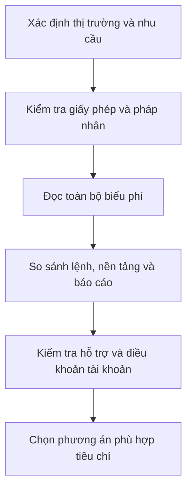

# Cách chọn broker chứng khoán (How do I select a stock broker)

> [!SUMMARY] Một câu tóm tắt
> Broker phù hợp là đơn vị được cấp phép, có chi phí và công cụ rõ ràng, vận hành đáng tin cậy và đáp ứng nhu cầu giao dịch của bạn.

## 1. Tổng quan

Broker (công ty môi giới) là đơn vị cung cấp tài khoản và chuyển lệnh của khách hàng tới thị trường hoặc nơi khớp lệnh. Chọn broker ảnh hưởng đến phí, cách lệnh được thực thi, khả năng tiếp cận thông tin và việc quản lý tài khoản. Người mới thường bị thu hút bởi ứng dụng đẹp hoặc ưu đãi mở tài khoản, nhưng nên kiểm tra cả tư cách pháp lý, biểu phí và dịch vụ hỗ trợ. Tiêu chí cụ thể phụ thuộc quốc gia, loại tài sản và tần suất giao dịch.

## 2. Mục tiêu học tập

- [ ] Nêu ít nhất bốn tiêu chí để so sánh broker.
- [ ] Nhận diện các loại chi phí ngoài phí giao dịch.
- [ ] Mô tả cách xác minh broker qua cơ quan quản lý chính thức.
- [ ] Tạo bảng so sánh dựa trên nhu cầu và không chỉ dựa vào khuyến mại.

## 3. Kiến thức cần chuẩn bị

- Bài trước: [Các lựa chọn thực thi giao dịch, phần 2](./07-options-to-execute-trade-part-2.md) — ôn cách đọc điều kiện lệnh và giới hạn thực thi.
- Khái niệm cần nhớ: broker giữ vai trò trung gian trong mở tài khoản, nhận/chuyển lệnh, sao kê và một số dịch vụ liên quan.

## 4. Thử đoán trước

1. Vì sao phí quảng cáo thấp chưa chắc đồng nghĩa với tổng chi phí thấp?
2. Bạn sẽ kiểm tra ở đâu xem một broker có được phép hoạt động tại thị trường mục tiêu hay không?

## 5. Kiến thức cốt lõi

### 5.1. Tư cách pháp lý và bảo vệ tài sản

Xác minh tên pháp nhân, giấy phép và phạm vi hoạt động trên trang của cơ quan quản lý chứng khoán hoặc sở giao dịch chính thức. Đọc cách tiền và chứng khoán khách hàng được lưu ký, tách biệt và xử lý khi broker gặp vấn đề; cơ chế bảo vệ khác nhau theo quốc gia, không nên giả định có bảo hiểm giống nhau ở mọi nơi.

### 5.2. Tổng chi phí

| Khoản mục | Điều cần hỏi |
|---|---|
| Hoa hồng/phí giao dịch | Tính theo giao dịch, giá trị hay bậc khối lượng? |
| Phí sàn và thuế | Đã gồm trong báo giá phí chưa? |
| Phí dữ liệu/nền tảng | Dữ liệu thời gian thực có tính thêm không? |
| Lãi margin | Lãi suất, cách tính và phí khi thiếu ký quỹ là gì? |
| Rút/chuyển tài sản | Có phí, giới hạn hoặc thời gian xử lý nào? |
| Chuyển đổi ngoại tệ | Tỷ giá áp dụng và chênh lệch quy đổi là bao nhiêu? |

### 5.3. Chất lượng giao dịch và vận hành

Đánh giá các loại lệnh có hỗ trợ, phạm vi tài sản/thị trường, tốc độ và độ ổn định nền tảng, cách cung cấp báo cáo giao dịch, quy trình hỗ trợ khi tài khoản hoặc lệnh gặp sự cố. Chất lượng khớp không chỉ là tốc độ; cần biết broker chuyển lệnh đi đâu và thông tin nào được cung cấp để khách hàng đánh giá.

## 6. Giải thích chi tiết

Bắt đầu bằng nhu cầu thực tế: bạn giao dịch cổ phiếu nội địa hay quốc tế, cần tài khoản tiền mặt hay có cân nhắc ký quỹ, dùng điện thoại hay máy tính, cần báo cáo thuế hoặc dữ liệu nào. Sau đó loại bỏ broker không đáp ứng yêu cầu pháp lý hoặc không minh bạch phí. Cuối cùng so sánh phần còn lại theo các tiêu chí bạn sẽ thật sự dùng.

Một biểu phí “0 đồng” có thể đi kèm phí quy đổi, phí nền tảng, chênh lệch giá hoặc điều kiện khác. Hãy đọc bảng phí và thỏa thuận tài khoản, bao gồm cơ chế xử lý khi lệnh lỗi, chính sách lưu ký và cách khiếu nại. Đánh giá trực tuyến có thể nêu vấn đề hữu ích nhưng không xác minh được tư cách pháp lý.

> [!WARNING] Kiểm tra nguồn chính thức
> Không chuyển tiền chỉ dựa vào quảng cáo, lời mời riêng hoặc tên miền có vẻ giống thương hiệu. Tự truy cập cơ quan quản lý hoặc sở giao dịch để đối chiếu pháp nhân, giấy phép, địa chỉ liên hệ và thông báo cảnh báo.

## 7. Ví dụ minh họa

**Ví dụ giả định:** Lan giao dịch cổ phiếu nội địa vài lần mỗi tháng, không dùng margin. Hai broker đều có ứng dụng và lệnh limit.

1. Broker A miễn hoa hồng nhưng thu phí dữ liệu và phí rút tài sản; Broker B có hoa hồng thấp, không thu các phí đó.
2. Lan lập tổng chi phí dự kiến theo số giao dịch, nhu cầu dữ liệu và số lần rút tiền, thay vì chỉ so hoa hồng.
3. Cô xác minh cả hai pháp nhân trên nguồn quản lý chính thức và đọc điều kiện lưu ký.
4. Sau đó cô kiểm tra độ ổn định, quy trình hỗ trợ và sao kê. Kết quả phù hợp phụ thuộc ưu tiên của Lan; ví dụ không khẳng định một broker nào tốt hơn cho mọi người.

## 8. Thực hành

**Bài tự làm:** So sánh hai broker giả định. A thu 0,10% mỗi giao dịch và phí dữ liệu 50.000 đồng/tháng. B thu 0,15% mỗi giao dịch, không có phí dữ liệu. Bạn dự kiến tổng giá trị giao dịch mua/bán tính phí là 20 triệu đồng/tháng và không cần dữ liệu trả phí.

- [ ] Tính phí giao dịch dự kiến của A và B.
- [ ] Cộng phí dữ liệu của A.
- [ ] Nêu ít nhất hai tiêu chí ngoài chi phí cần kiểm tra trước khi chọn.

Xem lời giải sau khi đã tự làm

Phí giao dịch A là $20.000.000×0,10\%=20.000$ đồng; cộng dữ liệu thành 70.000 đồng. Phí B là $20.000.000×0,15\%=30.000$ đồng. Theo giả định này B thấp hơn 40.000 đồng/tháng, nhưng phải kiểm tra phạm vi phí đã tính, tư cách pháp lý, lưu ký, chất lượng thực thi, hỗ trợ và các chi phí khác trước khi kết luận.

## 9. Những lỗi thường gặp

- **Chọn chỉ vì miễn phí hoặc thưởng mở tài khoản** — tính tổng chi phí và đọc điều kiện ưu đãi.
- **Tin một tên thương hiệu mà không kiểm tra pháp nhân** — xác minh trên cơ sở dữ liệu của cơ quan quản lý.
- **Bỏ qua phí phi giao dịch** — kiểm tra dữ liệu, rút tiền, ngoại tệ, lưu ký và margin.
- **Không đọc quy trình hỗ trợ/sao kê** — tìm hiểu cách xử lý lỗi lệnh, khiếu nại và lấy hồ sơ giao dịch.
- **Chọn quá nhiều tính năng không cần thiết** — ưu tiên yêu cầu thật và tránh trả phí cho dịch vụ không sử dụng.

## 10. Giải thích bằng lời của bạn

- Khái niệm: broker làm gì trong giao dịch chứng khoán?
- Vì sao: vì sao cần xem toàn bộ chi phí thay vì mỗi hoa hồng?
- Ví dụ của tôi: tiêu chí nào quan trọng nhất với nhu cầu của tôi?
- Chỗ chưa chắc: cơ quan quản lý hoặc điều khoản nào tôi cần tra cứu?

## 11. Câu hỏi ôn tập

### Câu 1

Nguồn nào phù hợp nhất để xác minh một công ty môi giới có giấy phép hoạt động?

A. Bài đăng quảng cáo của công ty
B. Trang hoặc cơ sở dữ liệu chính thức của cơ quan quản lý chứng khoán
C. Bình luận ẩn danh trên mạng xã hội
D. Danh sách mã cổ phiếu tăng giá

**Đáp án:** B. **Giải thích:** Cơ quan quản lý là nguồn chính thức để đối chiếu pháp nhân và giấy phép. Quảng cáo, bình luận và dữ liệu giá không xác nhận thẩm quyền pháp lý.

### Câu 2

Một broker công bố hoa hồng bằng 0. Điều nào vẫn cần kiểm tra?

A. Chỉ màu sắc của ứng dụng
B. Không cần kiểm tra khoản phí nào khác
C. Phí dữ liệu, rút tiền, chuyển đổi ngoại tệ và điều kiện thực thi
D. Số lượng quảng cáo của công ty

**Đáp án:** C. **Giải thích:** Tổng chi phí có thể phát sinh ngoài hoa hồng. Giao diện và quảng cáo không thay thế việc đọc biểu phí; phí bằng 0 ở một khoản không đồng nghĩa toàn bộ dịch vụ miễn phí.

### Câu 3

Với người không dùng margin, tiêu chí nào vẫn có ý nghĩa khi chọn broker?

A. Tư cách pháp lý và cách lưu ký tài sản
B. Mức lãi margin cao nhất
C. Số lượng sản phẩm phái sinh tối đa
D. Khả năng vay lớn nhất

**Đáp án:** A. **Giải thích:** Pháp lý và lưu ký quan trọng với mọi chủ tài khoản. Các tiêu chí về vay/margin ít liên quan đến nhu cầu đã nêu và không nên thay thế đánh giá an toàn, dịch vụ.

### Câu 4

Những yếu tố nào nên đưa vào bảng so sánh broker? (Chọn nhiều.)

A. Phí giao dịch và phí phi giao dịch
B. Độ ổn định nền tảng và cách xử lý hỗ trợ
C. Phạm vi loại lệnh và báo cáo tài khoản
D. Lời hứa lợi nhuận từ nhân viên môi giới

**Đáp án:** A, B, C. **Giải thích:** Chi phí, vận hành, công cụ và báo cáo là tiêu chí kiểm tra được. Lời hứa lợi nhuận không phải tiêu chí đáng tin để lựa chọn broker.

### Câu 5

Phát biểu sau đúng hay sai: “Một broker phổ biến trên mạng xã hội đương nhiên được cấp phép ở mọi thị trường mà nhà đầu tư muốn giao dịch.”

A. Đúng
B. Sai

**Đáp án:** B. **Giải thích:** Mức độ phổ biến không chứng minh giấy phép hay phạm vi hoạt động tại từng quốc gia. Cần xác minh pháp nhân và thẩm quyền trên nguồn chính thức.

### Câu 6

Lan không cần dữ liệu thời gian thực trả phí. Broker nào có chi phí dự kiến thấp hơn theo dữ liệu sau: A thu 0,10% hoa hồng cộng 50.000 đồng phí dữ liệu; B thu 0,15% và không phí dữ liệu; tổng giao dịch tính phí là 20 triệu đồng/tháng?

A. A, tổng 20.000 đồng
B. A, tổng 70.000 đồng
C. B, tổng 30.000 đồng
D. Hai bên bằng nhau ở 50.000 đồng

**Đáp án:** C. **Giải thích:** A có 20.000 đồng phí giao dịch cộng 50.000 đồng dữ liệu, tổng 70.000. B thu 30.000 đồng theo giả định, thấp hơn 40.000 đồng. Kết quả chỉ so sánh khoản đã cho; còn cần kiểm tra các chi phí và dịch vụ khác.

## 12. Tóm tắt kiến thức

- Kiểm tra pháp nhân, giấy phép và cơ chế lưu ký bằng nguồn chính thức.
- So sánh tổng chi phí thay vì chỉ nhìn hoa hồng hoặc khuyến mại.
- Đánh giá nền tảng, lệnh hỗ trợ, sao kê và chất lượng hỗ trợ theo nhu cầu.
- Không có một broker phù hợp với tất cả; quyết định cần dựa trên tiêu chí cá nhân và thông tin kiểm chứng được.

## 13. Tài liệu tham khảo

1. Investor.gov — tài liệu về lựa chọn chuyên gia tài chính và kiểm tra đăng ký.
2. U.S. Securities and Exchange Commission (SEC) — Investor Bulletin về cách kiểm tra chuyên gia đầu tư.
3. Ủy ban Chứng khoán Nhà nước Việt Nam (SSC/UBCKNN) — thông tin công khai về tổ chức kinh doanh chứng khoán được cấp phép.

## 14. Bài học tiếp theo

[What is Algorithmic Trading & Should I be doing it.](./09-what-is-algorithmic-trading-should-i-be-doing-it.md) — bài tiếp theo giới thiệu cách thuật toán tự động hóa quyết định và những giới hạn cần cân nhắc.
