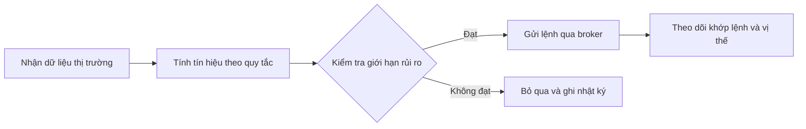

# Giao dịch thuật toán là gì và có nên sử dụng không? (What is Algorithmic Trading & Should I be doing it.)

> [!SUMMARY] Một câu tóm tắt
> Giao dịch thuật toán dùng quy tắc được mã hóa để tạo tín hiệu, quản lý hoặc gửi lệnh; tự động hóa giúp thực hiện nhất quán nhưng không biến một ý tưởng kém thành chiến lược tốt.

## 1. Tổng quan

Sau khi hiểu cách chọn nhà môi giới, bước tiếp theo là tìm hiểu mức độ tự động hóa trong giao dịch. **Algorithmic trading** (giao dịch thuật toán) dùng chương trình và quy tắc xác định để phân tích dữ liệu hoặc thực thi lệnh. Phạm vi có thể chỉ là lệnh định kỳ hoặc một chiến lược tự động từ tín hiệu đến đóng vị thế. Bài này giúp người mới đánh giá công cụ và giới hạn của nó trước khi nghĩ đến triển khai.

## 2. Mục tiêu học tập

Sau bài học, bạn có thể:

- [ ] Giải thích các thành phần cơ bản của quy trình giao dịch tự động.
- [ ] Phân biệt thuật toán tạo tín hiệu và thuật toán thực thi.
- [ ] Nêu ít nhất ba rủi ro vận hành hoặc kiểm thử.
- [ ] Thiết kế các bước kiểm tra trước khi chạy thử.

## 3. Kiến thức cần chuẩn bị

- Bài trước: [Cách chọn nhà môi giới chứng khoán](./08-how-do-i-select-a-stock-broker.md) — cần hiểu nhà môi giới, loại lệnh, phí và chất lượng khớp lệnh.
- Nhớ rằng lệnh có thể không khớp đúng giá kỳ vọng; phí và trượt giá ảnh hưởng kết quả.

## 4. Thử đoán trước

1. Nếu chương trình gửi lệnh nhanh hơn con người, điều đó có đảm bảo chiến lược sinh lời không?
2. Bạn sẽ kiểm tra gì trước khi cho phần mềm đặt lệnh bằng tiền thật?

## 5. Kiến thức cốt lõi

### 5.1. Thuật toán tự động hóa phần nào?

Một thuật toán có thể lọc dữ liệu, tính tín hiệu, xác định số lượng, đặt lệnh hoặc giám sát điều kiện dừng. Hệ thống thường gồm dữ liệu đầu vào, quy tắc, bộ quản lý rủi ro, kết nối broker và nhật ký. Tự động hóa thực thi không đồng nghĩa với việc máy tìm được chiến lược có lợi thế.

### 5.2. Các mục đích thường gặp

| Loại hệ thống | Công việc chính | Ví dụ |
|---|---|---|
| Tạo tín hiệu | Phát hiện điều kiện mua/bán | Cảnh báo khi giá vượt ngưỡng |
| Thực thi | Chia hoặc gửi lệnh có kiểm soát | Chia lệnh lớn thành nhiều lệnh nhỏ |
| Tự động đầu-cuối | Tạo tín hiệu, kiểm soát, đặt lệnh | Chạy theo lịch với hạn mức rủi ro |

### 5.3. Kết quả thử nghiệm không phải lời hứa

**Backtesting** (kiểm thử bằng dữ liệu quá khứ) cho biết quy tắc đã hoạt động ra sao trong dữ liệu được chọn. Kết quả có thể sai lệch nếu bỏ qua phí, cổ tức, trượt giá, thanh khoản hoặc vô tình dùng dữ liệu tương lai. **Overfitting** (quá khớp) xảy ra khi tinh chỉnh quá nhiều tham số để làm đẹp lịch sử; mô hình có thể ghi nhớ quá khứ nhưng kém trên dữ liệu mới.

## 6. Giải thích chi tiết

Thuật toán có thể giảm quyết định bốc đồng và lặp lại quy trình nhất quán. Nó cũng có thể phản ứng nhanh khi điều kiện xuất hiện. Nhưng tốc độ khuếch đại cả lỗi: dữ liệu sai, múi giờ lệch, nhầm đơn vị tiền, lỗi kết nối hoặc quy tắc thoát thiếu đều có thể tạo chuỗi lệnh ngoài dự kiến.

Đánh giá chiến lược qua nhiều giai đoạn, tách dữ liệu phát triển khỏi dữ liệu kiểm tra, và tính cả chi phí cùng giới hạn thanh khoản. Mô phỏng có thể phát hiện lỗi thao tác nhưng không tái hiện hoàn hảo tâm lý, độ trễ và khớp lệnh thật.

> [!WARNING] Cảnh báo
> Không cấp quyền giao dịch không giới hạn cho chương trình chưa được giám sát. Đặt hạn mức số lượng, giá trị, mức lỗ và số lệnh; biết cách ngắt hệ thống và kiểm tra quyền API.

> [!TIP] Mẹo
> Bắt đầu bằng quy tắc đơn giản, nhật ký dễ đọc và chế độ chỉ cảnh báo. Chỉ cân nhắc tự động gửi lệnh sau khi hiểu cách hệ thống phản ứng với lỗi.

## 7. Ví dụ minh họa

**Ví dụ giả định:** Một nhà đầu tư thử quy tắc cảnh báo khi giá đóng cửa vượt đường trung bình 20 ngày. Dữ liệu lịch sử cho kết quả gộp 8%.

1. Tính lại sau phí và trượt giá; kết quả còn 5%. Chi phí thực thi là một phần của chiến lược.
2. Kiểm tra giai đoạn thị trường giảm và dữ liệu chưa dùng để xây quy tắc. Kết quả âm ở một giai đoạn cho thấy hiệu quả không ổn định.
3. Chạy mô phỏng với giới hạn mỗi lệnh 2 triệu đồng và nhật ký. Đây là kiểm tra vận hành, không phải bằng chứng lợi nhuận tương lai.

## 8. Thực hành

**Bài tự làm:** Quy tắc cảnh báo cổ phiếu giảm 3% trong ngày. Viết ba rủi ro và ba kiểm soát trước khi tự động gửi lệnh.

- [ ] Tách rủi ro dữ liệu khỏi rủi ro khớp lệnh.
- [ ] Đặt giới hạn số lượng hoặc giá trị lệnh.
- [ ] Nêu cách dừng chương trình khi bất thường.

Xem lời giải sau khi đã tự làm

Rủi ro có thể gồm dữ liệu trễ/sai, trượt giá khi giá biến động nhanh, và lặp lệnh khi kết nối chập chờn. Kiểm soát gồm xác thực thời điểm dữ liệu, giới hạn giá trị/số lệnh, chống gửi lặp, mô phỏng, nhật ký và công tắc dừng. Các đáp án khác hợp lý nếu nêu rõ cơ chế.

## 9. Những lỗi thường gặp

- **Coi kiểm thử quá khứ là dự báo chắc chắn** — kiểm tra dữ liệu ngoài mẫu và nhiều điều kiện.
- **Bỏ qua phí và trượt giá** — đưa chi phí thực tế vào mô phỏng.
- **Tối ưu quá nhiều tham số** — dùng quy tắc dễ giải thích và dữ liệu kiểm tra độc lập.
- **Để hệ thống chạy không giám sát** — đặt hạn mức và cách ngắt khẩn cấp.

## 10. Giải thích bằng lời của bạn

- Khái niệm: Thuật toán giao dịch là gì và phần nào được tự động hóa?
- Vì sao: Vì sao tốc độ không đảm bảo lợi nhuận?
- Ví dụ của tôi: Một quy tắc tôi hiểu rõ có thể tự động hóa là gì?
- Chỗ chưa chắc: Rủi ro vận hành nào tôi cần tìm hiểu thêm?

## 11. Câu hỏi ôn tập

### Câu 1

Giao dịch thuật toán được mô tả chính xác nhất là gì?

A. Dùng quy tắc được mã hóa để phân tích hoặc thực thi giao dịch  
B. Mua cổ phiếu mà không xác định rủi ro  
C. Một loại tài khoản luôn miễn phí  
D. Cam kết lợi nhuận nhờ tốc độ máy tính

**Đáp án:** A. **Giải thích:** A mô tả tự động hóa theo quy tắc. B bỏ qua rủi ro; C không phải định nghĩa; D sai vì tốc độ không bảo đảm kết quả.

### Câu 2

Backtesting một chiến lược có mục đích chính nào?

A. Bảo đảm chiến lược lãi năm tới  
B. Xem quy tắc đã hoạt động thế nào trên dữ liệu quá khứ  
C. Bỏ qua chi phí giao dịch  
D. Thay thế mọi kiểm tra vận hành

**Đáp án:** B. **Giải thích:** B là mục đích kiểm thử lịch sử. A khẳng định quá mức; C làm sai lệch kết quả; D bỏ qua lỗi kết nối và khớp lệnh.

### Câu 3

Biện pháp nào giúp giảm rủi ro khi thử hệ thống tự động? (Chọn nhiều.)

A. Đặt hạn mức giá trị hoặc số lượng lệnh  
B. Cấp quyền API rộng nhất  
C. Chạy mô phỏng và kiểm tra dữ liệu ngoài mẫu  
D. Tắt nhật ký

**Đáp án:** A, C. **Giải thích:** A giới hạn thiệt hại tiềm tàng; C giúp phát hiện lỗi/quá khớp. B tăng quyền không cần thiết; D cản trở truy vết.

### Câu 4

Phát biểu sau đúng hay sai: “Chiến lược tốt trên dữ liệu quá khứ chắc chắn tiếp tục sinh lời.”

A. Đúng  
B. Sai

**Đáp án:** B. **Giải thích:** Kết quả lịch sử phụ thuộc dữ liệu và giả định; điều kiện tương lai có thể khác.

## 12. Tóm tắt kiến thức

- Thuật toán có thể tạo tín hiệu, quản lý hoặc thực thi lệnh theo quy tắc.
- Tự động hóa giúp nhất quán nhưng không tự tạo lợi thế.
- Dữ liệu, quá khớp, phí, trượt giá và lỗi vận hành đều ảnh hưởng kết quả.
- Cần thử nghiệm, hạn mức và giám sát trước khi dùng vốn thật.

## 13. Tài liệu tham khảo

1. SEC, Investor.gov — tài liệu giáo dục về giao dịch và rủi ro thị trường.
2. CFA Institute — tài liệu về kiểm thử chiến lược và quản trị rủi ro đầu tư.
3. Sở giao dịch hoặc cơ quan quản lý nơi mở tài khoản — quy định về giao dịch tự động.

## 14. Bài học tiếp theo

[Đầu tư bao nhiêu tiền vào thị trường chứng khoán](./10-how-much-money-should-you-invest-in-the-stock-market.md) — tiếp theo xác định quy mô vốn dựa trên mục tiêu, thời hạn và khả năng chịu lỗ.
