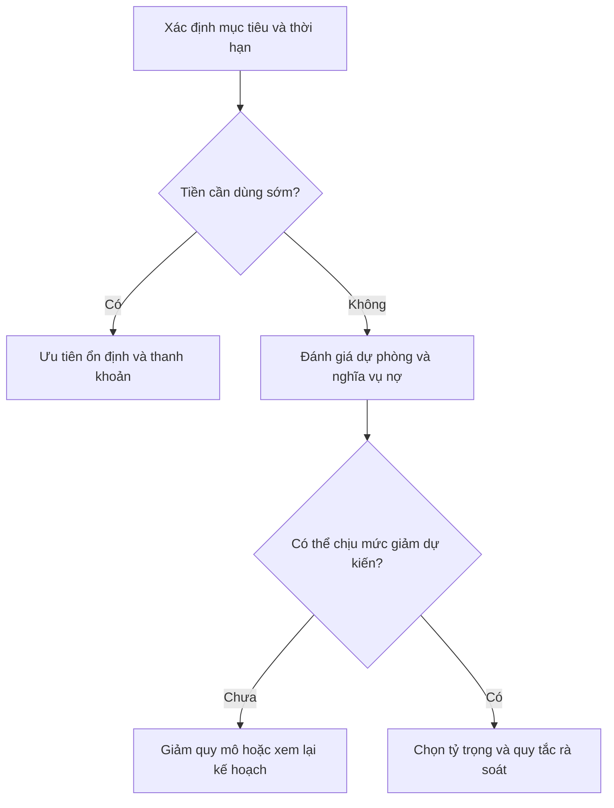

# Nên đầu tư bao nhiêu tiền vào thị trường chứng khoán? (How much money should you invest in the stock market)

> [!SUMMARY] Một câu tóm tắt
> Số vốn dành cho chứng khoán nên xuất phát từ kế hoạch tài chính và mức lỗ có thể chịu được, chứ không từ một con số áp dụng cho tất cả.

## 1. Tổng quan

Sau khi xem xét công cụ giao dịch, ta chuyển sang câu hỏi nền tảng hơn: bao nhiêu vốn có thể dành cho thị trường. Câu trả lời phụ thuộc vào thu nhập, chi tiêu, nợ, quỹ dự phòng, mục tiêu và thời điểm cần dùng tiền. Cổ phiếu có thể giảm mạnh trong ngắn hạn, nên tiền cho nhu cầu thiết yếu hoặc mục tiêu gần không mặc nhiên là vốn dài hạn. Bài này đưa ra quy trình suy nghĩ, không phải khuyến nghị tỷ lệ cho cá nhân.

## 2. Mục tiêu học tập

Sau bài học, bạn có thể:

- [ ] Sắp xếp các ưu tiên tài chính trước khi đầu tư.
- [ ] Phân biệt tiền đầu tư với tiền dự phòng và tiền cho mục tiêu gần.
- [ ] Tính tỷ trọng một khoản trong danh mục.
- [ ] Ghi giới hạn rủi ro và thời hạn cho kế hoạch.

## 3. Kiến thức cần chuẩn bị

- Bài trước: [Giao dịch thuật toán là gì và có nên sử dụng không?](./09-what-is-algorithmic-trading-should-i-be-doing-it.md) — hiểu rằng công cụ không thay thế quản trị rủi ro.
- Danh mục là toàn bộ các khoản đầu tư; tỷ trọng là phần trăm của một khoản so với tổng danh mục.

## 4. Thử đoán trước

1. Nếu tiền cần dùng trong sáu tháng, điều gì xảy ra nếu thị trường giảm ngay lúc cần rút?
2. Bạn xem xét điều gì trước khi chọn tỷ lệ vốn dành cho cổ phiếu?

## 5. Kiến thức cốt lõi

### 5.1. Ưu tiên nền tảng tài chính

Trước khi đầu tư, hãy xem dòng tiền, nghĩa vụ nợ, quỹ dự phòng và mục tiêu. Khoản vay lãi cao có thể làm chi phí tăng nhanh; dự phòng giúp tránh phải bán tài sản biến động vào thời điểm bất lợi. Không có mức dự phòng hay tỷ lệ cổ phiếu phù hợp mọi hoàn cảnh.

### 5.2. Thời hạn và khả năng chịu biến động

Tiền có thời điểm sử dụng gần thường ít có khả năng chờ thị trường hồi phục. Với mục tiêu dài hạn, nhà đầu tư vẫn cần chấp nhận khả năng danh mục giảm đáng kể. **Risk tolerance** (khả năng chấp nhận rủi ro) gồm năng lực tài chính và mức sẵn lòng chịu biến động mà không phá vỡ kế hoạch.

### 5.3. Đo tỷ trọng thay vì chỉ nhìn số tiền

$$
	ext{Tỷ trọng khoản đầu tư} = rac{	ext{Giá trị khoản đầu tư}}{	ext{Tổng giá trị danh mục}} 	imes 100\%
$$

Tỷ trọng giúp nhận ra mức tập trung. Một khoản có thể chiếm phần lớn danh mục dù số tiền tuyệt đối không lớn; vay để đầu tư cũng làm rủi ro tăng.

## 6. Giải thích chi tiết

Đừng chọn vốn bằng số tiền tối đa broker cho vay. Hãy tự hỏi nếu khoản đầu tư giảm 20%, 30% hoặc hơn, bạn còn trả được chi phí và giữ mục tiêu không. Những con số này là kịch bản kiểm tra, không phải dự báo. Tính thêm phí, thuế áp dụng, nhu cầu thanh khoản và khả năng thu nhập thay đổi.

Đầu tư theo từng đợt có thể giảm phụ thuộc vào một thời điểm mua, nhưng không loại bỏ rủi ro thị trường và có thể cho kết quả khác đầu tư một lần. Rà soát theo mục tiêu và tỷ trọng giúp điều chỉnh kế hoạch; tránh đổi liên tục chỉ vì biến động ngắn hạn.

> [!WARNING] Cảnh báo
> Không đầu tư tiền vay hoặc tiền cần cho chi phí thiết yếu nếu khoản lỗ có thể khiến bạn mất khả năng thanh toán. Đòn bẩy có thể làm tổn thất vượt vốn dự định mạo hiểm.

> [!NOTE]
> Đây là nội dung giáo dục tổng quát. Thuế, bảo vệ nhà đầu tư và sản phẩm khác nhau theo quốc gia; kiểm tra quy định nơi bạn cư trú.

## 7. Ví dụ minh họa

**Ví dụ giả định:** Một người có tài sản tài chính 300 triệu đồng. Họ tách 60 triệu làm dự phòng và 40 triệu cho học phí đến hạn trong năm, rồi cân nhắc đầu tư 50 triệu vào cổ phiếu.

1. Khoản dự kiến đầu tư chiếm $50/300 	imes 100\%=16{,}7\%$ tổng tài sản, hoặc $50/(300-60-40)=25\%$ phần còn lại sau hai mục tiêu.
2. Nếu 50 triệu giảm 30%, giá trị giảm 15 triệu. Người đó cần cân nhắc ảnh hưởng đến nghĩa vụ tài chính và khả năng giữ kế hoạch.
3. Nếu mức giảm không phù hợp, họ có thể giảm vốn hoặc xem lại thời hạn, mục tiêu. Ví dụ không đưa ra tỷ lệ khuyến nghị.

## 8. Thực hành

**Bài tự làm:** Tài sản tài chính giả định 200 triệu đồng; giữ 50 triệu dự phòng, 30 triệu cho mục tiêu trong 9 tháng và cân nhắc đầu tư 24 triệu.

- [ ] Tính tỷ trọng 24 triệu trên tổng tài sản.
- [ ] Tính tỷ trọng trên phần còn lại sau hai khoản đã tách.
- [ ] Tính số tiền giảm nếu khoản đầu tư giảm 25%.

Xem lời giải sau khi đã tự làm

Tỷ trọng trên tổng tài sản là $24/200=12\%$. Phần còn lại là $200-50-30=120$ triệu; 24 triệu chiếm $24/120=20\%$. Giảm 25% tương ứng $24 	imes 25\%=6$ triệu, còn 18 triệu trước phí/thuế. Đây là phép tính minh họa, không đánh giá mức phù hợp cá nhân.

## 9. Những lỗi thường gặp

- **Đầu tư tiền sắp cần dùng** — ghép thời hạn tài sản với thời điểm mục tiêu.
- **Bỏ qua nợ và dự phòng** — lập bảng dòng tiền trước khi xác định vốn.
- **Chỉ nhìn số tiền danh nghĩa** — xem tỷ trọng và kịch bản giảm giá toàn danh mục.
- **Dùng margin để tăng vốn** — hiểu lãi vay, yêu cầu ký quỹ và nguy cơ bán giải chấp.

## 10. Giải thích bằng lời của bạn

- Khái niệm: “Vốn có thể đầu tư” khác tổng tiền tiết kiệm ra sao?
- Vì sao: Vì sao thời điểm cần tiền ảnh hưởng phân bổ?
- Ví dụ của tôi: Một kịch bản giảm giá cần kiểm tra là gì?
- Chỗ chưa chắc: Khoản chi hoặc rủi ro nào chưa tính vào kế hoạch?

## 11. Câu hỏi ôn tập

### Câu 1

Yếu tố nào nên xem xét trước khi xác định vốn dành cho cổ phiếu?

A. Hạn mức vay tối đa broker chấp thuận  
B. Mã đang được bàn luận nhiều nhất  
C. Mục tiêu, thời hạn, dòng tiền và khả năng chịu lỗ  
D. Mức tăng của chỉ số tuần trước

**Đáp án:** C. **Giải thích:** C gắn quy mô vốn với kế hoạch và năng lực tài chính. A là tín dụng chứ không phải mức phù hợp; B và D không phản ánh hoàn cảnh cá nhân.

### Câu 2

Danh mục 80 triệu đồng có 20 triệu ở một khoản đầu tư. Tỷ trọng khoản đó là bao nhiêu?

A. 20%  
B. 25%  
C. 40%  
D. 60%

**Đáp án:** B. **Giải thích:** $20/80 	imes 100\%=25\%$. A nhầm số tiền với phần trăm; C và D sai phép chia.

### Câu 3

Những khoản nào nên cân nhắc tách riêng trước khi chọn vốn đầu tư? (Chọn nhiều.)

A. Tiền chi phí thiết yếu và dự phòng  
B. Khoản phải trả nợ theo kế hoạch  
C. Tiền đầu tư được coi là chắc chắn sinh lời  
D. Tiền cho mục tiêu sắp đến hạn

**Đáp án:** A, B, D. **Giải thích:** A, B, D là nghĩa vụ hoặc mục tiêu cần tính trước. C sai vì không khoản đầu tư nào chắc chắn sinh lời.

### Câu 4

Phát biểu sau đúng hay sai: “Đầu tư dài hạn thì không cần quan tâm khả năng chịu mức giảm lớn.”

A. Đúng  
B. Sai

**Đáp án:** B. **Giải thích:** Thời hạn dài không loại bỏ biến động hay nhu cầu thanh khoản; mức giảm vẫn có thể ảnh hưởng kế hoạch.

## 12. Tóm tắt kiến thức

- Xem mục tiêu, thời hạn, dòng tiền, nợ và dự phòng trước khi chọn vốn.
- Khả năng chịu rủi ro gồm năng lực tài chính và tâm lý.
- Tỷ trọng giúp nhìn mức tập trung tốt hơn con số đơn lẻ.
- Kiểm tra kịch bản giảm giá; tránh dùng tiền thiết yếu hoặc đòn bẩy chưa hiểu rõ.

## 13. Tài liệu tham khảo

1. Investor.gov — tài liệu về phân bổ tài sản, đa dạng hóa và thời hạn đầu tư.
2. CFA Institute — tài liệu giáo dục về hoạch định danh mục và khả năng chấp nhận rủi ro.
3. Ủy ban Chứng khoán Nhà nước Việt Nam — thông tin phổ biến kiến thức và cảnh báo nhà đầu tư.

## 14. Bài học tiếp theo

[Đầu tư bao nhiêu tiền vào một cổ phiếu cụ thể](./11-how-much-money-should-you-invest-in-a-particular-stock.md) — bài tiếp theo thu hẹp từ tỷ trọng toàn thị trường sang rủi ro của từng vị thế.
