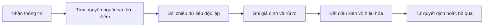

# Tìm nguồn thông tin chứng khoán đáng tin cậy (Where do I find good stock market tips)

> [!SUMMARY] Một câu tóm tắt
> Không có “mẹo” nào bảo đảm lợi nhuận; hãy truy nguyên thông tin, kiểm tra dữ liệu và xác định điều gì sẽ làm luận điểm sai trước khi ra quyết định.

## 1. Tổng quan

Nhà đầu tư mới thường gặp lời khuyên mua bán từ mạng xã hội, nhóm trò chuyện, bản tin và người quen. Một thông tin nghe thuyết phục vẫn có thể thiếu bối cảnh, lỗi thời hoặc được chia sẻ bởi người có lợi ích riêng. Bài này đưa ra cách sàng lọc nguồn và biến một lời mách thành giả thuyết cần kiểm tra. Bài tiếp theo giới thiệu quỹ tương hỗ như một hình thức đầu tư tập thể.

## 2. Mục tiêu học tập

- [ ] Phân biệt lời mách với luận điểm dựa trên bằng chứng.
- [ ] Kiểm tra nguồn gốc, ngày công bố và lợi ích liên quan.
- [ ] Viết được điều kiện xác nhận và điều kiện vô hiệu hóa một giả thuyết.

## 3. Kiến thức cần chuẩn bị

- Bài trước: [Quiz Futures & Options](./16-quiz-futures-options-quiz.md) — ôn lại rủi ro khi hành động dựa trên sản phẩm và đòn bẩy phức tạp.
- Cần nhớ: thông tin không thay thế kế hoạch vốn, khẩu vị rủi ro hoặc nghiên cứu độc lập.

## 4. Thử đoán trước

1. Một người đăng “cổ phiếu này chắc chắn tăng” cần đưa ra bằng chứng nào để lời nói đó có thể kiểm tra?
2. Vì sao thời điểm công bố thông tin quan trọng không kém nội dung của nó?

## 5. Kiến thức cốt lõi

### 5.1. Lời mách khác luận điểm

**Lời mách (stock tip)** thường là kết luận ngắn như “mua mã X”. **Luận điểm** giải thích vì sao giá có thể thay đổi, dựa trên dữ liệu, giả định, thời hạn và rủi ro. Luận điểm có thể sai; giá trị của nó nằm ở khả năng kiểm tra và cập nhật, không phải ở sự tự tin của người chia sẻ.

### 5.2. Bộ lọc nguồn thông tin

| Điều cần kiểm tra | Câu hỏi thực tế |
|---|---|
| Nguồn gốc | Dữ liệu đến từ báo cáo doanh nghiệp, sở giao dịch hay nguồn không rõ? |
| Thời điểm | Thông tin còn mới không, hay giá đã phản ánh từ trước? |
| Bằng chứng | Có số liệu và phương pháp để người khác kiểm tra không? |
| Lợi ích | Người chia sẻ đang nắm giữ, quảng bá hay được trả tiền không? |
| Thanh khoản | Mã có giao dịch đủ sâu để vào và thoát với chi phí hợp lý không? |

## 6. Giải thích chi tiết

Ưu tiên hồ sơ công bố thông tin, báo cáo tài chính, thông báo của cơ quan quản lý và dữ liệu sở giao dịch. Nguồn thứ cấp có thể giúp phát hiện câu hỏi, nhưng cần truy lại tài liệu gốc. So sánh ngày đăng với kỳ dữ liệu: một con số quý trước có thể bị trình bày như tình hình hiện tại. Kiểm tra xem người viết có nêu cả bằng chứng bất lợi, giả định và rủi ro hay chỉ nhấn mạnh khả năng tăng giá.

> [!WARNING] Cảnh báo
> Tin “nội bộ”, lời hứa lợi nhuận chắc chắn, lời thúc giục chuyển tiền gấp hoặc yêu cầu giữ bí mật là dấu hiệu cần dừng lại và xác minh. Không chia sẻ thông tin trọng yếu chưa công bố; quy định chống thao túng và giao dịch nội gián tùy thị trường.

Một luận điểm tốt không tự động tạo ra giao dịch tốt. Giá mua, quy mô, thời hạn, phí và khả năng chịu lỗ vẫn quan trọng. Thông tin chính xác cũng có thể không dự đoán được phản ứng giá vì kỳ vọng đã nằm trong giá hoặc thị trường diễn giải khác nhau.

## 7. Ví dụ minh họa

**Ví dụ giả định:** Một bài đăng nói doanh thu công ty A tăng 30% và khuyên mua ngay.

1. Tìm báo cáo gốc để xác nhận con số, kỳ so sánh và liệu đó là doanh thu hay lợi nhuận.
2. Kiểm tra tăng trưởng đến từ hoạt động cốt lõi hay một khoản bất thường; xem nợ, dòng tiền và hướng dẫn của doanh nghiệp.
3. So sánh ngày báo cáo với diễn biến giá và thông tin đã công bố; con số tốt có thể đã được kỳ vọng.
4. Viết điều kiện bác bỏ: chẳng hạn tăng trưởng không duy trì hoặc biên lợi nhuận giảm mạnh. Chưa đủ bằng chứng thì kết luận hợp lý là tiếp tục tìm hiểu, không phải bắt buộc giao dịch.

## 8. Thực hành

**Bài tự làm:** Bạn nhận được lời mách rằng một công ty sắp có “tin lớn”. Hãy lập quy trình kiểm tra trước khi hành động.

- [ ] Ghi nguồn gốc và ngày đăng.
- [ ] Tìm công bố chính thức hoặc dữ liệu độc lập để đối chiếu.
- [ ] Nêu một lợi ích/xung đột có thể có của người chia sẻ.
- [ ] Viết một giả định và một điều kiện khiến luận điểm không còn đúng.

Xem lời giải sau khi đã tự làm

Không có đáp án giao dịch duy nhất. Một quy trình hợp lý là xác định tác giả và ngày đăng, tìm thông báo chính thức, kiểm tra tính trọng yếu và bối cảnh, tìm dấu hiệu quảng bá hoặc nắm giữ, rồi ghi giả định/rủi ro. Nếu không xác minh được tin đồn, không nên xem nó là bằng chứng.

## 9. Những lỗi thường gặp

- **Tin người nói tự tin** — kiểm tra bằng chứng và hồ sơ của nguồn thay vì giọng điệu.
- **Chỉ tìm dữ liệu ủng hộ** — chủ động tìm phản chứng và rủi ro.
- **Dùng số liệu lỗi thời** — đọc ngày công bố và kỳ báo cáo.
- **Nhầm tin đúng với cơ hội có lãi** — xem kỳ vọng, định giá, chi phí và khả năng thua lỗ.

## 10. Giải thích bằng lời của bạn

- Khái niệm: lời mách khác luận điểm có thể kiểm chứng ra sao?
- Vì sao: vì sao phải kiểm tra cả thời điểm và lợi ích người chia sẻ?
- Ví dụ của tôi: tôi sẽ xác minh một thông tin chứng khoán như thế nào?
- Chỗ tôi chưa chắc: nguồn dữ liệu chính thức nào cần tìm thêm?

## 11. Câu hỏi ôn tập

### Câu 1

Khi nhận lời khuyên mua một cổ phiếu, bước nào giúp đánh giá cơ sở của lời khuyên tốt nhất?

A. Kiểm tra nguồn gốc, dữ liệu, thời điểm và giả định  
B. Mua ngay nếu nhiều người cùng đăng  
C. Chỉ xem giá đã tăng bao nhiêu hôm nay  
D. Tin người có lượng người theo dõi lớn nhất

**Đáp án:** A. **Giải thích:** A biến lời mách thành thông tin có thể kiểm tra. Số người đăng, biến động trong ngày hay độ nổi tiếng không xác minh luận điểm.

### Câu 2

Vì sao cần kiểm tra ngày công bố của dữ liệu?

A. Dữ liệu cũ luôn sai  
B. Giá cổ phiếu chỉ đổi vào ngày công bố  
C. Thông tin có thể đã lỗi thời hoặc đã được thị trường phản ánh  
D. Ngày công bố cho biết chắc chắn giá tương lai

**Đáp án:** C. **Giải thích:** Tính mới và thời điểm thị trường tiếp nhận ảnh hưởng cách diễn giải. Dữ liệu cũ không nhất thiết sai, nhưng không luôn mô tả hiện tại; ngày công bố không dự báo giá.

### Câu 3

Những dấu hiệu nào nên khiến người đọc xác minh kỹ hơn? (chọn nhiều)

A. Có liên kết tới báo cáo chính thức  
B. Cam kết lợi nhuận chắc chắn  
C. Thúc giục chuyển tiền gấp và giữ bí mật  
D. Nêu giả định và cả rủi ro bất lợi

**Đáp án:** B, C. **Giải thích:** Cam kết chắc chắn và áp lực bí mật/gấp là dấu hiệu cảnh giác. A và D giúp kiểm chứng, dù vẫn cần đọc và xác thực nội dung.

### Câu 4

Phát biểu sau đúng hay sai: “Một thông tin chính xác đồng nghĩa cổ phiếu chắc chắn tăng giá.”

A. Đúng  
B. Sai

**Đáp án:** B. **Giải thích:** Kỳ vọng có thể đã nằm trong giá, hoặc thị trường đánh giá triển vọng khác. Thông tin đúng không bảo đảm chiều biến động.

## 12. Tóm tắt kiến thức

- Lời mách chỉ là điểm bắt đầu; luận điểm cần dữ liệu, giả định và rủi ro.
- Ưu tiên nguồn gốc chính thức và kiểm tra thời điểm của thông tin.
- Tìm cả bằng chứng phản bác, xung đột lợi ích và vấn đề thanh khoản.
- Không có nguồn tin nào bảo đảm lợi nhuận.

## 13. Tài liệu tham khảo

1. Investor.gov — Investor Alerts and Bulletins, tài liệu về cảnh giác với lời chào mời đầu tư và kiểm tra thông tin.
2. U.S. Securities and Exchange Commission (SEC) — EDGAR, cơ sở dữ liệu hồ sơ công bố của doanh nghiệp.
3. Ủy ban Chứng khoán Nhà nước Việt Nam (SSC/UBCKNN) — thông tin công bố và cảnh báo nhà đầu tư.

## 14. Bài học tiếp theo

[Quỹ tương hỗ (Mutual Funds)](./18-mutual-funds.md) — tiếp theo là cách nhiều nhà đầu tư góp vốn vào một danh mục được quản lý theo chiến lược.
