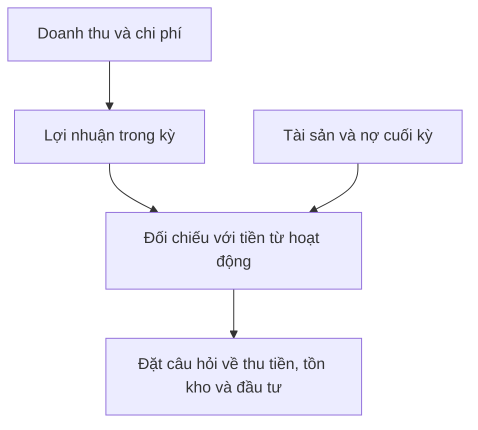

# Phân tích tài chính doanh nghiệp (Financial Analysis of a Company)

> [!SUMMARY] Một câu tóm tắt
> Phân tích tài chính bắt đầu bằng việc đọc ba báo cáo như một hệ thống, kiểm tra lợi nhuận, tài sản, nợ và tiền có kể cùng một câu chuyện hay không.

## 1. Tổng quan

Giá cổ phiếu không tự nói lên hoạt động bên trong doanh nghiệp. Báo cáo tài chính giúp tìm hiểu doanh nghiệp tạo doanh thu, tích lũy tài sản, sử dụng nợ và chuyển lợi nhuận thành tiền như thế nào. Bài này mở đầu module bằng một quy trình đọc tổng thể. Các bài sau đi sâu từng báo cáo và nhóm khoản mục.

## 2. Mục tiêu học tập

- [ ] Nêu chức năng của ba báo cáo tài chính cơ bản.
- [ ] Phân biệt số liệu tại một ngày với kết quả trong một khoảng thời gian.
- [ ] Đặt câu hỏi kiểm tra khi lợi nhuận và tiền từ hoạt động kinh doanh khác nhau.

## 3. Kiến thức cần chuẩn bị

- Bài trước: [Quiz 3 về giao dịch trên thị trường chứng khoán](../03-queries-on-stock-market-trading/21-quiz-stock-market-trading-quiz-3.md).
- Không cần kiến thức kế toán chuyên sâu; các thuật ngữ sẽ được giải thích trong module.

## 4. Thử đoán trước

1. Một công ty báo lãi có chắc đã thu được lượng tiền tương ứng trong kỳ không?
2. Báo cáo nào cho biết doanh nghiệp đang có bao nhiêu tài sản và nghĩa vụ vào cuối ngày báo cáo?

## 5. Kiến thức cốt lõi

### 5.1. Ba báo cáo trả lời ba nhóm câu hỏi

**Bảng cân đối kế toán** (balance sheet) trình bày tài sản, nợ phải trả và vốn chủ sở hữu tại một thời điểm. **Báo cáo kết quả kinh doanh** (income statement) tổng hợp doanh thu, chi phí và lợi nhuận trong một kỳ. **Báo cáo lưu chuyển tiền tệ** (cash flow statement) phân loại tiền thực thu, thực chi trong kỳ.

| Báo cáo | Mốc thời gian | Câu hỏi trọng tâm |
|---|---|---|
| Bảng cân đối kế toán | Một ngày cụ thể | Doanh nghiệp có gì và nợ gì? |
| Kết quả kinh doanh | Một kỳ | Hoạt động tạo doanh thu, lợi nhuận ra sao? |
| Lưu chuyển tiền tệ | Một kỳ | Tiền đến từ đâu và được dùng vào đâu? |

### 5.2. Đọc chéo thay vì đọc riêng lẻ

Lợi nhuận có thể được ghi nhận khác thời điểm thu tiền. Vì vậy, xem khoản phải thu, hàng tồn kho, đầu tư và dòng tiền hoạt động để hiểu bối cảnh.

## 6. Giải thích chi tiết

Báo cáo tài chính áp dụng quy tắc ghi nhận và ước tính; chúng không phải bản ghi trực tiếp mọi sự kiện tiền mặt. So sánh các kỳ giúp phát hiện xu hướng, còn so sánh doanh nghiệp cùng ngành giúp đặt con số vào bối cảnh. Khác biệt mô hình kinh doanh, mùa vụ, chính sách kế toán và sự kiện bất thường có thể làm phép so sánh lệch.

> [!TIP] Cách bắt đầu
> Ghi lại kỳ báo cáo, đơn vị tiền tệ và liệu số liệu là cuối kỳ hay cả kỳ trước khi tính tỷ số.

> [!WARNING] Giới hạn
> Một chỉ số đơn lẻ hoặc một năm báo cáo không đủ để kết luận doanh nghiệp tốt hay xấu, càng không tự nó đưa ra quyết định mua bán.

## 7. Ví dụ minh họa

**Ví dụ giả định:** Công ty An báo doanh thu 1.000 triệu đồng và lợi nhuận ròng 80 triệu đồng. Dòng tiền từ hoạt động kinh doanh âm 20 triệu đồng; khoản phải thu tăng 120 triệu đồng.

1. Báo cáo kết quả kinh doanh cho thấy lợi nhuận 80 triệu.
2. Lưu chuyển tiền tệ cho thấy hoạt động chưa tạo tiền ròng trong kỳ.
3. Phải thu tăng có thể phản ánh bán chịu hoặc chậm thu tiền; cần xem tuổi nợ và chính sách tín dụng trước khi kết luận.

## 8. Thực hành

**Bài tự làm:** Công ty B có doanh thu tăng 15%, lợi nhuận tăng 8%, tồn kho tăng 40%. Nêu hai câu hỏi cần kiểm tra trước khi đánh giá kết quả.

- [ ] Kiểm tra liệu tốc độ tăng tồn kho có vượt doanh số bán hàng hay không.
- [ ] Tìm dấu hiệu tồn kho chậm luân chuyển hoặc thay đổi kế hoạch cung ứng.
- [ ] Đối chiếu dòng tiền hoạt động và cách ghi nhận doanh thu.

Xem lời giải sau khi đã tự làm

Có thể hỏi tồn kho tăng do dự trữ cho tăng trưởng hay hàng bán chậm; đối chiếu doanh thu, giá vốn và thuyết minh. Cũng nên kiểm tra khoản phải trả, thu tiền và CFO. Riêng mức tồn kho tăng chưa chứng minh có vấn đề.

## 9. Những lỗi thường gặp

- **Coi lợi nhuận là tiền mặt** — đối chiếu với lưu chuyển tiền tệ và biến động vốn lưu động.
- **So sánh số liệu khác kỳ** — xác nhận cùng độ dài kỳ, ngày kết thúc và đơn vị.
- **Kết luận từ một tỷ số** — xem thêm xu hướng, ngành và thuyết minh.
- **Bỏ qua ước tính kế toán** — đọc chính sách và giả định có ảnh hưởng lớn.

## 10. Giải thích bằng lời của bạn

- Khái niệm: Ba báo cáo cơ bản cung cấp thông tin gì?
- Vì sao: Vì sao phải đối chiếu lợi nhuận với dòng tiền?
- Ví dụ của tôi: Tạo tình huống công ty lãi nhưng thu tiền chậm.
- Chỗ chưa chắc: Khoản mục hay thuật ngữ nào cần xem lại?

## 11. Câu hỏi ôn tập

### Câu 1

Báo cáo nào trình bày tài sản, nợ phải trả và vốn chủ sở hữu tại một ngày cụ thể?

A. Báo cáo lưu chuyển tiền tệ  
B. Báo cáo kết quả kinh doanh  
C. Bảng cân đối kế toán  
D. Báo cáo thay đổi vốn chủ sở hữu

**Đáp án:** C. **Giải thích:** Bảng cân đối phản ánh vị thế tại một thời điểm; các báo cáo còn lại trình bày hoạt động hoặc biến động trong kỳ.

### Câu 2

Công ty báo lợi nhuận dương nhưng dòng tiền hoạt động âm. Kết luận nào hợp lý nhất?

A. Cần điều tra biến động phải thu, tồn kho và các khoản điều chỉnh trước khi kết luận.  
B. Chắc chắn công ty gian lận.  
C. Chắc chắn công ty không có doanh thu.  
D. Lợi nhuận dương luôn có nghĩa tiền mặt tăng.

**Đáp án:** A. **Giải thích:** Lợi nhuận và tiền khác nhau do thời điểm ghi nhận, vốn lưu động và khoản phi tiền mặt. B, C và D khẳng định quá mức, không được dữ liệu hỗ trợ.

### Câu 3

Những thông tin nào giúp so sánh hai doanh nghiệp công bằng hơn? (Chọn nhiều)

A. Kỳ báo cáo và đơn vị tiền tệ  
B. Chỉ giá cổ phiếu hôm nay  
C. Mô hình kinh doanh và đặc điểm ngành  
D. Bỏ qua chính sách kế toán vì mọi doanh nghiệp giống nhau

**Đáp án:** A, C. **Giải thích:** Kỳ, đơn vị, ngành và mô hình ảnh hưởng khả năng so sánh. Giá cổ phiếu riêng lẻ không thay thế dữ liệu hoạt động; chính sách kế toán có thể khác.

### Câu 4

Phát biểu sau đúng hay sai: “Bảng cân đối kế toán cho biết doanh nghiệp có bao nhiêu doanh thu trong cả năm.”

A. Đúng  
B. Sai

**Đáp án:** B. **Giải thích:** Bảng cân đối là ảnh chụp tại một ngày; doanh thu cả năm nằm trên báo cáo kết quả kinh doanh.

## 12. Tóm tắt kiến thức

- Bảng cân đối là số liệu tại một thời điểm; kết quả kinh doanh và lưu chuyển tiền tệ là số liệu trong kỳ.
- Lợi nhuận không đồng nghĩa tiền đã thu.
- Đọc chéo báo cáo và thuyết minh để hình thành câu hỏi, không vội kết luận.

## 13. Tài liệu tham khảo

1. SEC, *Beginners’ Guide to Financial Statements*.
2. CFA Institute, tài liệu nhập môn về phân tích báo cáo tài chính.
3. Investor.gov, tài liệu giáo dục nhà đầu tư về báo cáo doanh nghiệp.

## 14. Bài học tiếp theo

[Hiểu bảng cân đối kế toán: tài sản ngắn hạn và nợ ngắn hạn (Understanding Balance Sheet & Current Assets & Current Liabiliites)](02-understanding-balance-sheet-current-assets-current-liabiliit.md) — bắt đầu phân tích từng khoản mục để hiểu thanh khoản ngắn hạn.
