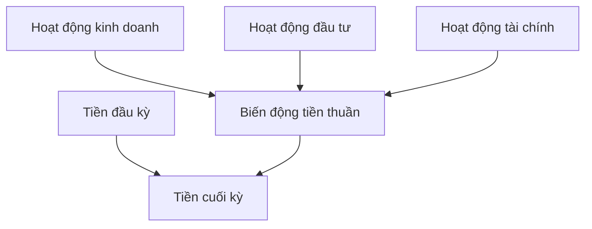

# Hiểu báo cáo lưu chuyển tiền tệ (Understanding Cash Flow Statement)

> [!SUMMARY] Một câu tóm tắt
> Báo cáo lưu chuyển tiền tệ phân loại tiền thực thu và chi trong kỳ, giúp kiểm tra doanh nghiệp tạo tiền từ hoạt động nào và đã sử dụng tiền ra sao.

## 1. Tổng quan

Báo cáo kết quả kinh doanh ghi nhận doanh thu và chi phí theo nguyên tắc kế toán, nên lợi nhuận không nhất thiết bằng tiền đã thu trong kỳ. Báo cáo lưu chuyển tiền tệ (cash flow statement) bổ sung góc nhìn về tiền mặt và tương đương tiền. Báo cáo thường được chia thành hoạt động kinh doanh, đầu tư và tài chính. Sau bài về biến động vốn chủ, bài này hoàn thiện cách đọc ba báo cáo chính trước khi chuyển sang phương pháp trình bày trực tiếp.

## 2. Mục tiêu học tập

- [ ] Phân loại ví dụ giao dịch vào CFO, CFI hoặc CFF.
- [ ] Giải thích vì sao lợi nhuận ròng khác dòng tiền hoạt động.
- [ ] Tính biến động tiền thuần và số dư tiền cuối kỳ.
- [ ] Nêu ít nhất hai câu hỏi cần kiểm tra khi CFO âm.

## 3. Kiến thức cần chuẩn bị

- Bài trước: [Hiểu báo cáo thay đổi vốn chủ sở hữu](./08-understanding-statement-of-changes-in-equity.md) — phân biệt kết quả kinh doanh với giao dịch vốn.
- Nhớ rằng bảng cân đối là tại một ngày, còn lưu chuyển tiền tệ tổng hợp trong một kỳ.

## 4. Thử đoán trước

1. Mua máy móc bằng tiền mặt thuộc hoạt động nào, và vì sao?
2. Một doanh nghiệp báo lãi ròng nhưng CFO âm: những khoản mục nào có thể giải thích chênh lệch?

## 5. Kiến thức cốt lõi

### 5.1. Ba nhóm dòng tiền

**Dòng tiền từ hoạt động kinh doanh (CFO)** phản ánh tiền gắn với hoạt động tạo doanh thu thường xuyên, như thu của khách hàng và trả nhà cung cấp, nhân viên. **Dòng tiền từ hoạt động đầu tư (CFI)** thường gồm mua bán tài sản dài hạn, khoản đầu tư và một số giao dịch mua bán đơn vị kinh doanh. **Dòng tiền từ hoạt động tài chính (CFF)** thường gồm vay và trả nợ gốc, phát hành cổ phiếu, mua lại cổ phiếu hoặc trả cổ tức. Phân loại cụ thể có thể khác theo chuẩn mực và chính sách trình bày.

| Nhóm | Câu hỏi | Ví dụ thường gặp |
|---|---|---|
| CFO | Hoạt động kinh doanh tạo hoặc tiêu tiền thế nào? | Thu khách hàng, trả lương, trả nhà cung cấp |
| CFI | Tiền được đầu tư vào hay thu hồi từ đâu? | Mua thiết bị, bán tài sản dài hạn |
| CFF | Công ty huy động hoặc hoàn trả vốn ra sao? | Vay, trả nợ gốc, phát hành cổ phiếu |

### 5.2. Liên hệ giữa ba nhóm

$$
\text{Biến động tiền thuần} = CFO + CFI + CFF
$$

$$
\text{Tiền cuối kỳ} = \text{Tiền đầu kỳ} + \text{Biến động tiền thuần}
$$

### 5.3. CFO theo phương pháp gián tiếp

Trong phương pháp gián tiếp, CFO bắt đầu từ lợi nhuận ròng, điều chỉnh khoản phi tiền mặt và thay đổi vốn lưu động. Ví dụ, khấu hao làm giảm lợi nhuận nhưng không phải khoản chi tiền kỳ đó nên thường được cộng lại; tăng phải thu thường làm giảm tiền thu từ hoạt động so với lợi nhuận ghi nhận.

## 6. Giải thích chi tiết

Dòng tiền và lợi nhuận khác nhau do thời điểm ghi nhận. Bán chịu có thể ghi nhận doanh thu trước khi khách trả; mua hàng tồn kho có thể dùng tiền trước khi chi phí được ghi nhận khi hàng bán. Các khoản khấu hao, dự phòng hoặc lãi/lỗ chưa thực hiện cũng có thể ảnh hưởng lợi nhuận mà không tạo dòng tiền tương ứng trong kỳ.

CFO dương thường cho thấy hoạt động tạo tiền, nhưng một kỳ đơn lẻ có thể chịu ảnh hưởng mùa vụ, thu nợ hoặc trì hoãn thanh toán. CFI âm có thể phản ánh đầu tư mở rộng, không tự động là xấu. CFF dương có thể đến từ vay hoặc phát hành cổ phiếu; cần xem nghĩa vụ hoàn trả, pha loãng và mục đích sử dụng tiền.

> [!WARNING] Giới hạn
> Đừng kết luận sức khỏe doanh nghiệp chỉ từ dấu âm/dương của một nhóm trong một kỳ. Hãy xem xu hướng nhiều kỳ, thuyết minh, ngành và nhu cầu vốn.

## 7. Ví dụ minh họa

**Ví dụ giả định:** Công ty M có CFO 240 triệu đồng, CFI âm 150 triệu do mua thiết bị, CFF âm 40 triệu do trả nợ gốc và cổ tức. Tiền đầu kỳ là 100 triệu đồng.

1. Cộng ba nhóm: 240 − 150 − 40 = 50 triệu đồng biến động tăng thuần.
2. Cộng với tiền đầu kỳ: 100 + 50 = 150 triệu đồng tiền cuối kỳ.
3. CFO dương cho thấy hoạt động tạo tiền trong kỳ; CFI âm gắn với đầu tư thiết bị, còn CFF âm phản ánh tiền trả cho bên cấp vốn.
4. Cần kiểm tra thiết bị phục vụ kế hoạch nào, lịch trả nợ và liệu CFO có bền vững qua các kỳ.

## 8. Thực hành

**Bài tự làm:** Công ty N có tiền đầu kỳ 300 triệu đồng; CFO âm 20 triệu, CFI âm 90 triệu và CFF dương 130 triệu.

- [ ] Tính biến động tiền thuần.
- [ ] Tính tiền cuối kỳ.
- [ ] Đưa ra hai câu hỏi để hiểu vì sao CFO âm và CFF dương.

Xem lời giải sau khi đã tự làm

Biến động tiền thuần = −20 − 90 + 130 = tăng 20 triệu đồng. Tiền cuối kỳ = 300 + 20 = 320 triệu đồng. Có thể kiểm tra phải thu, tồn kho, khoản phải trả để hiểu CFO; kiểm tra khoản vay hay phát hành cổ phiếu để hiểu CFF và nghĩa vụ tương lai.

## 9. Những lỗi thường gặp

- **Coi lợi nhuận là tiền mặt** — đối chiếu CFO và biến động phải thu, tồn kho, khoản phải trả.
- **Nhầm mua máy móc là chi phí hoạt động ngay** — phân biệt khoản đầu tư tài sản với chi phí ghi nhận theo kỳ.
- **Coi CFI âm luôn là xấu** — xem mục đích, hiệu quả kỳ vọng và khả năng tài trợ.
- **Bỏ qua nguồn CFF dương** — xác định tiền đến từ vay hay phát hành và xem nghĩa vụ đi kèm.

## 10. Giải thích bằng lời của bạn

- Khái niệm: CFO, CFI và CFF lần lượt phản ánh điều gì?
- Vì sao: Vì sao lãi ròng có thể khác CFO?
- Ví dụ của tôi: Nêu một khoản thu hoặc chi cho mỗi nhóm.
- Chỗ chưa chắc: Bạn còn băn khoăn về giao dịch nào được phân loại ra sao?

## 11. Câu hỏi ôn tập

### Câu 1

Khoản tiền trả để mua máy móc dài hạn thường được xếp vào nhóm nào trên báo cáo lưu chuyển tiền tệ?

A. Hoạt động tài chính
B. Hoạt động đầu tư
C. Hoạt động kinh doanh
D. Không bao giờ xuất hiện trên báo cáo

**Đáp án:** B. **Giải thích:** Mua tài sản dài hạn thường là CFI. A liên quan huy động/trả vốn, C là hoạt động tạo doanh thu thường nhật; D sai vì giao dịch dùng tiền được trình bày.

### Câu 2

Một doanh nghiệp có CFO 80 triệu, CFI âm 30 triệu và CFF âm 10 triệu. Tiền đầu kỳ là 50 triệu. Tiền cuối kỳ bằng bao nhiêu?

A. 90 triệu đồng
B. 110 triệu đồng
C. 70 triệu đồng
D. 130 triệu đồng

**Đáp án:** A. **Giải thích:** Biến động thuần = 80 − 30 − 10 = 40; tiền cuối kỳ 50 + 40 = 90. B bỏ qua một khoản giảm; C trừ nhầm CFO; D cộng sai CFI/CFF.

### Câu 3

Những khoản nào có thể khiến CFO khác lợi nhuận ròng theo phương pháp gián tiếp? (Chọn nhiều)

A. Khấu hao
B. Thay đổi khoản phải thu
C. Giá cổ phiếu tăng trên sàn nhưng công ty không giao dịch
D. Thay đổi hàng tồn kho

**Đáp án:** A, B, D. **Giải thích:** Khấu hao là khoản phi tiền mặt và phải thu, tồn kho là vốn lưu động ảnh hưởng CFO. Biến động giá cổ phiếu trên thị trường không tự thân là dòng tiền của doanh nghiệp.

### Câu 4

Phát biểu sau đúng hay sai: “CFO âm trong một kỳ chứng minh doanh nghiệp chắc chắn mất khả năng thanh toán.”

A. Đúng
B. Sai

**Đáp án:** B. **Giải thích:** CFO âm đáng để điều tra nhưng có thể do mùa vụ, tăng vốn lưu động hoặc nguyên nhân tạm thời. Cần thêm dữ liệu để đánh giá khả năng thanh toán.

## 12. Tóm tắt kiến thức

- CFO, CFI và CFF lần lượt phân loại tiền từ kinh doanh, đầu tư và tài chính.
- Theo phương pháp gián tiếp, CFO nối lợi nhuận với tiền bằng điều chỉnh phi tiền mặt và vốn lưu động.
- Tổng ba nhóm giải thích biến động tiền; cộng với tiền đầu kỳ để ra tiền cuối kỳ.
- Cần xem xu hướng và thuyết minh trước khi diễn giải dòng tiền âm/dương.

## 13. Tài liệu tham khảo

1. SEC, *Beginners’ Guide to Financial Statements* — phần báo cáo lưu chuyển tiền tệ.
2. IFRS Foundation, IAS 7 *Statement of Cash Flows* — phân loại và trình bày dòng tiền.
3. CFA Institute, tài liệu nhập môn về phân tích báo cáo tài chính.

## 14. Bài học tiếp theo

[Chú thích về phương pháp trực tiếp trong báo cáo lưu chuyển tiền tệ (Note on Direct Method of Cash Flow Reporting)](./10-note-on-direct-method-of-cash-flow-reporting.md) — bài tiếp theo tập trung vào cách trình bày CFO theo các khoản thu chi tiền mặt.