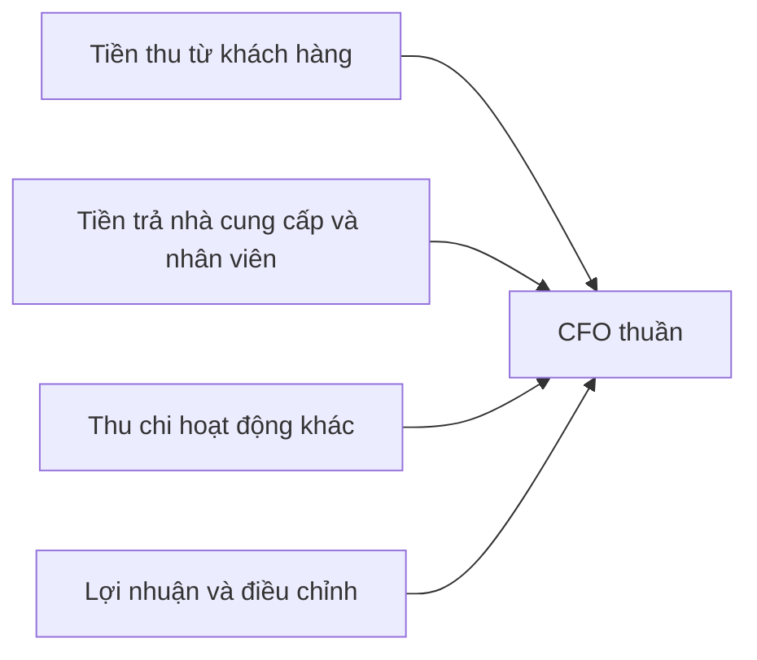

# Chú thích về phương pháp trực tiếp trong báo cáo lưu chuyển tiền tệ (Note on Direct Method of Cash Flow Reporting)

> [!SUMMARY] Một câu tóm tắt
> Phương pháp trực tiếp trình bày các nhóm tiền thực thu và thực chi để cho thấy rõ tiền hoạt động kinh doanh đến từ đâu và được dùng vào đâu.

## 1. Tổng quan

Bài trước phân biệt CFO, CFI và CFF, đồng thời giới thiệu cách phương pháp gián tiếp điều chỉnh lợi nhuận ròng. Bài ngắn này làm rõ phương pháp trực tiếp (direct method), trong đó CFO được trình bày qua các khoản thu chi vận hành bằng tiền. Cả hai phương pháp đều hướng tới dòng tiền thuần từ hoạt động kinh doanh; khác nhau chủ yếu ở cách trình bày. Đây là nền tảng để đọc báo cáo của các doanh nghiệp dùng định dạng khác nhau.

## 2. Mục tiêu học tập

- [ ] Nêu cách phương pháp trực tiếp trình bày dòng tiền hoạt động.
- [ ] So sánh cấu trúc trực tiếp với gián tiếp.
- [ ] Tính CFO từ tiền thu khách hàng và các khoản chi vận hành.

## 3. Kiến thức cần chuẩn bị

- Bài trước: [Hiểu báo cáo lưu chuyển tiền tệ](./09-understanding-cash-flow-statement.md) — ôn lại CFO và các nhóm dòng tiền.
- Nhớ phân biệt ghi nhận doanh thu với thời điểm nhận tiền.

## 4. Thử đoán trước

1. Nếu doanh thu ghi nhận là 500 triệu nhưng khách mới trả 420 triệu, phương pháp trực tiếp sẽ nhấn mạnh con số nào?
2. Phương pháp trực tiếp có làm thay đổi tổng CFO so với phương pháp gián tiếp không?

## 5. Kiến thức cốt lõi

### 5.1. Trình bày theo khoản thu và khoản chi

Phương pháp trực tiếp liệt kê các nhóm dòng tiền gộp, chẳng hạn tiền thu từ khách hàng, tiền trả nhà cung cấp, nhân viên, lãi hoặc thuế tùy quy định áp dụng. Người đọc thấy được các nguồn thu và mục đích chi bằng tiền trong kỳ.

### 5.2. So sánh hai cách trình bày

| Tiêu chí | Phương pháp trực tiếp | Phương pháp gián tiếp |
|---|---|---|
| Điểm bắt đầu | Các khoản tiền thu và chi chính | Lợi nhuận ròng hoặc chỉ tiêu lợi nhuận tương ứng |
| Cách thể hiện | Nhóm thu tiền, chi tiền | Điều chỉnh phi tiền mặt và vốn lưu động |
| Điểm hữu ích | Thấy rõ loại tiền thu chi | Thấy cầu nối từ lợi nhuận sang CFO |
| Kết quả CFO | Dòng tiền thuần hoạt động | Dòng tiền thuần hoạt động |

$$
CFO = \text{Tiền thu từ khách hàng} - \text{Tiền chi hoạt động} + \text{các khoản thu hoạt động khác}
$$

### 5.3. Mối liên hệ

Sơ đồ cho thấy hai cách trình bày khác nhau cùng phục vụ việc xác định CFO. Con số và phân loại chi tiết chịu ảnh hưởng của chuẩn mực kế toán áp dụng.

## 6. Giải thích chi tiết

Ở phương pháp trực tiếp, doanh thu bán chịu chưa thu được tiền không được xem là tiền thu khách hàng trong kỳ đó. Tương tự, chi phí đã ghi nhận nhưng chưa thanh toán chưa phải khoản chi tiền tương ứng. Vì vậy, phương pháp này hữu ích để quan sát luồng thu chi, nhưng người đọc vẫn cần hiểu cách phân loại, các khoản thu chi khác và phần đối chiếu được công bố.

Phương pháp gián tiếp bắt đầu từ lợi nhuận rồi điều chỉnh khấu hao, dự phòng và biến động vốn lưu động; nó giúp truy nguyên vì sao CFO lệch lợi nhuận. Không nên xem một phương pháp là bằng chứng chất lượng kinh doanh tốt hơn: nội dung giao dịch cơ bản không đổi chỉ vì cách trình bày khác.

> [!NOTE]
> Quy định trình bày và lựa chọn phân loại có thể khác giữa các chuẩn mực. Khi so sánh, hãy đọc chính sách kế toán và thuyết minh của doanh nghiệp.

## 7. Ví dụ minh họa

**Ví dụ giả định:** Trong kỳ, công ty thu khách hàng 600 triệu đồng; trả nhà cung cấp 310 triệu, trả nhân viên 150 triệu và nộp thuế thu nhập 25 triệu. Tạm bỏ qua các khoản thu chi hoạt động khác.

1. Tổng tiền chi hoạt động được nêu = 310 + 150 + 25 = 485 triệu.
2. CFO theo các khoản trực tiếp = 600 − 485 = 115 triệu đồng.
3. Doanh thu đã ghi nhận có thể lớn hơn 600 triệu nếu còn bán chịu; con số này phản ánh tiền thực thu, không phải doanh thu kế toán.

## 8. Thực hành

**Bài tự làm:** Công ty P thu khách hàng 900 triệu đồng; trả nhà cung cấp 420 triệu, nhân viên 210 triệu và các chi phí tiền mặt khác 80 triệu.

- [ ] Tính CFO giản lược theo cách trình bày trực tiếp.
- [ ] Nêu một khoản phải thu có thể khiến doanh thu khác tiền thu.
- [ ] Giải thích vì sao cách gián tiếp có thể cho cùng CFO nhưng bảng trình bày khác.

Xem lời giải sau khi đã tự làm

CFO giản lược = 900 − 420 − 210 − 80 = 190 triệu đồng. Bán chịu làm doanh thu ghi nhận cao hơn tiền đã thu; phương pháp gián tiếp điều chỉnh lợi nhuận và vốn lưu động để đi đến dòng tiền thuần hoạt động, còn phương pháp trực tiếp liệt kê các khoản thu chi.

## 9. Những lỗi thường gặp

- **Đồng nhất tiền thu khách hàng với doanh thu** — kiểm tra bán chịu và số dư phải thu.
- **Cho rằng hai phương pháp tạo hai mức CFO khác nhau** — phân biệt kết quả dòng tiền với cách trình bày.
- **Bỏ sót khoản chi hoạt động** — xác định rõ phạm vi khoản chi trong phép tính.
- **Coi mọi khoản thanh toán là CFO** — xem bản chất giao dịch và quy tắc phân loại.

## 10. Giải thích bằng lời của bạn

- Khái niệm: Phương pháp trực tiếp trình bày CFO theo cách nào?
- Vì sao: Vì sao tiền thu khách hàng có thể thấp hơn doanh thu?
- Ví dụ của tôi: Tự tạo ba khoản thu chi và tính CFO.
- Chỗ chưa chắc: Bạn muốn làm rõ khoản thu hoặc chi nào?

## 11. Câu hỏi ôn tập

### Câu 1

Điểm bắt đầu tiêu biểu của phương pháp trực tiếp khi trình bày dòng tiền hoạt động là gì?

A. Giá cổ phiếu đầu kỳ
B. Tổng tài sản cuối kỳ
C. Các nhóm tiền thu và tiền chi hoạt động
D. Lợi nhuận giữ lại đầu kỳ

**Đáp án:** C. **Giải thích:** Phương pháp trực tiếp liệt kê các khoản thu chi tiền mặt; A, B, D không phải điểm xuất phát của cách trình bày này.

### Câu 2

Công ty thu khách hàng 250 triệu, trả nhà cung cấp 120 triệu và trả nhân viên 70 triệu; bỏ qua khoản khác. CFO giản lược là bao nhiêu?

A. 60 triệu đồng
B. 100 triệu đồng
C. 200 triệu đồng
D. 440 triệu đồng

**Đáp án:** B. **Giải thích:** 250 − 120 − 70 = 60 triệu — chờ, phép tính cho ra 60. Do đó đáp án đúng là A; B cộng/trừ sai một khoản, C bỏ chi phí, D cộng toàn bộ.

### Câu 3

Những phát biểu nào đúng về phương pháp trực tiếp và gián tiếp? (Chọn nhiều)

A. Phương pháp trực tiếp liệt kê nhóm thu chi tiền.
B. Phương pháp gián tiếp điều chỉnh lợi nhuận và vốn lưu động.
C. Hai phương pháp luôn tạo ra tổng CFO khác nhau.
D. Bán chịu đồng nghĩa doanh nghiệp đã thu tiền khách.

**Đáp án:** A, B. **Giải thích:** A và B mô tả đúng cách trình bày. C sai vì cùng hướng tới CFO; D sai vì bán chịu chưa chắc đã thu tiền.

### Câu 4

Phát biểu sau đúng hay sai: “Phương pháp trực tiếp có thể cho thấy tiền thu khách hàng trong kỳ khác doanh thu ghi nhận trong kỳ.”

A. Đúng
B. Sai

**Đáp án:** A. **Giải thích:** Doanh thu có thể gồm bán chịu hoặc khoản thu thuộc kỳ khác; vì vậy tiền thực thu có thể khác doanh thu. B sai.

## 12. Tóm tắt kiến thức

- Phương pháp trực tiếp nêu các nhóm tiền thu và chi trong hoạt động kinh doanh.
- Phương pháp gián tiếp bắt đầu từ lợi nhuận và điều chỉnh khoản phi tiền mặt, vốn lưu động.
- Cả hai hướng tới dòng tiền thuần hoạt động; cách trình bày khác nhau.
- Bán chịu và thời điểm thanh toán khiến doanh thu khác tiền thu.

## 13. Tài liệu tham khảo

1. IFRS Foundation, IAS 7 *Statement of Cash Flows* — cách trình bày dòng tiền hoạt động.
2. SEC, *Beginners’ Guide to Financial Statements* — cách đọc báo cáo lưu chuyển tiền tệ.

## 14. Bài học tiếp theo

[Hiểu thuyết minh báo cáo tài chính và lịch biểu bổ sung (Understanding Financial Notes & Supplementary Schedules)](./11-understanding-financial-notes-supplementary-schedules.md) — thuyết minh giúp giải thích chi tiết các số tổng hợp vừa đọc.