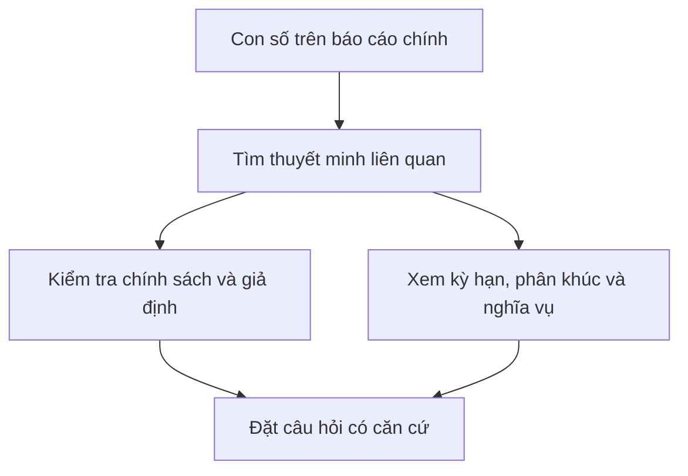

# Hiểu thuyết minh báo cáo tài chính và lịch biểu bổ sung (Understanding Financial Notes & Supplementary Schedules)

> [!SUMMARY] Một câu tóm tắt
> Thuyết minh và lịch biểu bổ sung mở rộng các con số tổng hợp, cho biết chính sách, giả định và nghĩa vụ có thể làm thay đổi cách hiểu về doanh nghiệp.

## 1. Tổng quan

Các báo cáo chính trình bày số liệu cô đọng để người đọc nắm nhanh tài sản, nợ, kết quả và dòng tiền. Tuy nhiên, một con số tổng thường không cho biết cấu phần, thời hạn, rủi ro hay giả định kế toán đằng sau nó. Thuyết minh báo cáo tài chính và lịch biểu bổ sung cung cấp các chi tiết đó. Đây là bài cuối module, nối những khoản mục đã học với thông tin cần tra cứu trước khi đưa ra nhận định.

## 2. Mục tiêu học tập

- [ ] Nêu ít nhất ba loại thông tin thường nằm trong thuyết minh.
- [ ] Giải thích vì sao chính sách và ước tính có thể ảnh hưởng khả năng so sánh.
- [ ] Xác định chi tiết bổ sung phù hợp với một khoản mục được nêu.
- [ ] Viết câu hỏi kiểm tra thay vì kết luận chỉ từ một số tổng hợp.

## 3. Kiến thức cần chuẩn bị

- Bài trước: [Chú thích về phương pháp trực tiếp trong báo cáo lưu chuyển tiền tệ](./10-note-on-direct-method-of-cash-flow-reporting.md) — số dòng tiền cần được đọc cùng chính sách và giải thích kèm theo.
- Nhớ rằng báo cáo tài chính có thể chứa ước tính và chính sách ghi nhận khác nhau.

## 4. Thử đoán trước

1. Nếu phải thu tăng mạnh, phần thông tin bổ sung nào có thể giúp đánh giá khả năng thu hồi?
2. Vì sao hai công ty cùng báo lợi nhuận ròng vẫn có thể có mức độ rủi ro khác nhau?

## 5. Kiến thức cốt lõi

### 5.1. Thuyết minh mở rộng con số trên báo cáo

Thuyết minh mô tả chính sách kế toán, phân tách số tổng hợp và giải thích biến động hoặc nghĩa vụ. Lịch biểu bổ sung (supplementary schedules) có thể trình bày chi tiết theo phân khúc, loại tài sản, kỳ hạn hoặc nhóm khoản mục. Hãy dùng chúng để hiểu con số trong ngữ cảnh, không xem như một báo cáo tách rời.

| Khoản mục hoặc chủ đề | Chi tiết nên tìm | Câu hỏi phân tích |
|---|---|---|
| Doanh thu | Thời điểm ghi nhận, nghĩa vụ còn phải thực hiện, phân khúc | Doanh thu có phụ thuộc một khách hàng hoặc thời điểm bất thường? |
| Phải thu | Tuổi nợ, dự phòng tổn thất, tập trung khách hàng | Khả năng thu tiền có thay đổi không? |
| Hàng tồn kho | Phương pháp tính giá, dự phòng giảm giá | Có hàng chậm luân chuyển hoặc lỗi thời? |
| Nợ vay | Lãi suất, lịch đáo hạn, tài sản bảo đảm, điều khoản | Khi nào cần trả và điều kiện vay là gì? |
| Nghĩa vụ tiềm tàng | Kiện tụng, bảo lãnh, cam kết | Có khoản chi tương lai chưa ghi nhận đầy đủ? |
| Giao dịch bên liên quan | Bản chất và giá trị giao dịch | Các điều kiện có khác giao dịch độc lập? |

### 5.2. Chính sách và ước tính ảnh hưởng cách đọc

Doanh thu, dự phòng phải thu, khấu hao, suy giảm giá trị và trả thưởng bằng cổ phiếu có thể dựa trên giả định. Thay đổi giả định có thể làm số liệu kỳ này khác kỳ trước mà không nhất thiết phản ánh thay đổi tương ứng trong tiền mặt. Cần đọc chính sách áp dụng và giải thích thay đổi trọng yếu.

### 5.3. Thông tin bổ sung không thay thế phân tích

Một ghi chú riêng lẻ không chứng minh có sai phạm hoặc chắc chắn xảy ra tổn thất. Nó giúp xác định điều gì chưa biết và cần theo dõi. So sánh nhiều kỳ, xem ngôn ngữ giải trình, dữ kiện định lượng và đối chiếu với báo cáo chính để tránh đọc quá mức.

## 6. Giải thích chi tiết

Ví dụ, khoản phải thu tăng có thể là hệ quả tăng doanh số bán chịu, chu kỳ thu tiền dài hơn hoặc khách hàng gặp khó khăn. Bảng tuổi nợ và dự phòng giúp phân biệt các khả năng nhưng vẫn cần xem thay đổi qua thời gian, khách hàng tập trung và dòng tiền thu sau ngày báo cáo nếu có công bố. Tương tự, nợ vay lớn cần được hiểu cùng kỳ hạn, lãi suất, tài sản bảo đảm và điều khoản ràng buộc.

Thuyết minh cũng có thể nêu phân khúc, cam kết thuê, kiện tụng, giao dịch bên liên quan, rủi ro tập trung và khoản mục bất thường. Mức độ chi tiết phụ thuộc chuẩn mực, ngành và yêu cầu công bố. Một số thông tin mang tính ước tính, nên tồn tại bất định; người đọc cần cân nhắc cả cách trình bày lẫn dữ kiện.

> [!TIP] Cách tra cứu
> Bắt đầu từ khoản mục lớn hoặc biến động bất thường trên báo cáo chính, tìm số ghi chú tương ứng, rồi ghi lại chính sách, cấu phần, thời hạn và giả định có thể ảnh hưởng.

> [!WARNING] Giới hạn
> Không diễn giải một từ như “kiện tụng” hoặc “ước tính” thành kết luận chắc chắn về thiệt hại. Tìm quy mô, trạng thái, xác suất được công bố và các yếu tố còn chưa biết.

## 7. Ví dụ minh họa

**Ví dụ giả định:** Công ty Q báo lợi nhuận ròng 200 triệu đồng và phải thu tăng từ 300 lên 520 triệu đồng. Thuyết minh cho biết 90 triệu đồng trong số phải thu đã quá hạn trên 90 ngày; dự phòng tổn thất tăng từ 5 lên 18 triệu.

1. Ghi nhận lợi nhuận 200 triệu không chứng minh đã thu đủ tiền từ khách hàng.
2. Phải thu tăng 220 triệu và khoản quá hạn 90 triệu gợi ý cần kiểm tra tốc độ thu tiền, khách hàng tập trung và kỳ hạn hợp đồng.
3. Dự phòng tăng 13 triệu làm giảm giá trị phải thu ròng và có thể ảnh hưởng lợi nhuận; xem cơ sở ước tính và so sánh các kỳ.
4. Đây là dấu hiệu cần phân tích thêm, chưa đủ để kết luận doanh nghiệp không thu hồi được nợ.

## 8. Thực hành

**Bài tự làm:** Một công ty có doanh thu tăng 25%, phải thu tăng 45% và nợ vay ngắn hạn đáo hạn trong 9 tháng. Nêu ba phần thuyết minh cần tra cứu và một câu hỏi cho mỗi phần.

- [ ] Tìm chính sách ghi nhận doanh thu và phân khúc/khách hàng tập trung.
- [ ] Tìm tuổi nợ, dự phòng và kỳ hạn thanh toán phải thu.
- [ ] Tìm lãi suất, lịch đáo hạn, bảo đảm và điều khoản vay.

Xem lời giải sau khi đã tự làm

Có thể xem thời điểm ghi nhận doanh thu và doanh thu theo khách hàng/phân khúc: mức tăng có tập trung vào một nhóm hoặc giao dịch cuối kỳ không? Với phải thu, xem tuổi nợ và dự phòng: phần quá hạn tăng nhanh không? Với khoản vay, xem lịch đáo hạn, lãi suất và khả năng tái cấp vốn: nguồn tiền nào có thể dùng để trả trong 9 tháng? Đây là câu hỏi phân tích, không phải kết luận đầu tư.

## 9. Những lỗi thường gặp

- **Bỏ qua thuyết minh vì số chính đã đủ** — tra ghi chú cho khoản mục lớn, bất thường hoặc dựa nhiều vào ước tính.
- **Coi ước tính là dữ kiện chắc chắn** — xem giả định, độ nhạy và mức độ bất định được công bố.
- **Đọc ghi chú mà không nối về báo cáo chính** — đối chiếu tên khoản mục, số tiền và kỳ báo cáo.
- **Kết luận từ một câu chữ rủi ro** — tìm quy mô, trạng thái và thông tin định lượng liên quan.

## 10. Giải thích bằng lời của bạn

- Khái niệm: Thuyết minh bổ sung điều gì cho các báo cáo chính?
- Vì sao: Vì sao chính sách kế toán và ước tính quan trọng khi so sánh doanh nghiệp?
- Ví dụ của tôi: Chọn một khoản mục và nêu ghi chú cần tìm.
- Chỗ chưa chắc: Loại cam kết hoặc giả định nào bạn muốn hiểu thêm?

## 11. Câu hỏi ôn tập

### Câu 1

Khoản phải thu tăng nhanh hơn doanh thu. Thông tin bổ sung nào hữu ích nhất để điều tra khả năng thu tiền?

A. Màu sắc nhận diện thương hiệu
B. Tuổi nợ và dự phòng tổn thất phải thu
C. Giá cổ phiếu của một công ty không liên quan
D. Số lượng nhân viên ở bộ phận marketing

**Đáp án:** B. **Giải thích:** Tuổi nợ và dự phòng giúp đánh giá thời gian quá hạn, rủi ro không thu được. Các thông tin còn lại không trực tiếp giải thích chất lượng khoản phải thu.

### Câu 2

Một khoản vay sắp đáo hạn. Chi tiết nào nên được xem cùng số dư nợ?

A. Lịch đáo hạn, lãi suất và điều khoản vay
B. Chỉ doanh thu của năm trước
C. Chỉ số lượng cổ phiếu niêm yết
D. Tên nhà cung cấp văn phòng phẩm

**Đáp án:** A. **Giải thích:** Những điều khoản này cho biết thời điểm, chi phí và ràng buộc trả nợ. B, C, D không đủ để đánh giá nghĩa vụ vay.

### Câu 3

Những nội dung nào thường có thể được giải thích trong thuyết minh? (Chọn nhiều)

A. Chính sách ghi nhận doanh thu
B. Kỳ hạn và lãi suất vay
C. Cam kết hoặc kiện tụng
D. Giá cổ phiếu chắc chắn trong năm tới

**Đáp án:** A, B, C. **Giải thích:** Chính sách, điều khoản nợ và nghĩa vụ tiềm tàng là nội dung thường được thuyết minh. Giá tương lai không thể được đảm bảo bởi phần thuyết minh.

### Câu 4

Phát biểu sau đúng hay sai: “Một khoản mục được nêu trong phần kiện tụng chứng minh doanh nghiệp chắc chắn sẽ thua kiện và mất tiền.”

A. Đúng
B. Sai

**Đáp án:** B. **Giải thích:** Việc công bố kiện tụng cho biết có rủi ro hoặc thủ tục cần xem xét; kết quả và thiệt hại chưa chắc chắn. Cần đọc thông tin cụ thể, không suy diễn chắc chắn.

## 12. Tóm tắt kiến thức

- Thuyết minh giải thích chính sách, cấu phần, giả định và nghĩa vụ sau các con số tổng hợp.
- Tập trung vào khoản mục lớn, biến động bất thường và các ước tính quan trọng.
- Đối chiếu tuổi nợ, kỳ hạn vay, cam kết, phân khúc và giao dịch bên liên quan khi phù hợp.
- Thông tin bổ sung giúp đặt câu hỏi có căn cứ nhưng không tự nó đưa ra kết luận chắc chắn.

## 13. Tài liệu tham khảo

1. SEC, *Beginners’ Guide to Financial Statements* — cách đọc báo cáo và thông tin công bố kèm theo.
2. IFRS Foundation, IAS 1 *Presentation of Financial Statements* — yêu cầu trình bày và thuyết minh.
3. CFA Institute, tài liệu nhập môn về phân tích báo cáo tài chính.

## 14. Bài học tiếp theo

[Phân tích quy mô chung của bảng cân đối kế toán (Common Size Analysis of Balance Sheet)](../05-common-size-analysis/01-common-size-analysis-of-balance-sheet.md) — bước kế tiếp chuyển các khoản mục thành tỷ trọng để so sánh cấu trúc giữa các kỳ và doanh nghiệp.