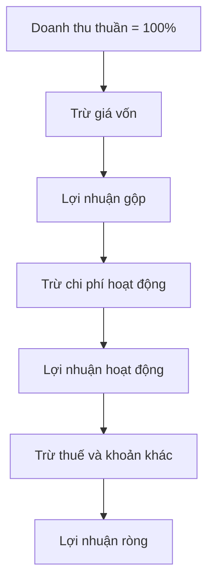

# Phân tích quy mô chung của báo cáo kết quả kinh doanh (Common Size Analysis of Income Statement)

> [!SUMMARY] Một câu tóm tắt
> Chia từng khoản mục báo cáo kết quả cho doanh thu giúp nhìn rõ mỗi đồng doanh thu được dùng vào chi phí nào và còn lại bao nhiêu lợi nhuận.

## 1. Tổng quan

Báo cáo kết quả kinh doanh phản ánh doanh thu, chi phí và lợi nhuận trong một giai đoạn. Số tuyệt đối dễ bị ảnh hưởng bởi quy mô, vì vậy phân tích quy mô chung biểu diễn các dòng dưới dạng phần trăm doanh thu. Cách đọc này giúp theo dõi biên lợi nhuận và cấu trúc chi phí qua các năm. Bài học tiếp tục kỹ thuật chuẩn hóa đã dùng cho bảng cân đối, nhưng mẫu số phù hợp ở đây là doanh thu.

## 2. Mục tiêu học tập

- [ ] Tính tỷ trọng chi phí và lợi nhuận trên doanh thu.
- [ ] Phân biệt biên lợi nhuận gộp, hoạt động và ròng.
- [ ] Diễn giải thay đổi tỷ trọng chi phí mà không vội kết luận.
- [ ] Đề xuất dữ liệu cần kiểm tra để tìm nguyên nhân biến động.

## 3. Kiến thức cần chuẩn bị

- Bài trước: [Phân tích quy mô chung của bảng cân đối kế toán](./01-common-size-analysis-of-balance-sheet.md) — nguyên tắc chuẩn hóa và so sánh tỷ trọng.
- Nhớ quan hệ cơ bản: Doanh thu thuần trừ giá vốn tạo lợi nhuận gộp.

## 4. Thử đoán trước

1. Nếu doanh thu tăng nhưng tỷ lệ giá vốn trên doanh thu cũng tăng, điều đó có thể nói gì về biên lợi nhuận gộp?
2. Hai công ty có doanh thu khác nhau có thể so sánh tỷ trọng chi phí bán hàng không?

## 5. Kiến thức cốt lõi

### 5.1. Lấy doanh thu làm chuẩn

Với mỗi dòng, lấy giá trị khoản mục chia cho doanh thu thuần cùng kỳ. Doanh thu thuần thường được quy ước là 100%; các khoản chi phí thể hiện phần doanh thu đã tiêu hao, còn lợi nhuận thể hiện phần còn lại tại một tầng tính toán.

$$
\text{Tỷ trọng khoản mục} = \frac{\text{Khoản mục báo cáo kết quả}}{\text{Doanh thu thuần}} \times 100\%
$$

### 5.2. Các biên lợi nhuận

Biên là tỷ lệ lợi nhuận trên doanh thu. Biên gộp tập trung vào giá vốn; biên hoạt động tính thêm chi phí hoạt động; biên ròng phản ánh phần lợi nhuận sau các khoản chi phí, lãi vay và thuế được báo cáo.

$$
\text{Biên lợi nhuận} = \frac{\text{Mức lợi nhuận tương ứng}}{\text{Doanh thu thuần}} \times 100\%
$$

| Chỉ tiêu | Phần chi phí đã tính | Câu hỏi phân tích |
|---|---|---|
| Biên gộp | Giá vốn | Giá bán, cơ cấu sản phẩm hoặc đầu vào đổi ra sao? |
| Biên hoạt động | Giá vốn và chi phí hoạt động | Chi phí bán hàng, quản lý có tăng nhanh hơn doanh thu? |
| Biên ròng | Bao gồm lãi vay, thuế và khoản khác | Lợi nhuận cuối cùng chịu ảnh hưởng từ đâu? |

### 5.3. Tìm thay đổi, rồi kiểm chứng

Nếu tỷ trọng giá vốn tăng từ 60% lên 68%, biên gộp giảm từ 40% xuống 32%. Có thể do giá nguyên liệu, chiết khấu, cạnh tranh hoặc cơ cấu sản phẩm. Cần kiểm tra thuyết minh và dữ liệu nhiều kỳ trước khi quy kết nguyên nhân.

## 6. Giải thích chi tiết

Phân tích tỷ trọng cho phép so sánh công ty có quy mô doanh thu khác nhau, nhưng không xóa được khác biệt ngành, mô hình bán hàng hay chính sách kế toán. Một doanh nghiệp tăng chi phí quảng cáo có thể đang đầu tư để mở rộng; kết quả cần được nhìn cùng tăng trưởng doanh thu và lợi nhuận tương lai, không thể suy ra chỉ từ một năm. Các khoản bất thường hoặc thay đổi phân loại cũng làm tỷ lệ biến động.

> [!TIP] Mẹo
> Đọc từ trên xuống theo cấu trúc báo cáo: doanh thu, giá vốn, lợi nhuận gộp, chi phí hoạt động, rồi lợi nhuận ròng. Cách này giúp xác định tầng nào làm biên thay đổi.

## 7. Ví dụ minh họa

**Ví dụ giả định:** Công ty Bình có doanh thu thuần 500 tỷ đồng, giá vốn 300 tỷ, chi phí bán hàng và quản lý 120 tỷ, chi phí lãi vay và thuế tổng cộng 30 tỷ. Lợi nhuận ròng là 50 tỷ.

1. Doanh thu thuần là chuẩn 100%.
2. Giá vốn chiếm 300/500 = **60%**, nên lợi nhuận gộp 200 tỷ tương đương **40%** doanh thu.
3. Chi phí bán hàng và quản lý chiếm 120/500 = **24%**. Lợi nhuận hoạt động trước các khoản tiếp theo là 80 tỷ, tương đương **16%**.
4. Lợi nhuận ròng 50/500 = **10%**.

Nếu năm trước giá vốn chỉ chiếm 55%, biên gộp giảm 5 điểm phần trăm. Đây là dấu hiệu cần tìm hiểu, chưa phải bằng chứng rằng hoạt động xấu đi.

## 8. Thực hành

**Bài tự làm:** Doanh thu thuần 800 tỷ, giá vốn 520 tỷ, chi phí hoạt động 200 tỷ, lợi nhuận ròng 40 tỷ.

- [ ] Tính tỷ trọng giá vốn và biên gộp.
- [ ] Tính tỷ trọng chi phí hoạt động và lợi nhuận ròng.
- [ ] Nêu một giả thuyết nếu tỷ trọng giá vốn kỳ sau tăng 4 điểm phần trăm.

Xem lời giải sau khi đã tự làm

Giá vốn chiếm 520/800 = 65%, nên biên gộp là 35%. Chi phí hoạt động chiếm 200/800 = 25%; lợi nhuận ròng chiếm 40/800 = 5%. Giá vốn tăng tỷ trọng có thể liên quan đến nguyên liệu đắt hơn, giá bán thấp hơn hoặc cơ cấu sản phẩm thay đổi; cần kiểm tra thêm dữ liệu và thuyết minh.

## 9. Những lỗi thường gặp

- **Dùng tổng tài sản làm mẫu số** — với báo cáo kết quả, dùng doanh thu thuần.
- **Nhầm phần trăm với điểm phần trăm** — thay đổi từ 40% xuống 32% là giảm 8 điểm phần trăm.
- **Coi biên giảm là bằng chứng duy nhất về hiệu quả kém** — xác định nguyên nhân và xem bối cảnh.
- **Cộng các tỷ lệ ở các tầng khác nhau** — lợi nhuận gộp và lợi nhuận ròng là các mức nối tiếp nhau, không phải chi phí song song.

## 10. Giải thích bằng lời của bạn

- Phân tích quy mô chung trên báo cáo kết quả là gì?
- Vì sao doanh thu thuần là mẫu số thích hợp?
- Một ví dụ của tôi về chi phí làm thay đổi biên:
- Chỗ tôi còn chưa chắc:

## 11. Câu hỏi ôn tập

### Câu 1

Mẫu số thông dụng để chuẩn hóa các khoản mục trên báo cáo kết quả kinh doanh là gì?

A. Doanh thu thuần
B. Tổng nợ phải trả
C. Tổng tài sản cố định
D. Tiền cuối kỳ

**Đáp án:** A. **Giải thích:** Doanh thu thuần được quy ước là 100%. Các lựa chọn khác không phải nền chuẩn hóa thông dụng cho báo cáo kết quả.

### Câu 2

Doanh thu là 1.000 tỷ đồng và giá vốn là 650 tỷ đồng. Biên lợi nhuận gộp bằng bao nhiêu?

A. 35%
B. 65%
C. 1,54%
D. 650%

**Đáp án:** A. **Giải thích:** Lợi nhuận gộp = 1.000 − 650 = 350 tỷ; biên gộp = 350/1.000 = 35%. 65% là tỷ trọng giá vốn.

### Câu 3

Những nguyên nhân nào có thể làm tỷ trọng giá vốn tăng? (Chọn nhiều.)

A. Giá nguyên liệu đầu vào tăng.
B. Doanh thu được đặt làm 100%.
C. Doanh nghiệp giảm giá bán hoặc tăng khuyến mại.
D. Mọi khoản mục khác đều chắc chắn không đổi.

**Đáp án:** A, C. **Giải thích:** Đầu vào đắt hơn hoặc giá bán thấp hơn có thể làm giá vốn chiếm tỷ lệ doanh thu cao hơn. Việc đặt doanh thu bằng 100% là quy ước; các khoản khác không nhất thiết cố định.

### Câu 4

Phát biểu sau đúng hay sai: “Tỷ trọng chi phí bán hàng tăng chứng minh doanh nghiệp đã vận hành kém hiệu quả.”

A. Đúng
B. Sai

**Đáp án:** B. **Giải thích:** Chi phí tăng tỷ trọng có thể do đầu tư mở rộng, chiến dịch có thời điểm hoặc doanh thu giảm. Cần đánh giá kết quả và bối cảnh.

## 12. Tóm tắt kiến thức

- Chuẩn hóa các dòng báo cáo kết quả bằng doanh thu thuần.
- Tỷ trọng giá vốn quyết định biên gộp; các tầng chi phí tiếp theo tác động đến biên hoạt động và ròng.
- Thay đổi tỷ lệ giúp khoanh vùng câu hỏi về giá, sản phẩm và chi phí.
- Cần xem nhiều kỳ, thuyết minh và đặc điểm ngành trước khi kết luận.

## 13. Tài liệu tham khảo

1. SEC Investor.gov — *How to Read a 10-K* — phần doanh thu, chi phí và lợi nhuận.
2. CFA Institute — tài liệu nền tảng về phân tích báo cáo tài chính.
3. Investopedia — *Common-Size Financial Statement*.

## 14. Bài học tiếp theo

[Phân tích quy mô chung của báo cáo lưu chuyển tiền tệ](./03-common-size-analysis-of-cash-flow-statement.md) — tiếp theo sẽ xem các dòng tiền theo tỷ lệ phù hợp với câu hỏi phân tích.
