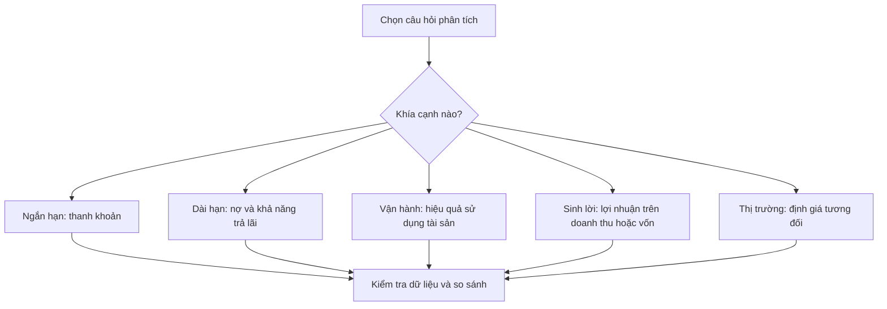

# Hiểu các tỷ số tài chính (Understanding Financial Ratios)

> [!SUMMARY] Một câu tóm tắt
> Tỷ số tài chính biến các con số trong báo cáo thành thước đo có thể so sánh, nhưng chỉ hữu ích khi hiểu câu hỏi, dữ liệu và bối cảnh đứng sau chúng.

## 1. Tổng quan

Doanh nghiệp có thể có doanh thu lớn nhưng thu tiền chậm, lợi nhuận tốt nhưng gánh nợ cao, hoặc định giá thấp vì triển vọng đang suy yếu. Tỷ số tài chính giúp tổ chức các câu hỏi này thành nhóm để đọc báo cáo có mục tiêu hơn. Bài học mở đầu module phân tích tỷ số: trước khi đi sâu vào từng công thức hoạt động, thanh khoản, khả năng sinh lời hay định giá, bạn cần hiểu cách tỷ số được tạo ra và so sánh. Đây là công cụ sàng lọc và đặt câu hỏi, không phải câu trả lời tự động về việc mua hay bán.

## 2. Mục tiêu học tập

- [ ] Phân loại các tỷ số theo câu hỏi phân tích.
- [ ] Giải thích ý nghĩa của tử số, mẫu số và kỳ đo lường.
- [ ] So sánh tỷ số qua thời gian hoặc giữa doanh nghiệp tương đồng.
- [ ] Nhận diện giới hạn của một kết luận chỉ dựa trên một tỷ số.

## 3. Kiến thức cần chuẩn bị

- Bài trước: [Quiz Common-Size Analysis](../05-common-size-analysis/04-quiz-common-size-analysis-quiz.md) — ôn cách biểu diễn các khoản mục báo cáo theo tỷ trọng.
- Cần biết: bảng cân đối kế toán ghi nhận tài sản, nợ và vốn chủ sở hữu tại một thời điểm; báo cáo kết quả kinh doanh và lưu chuyển tiền tệ phản ánh hoạt động trong một kỳ.

## 4. Thử đoán trước

1. Hai công ty có cùng lợi nhuận ròng nhưng quy mô tài sản khác nhau: chỉ nhìn lợi nhuận có đủ để so hiệu quả không?
2. Nếu một tỷ số tăng, điều đó có luôn là tín hiệu tốt không?

## 5. Kiến thức cốt lõi

### 5.1. Tỷ số trả lời những câu hỏi khác nhau

**Tỷ số tài chính** (financial ratio) là phép chia một đại lượng tài chính cho đại lượng khác để làm rõ quan hệ giữa chúng. Nhóm **thanh khoản** xem doanh nghiệp đáp ứng nghĩa vụ ngắn hạn ra sao; nhóm **đòn bẩy và khả năng thanh toán dài hạn** xem cấu trúc nợ có bền vững không; nhóm **hoạt động** đo tốc độ quản lý hàng tồn kho, khoản phải thu và tài sản; nhóm **sinh lời** đánh giá lợi nhuận tạo ra trên doanh thu hoặc vốn; nhóm **định giá** liên hệ giá thị trường với lợi nhuận, doanh thu hoặc giá trị sổ sách.

### 5.2. Đọc cấu trúc trước khi đọc kết quả

Trong tỷ số, **tử số** là đại lượng được so với **mẫu số**. Ví dụ, lợi nhuận ròng chia cho doanh thu hỏi mỗi đồng doanh thu để lại bao nhiêu lợi nhuận; lợi nhuận ròng chia cho vốn chủ sở hữu hỏi vốn chủ tạo ra mức lợi nhuận nào. Đổi mẫu số là đổi câu hỏi. Cần kiểm tra đơn vị, kỳ báo cáo, cách định nghĩa và liệu các khoản mục có nhất quán hay không.

| Nhóm | Câu hỏi điển hình | Ví dụ đại lượng |
|---|---|---|
| Thanh khoản | Có đủ nguồn lực ngắn hạn trả nợ đến hạn? | Tài sản ngắn hạn / Nợ ngắn hạn |
| Hoạt động | Vốn và tài sản được vận hành hiệu quả thế nào? | Doanh thu / Tài sản bình quân |
| Sinh lời | Doanh nghiệp giữ lại hoặc tạo lợi nhuận ra sao? | Lợi nhuận / Doanh thu hoặc vốn |
| Định giá | Thị trường đang trả bao nhiêu cho một đơn vị kết quả? | Giá cổ phiếu / EPS |

### 5.3. Mẫu số và kỳ đo lường

Báo cáo kết quả kinh doanh đo hoạt động trong cả kỳ, còn bảng cân đối là ảnh chụp tại một ngày. Khi ghép dòng chảy trong kỳ với số dư tại một thời điểm, nhiều phân tích dùng số dư bình quân đầu kỳ và cuối kỳ. Cách đó giảm sai lệch do số dư biến động, nhưng số bình quân hai điểm vẫn có thể bỏ qua mùa vụ hoặc giao dịch lớn giữa kỳ.

## 6. Giải thích chi tiết

Một tỷ số không có ngưỡng “tốt” chung cho mọi doanh nghiệp. Nhà bán lẻ thường có vòng quay hàng tồn kho khác công ty phần mềm; ngân hàng có cấu trúc tài sản và nợ khác nhà sản xuất. Vì vậy, so sánh theo chuỗi thời gian của chính công ty và với nhóm đối thủ cùng mô hình thường hữu ích hơn việc nhìn một con số đơn lẻ.

> [!WARNING] Cảnh báo
> Kết quả kế toán có thể bị ảnh hưởng bởi khoản bất thường, chính sách ghi nhận, mùa vụ hoặc thay đổi cơ cấu kinh doanh. Hãy đọc thuyết minh báo cáo và kiểm tra dòng tiền trước khi diễn giải tỷ số như bằng chứng về sức khỏe tài chính.

Tỷ số cũng có thể cải thiện vì lý do không bền vững. Chẳng hạn lợi nhuận tăng do bán tài sản một lần, hoặc tỷ lệ nợ trên vốn chủ giảm sau khi phát hành cổ phiếu làm pha loãng cổ đông hiện hữu. Luôn hỏi: thay đổi đến từ hoạt động cốt lõi, biến động mẫu số, hay một giao dịch đặc biệt? Hãy xem nhiều kỳ và dùng các thước đo bổ sung.

## 7. Ví dụ minh họa

**Ví dụ giả định:** Công ty An Phú ghi nhận doanh thu 500 tỷ đồng, lợi nhuận ròng 25 tỷ đồng. Tổng tài sản đầu năm là 180 tỷ và cuối năm 220 tỷ. Công ty Bình Minh có doanh thu 300 tỷ, lợi nhuận ròng 24 tỷ, tài sản bình quân 120 tỷ.

1. Biên lợi nhuận ròng An Phú = 25 / 500 = 5%. Mỗi 100 đồng doanh thu để lại 5 đồng lợi nhuận ròng.
2. Tài sản bình quân An Phú = (180 + 220) / 2 = 200 tỷ. Vòng quay tổng tài sản = 500 / 200 = 2,5 lần.
3. Bình Minh có biên lợi nhuận = 24 / 300 = 8%, và vòng quay tài sản = 300 / 120 = 2,5 lần.
4. Bình Minh giữ biên lợi nhuận cao hơn trong ví dụ, còn cả hai tạo doanh thu trên tài sản ở cùng mức. Chưa thể kết luận công ty nào hấp dẫn hơn nếu chưa xét nợ, dòng tiền, rủi ro, triển vọng và giá cổ phiếu.

## 8. Thực hành

**Bài tự làm:** Doanh nghiệp giả định có doanh thu 800 tỷ đồng, lợi nhuận ròng 40 tỷ, tài sản đầu kỳ 250 tỷ và cuối kỳ 350 tỷ.

- [ ] Tính biên lợi nhuận ròng.
- [ ] Tính tài sản bình quân và vòng quay tổng tài sản.
- [ ] Nêu một dữ kiện khác cần xem trước khi kết luận doanh nghiệp hoạt động tốt.

Xem lời giải sau khi đã tự làm

Biên lợi nhuận = 40 / 800 = 5%. Tài sản bình quân = (250 + 350) / 2 = 300 tỷ; vòng quay = 800 / 300 ≈ 2,67 lần. Cần xem thêm xu hướng nhiều năm, dòng tiền, nợ, ngành và khoản bất thường để diễn giải kết quả.

## 9. Những lỗi thường gặp

- **Coi tỷ số cao luôn tốt** — xác định câu hỏi và đánh đổi; tỷ số thanh khoản quá cao có thể đi cùng vốn nhàn rỗi.
- **So sánh khác ngành** — dùng doanh nghiệp có mô hình và kỳ báo cáo tương đồng.
- **Bỏ qua mẫu số** — kiểm tra xem thay đổi đến từ tử số hay mẫu số.
- **Dùng số cuối kỳ thay cho bình quân một cách máy móc** — cân nhắc số bình quân và mùa vụ khi ghép số dư với doanh thu hoặc lợi nhuận.
- **Xem một tỷ số như kết luận đầu tư** — kết hợp báo cáo gốc, dòng tiền, rủi ro và định giá.

## 10. Giải thích bằng lời của bạn

- Khái niệm: Tỷ số tài chính là gì và tử số/mẫu số đại diện điều gì?
- Vì sao: Vì sao cùng một tỷ số có thể được diễn giải khác giữa hai ngành?
- Ví dụ của tôi: Tạo một tỷ số từ doanh thu, lợi nhuận hoặc tài sản.
- Chỗ chưa chắc: Điều gì về kỳ báo cáo hoặc chất lượng dữ liệu bạn muốn kiểm tra thêm?

## 11. Câu hỏi ôn tập

### Câu 1

Tỷ số lợi nhuận ròng chia cho doanh thu chủ yếu cho biết điều gì?

A. Lợi nhuận ròng trên mỗi đồng doanh thu
B. Mức nợ đến hạn trong năm
C. Tốc độ thu tiền từ khách hàng
D. Giá thị trường trên mỗi cổ phiếu

**Đáp án:** A. **Giải thích:** A là biên lợi nhuận ròng. B cần dữ liệu nợ, C liên quan khoản phải thu, D là thước đo định giá.

### Câu 2

Khi so hiệu quả sử dụng tài sản của hai công ty, cách nào phù hợp nhất?

A. So bất kỳ công ty nào có giá cổ phiếu gần nhau
B. So doanh nghiệp cùng ngành, cùng kỳ và kiểm tra định nghĩa dữ liệu
C. Chỉ lấy số của một quý bất kỳ
D. Chọn công ty có doanh thu lớn hơn mà không xét tài sản

**Đáp án:** B. **Giải thích:** B kiểm soát khác biệt về mô hình và kỳ đo. A và D không xét quy mô liên quan; C dễ bị mùa vụ chi phối.

### Câu 3

Những phát biểu nào đúng khi diễn giải tỷ số tài chính? (Chọn nhiều.)

A. Tử số và mẫu số xác định câu hỏi mà tỷ số trả lời.
B. Một tỷ số có ngưỡng tốt chung cho mọi ngành.
C. So sánh qua nhiều kỳ giúp nhận ra xu hướng.
D. Lợi nhuận kế toán luôn bằng tiền mặt tạo ra trong kỳ.

**Đáp án:** A, C. **Giải thích:** A và C đúng. B bỏ qua khác biệt ngành; D nhầm lợi nhuận với dòng tiền.

### Câu 4

Phát biểu sau đúng hay sai: “Nếu tỷ số của doanh nghiệp tăng, sức khỏe tài chính chắc chắn đã tốt lên.”

A. Đúng
B. Sai

**Đáp án:** B. **Giải thích:** Tỷ số tăng có thể do mẫu số giảm, khoản bất thường hoặc đánh đổi khác; cần xem nguyên nhân và bối cảnh.

## 12. Tóm tắt kiến thức

- Tỷ số là phép so sánh hai đại lượng để trả lời một câu hỏi phân tích cụ thể.
- Các nhóm chính gồm thanh khoản, hoạt động, sinh lời và định giá.
- Kỳ báo cáo, số dư bình quân, định nghĩa và chất lượng dữ liệu ảnh hưởng kết quả.
- So sánh theo thời gian và với doanh nghiệp tương đồng; không dùng một tỷ số làm quyết định đầu tư.

## 13. Tài liệu tham khảo

1. SEC / Investor.gov — tài liệu hướng dẫn đọc báo cáo tài chính và phân tích doanh nghiệp.
2. CFA Institute — nội dung Financial Statement Analysis trong chương trình CFA.
3. Investopedia — các mục giải thích financial ratios, liquidity ratios và profitability ratios.

## 14. Bài học tiếp theo

[Quiz: Các tỷ số tài chính](./02-quiz-financial-ratios-quiz.md) — dùng câu hỏi ngắn để củng cố cách phân loại và diễn giải tỷ số.
