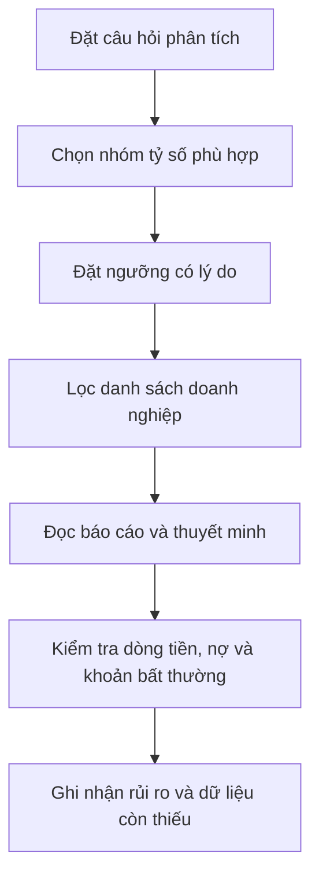

# Dùng tỷ số để chọn lọc cổ phiếu (Using Ratios to select Stocks)

> [!SUMMARY] Một câu tóm tắt
> Tỷ số tài chính hữu ích nhất khi phục vụ một câu hỏi cụ thể, được kết hợp thành nhiều góc nhìn rồi xác minh bằng báo cáo và bối cảnh kinh doanh.

## 1. Tổng quan

Đây là bài kết thúc module về phân tích tỷ số tài chính. Ta đã học các chỉ tiêu vận hành, thanh khoản, khả năng thanh toán, sinh lời và định giá; giờ cần ghép chúng thành quy trình sàng lọc có kỷ luật. Công cụ lọc giúp thu hẹp danh sách, nhưng không thay thế việc đọc báo cáo hay đánh giá rủi ro. Bài tiếp theo chuyển sang quan điểm chọn cổ phiếu của Benjamin Graham.

## 2. Mục tiêu học tập

- [ ] Chọn nhóm tỷ số phù hợp với mục tiêu phân tích.
- [ ] Dùng nhiều chỉ tiêu để giảm nguy cơ kết luận từ một con số.
- [ ] Xác minh kết quả lọc với báo cáo tài chính và dòng tiền.
- [ ] Ghi lại giả định, ngoại lệ và dữונים còn thiếu trước khi đánh giá.

## 3. Kiến thức cần chuẩn bị

- Bài trước: [Quiz Sinh lời và Định giá](./11-quiz-profitability-valuation-ratios-quiz.md) — ôn lại P/E, P/S, P/B và các tỷ số sinh lời.
- Có thể xem lại [Activity ratios](./01-activity-ratios.md), [Liquidity và Solvency](./02-liquidity-solvency.md) để nối các nhóm chỉ số.

## 4. Thử đoán trước

1. Nếu muốn tìm doanh nghiệp có bảng cân đối khỏe, bạn sẽ xem nhóm tỷ số nào trước?
2. Một cổ phiếu vượt qua bộ lọc định lượng đã đủ để kết luận phù hợp chưa?

## 5. Kiến thức cốt lõi

### 5.1. Bắt đầu bằng câu hỏi

Xác định điều cần tìm hiểu trước khi đặt ngưỡng. Ví dụ: doanh nghiệp có lợi nhuận ổn định không, có thể trả lãi trong kịch bản khó khăn không, hay giá hiện tại đang giả định tăng trưởng nào? Một câu hỏi rõ ràng giúp chọn đúng nhóm chỉ tiêu.

### 5.2. Ghép nhiều nhóm chỉ tiêu

| Câu hỏi | Nhóm tỷ số gợi ý | Kiểm tra bổ sung |
|---|---|---|
| Hoạt động có sinh lời không? | Biên gộp/hoạt động/ròng, ROA, ROE | Khoản bất thường, dòng tiền hoạt động |
| Bảng cân đối có sức chịu đựng không? | Current/quick ratio, nợ trên vốn, coverage | Kỳ hạn nợ, lãi suất, cam kết ngoài bảng cân đối |
| Vận hành vốn có hiệu quả không? | Vòng quay tài sản, hàng tồn kho, phải thu | Mùa vụ, điều khoản tín dụng, mô hình kinh doanh |
| Giá thị trường đang hàm ý gì? | P/E, P/S, P/B | Tăng trưởng, chất lượng lợi nhuận, đối thủ tương đồng |

### 5.3. Quy trình lọc rồi xác minh

## 6. Giải thích chi tiết

Ngưỡng lọc không phải chân lý phổ quát. Current ratio 1,5 có thể hợp lý ở công ty dịch vụ ít hàng tồn, nhưng không đủ để hiểu một nhà bán lẻ có vòng quay nhanh hay doanh nghiệp theo mùa. Tương tự, ROE cao có thể do lợi nhuận tốt hoặc vốn chủ nhỏ; P/E thấp có thể là giá thấp hoặc triển vọng suy yếu.

Screener có thể dùng dữ liệu trễ, kỳ báo cáo khác nhau, cách điều chỉnh EPS khác nhau hoặc bỏ qua khoản một lần. Sau khi thu hẹp danh sách, kiểm tra báo cáo tài chính đã công bố, thuyết minh, dòng tiền hoạt động (CFO) so với lợi nhuận, nợ và khả năng trả lãi. Đọc xu hướng nhiều kỳ giúp phân biệt cải thiện bền vững với biến động nhất thời.

> [!TIP] Ghi lại thiết kế bộ lọc
> Với mỗi ngưỡng, ghi “vì sao dùng”, kỳ dữ liệu, ngành áp dụng và điều kiện loại trừ. Điều này giúp bạn sửa bộ lọc khi thấy nó loại nhầm doanh nghiệp phù hợp.

> [!WARNING] Không biến bộ lọc thành khuyến nghị
> Sàng lọc chỉ tạo danh sách để nghiên cứu tiếp, không dự báo chắc chắn hiệu suất tương lai và không thay thế đánh giá rủi ro cá nhân.

## 7. Ví dụ minh họa

**Ví dụ giả định:** Bạn muốn lập danh sách các công ty tiêu dùng có lợi nhuận hoạt động dương, nợ vừa phải và dòng tiền kinh doanh không quá lệch khỏi lợi nhuận.

1. Chọn biên hoạt động và ROA để xem khả năng sinh lời; không chỉ lấy ROE vì đòn bẩy có thể làm ROE tăng.
2. Chọn nợ/vốn chủ và interest coverage để nhìn nghĩa vụ dài hạn; kiểm tra kỳ hạn nợ trong thuyết minh.
3. So CFO với lợi nhuận ròng qua ba năm. Nếu lợi nhuận tăng nhưng CFO liên tục yếu, tìm nguyên nhân ở phải thu, hàng tồn kho hoặc ghi nhận doanh thu.
4. Dùng P/E hoặc P/S để so tương đối với đối thủ cùng ngành, đồng thời ghi nhận chênh lệch tăng trưởng và rủi ro.
5. Mở báo cáo gốc của các công ty còn lại, xác minh dữ liệu và ghi rõ câu hỏi chưa được giải đáp.

Kết quả là danh sách nghiên cứu có căn cứ hơn, không phải kết luận mua bán.

## 8. Thực hành

**Bài tự làm:** Bạn muốn sàng lọc doanh nghiệp sản xuất có hoạt động sinh lời, quản lý hàng tồn kho và nợ ở mức có thể theo dõi. Hãy hoàn thành checklist:

- [ ] Chọn ít nhất hai tỷ số sinh lời hoặc hoạt động.
- [ ] Chọn hai chỉ tiêu về nợ/thanh toán.
- [ ] Viết một kiểm tra báo cáo gốc về dòng tiền hoặc hàng tồn kho.
- [ ] Nêu một hạn chế của ngưỡng lọc cố định.

Xem lời giải sau khi đã tự làm

Một cách làm hợp lý: xem biên hoạt động và ROA; vòng quay hàng tồn kho hoặc DIO; nợ/vốn chủ và interest coverage; sau đó đọc biến động tồn kho, CFO và kỳ hạn nợ trong báo cáo. Ngưỡng phải xét theo ngành, mùa vụ và chuỗi thời gian; không có một bộ ngưỡng phù hợp cho mọi công ty.

## 9. Những lỗi thường gặp

- **Chọn ngưỡng trước khi xác định câu hỏi** — dễ lọc theo con số tùy tiện; bắt đầu từ giả thuyết phân tích.
- **Dựa vào một tỷ số duy nhất** — một chỉ tiêu có thể bị méo; kết hợp nhóm sinh lời, rủi ro và định giá.
- **Coi dữ liệu screener là dữ liệu cuối cùng** — có thể trễ hoặc khác cách tính; xác minh với báo cáo công bố.
- **Bỏ qua đặc thù ngành và mùa vụ** — tỷ số lệch nhau đáng kể; so theo mô hình tương đồng và nhiều kỳ.

## 10. Giải thích bằng lời của bạn

- Khái niệm: sàng lọc cổ phiếu bằng tỷ số là gì?
- Vì sao: vì sao cần đọc báo cáo gốc sau khi lọc?
- Ví dụ của tôi: chọn một câu hỏi và nhóm tỷ số tương ứng.
- Chỗ chưa chắc: dữ liệu hoặc giả định nào bạn cần xác minh thêm?

## 11. Câu hỏi ôn tập

### Câu 1

Bước hợp lý đầu tiên khi thiết kế bộ lọc tỷ số là gì?

A. Chọn cổ phiếu có P/E thấp nhất
B. Đặt câu hỏi phân tích cần trả lời
C. Chọn ngưỡng phổ biến trên mạng
D. Xem biểu đồ giá trước rồi bỏ qua báo cáo

**Đáp án:** B. **Giải thích:** Câu hỏi xác định nhóm chỉ tiêu và ngưỡng có ý nghĩa; các lựa chọn khác bắt đầu từ một tiêu chí tùy tiện hoặc bỏ qua phân tích nền tảng.

### Câu 2

Sau khi một công ty vượt qua screener, bước nào phù hợp nhất?

A. Xem kết quả như quyết định đầu tư cuối cùng
B. Bỏ qua các khoản mục không khớp giả thuyết
C. Đối chiếu số liệu với báo cáo gốc và thuyết minh
D. Tăng ngưỡng cho đến khi chỉ còn một công ty

**Đáp án:** C. **Giải thích:** Screener hỗ trợ thu hẹp danh sách; báo cáo gốc giúp xác minh kỳ dữ liệu, khoản bất thường và rủi ro.

### Câu 3

Những việc nào giúp đánh giá chất lượng kết quả sàng lọc? (Chọn nhiều)

A. So CFO với lợi nhuận qua nhiều kỳ
B. Kiểm tra kỳ hạn nợ và khả năng trả lãi
C. So sánh công ty khác ngành bằng cùng một ngưỡng bất kể mô hình
D. Ghi lại lý do cho từng ngưỡng lọc

**Đáp án:** A, B, D. **Giải thích:** Các bước này kiểm tra chất lượng lợi nhuận, sức chịu nợ và logic bộ lọc; C bỏ qua đặc thù ngành.

### Câu 4

Nếu ROE cao do vốn chủ sở hữu rất nhỏ, có thể cần kiểm tra thêm đòn bẩy và cấu trúc vốn.

A. Đúng
B. Sai

**Đáp án:** A. **Giải thích:** Mẫu số vốn chủ nhỏ có thể làm ROE tăng mạnh mà không chứng minh hoạt động cốt lõi tốt hơn.

## 12. Tóm tắt kiến thức

- Bắt đầu từ câu hỏi phân tích, rồi chọn nhóm tỷ số và ngưỡng có căn cứ.
- Kết hợp sinh lời, vận hành, thanh khoản/nợ và định giá theo mục tiêu.
- Đọc báo cáo gốc, thuyết minh và dòng tiền để xác minh kết quả lọc.
- Tỷ số là công cụ sàng lọc; bối cảnh ngành và rủi ro vẫn cần được đánh giá.

## 13. Tài liệu tham khảo

1. Investopedia, “Financial Ratios” — tổng quan nhóm tỷ số và cách diễn giải.
2. SEC, Investor.gov — tài liệu hướng dẫn đọc báo cáo tài chính doanh nghiệp.
3. CFA Institute, *Financial Statement Analysis* — khung phân tích và đánh giá dữ liệu tài chính.

## 14. Bài học tiếp theo

[Benjamin Graham's Recommendation on Stock Selection](../07-benjamin-graham-value-investing/01-benjamin-graham-s-recommendation-on-stock-selection.md) — tiếp tục với một khung chọn cổ phiếu dựa trên nguyên tắc đầu tư giá trị.
