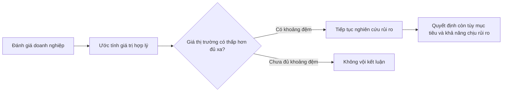

# Khuyến nghị chọn cổ phiếu của Benjamin Graham (Benjamin Graham's Recommendation on Stock Selection)

> [!SUMMARY] Một câu tóm tắt
> Graham khuyến nghị đánh giá doanh nghiệp và giá trị ước tính trước khi nhìn giá thị trường, rồi chỉ cân nhắc mức giá có khoảng đệm đủ lớn cho sai số.

## 1. Tổng quan

Phân tích tỷ số giúp mô tả tình hình doanh nghiệp, nhưng nhà đầu tư còn phải quyết định giá hiện tại có hợp lý hay không. Benjamin Graham, một trong những người đặt nền móng cho đầu tư giá trị, nhấn mạnh sự khác nhau giữa giá thị trường và giá trị kinh tế của doanh nghiệp. Bài này giới thiệu cách suy nghĩ và các câu hỏi sàng lọc ở mức khái niệm; các tiêu chí định lượng cụ thể sẽ được tách sang bài kế tiếp. Không có phương pháp nào bảo đảm lợi nhuận hoặc loại bỏ hoàn toàn rủi ro.

## 2. Mục tiêu học tập

- [ ] Phân biệt giá thị trường với giá trị nội tại.
- [ ] Giải thích được biên an toàn và mục đích của nó.
- [ ] Đặt câu hỏi về chất lượng doanh nghiệp, bảng cân đối và mức giá.
- [ ] Mô tả ít nhất hai giới hạn khi ước tính giá trị.

## 3. Kiến thức cần chuẩn bị

- Bài trước: [Dùng tỷ số để chọn lọc cổ phiếu](../06-financial-ratio-analysis/12-using-ratios-to-select-stocks.md) — ôn lại cách dùng nhiều chỉ tiêu và xác minh số liệu.
- Khái niệm cần nhớ: lợi nhuận, tài sản, nợ và tỷ số định giá đều phụ thuộc vào kỳ báo cáo và cách ghi nhận kế toán.

## 4. Thử đoán trước

1. Nếu một cổ phiếu giảm giá mạnh, điều đó có tự động nghĩa là doanh nghiệp đang bị định giá thấp không?
2. Vì sao nhà đầu tư có thể muốn mua thấp hơn giá trị mình ước tính?

## 5. Kiến thức cốt lõi

### 5.1. Giá thị trường và giá trị nội tại

**Giá thị trường** là mức giá giao dịch hiện tại do cung cầu quyết định. **Giá trị nội tại** là ước tính giá trị kinh tế dựa trên khả năng tạo lợi nhuận, tài sản, rủi ro và triển vọng của doanh nghiệp. Giá trị nội tại không phải con số quan sát trực tiếp; các nhà phân tích có thể đưa ra kết quả khác nhau vì giả định khác nhau.

Graham khuyến khích nhà đầu tư đánh giá doanh nghiệp trước rồi mới so với giá. Giá thấp tuyệt đối không đủ; cần hỏi thấp so với điều gì và chất lượng doanh nghiệp ra sao.

### 5.2. Biên an toàn

**Biên an toàn (margin of safety)** là khoảng chênh lệch giữa giá trị ước tính và giá mua. Nếu ước tính giá trị là 100 đơn vị và giá mua là 70, biên an toàn tính theo giá trị ước tính là 30%. Khoảng đệm này nhằm hấp thụ một phần sai số dự báo, biến động kinh doanh hoặc thông tin chưa biết.

### 5.3. Câu hỏi sàng lọc theo tinh thần Graham

| Góc nhìn | Câu hỏi cần đặt ra | Vì sao quan trọng |
|---|---|---|
| Hoạt động kinh doanh | Lợi nhuận có ổn định qua nhiều năm không? | Một năm tốt có thể do yếu tố bất thường. |
| Bảng cân đối | Nợ và nghĩa vụ có thể chịu đựng được không? | Nợ lớn làm doanh nghiệp dễ tổn thương khi doanh thu giảm. |
| Giá mua | Giá hiện tại có hợp lý so với lợi nhuận và tài sản? | Doanh nghiệp tốt vẫn có thể là khoản đầu tư đắt. |
| Giả định | Điều gì phải xảy ra để mức giá này hợp lý? | Giả định quá lạc quan làm giảm vùng đệm. |

## 6. Giải thích chi tiết

Biên an toàn không phải dự báo rằng giá sẽ tăng đến giá trị ước tính. Nó là nguyên tắc thận trọng trước khi đưa ra quyết định khi thông tin không hoàn hảo. Muốn dùng nguyên tắc này, người phân tích phải nhận diện rủi ro của doanh nghiệp và hiểu độ bất định trong các con số mình sử dụng.

Giá trị ước tính thay đổi khi lợi nhuận, lãi suất, cạnh tranh hoặc triển vọng ngành thay đổi. Công ty có tài sản vô hình lớn, lợi nhuận chu kỳ hoặc mô hình kinh doanh mới thường khó định giá bằng một công thức duy nhất. Cũng cần tránh xem tài sản ghi sổ như giá trị có thể thu hồi ngay; chất lượng và khả năng thanh lý có thể khác đáng kể.

> [!WARNING] Biên an toàn không bảo đảm không lỗ
> Ước tính giá trị có thể sai, và doanh nghiệp có thể suy giảm lâu dài. Khoảng đệm chỉ giúp giảm phụ thuộc vào một dự báo chính xác tuyệt đối.

> [!TIP] Tách dữ kiện khỏi giả định
> Ghi riêng số liệu đã công bố, giả định của bạn và câu hỏi chưa được giải đáp. Cách này giúp phát hiện khi kết luận dựa quá nhiều vào kỳ vọng.

## 7. Ví dụ minh họa

**Ví dụ giả định:** Sau khi nghiên cứu lợi nhuận và tài sản, một nhà phân tích ước tính giá trị mỗi cổ phiếu của công ty A trong khoảng 80–100 nghìn đồng. Thị giá là 90 nghìn đồng.

1. Dùng khoảng giá trị thay vì khẳng định một con số chính xác, vì dự báo có sai số.
2. Thị giá 90 nằm trong khoảng ước tính, nên chưa thể nói có biên an toàn đáng kể.
3. Nếu thị giá là 65 nghìn đồng, mức chênh so với cận thấp 80 là 18,75%: $(80-65)/80$.
4. Tiếp tục kiểm tra liệu lợi nhuận có bền vững, nợ có kiểm soát và giả định có hợp lý không. Mức giá thấp hơn chỉ là tín hiệu để nghiên cứu tiếp.

Đây là minh họa phương pháp, không phải khuyến nghị mua bán.

## 8. Thực hành

**Bài tự làm:** Bạn ước tính giá trị cổ phiếu B là 120–150 nghìn đồng; giá thị trường 105 nghìn đồng.

- [ ] Tính khoảng chênh giữa giá thị trường và cận thấp ước tính.
- [ ] Nêu hai dữ kiện doanh nghiệp cần xác minh trước khi kết luận.
- [ ] Giải thích vì sao kết quả chưa đủ để dự báo lợi nhuận đầu tư.

Xem lời giải sau khi đã tự làm

So với cận thấp 120, chênh lệch là $(120-105)/120=12,5\%$. Đây chỉ là phép so sánh với một giả định giá trị. Cần kiểm tra xu hướng lợi nhuận, dòng tiền, nợ, rủi ro ngành và chất lượng tài sản. Giá trị ước tính có thể sai nên con số này không bảo đảm mức sinh lời.

## 9. Những lỗi thường gặp

- **Cho rằng giá giảm đồng nghĩa cổ phiếu rẻ** — so với giá trị và chất lượng doanh nghiệp, không chỉ so với giá quá khứ.
- **Coi giá trị nội tại là con số chắc chắn** — dùng khoảng ước tính và ghi rõ giả định.
- **Hiểu biên an toàn là bảo đảm không lỗ** — nhớ rằng doanh nghiệp và ước tính đều có thể xấu đi.
- **Chỉ nhìn tỷ số định giá** — kết hợp lợi nhuận, nợ, tài sản và bối cảnh kinh doanh.

## 10. Giải thích bằng lời của bạn

- Khái niệm: giá thị trường và giá trị nội tại khác nhau thế nào?
- Vì sao: biên an toàn giúp xử lý loại bất định nào?
- Ví dụ của tôi: tự đặt một khoảng giá trị và một giá thị trường giả định.
- Chỗ chưa chắc: giả định nào trong ví dụ cần thêm bằng chứng?

## 11. Câu hỏi ôn tập

### Câu 1

Giá trị nội tại của một công ty nên được hiểu như thế nào?

A. Giá đóng cửa gần nhất trên sàn
B. Mức giá cao nhất công ty từng đạt
C. Ước tính giá trị kinh tế dựa trên hoạt động và rủi ro
D. Giá trị do một nhà phân tích công bố luôn chính xác

**Đáp án:** C. **Giải thích:** Giá trị nội tại là ước tính dựa trên các yếu tố kinh tế; A là giá thị trường, B là dữ kiện lịch sử, D nhầm ước tính với sự chắc chắn.

### Câu 2

Một cổ phiếu có giá trị ước tính 100.000 đồng và giá mua giả định 75.000 đồng. Biên an toàn tính theo giá trị ước tính là bao nhiêu?

A. 25%
B. 33,3%
C. 75%
D. 125%

**Đáp án:** A. **Giải thích:** $(100.000-75.000)/100.000=25\%$. B dùng giá mua làm mẫu số; C là tỷ lệ giá mua trên giá trị; D không phải cách tính biên an toàn.

### Câu 3

Những yếu tố nào nên được xem xét khi đánh giá doanh nghiệp theo cách tiếp cận thận trọng? (Chọn nhiều)

A. Tính ổn định của lợi nhuận qua nhiều kỳ
B. Nghĩa vụ nợ và khả năng chịu đựng
C. Chỉ biến động giá trong vài phiên
D. Mức giá so với giả định về giá trị

**Đáp án:** A, B, D. **Giải thích:** Lợi nhuận, sức khỏe bảng cân đối và mức giá đều quan trọng; biến động vài phiên không thay thế phân tích doanh nghiệp.

### Câu 4

Biên an toàn loại bỏ hoàn toàn khả năng thua lỗ nếu nhà đầu tư tính đúng công thức.

A. Đúng
B. Sai

**Đáp án:** B. **Giải thích:** Giá trị có thể ước tính sai và tình hình doanh nghiệp có thể xấu đi; biên an toàn không bảo đảm kết quả.

## 12. Tóm tắt kiến thức

- Giá thị trường là giá giao dịch; giá trị nội tại là ước tính dựa trên kinh tế doanh nghiệp.
- Biên an toàn tạo vùng đệm trước sai số và thông tin không chắc chắn.
- Cần xem xét lợi nhuận, bảng cân đối, mức giá và giả định.
- Một bộ tiêu chí không thay thế xác minh dữ liệu và đánh giá rủi ro.

## 13. Tài liệu tham khảo

1. Benjamin Graham, *The Intelligent Investor* — tư duy đầu tư thận trọng và biên an toàn.
2. CFA Institute, tài liệu về phân tích báo cáo tài chính và định giá doanh nghiệp.
3. SEC, Investor.gov — hướng dẫn nhà đầu tư tìm hiểu công ty và báo cáo công bố.

## 14. Bài học tiếp theo

[Tiêu chí định lượng của Benjamin Graham](./02-benjamin-graham-s-quantitative-criteria-for-stock-selection.md) — tiếp nối các nguyên tắc chung bằng những chỉ tiêu sàng lọc cụ thể.
