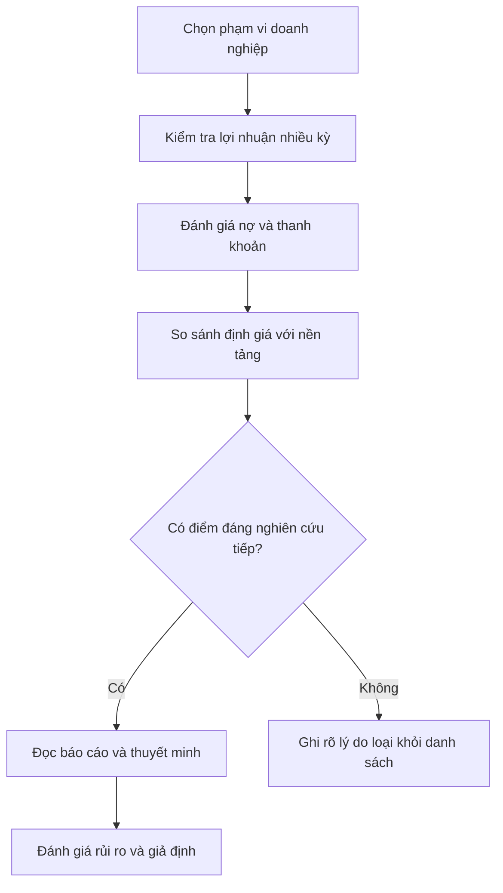

# Tiêu chí định lượng của Benjamin Graham để chọn cổ phiếu (Benjamin Graham's Quantitative Criteria for Stock Selection)

> [!SUMMARY] Một câu tóm tắt
> Các tiêu chí định lượng kiểu Graham giúp sàng lọc doanh nghiệp có quy mô, lợi nhuận và bảng cân đối đáng xem xét, nhưng cần điều chỉnh theo ngành và kiểm tra dữ liệu gốc.

## 1. Tổng quan

Bài trước giới thiệu việc phân biệt giá với giá trị và sử dụng biên an toàn. Bài này chuyển sang các nhóm thước đo định lượng thường gắn với cách sàng lọc của Graham: quy mô, ổn định lợi nhuận, sức khỏe tài chính, cổ tức và mức định giá. Những ngưỡng lịch sử có thể giúp đặt câu hỏi có hệ thống, nhưng không phải chuẩn phổ quát cho thị trường ngày nay. Bài sau sẽ xem một phép ước tính liên quan đến EPS và giá trị sổ sách, đồng thời làm rõ giới hạn của nó.

## 2. Mục tiêu học tập

- [ ] Liệt kê các nhóm tiêu chí định lượng thường dùng trong sàng lọc kiểu Graham.
- [ ] Giải thích mỗi nhóm đo lường loại rủi ro nào.
- [ ] Phân biệt sàng lọc sơ bộ với định giá đầy đủ.
- [ ] Nêu ít nhất hai lý do khiến ngưỡng cố định có thể gây sai lệch.

## 3. Kiến thức cần chuẩn bị

- Bài trước: [Khuyến nghị chọn cổ phiếu của Benjamin Graham](./01-benjamin-graham-s-recommendation-on-stock-selection.md) — ôn lại giá trị nội tại và biên an toàn.
- Khái niệm cần nhớ: EPS là lợi nhuận trên mỗi cổ phiếu; giá trị sổ sách là giá trị tài sản ròng ghi nhận kế toán.

## 4. Thử đoán trước

1. Vì sao một công ty có tỷ lệ nợ thấp vẫn có thể là khoản đầu tư rủi ro?
2. Một ngưỡng P/E giống nhau có hợp lý cho mọi ngành không?

## 5. Kiến thức cốt lõi

### 5.1. Các nhóm tiêu chí

Các bộ tiêu chí Graham thường quan tâm đến quy mô doanh nghiệp, lợi nhuận ổn định, cổ tức liên tục, mức nợ vừa phải và giá không quá cao so với lợi nhuận hoặc tài sản. Cách diễn giải cụ thể phụ thuộc phiên bản tiêu chí và loại nhà đầu tư; không nên gán một ngưỡng duy nhất cho mọi trường hợp.

| Nhóm | Chỉ báo có thể xem | Câu hỏi cần hỏi |
|---|---|---|
| Quy mô và độ bền | Doanh thu, vốn hóa, lịch sử hoạt động | Doanh nghiệp có đủ quy mô và dữ liệu để phân tích? |
| Ổn định lợi nhuận | EPS qua nhiều năm, lợi nhuận hoạt động | Lợi nhuận có liên tục hay phụ thuộc một năm bất thường? |
| Sức khỏe tài chính | Nợ, thanh khoản, khả năng trả lãi | Công ty có thể chịu được suy giảm kinh doanh? |
| Lịch sử phân phối | Cổ tức qua các năm | Khoản chi trả có bền vững hay làm suy yếu vốn cần thiết? |
| Định giá | P/E, P/B, giá so với lợi nhuận/tài sản | Giá hiện tại hàm ý kỳ vọng nào? |

### 5.2. Dùng tiêu chí như bộ lọc

### 5.3. Phân biệt chỉ báo và kết luận

Chỉ báo định lượng rút gọn thông tin để dễ so sánh. Nó không phản ánh đầy đủ chất lượng quản trị, lợi thế cạnh tranh, thay đổi công nghệ hay nghĩa vụ chưa hiện rõ trong tỷ số. EPS dương nhiều năm là một tín hiệu về tính liên tục, nhưng cần xem dòng tiền và khoản mục bất thường. Cổ tức ổn định cũng không chứng minh doanh nghiệp đang được định giá hợp lý.

## 6. Giải thích chi tiết

Graham ưa chuộng doanh nghiệp có nền tảng tài chính đủ vững và mức giá không đòi hỏi giả định tăng trưởng quá lạc quan. Các tiêu chí định lượng hỗ trợ kỷ luật: người phân tích đặt câu hỏi trước thay vì chỉ chọn cổ phiếu đang được thị trường chú ý. Tuy nhiên, tiêu chí lịch sử xuất hiện trong bối cảnh lạm phát, ngành nghề và quy tắc kế toán khác hiện nay.

Ngưỡng nợ phù hợp với công ty tiện ích có dòng tiền ổn định có thể không phù hợp với công ty phần mềm ít tài sản hữu hình. P/E thấp có thể phản ánh lợi nhuận đang ở đỉnh chu kỳ. P/B thấp có thể xảy ra khi tài sản đã lỗi thời hoặc khả năng sinh lời trên vốn yếu. Cần đọc báo cáo nhiều năm, thuyết minh và so sánh doanh nghiệp tương đồng.

> [!NOTE] Ngưỡng là điểm khởi đầu
> Hãy ghi rõ kỳ dữ liệu, ngành và lý do chọn ngưỡng. Sàng lọc tạo danh sách nghiên cứu, không tạo khuyến nghị đầu tư.

> [!WARNING] Dữ liệu kế toán có giới hạn
> EPS có thể bị ảnh hưởng bởi khoản một lần, pha loãng cổ phiếu hoặc chính sách ghi nhận. Đối chiếu lợi nhuận với dòng tiền và đọc thuyết minh trước khi diễn giải.

## 7. Ví dụ minh họa

**Ví dụ giả định:** Nhà đầu tư sàng lọc một công ty sản xuất, thấy lợi nhuận dương trong 8/10 năm gần nhất, nợ/vốn chủ sở hữu 0,4 và P/E 11.

1. Lịch sử lợi nhuận cho thấy một mức liên tục nhất định, nhưng cần biết hai năm lỗ do chu kỳ, sự cố hay thay đổi cấu trúc.
2. Nợ/vốn chủ 0,4 có vẻ vừa phải ở một số ngành, song cần xem lãi suất, kỳ hạn nợ và dòng tiền trả lãi.
3. P/E 11 mô tả giá so với EPS hiện tại; nếu EPS đang ở đỉnh, tỷ số có thể đánh giá mức giá quá rẻ.
4. Kiểm tra dòng tiền hoạt động, chất lượng tài sản và so sánh đối thủ cùng ngành trước khi quyết định có nghiên cứu sâu hơn.

Các con số chỉ minh họa quy trình, không đại diện cho khuyến nghị.

## 8. Thực hành

**Bài tự làm:** Công ty X có EPS dương 9/10 năm, nợ/vốn chủ 0,8, P/E 8 và vừa bán một tài sản lớn ghi nhận lợi nhuận bất thường.

- [ ] Nêu hai điểm có thể khiến công ty vượt qua bộ lọc ban đầu.
- [ ] Nêu ba kiểm tra cần làm trước khi xem kết quả là tích cực.
- [ ] Giải thích vì sao P/E thấp có thể gây hiểu nhầm trong tình huống này.

Xem lời giải sau khi đã tự làm

EPS dương phần lớn các năm và P/E 8 có thể khiến công ty đáng xem xét thêm. Cần tách lợi nhuận bất thường khỏi lợi nhuận cốt lõi, kiểm tra dòng tiền hoạt động, kỳ hạn và chi phí nợ, đồng thời tìm hiểu lý do năm lỗ. Lợi nhuận một lần có thể làm EPS tăng và khiến P/E nhìn thấp hơn mức dựa trên khả năng sinh lời bền vững.

## 9. Những lỗi thường gặp

- **Áp ngưỡng lịch sử như quy luật hiện hành** — xem chúng là bộ câu hỏi và đánh giá lại theo thị trường, ngành.
- **Kết luận từ một tỷ số** — ghép lợi nhuận, nợ, dòng tiền và định giá.
- **Bỏ qua lợi nhuận bất thường** — đọc thuyết minh và tách khoản không lặp lại.
- **So doanh nghiệp khác mô hình** — ưu tiên nhóm tương đồng về ngành, chu kỳ và cấu trúc vốn.

## 10. Giải thích bằng lời của bạn

- Khái niệm: tiêu chí định lượng kiểu Graham gồm những nhóm nào?
- Vì sao: vì sao sàng lọc không thay thế việc đọc báo cáo?
- Ví dụ của tôi: chọn một công ty giả định và đề xuất ba nhóm chỉ báo.
- Chỗ chưa chắc: ngưỡng nào cần điều chỉnh theo ngành?

## 11. Câu hỏi ôn tập

### Câu 1

Tiêu chí ổn định lợi nhuận qua nhiều năm chủ yếu giúp nhà phân tích xem xét điều gì?

A. Mức giá cao nhất trong ngày
B. Tính liên tục của khả năng tạo lợi nhuận
C. Tỷ lệ cổ phiếu do nhà sáng lập nắm giữ
D. Khối lượng giao dịch tuần gần nhất

**Đáp án:** B. **Giải thích:** Lịch sử lợi nhuận giúp đánh giá độ liên tục; các lựa chọn còn lại không đo trực tiếp tính ổn định lợi nhuận.

### Câu 2

Một công ty có P/E thấp hơn đối thủ. Kết luận hợp lý nhất là gì?

A. Cổ phiếu chắc chắn bị định giá thấp
B. Công ty không có rủi ro
C. Nên kiểm tra thêm chất lượng EPS, tăng trưởng và rủi ro
D. Giá sẽ tăng về mức P/E của đối thủ

**Đáp án:** C. **Giải thích:** P/E thấp là tín hiệu cần phân tích; có thể phản ánh lợi nhuận đỉnh chu kỳ hoặc triển vọng yếu. A, B, D khẳng định điều tỷ số không thể bảo đảm.

### Câu 3

Những kiểm tra nào giúp diễn giải tiêu chí định lượng tốt hơn? (Chọn nhiều)

A. Đối chiếu lợi nhuận với dòng tiền
B. Đọc thuyết minh khoản bất thường
C. Dùng cùng ngưỡng cho mọi ngành mà không cần lý do
D. Xem kỳ hạn nợ và khả năng trả lãi

**Đáp án:** A, B, D. **Giải thích:** Các kiểm tra này làm rõ chất lượng lợi nhuận và sức khỏe tài chính; C bỏ qua khác biệt mô hình kinh doanh.

### Câu 4

Một doanh nghiệp đạt mọi ngưỡng sàng lọc định lượng thì chắc chắn phù hợp với mọi nhà đầu tư.

A. Đúng
B. Sai

**Đáp án:** B. **Giải thích:** Bộ lọc không đánh giá đầy đủ mọi rủi ro, mục tiêu hay khả năng chịu lỗ của từng người.

## 12. Tóm tắt kiến thức

- Các nhóm tiêu chí thường xem gồm quy mô, ổn định lợi nhuận, nợ, cổ tức và định giá.
- Chỉ báo giúp sàng lọc, không thể mô tả toàn bộ doanh nghiệp.
- Ngưỡng phải được diễn giải theo ngành, chu kỳ và kỳ dữ liệu.
- Xác minh báo cáo, dòng tiền và các khoản bất thường trước khi kết luận.

## 13. Tài liệu tham khảo

1. Benjamin Graham, *The Intelligent Investor* — nguyên tắc sàng lọc và nhà đầu tư thận trọng.
2. Investopedia, mục “Benjamin Graham” và “Value Investing” — tổng quan các khái niệm.
3. SEC, Investor.gov — hướng dẫn đọc báo cáo thường niên và báo cáo tài chính.

## 14. Bài học tiếp theo

[Graham’s Number và suy nghĩ về giá trị nội tại](./03-graham-s-number-thoughts-on-intrinsic-value.md) — tìm hiểu một phép sàng lọc định giá đơn giản và vì sao không nên xem nó là giá trị thật.
