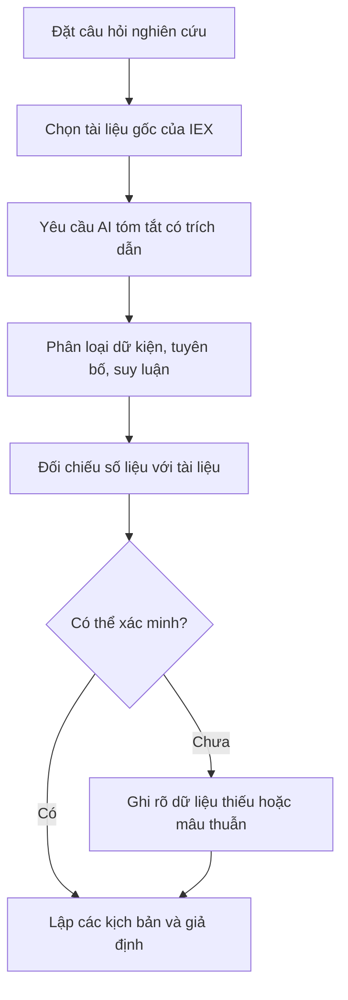

# Nghiên cứu IEX bằng AI (IEX Case Study using AI)

> [!SUMMARY] Một câu tóm tắt
> Dùng AI như trợ lý để tổ chức và chất vấn thông tin về IEX, sau đó tự xác minh mọi dữ kiện quan trọng bằng tài liệu gốc trước khi hình thành nhận định.

## 1. Tổng quan

Sau khi học báo cáo tài chính, tỷ số và một số cách tiếp cận giá trị nội tại, bước kế tiếp là biến những kiến thức đó thành quy trình nghiên cứu một doanh nghiệp cụ thể. IEX ở đây là mã cổ phiếu của IDEXX Laboratories, Inc., một doanh nghiệp hoạt động trong lĩnh vực chẩn đoán thú y và dịch vụ liên quan. Case study này minh họa cách đặt câu hỏi cho AI, dùng tài liệu công khai làm bằng chứng và phát hiện chỗ câu trả lời có thể sai hoặc thiếu. Mục tiêu không phải tạo ra một khuyến nghị mua bán, mà là xây dựng một bản ghi nghiên cứu có thể kiểm tra lại.

## 2. Mục tiêu học tập

Sau bài học, bạn có thể:

- [ ] Chọn tài liệu gốc để tìm hiểu mô hình kinh doanh của IEX.
- [ ] Tách dữ kiện, tuyên bố của ban lãnh đạo và suy luận trong câu trả lời của AI.
- [ ] Kiểm tra một con số bằng kỳ báo cáo, đơn vị và vị trí nguồn cụ thể.
- [ ] Viết ba kịch bản nghiên cứu và nêu dữ kiện còn thiếu.

## 3. Kiến thức cần chuẩn bị

- Bài trước: [Graham's Number và giới hạn của một công thức định giá](../07-benjamin-graham-value-investing/03-graham-s-number-thoughts-on-intrinsic-value.md) — xem định giá như một phép ước lượng có giới hạn, không phải giá trị chắc chắn.
- Cần nhớ: doanh thu, lợi nhuận, dòng tiền và giá cổ phiếu là những khái niệm khác nhau; một chỉ số riêng lẻ không đủ mô tả toàn bộ doanh nghiệp.

## 4. Thử đoán trước

1. Nếu AI đưa ra số tăng trưởng doanh thu của IEX mà không ghi kỳ báo cáo, bạn cần kiểm tra những gì trước khi sử dụng?
2. Vì sao một bản tóm tắt rất trôi chảy vẫn có thể dẫn đến kết luận sai?

## 5. Kiến thức cốt lõi

### 5.1. Bắt đầu từ câu hỏi và nguồn gốc

AI tạo sinh có thể giúp tóm tắt tài liệu dài, lập danh sách câu hỏi và so sánh nhiều kỳ. Nhưng chất lượng phân tích phụ thuộc vào câu hỏi, nguồn đầu vào và việc kiểm chứng của người đọc. Với IEX, hãy bắt đầu từ hồ sơ thường niên, báo cáo quý, bản trình bày nhà đầu tư và thông tin công bố chính thức của doanh nghiệp. Xác nhận đúng pháp nhân, mã giao dịch, ngày công bố và kỳ tài chính; tên viết tắt giống nhau có thể chỉ những tổ chức khác.

### 5.2. Phân loại phát biểu

| Nhóm | Ý nghĩa | Ví dụ cách ghi |
|---|---|---|
| Dữ kiện | Thông tin có thể truy về nguồn, kỳ và đơn vị | “Doanh thu năm tài chính X là … theo báo cáo thường niên.” |
| Tuyên bố của ban lãnh đạo | Quan điểm, mục tiêu hoặc giải thích do công ty đưa ra | “Ban lãnh đạo kỳ vọng nhu cầu xét nghiệm tăng.” |
| Suy luận | Diễn giải của nhà phân tích từ dữ kiện hoặc giả định | “Nhu cầu lặp lại có thể hỗ trợ doanh thu định kỳ.” |

Không biến tuyên bố thành dữ kiện đã được xác nhận, hoặc biến suy luận thành lời hứa về kết quả tương lai.

### 5.3. Quy trình nghiên cứu có AI hỗ trợ

### 5.4. Đặt yêu cầu để giảm lỗi

Yêu cầu AI nêu tên tài liệu, ngày, kỳ báo cáo, trang hoặc mục, đơn vị và trích đoạn hỗ trợ. Đề nghị nó đánh dấu điều không tìm thấy thay vì tự lấp chỗ trống. Khi so sánh, phải bảo đảm các số liệu cùng kỳ, cùng định nghĩa và cùng loại tiền tệ; nếu một nguồn dùng năm tài chính còn nguồn khác dùng năm dương lịch, phép so sánh có thể gây hiểu nhầm.

## 6. Giải thích chi tiết

Một quy trình tốt giữ lại đường dẫn từ nhận định tới bằng chứng. Ví dụ, câu hỏi “IEX có động lực tăng trưởng nào?” có thể được chia thành các câu nhỏ: doanh thu đến từ dòng sản phẩm hoặc dịch vụ nào; tăng trưởng đến từ số lượng, giá bán hay sản phẩm mới; biên lợi nhuận và dòng tiền thay đổi ra sao; công ty nêu rủi ro nào. AI có thể hỗ trợ trích xuất và sắp xếp, nhưng người nghiên cứu vẫn cần đọc phần ngữ cảnh và thuyết minh.

Tiếp theo, lập ba kịch bản. Kịch bản tăng giá mô tả điều kiện thuận lợi có thể làm kết quả tốt hơn kỳ vọng; kịch bản cơ sở ghi giả định trung tính; kịch bản giảm giá xem xét điều gì xảy ra nếu nhu cầu, giá bán, chi phí hoặc cạnh tranh bất lợi. Mỗi kịch bản cần giả định rõ, bằng chứng hỗ trợ, bằng chứng phản bác và câu hỏi chưa được trả lời. Đây là cách kiểm tra độ nhạy của luận điểm, không phải dự đoán chắc chắn.

> [!WARNING] Cảnh báo
> Không nhập dữ liệu nhạy cảm hoặc thông tin tài khoản vào công cụ AI không được phép xử lý loại dữ liệu đó. Không dùng câu trả lời AI làm số liệu thị trường hiện tại, dữ liệu pháp lý hay lời khuyên đầu tư nếu chưa xác minh qua nguồn có thẩm quyền và cập nhật.

> [!TIP] Mẹo
> Với từng con số quan trọng, lưu lại giá trị, đơn vị, kỳ báo cáo, tài liệu và vị trí tìm thấy. Nếu không thể truy lại, hãy đánh dấu “chưa xác minh” thay vì đưa vào kết luận như một sự thật.

## 7. Ví dụ minh họa

**Ví dụ giả định:** Bạn muốn đánh giá liệu doanh thu của IEX có tăng liên tục hay không. AI trả lời: “Doanh thu tăng 12% trong năm gần nhất nhờ nhu cầu xét nghiệm cao hơn.” Chưa có trích dẫn nên không thể coi câu này là đã kiểm chứng.

1. Tìm báo cáo thường niên và báo cáo quý gần nhất trên trang quan hệ nhà đầu tư hoặc cơ sở dữ liệu công bố chính thức. Ghi rõ năm tài chính mà số liệu đề cập.
2. Tìm dòng doanh thu trong báo cáo, kiểm tra đơn vị tiền tệ và xem con số so sánh thuộc cùng kỳ năm trước hay không. Nếu báo cáo nêu hai số là 3,0 tỷ và 3,3 tỷ đơn vị tiền tệ, phép tính tăng trưởng là $(3,3-3,0)/3,0=10\%$, không phải 12%; đây chỉ là số giả định để minh họa phép kiểm tra.
3. Đối chiếu lời giải thích “nhờ nhu cầu xét nghiệm cao hơn” với phần thảo luận của ban lãnh đạo. Ghi nhãn đó là tuyên bố của công ty, trừ khi có bằng chứng độc lập phù hợp.
4. Kết luận thận trọng: số tăng trưởng cần dùng là số đã xác minh trong báo cáo; nguyên nhân tăng trưởng là giải thích do công ty nêu; dự báo duy trì mức tăng là suy luận cần thêm dữ liệu.

## 8. Thực hành

**Bài tự làm:** AI tạo ba nhận định: (1) doanh thu IEX tăng nhanh hơn năm trước; (2) công ty cho rằng một mảng dịch vụ đóng góp vào tăng trưởng; (3) lợi nhuận sẽ tiếp tục tăng trong năm tới. Hãy phân loại từng nhận định và thiết kế bước kiểm tra.

- [ ] Gắn nhãn mỗi nhận định là dữ kiện, tuyên bố hay suy luận.
- [ ] Nêu tài liệu gốc cần tìm và thông tin phải ghi lại.
- [ ] Viết một câu nêu giới hạn của kết luận.

Xem lời giải sau khi đã tự làm

(1) Là dữ kiện có thể kiểm tra, nhưng cần số liệu, kỳ và nguồn. (2) Là tuyên bố của công ty; kiểm tra trong báo cáo hoặc tài liệu nhà đầu tư và giữ nguyên cách quy thuộc. (3) Là suy luận/dự báo, không được xác nhận bởi hai phát biểu trước; cần nêu giả định và rủi ro. Nếu không tìm thấy nguồn hoặc số liệu không đồng nhất kỳ, ghi là chưa xác minh.

## 9. Những lỗi thường gặp

- **Tin câu trả lời vì văn phong tự tin** — yêu cầu nguồn cụ thể và tự mở tài liệu gốc.
- **Nhầm tuyên bố của doanh nghiệp với kết quả đã xảy ra** — dùng cách diễn đạt quy thuộc như “công ty cho biết”.
- **So sánh khác kỳ hoặc khác định nghĩa** — kiểm tra kỳ tài chính, đơn vị và cách tính trước khi so sánh.
- **Dùng dữ liệu cũ như dữ liệu hiện tại** — ghi ngày cập nhật và xác minh lại mọi thông tin có thể thay đổi.
- **Chỉ tìm bằng chứng ủng hộ luận điểm** — chủ động yêu cầu AI liệt kê phản chứng, rủi ro và dữ liệu còn thiếu.

## 10. Giải thích bằng lời của bạn

- Khái niệm AI như trợ lý nghiên cứu cổ phiếu nghĩa là gì?
- Vì sao cần tách dữ kiện, tuyên bố và suy luận?
- Ví dụ của tôi về một con số AI cần kiểm chứng:
- Chỗ tôi còn chưa chắc:

## 11. Câu hỏi ôn tập

### Câu 1

Khi AI nêu doanh thu của IEX, bộ thông tin nào giúp kiểm chứng con số tốt nhất?

A. Tên công ty và nhận xét của AI  
B. Giá cổ phiếu trong ngày và số lượt tìm kiếm  
C. Giá trị, đơn vị, kỳ báo cáo và vị trí trong tài liệu gốc  
D. Tóm tắt ngắn không có nguồn

**Đáp án:** C. **Giải thích:** Cung cấp các yếu tố để truy lại và so sánh đúng kỳ. A và D không đủ nguồn; B không xác minh doanh thu.

### Câu 2

Phát biểu “ban lãnh đạo kỳ vọng nhu cầu sẽ tăng” nên được phân loại thế nào?

A. Tuyên bố của ban lãnh đạo  
B. Dữ kiện chắc chắn về kết quả tương lai  
C. Giá thị trường  
D. Số liệu kế toán đã kiểm toán

**Đáp án:** A. **Giải thích:** Đây là quan điểm hoặc kỳ vọng được quy cho ban lãnh đạo. Nó không chứng minh tương lai chắc chắn; cũng không phải giá hay số liệu kế toán.

### Câu 3

Những việc nào giúp giảm nguy cơ dùng sai kết quả AI? (Chọn nhiều)

A. Yêu cầu ghi nguồn, kỳ và đơn vị  
B. Bỏ qua thông tin trái với luận điểm ban đầu  
C. Đánh dấu rõ dữ liệu chưa tìm thấy  
D. Dùng mọi dự báo do AI tạo như dữ kiện

**Đáp án:** A, C. **Giải thích:** A và C làm rõ khả năng kiểm chứng cũng như độ không chắc chắn. B tạo thiên lệch xác nhận; D đánh đồng dự báo với dữ kiện.

### Câu 4

Phát biểu sau đúng hay sai: “Nếu AI tóm tắt đúng một báo cáo, mọi dự báo mà AI đưa ra về IEX cũng được xác minh.”

A. Đúng  
B. Sai

**Đáp án:** B. **Giải thích:** Tóm tắt một tài liệu không xác minh các dự báo. Dự báo cần giả định, bằng chứng và đánh giá độc lập; độ trôi chảy không thay thế kiểm chứng.

## 12. Tóm tắt kiến thức

- Bắt đầu bằng câu hỏi rõ và tài liệu gốc xác định đúng doanh nghiệp, kỳ báo cáo.
- Phân biệt dữ kiện có thể kiểm chứng, tuyên bố của công ty và suy luận của người phân tích.
- Kiểm tra số liệu cùng đơn vị, định nghĩa và kỳ; lưu nguồn để có thể truy lại.
- Dùng các kịch bản để xem xét giả định, phản chứng và điều chưa biết; AI không thay thế phán đoán.

## 13. Tài liệu tham khảo

1. IDEXX Laboratories, Inc. — báo cáo thường niên và hồ sơ công bố doanh nghiệp; dùng để xác minh hoạt động, rủi ro và số liệu theo kỳ.
2. U.S. Securities and Exchange Commission, Investor.gov — tài liệu giáo dục nhà đầu tư về nghiên cứu doanh nghiệp và công bố thông tin.
3. CFA Institute — tài liệu về phân tích báo cáo tài chính và quy trình nghiên cứu đầu tư.

## 14. Bài học tiếp theo

[Phân tích kỹ thuật là gì? (What is Technical Analysis)](../09-introduction-technical-analysis/01-what-is-technical-analysis.md) — tiếp theo, bạn sẽ tìm hiểu cách đọc hành vi giá và thị trường, một góc nhìn khác với nghiên cứu doanh nghiệp cơ bản.
