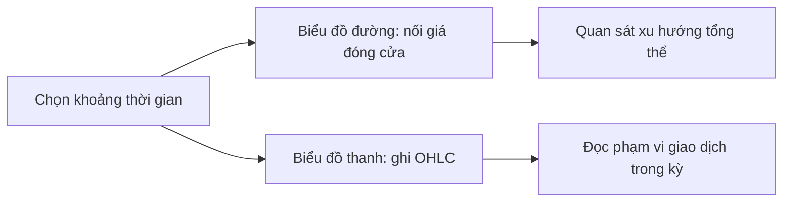

# Biểu đồ đường và biểu đồ thanh (Line Charts & Bar Charts)

> [!SUMMARY] Một câu tóm tắt
> Biểu đồ đường làm rõ hướng đi của giá đóng cửa, còn biểu đồ thanh cho thấy đủ bốn mốc giá quan trọng trong mỗi kỳ.

## 1. Tổng quan

Biểu đồ biến chuỗi giá thành hình ảnh để người học quan sát diễn biến theo thời gian. Hai dạng cơ bản là biểu đồ đường (*line chart*) và biểu đồ thanh (*bar chart*). Dạng đường thường nối giá đóng cửa nên gọn, dễ nhìn xu hướng tổng thể. Dạng thanh giữ thêm giá mở cửa, cao nhất và thấp nhất, hữu ích khi cần xem phạm vi biến động trong từng kỳ. Đây là bước đầu của module biểu đồ trước khi tìm hiểu cách thể hiện tương tự bằng nến.

## 2. Mục tiêu học tập

- [ ] Giải thích cách biểu đồ đường tổng hợp giá đóng cửa theo thời gian.
- [ ] Xác định open, high, low và close trên một thanh giá.
- [ ] So sánh lượng thông tin và giới hạn của hai loại biểu đồ.
- [ ] Đọc một ví dụ OHLC và mô tả diễn biến trong kỳ.

## 3. Kiến thức cần chuẩn bị

- Bài trước: [Quiz: Giới thiệu phân tích kỹ thuật](../09-introduction-technical-analysis/04-quiz-introduction-to-technical-analysis-quiz.md) — nhắc lại rằng biểu đồ là công cụ mô tả dữ liệu, không phải dự báo chắc chắn.
- Cần biết trục ngang thường biểu diễn thời gian, trục dọc biểu diễn giá.

## 4. Thử đoán trước

1. Nếu chỉ giữ một điểm giá mỗi ngày, mốc nào giúp so sánh giá cuối ngày nhất?
2. Một thanh có giá cao nhất lớn hơn nhiều giá đóng cửa cho biết điều gì về phạm vi giao dịch?

## 5. Kiến thức cốt lõi

### 5.1. Biểu đồ đường

Biểu đồ đường (*line chart*) đặt một điểm cho mỗi kỳ rồi nối các điểm theo thứ tự thời gian. Điểm thường dùng là giá đóng cửa (*close*), dù một số biểu đồ cho phép chọn giá khác. Vì bỏ qua dao động bên trong kỳ, đường giá ít rối và thuận tiện quan sát xu hướng dài hơn.

### 5.2. Biểu đồ thanh và OHLC

Một thanh giá (*price bar*) thường mã hóa OHLC: giá mở cửa (*open*), cao nhất (*high*), thấp nhất (*low*) và đóng cửa (*close*). Đoạn dọc biểu diễn khoảng từ low đến high; vạch ngang trái đánh dấu open, vạch ngang phải đánh dấu close. Mỗi thanh đại diện một khoảng thời gian đã chọn, chẳng hạn một ngày.

| Tiêu chí | Biểu đồ đường | Biểu đồ thanh |
|---|---|---|
| Dữ liệu thường thấy | Giá đóng cửa | Open, high, low, close |
| Điểm mạnh | Gọn, dễ nhìn xu hướng | Thấy phạm vi và vị trí mở/đóng |
| Giới hạn | Bỏ qua dao động trong kỳ | Dày thông tin, khó đọc khi quá nhiều mã/kỳ |
| Hợp khi | Tổng quan hướng giá | Cần xem biên độ từng kỳ |

## 6. Giải thích chi tiết

OHLC chỉ là bốn mốc, không mô tả thứ tự mọi giao dịch đã xảy ra giữa chúng. Chẳng hạn, high có thể xuất hiện trước low hoặc ngược lại; thanh ngày không cho biết đường đi chính xác. Khoảng cách giữa open và close phản ánh kết quả ròng trong kỳ, còn high-low thể hiện biên độ.

Biểu đồ đường cũng phụ thuộc lựa chọn điểm nối. Nếu dùng close, hai phiên có cùng close nhưng khác nhau nhiều về biến động nội phiên sẽ trông giống nhau. Do đó, chọn dạng biểu đồ theo câu hỏi cần trả lời: muốn xem hướng tổng quát hay phạm vi giá chi tiết.

> [!NOTE]
> Biểu đồ giá có thể điều chỉnh cổ tức hoặc chia tách cổ phiếu. Khi so sánh dài hạn, cần biết dữ liệu đang dùng là giá đã điều chỉnh hay chưa.

## 7. Ví dụ minh họa

**Ví dụ giả định:** Một cổ phiếu có OHLC trong phiên lần lượt là 100, 108, 97 và 105 (đơn vị tiền tệ bất kỳ).

1. Thanh dọc kéo từ 97 đến 108, vì đó là low và high.
2. Vạch open ở 100, vạch close ở 105; giá kết phiên cao hơn lúc mở 5 đơn vị.
3. Biểu đồ đường dùng close sẽ đặt điểm tại 105. Nó không cho thấy giá từng chạm 108 hay lùi xuống 97.
4. Vì vậy, đường phù hợp nhìn chuỗi giá đóng cửa, còn thanh phù hợp kiểm tra biên độ phiên.

Đây là minh họa cách đọc dữ liệu, không phải tín hiệu mua bán.

## 8. Thực hành

**Bài tự làm:** Một phiên giả định có open = 52, high = 56, low = 49, close = 50. Mô tả vị trí các vạch và nêu biểu đồ nào cho biết close của phiên.

- [ ] Xếp bốn mức từ thấp đến cao.
- [ ] Xác định close cao hay thấp hơn open.
- [ ] Nêu thông tin bị lược bỏ nếu chỉ xem biểu đồ đường.

Xem lời giải sau khi đã tự làm

Thứ tự là low 49, open 52, close 50, high 56. Close thấp hơn open 2 đơn vị. Biểu đồ đường thường đặt điểm tại close = 50; nó không thể hiện low 49, high 56 hay open 52.

## 9. Những lỗi thường gặp

- **Cho rằng biểu đồ đường thể hiện toàn bộ biến động phiên** — kiểm tra loại giá được nối; thông thường đó chỉ là close.
- **Đảo vạch open và close** — nhớ open nằm bên trái, close bên phải của thanh.
- **Coi high-low là thứ tự biến động** — thanh chỉ cho biết hai cực trị, không cho biết cực trị nào đến trước.
- **So sánh chuỗi giá chưa điều chỉnh** — kiểm tra sự kiện chia tách và phương pháp điều chỉnh dữ liệu.

## 10. Giải thích bằng lời của bạn

- Khái niệm: Biểu đồ đường và biểu đồ thanh mã hóa dữ liệu gì?
- Vì sao: Khi nào close hữu ích hơn toàn bộ OHLC?
- Ví dụ của tôi: Tạo một bộ OHLC và mô tả thanh.
- Chỗ tôi còn chưa chắc: Tôi muốn hỏi thêm điều gì về cách đọc giá?

## 11. Câu hỏi ôn tập

### Câu 1

Một biểu đồ đường ngày thường nối điểm giá nào để thể hiện diễn biến gọn nhất?

A. Giá mở cửa
B. Giá cao nhất
C. Giá đóng cửa
D. Khối lượng

**Đáp án:** C. **Giải thích:** Close thường được nối để tạo biểu đồ đường. Open và high là các mốc khác; khối lượng không phải giá.

### Câu 2

Trên thanh OHLC, đoạn dọc biểu diễn điều gì?

A. Từ giá thấp nhất đến giá cao nhất
B. Từ giá mở cửa đến giá đóng cửa
C. Chỉ giá đóng cửa
D. Khối lượng mua trong phiên

**Đáp án:** A. **Giải thích:** Đoạn dọc trải từ low tới high. Open và close được đánh dấu bằng vạch ngang; khối lượng là dữ liệu khác.

### Câu 3

Những phát biểu nào đúng về biểu đồ đường và biểu đồ thanh? (Chọn nhiều.)

A. Biểu đồ đường dùng giá đóng cửa thường bỏ qua dao động nội kỳ.
B. Thanh OHLC cho biết chính xác thứ tự mọi giao dịch.
C. Thanh OHLC thể hiện high và low của kỳ.
D. Biểu đồ đường luôn chứa nhiều dữ liệu hơn thanh giá.

**Đáp án:** A, C. **Giải thích:** Đường close lược bỏ dao động trong kỳ và thanh thể hiện phạm vi high-low. OHLC không ghi thứ tự mọi giao dịch; biểu đồ đường không chứa nhiều dữ liệu hơn.

### Câu 4

Một thanh có open = 20 và close = 18. Phát biểu “giá đóng cửa thấp hơn giá mở cửa” đúng hay sai?

A. Đúng
B. Sai

**Đáp án:** A. **Giải thích:** 18 thấp hơn 20. Sai sẽ đảo quan hệ giữa open và close.

## 12. Tóm tắt kiến thức

- Biểu đồ đường thường nối các mức close để làm rõ hướng tổng thể.
- Thanh OHLC biểu diễn open, high, low và close.
- OHLC cho biết cực trị nhưng không ghi đường đi hay thứ tự giao dịch.
- Chọn kiểu biểu đồ theo mục đích đọc dữ liệu.

## 13. Tài liệu tham khảo

1. Investopedia, “Bar Chart: Definition, How Analysts Use It, and Example” — cấu tạo thanh giá.
2. Investor.gov, tài liệu giáo dục nhà đầu tư — hiểu dữ liệu thị trường và giới hạn của biểu đồ.

## 14. Bài học tiếp theo

[Giới thiệu biểu đồ nến (Introduction to Candlesticks Chart)](02-introduction-to-candlesticks-chart.md) — bài tiếp theo thể hiện cùng dữ liệu OHLC bằng thân và bóng nến.
