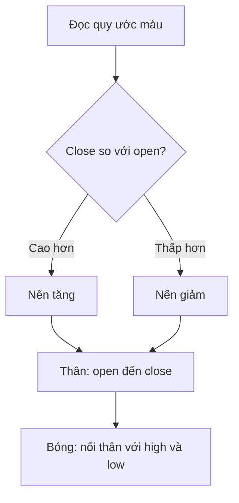

# Giới thiệu biểu đồ nến (Introduction to Candlesticks Chart)

> [!SUMMARY] Một câu tóm tắt
> Nến gom bốn mốc OHLC vào thân và bóng để người đọc thấy kết quả đóng cửa cùng toàn bộ biên độ của kỳ.

## 1. Tổng quan

Biểu đồ nến (*candlestick chart*) là cách thể hiện OHLC phổ biến trong phân tích giá. Mỗi cây tương ứng một kỳ được chọn, như một phút, một ngày hoặc một tuần. Thân nến cho thấy quan hệ giữa open và close; bóng nến chỉ ra high và low. Bài này nối tiếp biểu đồ đường và thanh, tập trung vào cách đọc cấu tạo cơ bản trước khi khảo sát các cân nhắc về timeframe và khối lượng.

## 2. Mục tiêu học tập

- [ ] Xác định open, high, low và close trên một cây nến.
- [ ] Phân biệt thân nến với bóng nến.
- [ ] Diễn giải nến tăng, nến giảm và giới hạn của một cây nến riêng lẻ.

## 3. Kiến thức cần chuẩn bị

- Bài trước: [Biểu đồ đường và biểu đồ thanh](01-line-charts-bar-charts.md) — ôn bốn mốc OHLC và phạm vi một kỳ.

## 4. Thử đoán trước

1. Nếu close cao hơn open, phần thân thường được tô theo quy ước nến tăng hay nến giảm?
2. Bóng trên dài cho biết giá đã đi đến đâu so với mức đóng cửa?

## 5. Kiến thức cốt lõi

### 5.1. Cấu tạo một cây nến

Thân nến (*real body*) nối hai mức open và close. Bóng nến (*wick* hoặc *shadow*) kéo từ thân tới các mức cực trị. Nếu high nằm trên thân thì đoạn phía trên là bóng trên; nếu low nằm dưới thân thì đoạn phía dưới là bóng dưới.

### 5.2. Nến tăng và nến giảm

Khi close cao hơn open, nến thường được tô xanh/trắng và gọi là nến tăng. Khi close thấp hơn open, nến thường đỏ/đen và gọi là nến giảm. Màu sắc chỉ là quy ước hiển thị, có thể đổi theo nền tảng; hãy kiểm tra chú giải trước khi đọc.

| Phần | Ý nghĩa | Không cho biết |
|---|---|---|
| Thân | Khoảng open–close | Thứ tự giao dịch trong kỳ |
| Bóng trên | Phần từ thân tới high | Vì sao giá đạt high |
| Bóng dưới | Phần từ low tới thân | Có chắc chắn đảo chiều không |
| Màu | Close cao/thấp hơn open theo quy ước | Hướng giá kỳ sau |

## 6. Giải thích chi tiết

Một nến tổng kết bốn mức giá, nhưng không phải bản ghi đầy đủ mọi giao dịch. Thân dài cho thấy chênh lệch open-close lớn hơn thân ngắn trong cùng đơn vị trục; điều đó tự nó không chứng minh sức mạnh sẽ tiếp diễn. Bóng dài cho biết giá đã vượt ra ngoài vùng thân trước khi kỳ kết thúc, nhưng không giải thích nguyên nhân.

Ý nghĩa của nến phụ thuộc kỳ và bối cảnh. Nến một phút và nến tuần có thể có hình dạng tương tự nhưng đại diện thời lượng rất khác. Một cây nến đơn lẻ không đủ để kết luận xu hướng hay đưa ra dự báo chắc chắn.

> [!WARNING] Cảnh báo
> Không xem một màu nến hoặc hình dáng riêng lẻ như tín hiệu đảm bảo. Dữ liệu, thanh khoản, sự kiện tin tức và timeframe đều ảnh hưởng cách diễn giải.

## 7. Ví dụ minh họa

**Ví dụ giả định:** Trong một ngày, cổ phiếu có open = 40, high = 46, low = 38, close = 44.

1. Close 44 cao hơn open 40 nên đây là nến tăng theo quy ước thông dụng.
2. Thân kéo từ 40 đến 44; mức tăng ròng trong kỳ là 4 đơn vị.
3. Bóng trên nối 44 với 46, còn bóng dưới nối 38 với 40.
4. Nến tóm tắt phạm vi 38–46 nhưng không cho biết giá chạm các mức đó theo thứ tự nào.

## 8. Thực hành

**Bài tự làm:** Một nến giả định có open = 73, high = 75, low = 68, close = 70.

- [ ] Xác định đây là nến tăng hay giảm.
- [ ] Ghi khoảng thân và hai bóng.
- [ ] Nêu một điều không thể suy ra từ hình nến này.

Xem lời giải sau khi đã tự làm

Đây là nến giảm vì close 70 thấp hơn open 73. Thân là 70–73, bóng trên 73–75, bóng dưới 68–70. Không thể suy ra thứ tự giá chạm high và low, nguyên nhân biến động hay chắc chắn kỳ tiếp theo giảm.

## 9. Những lỗi thường gặp

- **Chỉ nhìn màu nến** — đọc open và close, vì bảng màu có thể tùy chỉnh.
- **Gọi bóng là thân** — thân nối open-close; bóng nối thân với high/low.
- **Suy diễn chắc chắn về kỳ kế tiếp** — nến mô tả kỳ đã qua, không đảm bảo dự báo.
- **Bỏ qua timeframe** — xác định mỗi nến đại diện một phút, ngày hay khoảng khác.

## 10. Giải thích bằng lời của bạn

- Khái niệm: Thân và bóng nến mã hóa mức nào?
- Vì sao: Màu nến cần được kiểm tra theo quy ước nào?
- Ví dụ của tôi: Tự đặt OHLC và mô tả cây nến.
- Chỗ tôi còn chưa chắc: Đặc điểm nào dễ nhầm nhất?

## 11. Câu hỏi ôn tập

### Câu 1

Nếu close của một kỳ cao hơn open, cây nến thường được gọi là gì?

A. Nến giảm
B. Nến tăng
C. Nến không có OHLC
D. Nến khối lượng

**Đáp án:** B. **Giải thích:** Close cao hơn open tạo nến tăng theo quy ước thông dụng. Các lựa chọn khác không mô tả quan hệ này.

### Câu 2

Phần nào của cây nến biểu diễn khoảng cách giữa open và close?

A. Trục thời gian
B. Bóng trên
C. Thân nến
D. Bóng dưới

**Đáp án:** C. **Giải thích:** Thân nối open với close. Bóng trên/dưới nối thân tới các cực trị; trục thời gian là thành phần biểu đồ.

### Câu 3

Những phát biểu nào đúng về nến? (Chọn nhiều.)

A. Bóng trên có thể chỉ ra high nằm cao hơn thân.
B. Một cây nến cho biết chính xác mọi giao dịch theo trình tự.
C. Màu xanh luôn có nghĩa giá sẽ tăng kỳ sau.
D. Bóng dưới nối low với thân khi low thấp hơn thân.

**Đáp án:** A, D. **Giải thích:** Bóng trên/dưới thể hiện cực trị so với thân. Nến không lưu mọi giao dịch, và màu không đảm bảo hướng kỳ sau.

### Câu 4

Một cây nến có open = 12 và close = 10 được gọi là nến giảm theo quy ước phổ biến. Đúng hay sai?

A. Đúng
B. Sai

**Đáp án:** A. **Giải thích:** Close thấp hơn open nên là nến giảm. Phương án sai đảo ngược quan hệ giá.

## 12. Tóm tắt kiến thức

- Mỗi cây nến mã hóa open, high, low và close trong một kỳ.
- Thân nối open-close; bóng thể hiện phần còn lại tới cực trị.
- Nến tăng có close cao hơn open; nến giảm có close thấp hơn open.
- Một cây nến không cho biết mọi giao dịch hay đảm bảo hướng tương lai.

## 13. Tài liệu tham khảo

1. Investopedia, “Candlestick” — cấu tạo và cách đọc nến.
2. John J. Murphy, *Technical Analysis of the Financial Markets* — nền tảng biểu đồ giá.

## 14. Bài học tiếp theo

[Những cân nhắc khi đọc biểu đồ (Charting Considerations)](03-charting-considerations.md) — bài kế tiếp xem xét timeframe, tỷ lệ trục và khối lượng khi diễn giải hình giá.
