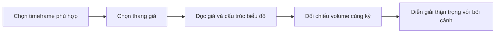

# Những cân nhắc khi đọc biểu đồ (Charting Considerations)

> [!SUMMARY] Một câu tóm tắt
> Timeframe, thang giá và khối lượng quyết định cách dữ liệu hiện ra, nên cần được kiểm tra trước khi rút ra nhận xét từ biểu đồ.

## 1. Tổng quan

Sau khi biết cách đọc đường, thanh và nến, người học cần xét các lựa chọn cài đặt ảnh hưởng đến hình ảnh biểu đồ. Cùng một mã có thể trông khác trên khung 5 phút và khung ngày. Thang tuyến tính và logarit cũng nhấn mạnh các khía cạnh khác nhau của biến động. Khối lượng bổ sung thông tin về mức giao dịch, nhưng không xác nhận chắc chắn hướng giá. Bài học khép lại phần nhập môn biểu đồ và chuẩn bị cho quiz tổng hợp.

## 2. Mục tiêu học tập

- [ ] Giải thích cách timeframe làm thay đổi tín hiệu quan sát được.
- [ ] Phân biệt thang tuyến tính và thang logarit.
- [ ] Mô tả vai trò và giới hạn của khối lượng giao dịch.
- [ ] Áp dụng một quy trình kiểm tra biểu đồ trước khi diễn giải.

## 3. Kiến thức cần chuẩn bị

- Bài trước: [Giới thiệu biểu đồ nến](02-introduction-to-candlesticks-chart.md) — mỗi nến ứng với một timeframe xác định.

## 4. Thử đoán trước

1. Một mức tăng 10% có nên chiếm khoảng cách bằng nhau trên trục log ở mọi vùng giá không?
2. Khối lượng cao khi giá phá vùng cũ có đảm bảo giá sẽ tiếp tục tăng không?

## 5. Kiến thức cốt lõi

### 5.1. Timeframe

*Timeframe* là khoảng thời gian mỗi điểm, thanh hoặc nến đại diện. Biểu đồ 5 phút gom giao dịch thành kỳ ngắn; biểu đồ ngày gom thành phiên. Chuyển timeframe làm thay đổi độ chi tiết và có thể khiến dao động nhỏ hiện thành xu hướng hoặc biến mất trong bức tranh lớn hơn.

### 5.2. Thang tuyến tính và logarit

Trên thang tuyến tính (*linear scale*), khoảng cách bằng nhau trên trục dọc tương ứng cùng một số đơn vị giá. Trên thang logarit (*log scale*), khoảng cách tương ứng cùng tỷ lệ phần trăm thay đổi. Thang log hữu ích khi so sánh biến động phần trăm trên giai đoạn dài và giá thay đổi nhiều lần; tuyến tính trực quan khi quan tâm số đơn vị tuyệt đối.

| Đặc điểm | Tuyến tính | Logarit |
|---|---|---|
| Khoảng cách bằng nhau | Cùng số tiền | Cùng tỷ lệ phần trăm |
| Dễ dùng cho | Biến động tuyệt đối, đoạn ngắn | So sánh tăng giảm tương đối dài hạn |
| Cần lưu ý | Phần trăm biến động nhìn khác theo vùng giá | Người mới có thể thấy khoảng cách không trực quan |

### 5.3. Khối lượng

*Volume* là số cổ phiếu, hợp đồng hoặc đơn vị được giao dịch trong một kỳ, tùy thị trường. Khối lượng giúp đánh giá mức độ tham gia cùng diễn biến giá. Một đợt breakout có volume cao có thể cho thấy nhiều giao dịch tham gia hơn, nhưng không chứng minh breakout thành công hay thị trường đồng thuận về hướng.

## 6. Giải thích chi tiết

Khi phân tích nhiều khung thời gian, nên bắt đầu từ khung gắn với mục đích phân tích, sau đó dùng khung thấp hơn để xem chi tiết. Một biến động trên khung 5 phút có thể chỉ là nhiễu trong xu hướng ngày. Ngược lại, khung ngày có thể che mất điểm vào/ra ngắn hạn. Không có một timeframe đúng cho mọi người.

Trục log không biến dữ liệu thành tốt hơn; nó đổi cách biểu diễn. Nếu giá tăng từ 10 lên 20 và từ 100 lên 110, mức tăng tuyệt đối đều là 10, nhưng mức tăng tương đối lần lượt là 100% và 10%. Tuyến tính hiển thị hai chênh lệch tuyệt đối như nhau; log làm nổi bật chênh lệch phần trăm.

Volume còn phụ thuộc thị trường, nguồn dữ liệu và cách tổng hợp. Với cổ phiếu, khối lượng thường là số cổ phiếu giao dịch; với một số thị trường khác, dữ liệu volume có thể không bao quát toàn thị trường. Hãy so sánh cùng mã, kỳ và nguồn dữ liệu khi có thể.

> [!TIP] Trình tự kiểm tra
> Xác định mã và khoảng ngày, timeframe, loại thang giá, rồi mới đọc hình giá và volume. Ghi lại các cài đặt nếu cần so sánh biểu đồ.

## 7. Ví dụ minh họa

**Ví dụ giả định:** Một cổ phiếu tăng từ 20 lên 40 trong vài năm; trong cùng đoạn có lúc dao động 2 đơn vị.

1. Trên thang tuyến tính, 2 đơn vị luôn có cùng khoảng cách dọc, bất kể giá đang ở 20 hay 40.
2. Trên thang log, khoảng cách từ 20 lên 40 (100%) lớn hơn nhiều so với 20 lên 22 (10%), dù hai đoạn đều tăng 20 đơn vị? Không: đoạn đầu là 20 đơn vị, đoạn sau là 2 đơn vị; tỷ lệ vẫn là điều được so sánh.
3. Nếu zoom xuống biểu đồ 5 phút, các dao động ngắn sẽ nổi bật; biểu đồ ngày gộp chúng vào mỗi phiên.
4. Volume cao ở một phiên tăng cho biết giao dịch sôi động, nhưng chưa đủ để khẳng định diễn biến sẽ tiếp tục.

## 8. Thực hành

**Bài tự làm:** Giá giả định tăng từ 50 lên 55, đồng thời volume tăng gấp đôi mức thường thấy. Trả lời:

- [ ] Mức tăng phần trăm là bao nhiêu?
- [ ] Nếu so sánh hiệu suất phần trăm nhiều năm, thang nào thường hữu ích hơn?
- [ ] Volume gấp đôi chứng minh được điều gì và không chứng minh điều gì?

Xem lời giải sau khi đã tự làm

Mức tăng là (55 − 50) / 50 = 10%. Thang log thường hữu ích khi so sánh biến động phần trăm qua giai đoạn dài. Volume cao cho biết mức giao dịch trong kỳ lớn hơn mốc thường thấy theo dữ liệu đó; nó không chứng minh giá sẽ tiếp tục tăng hay breakout chắc chắn thành công.

## 9. Những lỗi thường gặp

- **Bỏ qua timeframe** — xác định kỳ của mỗi nến/thanh trước khi so sánh.
- **Đọc thang log như tuyến tính** — nhớ khoảng cách log phản ánh tỷ lệ, không phải cùng số tiền.
- **Xem volume cao là xác nhận chắc chắn** — coi đó là dữ liệu tham khảo, kiểm tra thêm bối cảnh.
- **So sánh biểu đồ khác cấu hình** — ghi nhận thang, kỳ và cách điều chỉnh giá.

## 10. Giải thích bằng lời của bạn

- Khái niệm: Timeframe, thang log và volume là gì?
- Vì sao: Vì sao một cú breakout ngắn hạn có thể không quan trọng trên khung lớn?
- Ví dụ của tôi: Mô tả cùng một biến động trên hai timeframe.
- Chỗ tôi còn chưa chắc: Cài đặt nào khiến tôi dễ đọc nhầm nhất?

## 11. Câu hỏi ôn tập

### Câu 1

Trên thang tuyến tính, hai khoảng cách dọc bằng nhau thường tương ứng với điều gì?

A. Cùng tỷ lệ phần trăm
B. Cùng số đơn vị giá
C. Cùng khối lượng
D. Cùng thời lượng nến

**Đáp án:** B. **Giải thích:** Tuyến tính giữ khoảng cách theo mức giá tuyệt đối. Tỷ lệ phần trăm gắn với thang log; volume và thời lượng là dữ liệu khác.

### Câu 2

Vì sao nhà phân tích có thể xem biểu đồ ở nhiều timeframe?

A. Để bảo đảm dự báo đúng
B. Để bỏ qua biến động giá
C. Để so sánh bức tranh tổng thể với chi tiết ngắn hạn
D. Để biến volume thành giá

**Đáp án:** C. **Giải thích:** Các khung thể hiện độ chi tiết khác nhau. Chúng không đảm bảo dự báo, không xóa biến động và không đổi volume thành giá.

### Câu 3

Những phát biểu nào đúng về volume? (Chọn nhiều.)

A. Volume cao có thể cho thấy mức tham gia giao dịch lớn trong kỳ.
B. Volume cao đảm bảo giá sẽ đi theo hướng của nến.
C. Ý nghĩa dữ liệu volume có thể phụ thuộc thị trường và nguồn dữ liệu.
D. Volume luôn là số tiền đầu tư của từng cá nhân.

**Đáp án:** A, C. **Giải thích:** Volume phản ánh đơn vị giao dịch theo định nghĩa của thị trường và có giới hạn. Nó không bảo đảm hướng giá hay cho biết số tiền từng cá nhân.

### Câu 4

Thang logarit thường hữu ích khi so sánh tỷ lệ phần trăm biến động trong giai đoạn dài. Đúng hay sai?

A. Đúng
B. Sai

**Đáp án:** A. **Giải thích:** Logarit giúp khoảng cách thể hiện tỷ lệ tương đối. Thang tuyến tính thể hiện chênh lệch đơn vị tuyệt đối.

## 12. Tóm tắt kiến thức

- Timeframe xác định thời lượng mỗi điểm, thanh hoặc nến.
- Thang tuyến tính so sánh số đơn vị giá; thang log so sánh tỷ lệ phần trăm.
- Volume cung cấp ngữ cảnh về mức giao dịch, không đảm bảo hướng giá.
- Kiểm tra cài đặt và nguồn dữ liệu trước khi so sánh biểu đồ.

## 13. Tài liệu tham khảo

1. Investopedia, “Logarithmic Price Scale vs. Linear Price Scale” — khác biệt hai thang.
2. CFA Institute, tài liệu về phân tích kỹ thuật và dữ liệu thị trường — đặt chỉ báo trong bối cảnh.
3. Investor.gov — tài liệu giáo dục nhà đầu tư về rủi ro và dữ liệu thị trường.

## 14. Bài học tiếp theo

[Quiz: Giới thiệu biểu đồ (Introduction to Charting Quiz)](04-quiz-introduction-to-charting-quiz.md) — quiz giúp củng cố cách đọc loại biểu đồ, timeframe, scale và volume.
