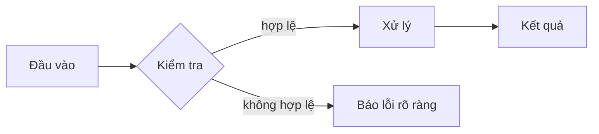

# Mẫu nến nhíp (Tweezer) (Tweezer Candlestick Patterns)

> [!SUMMARY] Một câu tóm tắt
> Viết 1–2 câu: bài này giải quyết vấn đề gì và vì sao nó quan trọng. Người học đọc câu này trước để biết mình sắp học gì.

## 1. Tổng quan

Đoạn mở đầu 3–5 câu: bối cảnh, vấn đề thực tế, và bài này nằm ở đâu trong cả khóa.

## 2. Mục tiêu học tập

Sau bài học, bạn có thể:

- [ ] Giải thích … (dùng động từ đo được: giải thích, so sánh, tính, sửa lỗi, thiết kế)
- [ ] So sánh … với …
- [ ] Tự làm được … mà không cần xem lời giải

> Ô vuông ở trên bấm được trên web: người học tự tích khi đạt mục tiêu.

## 3. Kiến thức cần chuẩn bị

- Bài trước: [Umbrella Candlestick Patterns](./05-umbrella-candlestick-patterns.md) — liên kết tương đối tới file `.md` sẽ mở đúng bài trên web.
- Khái niệm cần nhớ: …

## 4. Thử đoán trước

Trả lời nhanh trong đầu trước khi đọc tiếp — sai cũng không sao, đoán trước giúp nhớ lâu hơn.

1. Bạn nghĩ … xảy ra khi …?
2. Vì sao … lại cần …?

## 5. Kiến thức cốt lõi

Mỗi tiểu mục một ý. Khái niệm có quan hệ với nhau thì kèm sơ đồ hoặc bảng.

### 5.1. Ý chính thứ nhất

Giải thích ngắn gọn. Dùng **in đậm** cho thuật ngữ khi xuất hiện lần đầu, `code` cho tên hàm/lệnh.



### 5.2. Ý chính thứ hai

| Tiêu chí | Cách A | Cách B |
|---|---|---|
| Khi nào dùng | … | … |
| Ưu điểm | … | … |
| Nhược điểm | … | … |

<!-- Ảnh: đặt file trong thư mục assets/ cạnh bài rồi viết  -->

> Ảnh đặt trong thư mục `assets/` cạnh file bài học, gọi bằng đường dẫn tương đối. Trên web bấm vào ảnh để phóng to.

### 5.3. Công thức (nếu có — không bắt buộc)

Công thức nội dòng: $E = mc^2$. Công thức riêng dòng:

$$
\text{Điểm} = \frac{\text{số câu đúng}}{\text{tổng số câu}} \times 100
$$

## 6. Giải thích chi tiết

Đi sâu vào cách hoạt động: vì sao, khi nào, giới hạn. Dùng callout cho lưu ý:

> [!TIP] Mẹo
> Một mẹo thực hành giúp làm nhanh hơn hoặc ít lỗi hơn.

> [!WARNING] Cảnh báo
> Điều dễ gây lỗi nghiêm trọng hoặc mất dữ liệu.

> [!NOTE]
> Ghi chú bổ sung, không bắt buộc phải đọc.

## 7. Ví dụ minh họa

Ví dụ có lời giải **từng bước, kèm lý do** — đặt trước bài tự làm.

**Bài toán:** Mô tả tình huống cụ thể.

1. Bước 1 — làm gì, vì sao.
2. Bước 2 — làm gì, vì sao.
3. Kết quả và cách kiểm tra lại.

```python
# Code chia thành từng bước nhỏ, có chú thích ngắn
def tinh_diem(dung: int, tong: int) -> float:
    if tong == 0:
        return 0.0          # tránh chia cho 0
    return dung / tong * 100

print(tinh_diem(8, 10))     # 80.0
```

## 8. Thực hành

**Bài tự làm:** Đề bài mới, tương tự ví dụ nhưng đổi dữ kiện.

- [ ] Bước 1: …
- [ ] Bước 2: …

<details>
<summary>Xem lời giải sau khi đã tự làm</summary>

Lời giải từng bước. Khối này được thu gọn trên web để người học thử trước.

</details>

## 9. Những lỗi thường gặp

- **Nhầm … với …** — cách phân biệt: …
- **Quên …** — hậu quả: …, cách tránh: …

## 10. Giải thích bằng lời của bạn

Viết lại ý chính bằng lời của mình trong ô *Ghi chú cá nhân* trên web (dưới cuối bài):

- Khái niệm là gì?
- Vì sao nó đúng / cần thiết?
- Một ví dụ của riêng tôi:
- Chỗ tôi còn chưa chắc:

## 11. Câu hỏi ôn tập

<!--
Trên web, mục này tự biến thành bài trắc nghiệm tương tác (đáp án ẩn đến khi nộp bài).
Quy tắc:
  • Mỗi câu bắt đầu bằng "### Câu N".
  • Phương án: các dòng "A. …", "B. …" (tối đa H).
  • Đáp án: "**Đáp án:** B. **Giải thích:** …" — nhiều đáp án thì "**Đáp án:** A, C".
  • Câu tự luận: không có phương án, chỉ có "**Đáp án:** <đáp án mẫu>" → người học tự đối chiếu.
  • Câu hỏi phải hiểu được khi bỏ tên bài; giải thích cả vì sao các phương án sai là sai.
-->

### Câu 1

Câu hỏi kiểm tra một ý duy nhất, đọc riêng vẫn hiểu?

A. Phương án nhiễu hợp lý  
B. Phương án đúng  
C. Phương án nhiễu hợp lý  
D. Phương án nhiễu hợp lý  

**Đáp án:** B. **Giải thích:** Vì sao B đúng; vì sao A, C, D sai.

### Câu 2

Những phát biểu nào đúng? (chọn nhiều)

A. Phát biểu đúng thứ nhất  
B. Phát biểu sai  
C. Phát biểu đúng thứ hai  
D. Phát biểu sai  

**Đáp án:** A, C. **Giải thích:** …

### Câu 3

Phát biểu sau đúng hay sai: “…”

A. Đúng  
B. Sai  

**Đáp án:** B. **Giải thích:** …

### Câu 4

Vì sao … ? (câu tự luận ngắn — người học tự đối chiếu với đáp án mẫu)

**Đáp án:** Đáp án mẫu 1–3 câu, nêu đúng ý chính cần có.

## 12. Luyện thêm

<!-- Tuỳ chọn. Dạng nâng cao (điền chỗ trống, sắp xếp, ghép cặp, đọc code) viết trong khối quiz (YAML). -->

```quiz
title: Luyện thêm
questions:
  - type: fill_blank
    prompt: "Tỉ lệ đúng 8/10 câu tương ứng ___ điểm."
    blanks: [["80", "80 điểm"]]
    explanation: "8 / 10 × 100 = 80."
    difficulty: easy
  - type: ordering
    prompt: "Sắp xếp các bước theo đúng thứ tự"
    items: ["Đọc đề", "Làm ví dụ mẫu", "Tự làm bài mới", "Đối chiếu lời giải"]
  - type: matching
    prompt: "Ghép thuật ngữ với nghĩa"
    pairs:
      - { left: "Truy hồi", right: "Tự nhớ lại không nhìn tài liệu" }
      - { left: "Giãn cách", right: "Ôn lại sau những khoảng thời gian tăng dần" }
  - type: single
    prompt: "Đoạn code in ra gì?"
    code: "print(tinh_diem(8, 10))"
    codeLanguage: python
    options:
      - { id: A, text: "8" }
      - { id: B, text: "80.0" }
      - { id: C, text: "0.8" }
    answer: B
    explanation: "Hàm trả về dung / tong * 100 = 80.0"
```

## 13. Tóm tắt kiến thức

- Ý chính 1.
- Ý chính 2.
- Ý chính 3.

## 14. Tài liệu tham khảo

1. [Tên tài liệu](https://example.com) — ghi rõ phần nào nên đọc.

## 15. Bài học tiếp theo

[Introduction to Gaps](../12-gap-formations/01-introduction-to-gaps.md) — một câu nói vì sao nên học tiếp bài này.
