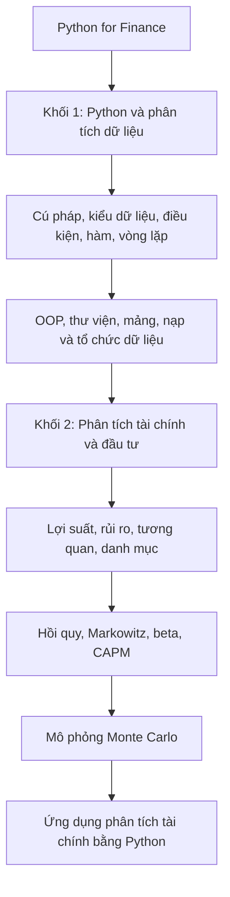
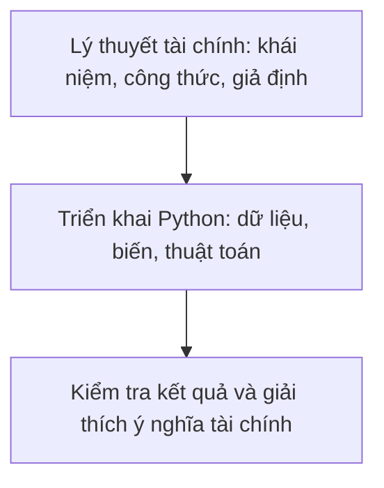

# Bài 001 — Khóa học bao gồm những gì? (What Does the Course Cover?)

**Khóa học:** Python for Finance: Investment Fundamentals & Data Analytics  
**Module 01:** Welcome! Course Introduction  
**Thứ tự:** Bài 001  
**Loại mục Udemy:** `VIDEO_LECTURE`  
**Thời lượng metadata:** 5,2 phút  
**Giảng viên:** Martin và Ned — 365 Careers  
**Trang khóa học:** [Python for Finance: Investment Fundamentals & Data Analytics](https://www.udemy.com/course/python-for-finance-investment-fundamentals-data-analytics)

> **Phạm vi:** Tài liệu học bổ trợ bằng tiếng Việt, biên soạn lại từ nội dung bài giới thiệu do người học cung cấp và có bổ sung giải thích, ví dụ minh họa. Không phải bản chép lời nguyên văn của bài giảng. Các ví dụ số liệu được ghi rõ là giả định.

---

## 1. Tổng quan bài học

Python là một công cụ quan trọng trong phân tích dữ liệu tài chính, nghiên cứu đầu tư và xây dựng mô hình định lượng. Thay vì thực hiện nhiều phép tính thủ công, chúng ta có thể sử dụng Python để xử lý dữ liệu thị trường, đo lường lợi suất, phân tích rủi ro, xây dựng danh mục đầu tư và mô phỏng các tình huống tài chính.

Khóa học **Python for Finance: Investment Fundamentals & Data Analytics** kết hợp hai lĩnh vực:

- **Lập trình Python:** Xây dựng nền tảng lập trình, kỹ thuật xử lý dữ liệu và công cụ tính toán.
- **Tài chính và phân tích đầu tư:** Tìm hiểu các nguyên lý tài chính, phương pháp đo lường rủi ro, định giá tài sản và ứng dụng mô hình định lượng.

Phương pháp học chú trọng cả **cơ sở lý thuyết** lẫn **triển khai thực tế**: hiểu vì sao một công thức được sử dụng, sau đó dùng Python để tính toán và diễn giải kết quả.

Hai giảng viên đảm nhiệm các mảng chuyên môn bổ trợ:

| Giảng viên | Chuyên môn | Vai trò trong khóa học |
|---|---|---|
| Martin | Kinh tế, phương pháp định lượng, kinh tế lượng và khoa học dữ liệu | Giới thiệu Python và triển khai các phép tính bằng mã |
| Ned | Tài chính; từng làm tư vấn và phân tích tài chính | Giải thích các khái niệm và mô hình tài chính |

Khóa học phù hợp với người mới học lập trình và người đã có nền tảng Python nhưng muốn ứng dụng vào phân tích tài chính, đầu tư.

## 2. Mục tiêu học tập

Sau bài giới thiệu, người học có thể:

1. **Trình bày** cấu trúc hai khối kiến thức của khóa học: Python và tài chính.
2. **Nhận diện** các kỹ năng lập trình phục vụ xử lý và phân tích dữ liệu tài chính.
3. **Phân biệt** các nhóm chủ đề: lợi suất, rủi ro, danh mục đầu tư, hồi quy, CAPM và Monte Carlo.
4. **Giải thích** quy trình kết hợp lý thuyết tài chính với Python trong bài toán định lượng.
5. **Xây dựng** kế hoạch học tập với mục tiêu cụ thể, sản phẩm thực hành và tiêu chí tự đánh giá.

## 3. Cấu trúc tổng thể của khóa học

### 3.1. Khối 1 — Python Programming & Data Analytics

Khối đầu tiên xây dựng khả năng lập trình Python. Người học tiếp cận cú pháp, kiểu dữ liệu, toán tử, điều kiện, vòng lặp, hàm, danh sách, tuple, dictionary và các kiến thức nền tảng khác. Chương trình tiếp tục với lập trình hướng đối tượng, mô-đun, thư viện, mảng và cách nạp, tổ chức dữ liệu.

Mục tiêu là sử dụng Python như một công cụ tính toán và phân tích thay vì chỉ ghi nhớ các câu lệnh.

### 3.2. Khối 2 — Investment Fundamentals & Financial Analysis

Khối thứ hai vận dụng Python vào các bài toán tài chính: lợi suất chứng khoán, rủi ro, tương quan, đa dạng hóa danh mục, hồi quy, biên giới hiệu quả Markowitz, beta, CAPM và mô phỏng Monte Carlo.

Thông thường, mỗi chủ đề đi theo hai bước: **hiểu lý thuyết tài chính** rồi **triển khai phép tính bằng Python**.

### 3.3. Sơ đồ lộ trình kiến thức



Hai khối kiến thức bổ trợ nhau: Python cung cấp công cụ tính toán, còn lý thuyết tài chính giúp xác định **cần tính gì, tính để làm gì và diễn giải thế nào**.

## 4. Nội dung kiến thức chi tiết

### 4.1. Nền tảng lập trình Python

| Chủ đề | Nội dung | Ứng dụng vào tài chính |
|---|---|---|
| Python Syntax | Cú pháp và quy tắc viết chương trình | Viết phép tính và quy trình xử lý |
| Data Types | Số nguyên, số thực, chuỗi, Boolean | Biểu diễn giá, khối lượng, tỷ lệ và thông tin tài sản |
| Operators | Toán tử số học, so sánh và logic | Tính lợi suất, kiểm tra điều kiện |
| Conditional Statements | `if`, `elif`, `else` | Xây dựng các quy tắc theo điều kiện |
| Functions | Định nghĩa và gọi hàm | Tái sử dụng công thức tài chính |
| Lists | Danh sách có thứ tự | Lưu chuỗi giá trị |
| Tuples | Nhóm giá trị có thứ tự, không thay đổi | Biểu diễn nhóm tham số cố định |
| Dictionaries | Các cặp khóa–giá trị | Tổ chức thông tin tài sản |
| Loops | `for`, `while` | Tính toán lặp trên nhiều quan sát |

**Ví dụ minh họa — lợi suất đơn giản:**

$$
R_t = \frac{P_t - P_{t-1}}{P_{t-1}}
$$

Trong đó, $P_t$ là giá tại thời điểm hiện tại, $P_{t-1}$ là giá tại thời điểm trước, còn $R_t$ là lợi suất trong kỳ (chưa tính cổ tức hoặc chi phí).

```python
previous_price = 100
current_price = 105

stock_return = (current_price - previous_price) / previous_price
print(f"Stock return: {stock_return:.2%}")
```

Kết quả:

```text
Stock return: 5.00%
```

Đây là ví dụ nhỏ về việc chuyển công thức tài chính thành các phép toán Python. Khi có nhiều quan sát, có thể tự động hóa nguyên tắc tính toán tương tự.

### 4.2. Python nâng cao và xử lý dữ liệu

**Lập trình hướng đối tượng (Object-Oriented Programming — OOP).** Đây là phương pháp tổ chức chương trình bằng các đối tượng chứa dữ liệu và hành vi. Trong một chương trình tài chính, tư duy này có thể được dùng để xây dựng thành phần đại diện cho tài sản, danh mục hoặc mô hình tính toán.

**Modules và Libraries.** Python hỗ trợ nhập và sử dụng mô-đun, thư viện để tận dụng chức năng sẵn có. Điều này đặc biệt hữu ích với các phép toán số học và xử lý dữ liệu.

**Arrays.** Mảng giúp biểu diễn nhiều giá trị và thực hiện tính toán trên một tập quan sát, ví dụ chuỗi giá hoặc lợi suất theo thời gian.

**Nạp và tổ chức dữ liệu.** Dữ liệu cần được đọc, sắp xếp và chuẩn hóa cấu trúc trước khi đưa vào công thức hoặc mô hình phân tích.

Một bảng giá tài chính giả định có thể được tổ chức như sau:

| Ngày | Giá đóng cửa | Khối lượng |
|---|---:|---:|
| 01/01 | 100 | 1.200 |
| 02/01 | 102 | 1.450 |
| 03/01 | 101 | 1.310 |
| 04/01 | 104 | 1.600 |

*Dữ liệu chỉ nhằm minh họa, không đại diện cho một mã chứng khoán cụ thể.*

### 4.3. Lợi suất, rủi ro và danh mục đầu tư

**Lợi suất chứng khoán (Stock Returns)** đo lường sự thay đổi giá trị đầu tư trong một khoảng thời gian. Có thể phân biệt lợi suất theo kỳ, lợi suất tích lũy và lợi suất kỳ vọng tùy bài toán.

**Rủi ro đầu tư (Investment Risk)** phản ánh tính không chắc chắn của kết quả. Độ lệch chuẩn của lợi suất là một thước đo biến động thường dùng, song không bao quát mọi dạng rủi ro.

**Danh mục đầu tư (Portfolio)** là tập hợp các tài sản với tỷ trọng nhất định. Lợi suất danh mục trong một kỳ có thể biểu diễn:

$$
R_p = \sum_{i=1}^{n} w_i R_i
$$

Trong đó, $w_i$ là tỷ trọng tài sản thứ $i$, $R_i$ là lợi suất của tài sản đó và $R_p$ là lợi suất danh mục.

**Tương quan (Correlation)** cho biết mức độ và chiều hướng biến động tuyến tính giữa lợi suất của hai tài sản. Tương quan có vai trò quan trọng trong tính rủi ro của danh mục.

**Đa dạng hóa (Portfolio Diversification)** là phân bổ vốn vào nhiều tài sản để giảm sự phụ thuộc vào một tài sản riêng lẻ. Hiệu quả đa dạng hóa phụ thuộc vào tương quan, không chỉ số lượng tài sản.

### 4.4. Các mô hình tài chính và phương pháp định lượng

| Mô hình / phương pháp | Câu hỏi phân tích chính |
|---|---|
| Regression | Mối quan hệ giữa một biến cần giải thích và các yếu tố liên quan được mô tả thế nào? |
| Markowitz Efficient Frontier | Danh mục nào cho lợi suất kỳ vọng cao nhất ở một mức rủi ro, hoặc rủi ro thấp nhất ở một mức lợi suất kỳ vọng? |
| Beta | Lợi suất cổ phiếu nhạy cảm như thế nào với biến động của thị trường? |
| CAPM | Lợi suất kỳ vọng liên hệ với rủi ro hệ thống như thế nào? |
| Multiple Regression | Có thể xem xét đồng thời nhiều biến giải thích trong một mô hình như thế nào? |

**Hồi quy (Regression)** hỗ trợ nghiên cứu quan hệ giữa các biến. Trong tài chính, nó có thể được dùng để phân tích mối liên hệ giữa lợi suất tài sản và các yếu tố thị trường.

**Biên giới hiệu quả Markowitz (Efficient Frontier)** thể hiện những danh mục đầu tư có tính hiệu quả theo tiêu chí lợi suất kỳ vọng và rủi ro. Một danh mục không hiệu quả nếu có một danh mục khả thi khác cho lợi suất kỳ vọng cao hơn với cùng rủi ro, hoặc rủi ro thấp hơn với cùng lợi suất kỳ vọng.

**Beta và CAPM.** Beta đo độ nhạy của lợi suất tài sản đối với biến động của thị trường. Mô hình định giá tài sản vốn (CAPM) biểu diễn lợi suất kỳ vọng như sau:

$$
E(R_i) = R_f + \beta_i\left[E(R_m) - R_f\right]
$$

Trong đó:

- $E(R_i)$: Lợi suất kỳ vọng của tài sản.
- $R_f$: Lãi suất phi rủi ro.
- $\beta_i$: Hệ số beta của tài sản.
- $E(R_m)$: Lợi suất kỳ vọng của thị trường.

**Hồi quy với nhiều biến giải thích (Multiple Regression)** mở rộng mô hình sử dụng một biến giải thích bằng cách đưa nhiều yếu tố vào phân tích đồng thời.

### 4.5. Mô phỏng Monte Carlo

Monte Carlo là phương pháp tính toán dựa trên việc tạo nhiều kết quả có thể xảy ra từ một mô hình có thành phần ngẫu nhiên. Thay vì chỉ khảo sát một kịch bản, phương pháp này cho phép đánh giá phân bố kết quả của nhiều kịch bản.

Ba ứng dụng được giới thiệu trong khóa học:

1. **Tài chính doanh nghiệp (Corporate Finance):** Mô phỏng những kết quả tài chính có thể xảy ra dưới điều kiện bất định.
2. **Định giá quyền chọn mua cổ phiếu (Call Option Pricing):** Ước tính giá trị quyền chọn mua theo các giả định mô hình.
3. **Định giá cổ phiếu (Stock Valuation):** Khảo sát các kịch bản khác nhau để hỗ trợ ước tính giá trị cổ phiếu.

Quy trình cơ bản:


**Lưu ý:** Mô phỏng không tự bảo đảm dự báo chính xác. Kết quả phụ thuộc vào chất lượng dữ liệu, giả định, tham số và mức độ phù hợp của mô hình.

## 5. Phương pháp học tập

### 5.1. Kết hợp lý thuyết và thực hành



Ví dụ, để tính lợi suất chứng khoán, người học cần hiểu định nghĩa và cách đo lợi suất trước khi thực hiện công thức bằng Python. Tư duy này giúp tránh tình trạng mã chạy đúng nhưng kết quả bị diễn giải sai.

### 5.2. Học theo trình tự kiến thức

Các phần có quan hệ kế thừa: cú pháp và cấu trúc dữ liệu là nền tảng lập trình; xử lý dữ liệu là điều kiện để phân tích giá và lợi suất; còn lợi suất, rủi ro và tương quan là kiến thức đầu vào để học phân tích danh mục và các mô hình tài chính.

Người mới bắt đầu nên học theo thứ tự các bài thay vì bỏ qua nền tảng.

### 5.3. Sử dụng tài nguyên học tập

Các tài nguyên bổ trợ được giới thiệu gồm ghi chú bài học, tệp bài tập, tài liệu PDF và notebook thực hành. Người học nên tự chạy lại ví dụ, thực hiện bài tập và đối chiếu kết quả. Có thể trao đổi trong khu vực thảo luận khóa học khi gặp khó khăn.

## 6. Ví dụ thực hành nhập môn

### 6.1. Bài toán

Cho dữ liệu giá đóng cửa **giả định** của một cổ phiếu trong bốn phiên liên tiếp:

$$
P = [100, 102, 101, 104]
$$

Yêu cầu: lưu giá bằng Python; tính lợi suất đơn giản giữa các phiên liên tiếp; tính lợi suất bình quân số học theo kỳ; và giải thích kết quả.

### 6.2. Triển khai Python

```python
# Dữ liệu giá giả định
prices = [100, 102, 101, 104]

# Tính lợi suất từng kỳ
returns = []

for i in range(1, len(prices)):
    daily_return = (prices[i] - prices[i - 1]) / prices[i - 1]
    returns.append(daily_return)

# Lợi suất bình quân số học
average_return = sum(returns) / len(returns)

for i, value in enumerate(returns, start=1):
    print(f"Period {i}: {value:.2%}")

print(f"Average return: {average_return:.2%}")
```

Kết quả:

```text
Period 1: 2.00%
Period 2: -0.98%
Period 3: 2.97%
Average return: 1.33%
```

### 6.3. Giải thích kết quả

Trong ba khoảng thời gian liên tiếp, cổ phiếu có hai kỳ tăng giá và một kỳ giảm giá. Lợi suất bình quân số học theo kỳ xấp xỉ **1,33%**.

Kết quả này minh họa cách sử dụng danh sách, vòng lặp, toán tử và định dạng đầu ra của Python trong phân tích tài chính. Tuy nhiên, **lợi suất bình quân số học khác lợi suất tích lũy**; số liệu quá khứ cũng không đảm bảo lợi suất tương lai.

## 7. Xây dựng kế hoạch học tập cá nhân

| Kỹ năng | Mục tiêu cụ thể | Sản phẩm thực hành |
|---|---|---|
| 1. Python Fundamentals | Dùng được biến, điều kiện, hàm, vòng lặp và cấu trúc dữ liệu | Chương trình tính lợi suất |
| 2. Financial Data Analytics | Nạp, sắp xếp, xử lý dữ liệu | Notebook xử lý chuỗi giá |
| 3. Risk & Portfolio Analysis | Phân tích lợi suất, rủi ro, tương quan và danh mục | Báo cáo danh mục giả định |
| 4. Financial Models | Giải thích và triển khai hồi quy, Markowitz, CAPM | Notebook mô hình tài chính |
| 5. Monte Carlo Simulation | Mô phỏng nhiều kịch bản tài chính | Chương trình Monte Carlo |

**Bài tập:** Tạo tệp `learning-goals.md` và ghi năm kỹ năng muốn đạt sau khóa học. Với mỗi kỹ năng, hãy xác định một kết quả có thể kiểm tra, một bài thực hành và kiến thức cần bổ sung.

Ví dụ, thay vì đặt mục tiêu chung chung *“Biết phân tích rủi ro”*, hãy xác định: *“Dùng Python tính độ lệch chuẩn của lợi suất, so sánh hai tài sản và giải thích ý nghĩa của mức độ biến động.”*

## 8. Những lưu ý khi học

### 8.1. Không học Python tách rời hoàn toàn khỏi bài toán

Cú pháp là phương tiện, không phải đích đến. Cần biết công cụ nào phù hợp với câu hỏi tài chính cần giải quyết.

### 8.2. Không chỉ ghi nhớ công thức

Để sử dụng công thức đúng, phải hiểu biến đầu vào, đơn vị đo, giả định và phạm vi áp dụng. Ví dụ, độ lệch chuẩn từ lợi suất ngày không thể diễn giải trực tiếp như độ lệch chuẩn lợi suất năm nếu chưa xử lý quy đổi phù hợp.

### 8.3. Phân biệt phân tích với dự báo

Mô hình mô tả tốt dữ liệu quá khứ chưa chắc dự báo tốt tương lai. Khi có bài toán dự báo chuỗi thời gian, cần tránh dùng thông tin tương lai để ra quyết định tại quá khứ (*look-ahead bias*) và tránh điều chỉnh mô hình quá mức dựa trên dữ liệu đã quan sát (*overfitting*).

### 8.4. Không đánh giá mô hình chỉ qua một con số

Kết quả CAPM, hồi quy hay Monte Carlo đều phụ thuộc vào giả định. Một phép tính được thực hiện chính xác bằng Python không tự động có nghĩa mô hình phản ánh đúng thực tế thị trường.

## 9. Câu hỏi ôn tập

### Câu 1

Khóa học được tổ chức theo hai khối kiến thức chính nào?

A. Kế toán và kiểm toán.  
B. Lập trình Python và tài chính ứng dụng.  
C. Lập trình web và thiết kế giao diện.  
D. Blockchain và quản trị cơ sở dữ liệu.

**Đáp án: B.** Hai khối chính xây dựng nền tảng Python, sau đó áp dụng công cụ đó vào những bài toán phân tích tài chính và đầu tư.

### Câu 2

Vì sao cần học cấu trúc dữ liệu và kỹ thuật xử lý dữ liệu trước khi triển khai mô hình tài chính?

A. Vì chúng thay thế hoàn toàn lý thuyết tài chính.  
B. Vì mọi mô hình tài chính đều dùng cùng một cấu trúc dữ liệu.  
C. Vì chúng giúp tổ chức dữ liệu và thực hiện các phép tính phục vụ phân tích.  
D. Vì học những kỹ thuật này bảo đảm dự báo chính xác.

**Đáp án: C.** Việc lưu trữ, truy cập và xử lý dữ liệu giúp chuyển các công thức thành chương trình có thể chạy và kiểm tra.

### Câu 3

Mục đích chính của việc đa dạng hóa danh mục đầu tư là gì?

A. Giảm mức độ phụ thuộc vào một tài sản bằng cách kết hợp các tài sản khác nhau.  
B. Bảo đảm mọi tài sản luôn sinh lời.  
C. Loại bỏ hoàn toàn rủi ro thị trường.  
D. Chỉ lựa chọn tài sản có lợi suất quá khứ cao nhất.

**Đáp án: A.** Đa dạng hóa có thể làm giảm một phần rủi ro nhờ tương quan giữa các tài sản, nhưng không thể loại bỏ mọi rủi ro.

### Câu 4

Ba ứng dụng Monte Carlo được giới thiệu trong khóa học là gì?

A. Thiết kế giao diện, phát triển game và xử lý ảnh.  
B. Tự động hóa văn phòng, xử lý ngôn ngữ và bảo mật.  
C. Quản trị mạng, cơ sở dữ liệu và điện toán đám mây.  
D. Tài chính doanh nghiệp, định giá quyền chọn mua và định giá cổ phiếu.

**Đáp án: D.** Chương trình tập trung vào ba bối cảnh tài chính nêu trên khi giới thiệu mô phỏng Monte Carlo.

### Câu 5

Cách tiếp cận phù hợp nhất khi học một mô hình tài chính mới là gì?

A. Sao chép mã và chỉ nhìn kết quả cuối.  
B. Hiểu lý thuyết, triển khai Python, kiểm tra và diễn giải kết quả.  
C. Bỏ qua giả định nếu chương trình chạy thành công.  
D. Liên tục thay đổi tham số đến khi có lợi nhuận cao nhất.

**Đáp án: B.** Kết hợp lý thuyết và thực hành giúp hiểu cả cơ chế tính toán lẫn ý nghĩa tài chính của mô hình.

## 10. Tổng kết

Khóa học **Python for Finance: Investment Fundamentals & Data Analytics** xây dựng năm nhóm năng lực:

1. **Lập trình Python:** Cú pháp, cấu trúc dữ liệu và kỹ thuật lập trình.
2. **Xử lý dữ liệu:** Nạp, tổ chức và tính toán trên dữ liệu tài chính.
3. **Phân tích đầu tư:** Lợi suất, rủi ro, tương quan và đa dạng hóa danh mục.
4. **Mô hình hóa tài chính:** Hồi quy, Markowitz, beta và CAPM.
5. **Mô phỏng định lượng:** Monte Carlo trong các bài toán tài chính và định giá.

Mục tiêu không chỉ là khiến Python trả về một con số, mà là biết **chuyển một vấn đề tài chính thành bài toán định lượng, triển khai cách giải và diễn giải kết quả với những giả định rõ ràng**.

Đó là nền tảng để tiến tới phân tích dữ liệu tài chính, nghiên cứu đầu tư và phát triển các mô hình định lượng.
