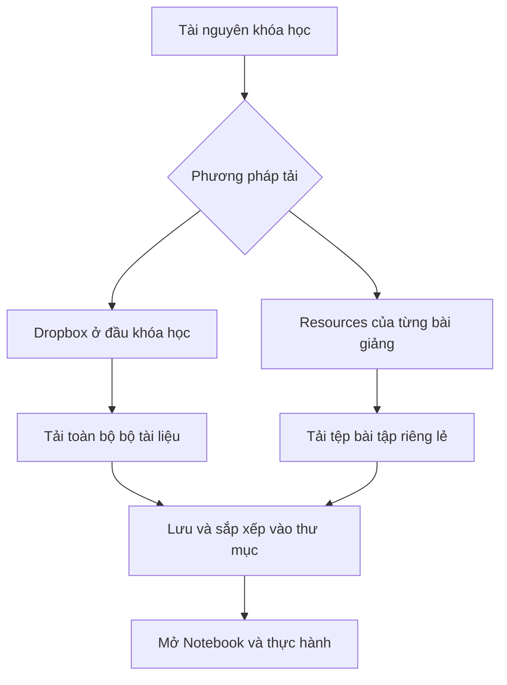
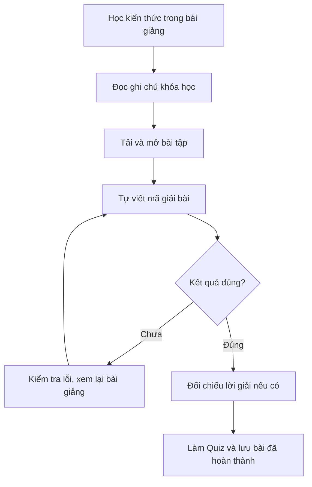

# Bài 002 – Download Useful Resources: Exercises and Solutions

**Khóa học:** Python for Finance: Investment Fundamentals & Data Analytics  
**Module 01:** Welcome! Course Introduction  
**Thứ tự:** Bài 002  
**Loại bài học:** Video Lecture  
**Thời lượng:** 2,9 phút  
**Trang khóa học:** [Python for Finance – Udemy](https://www.udemy.com/course/python-for-finance-investment-fundamentals-data-analytics)

> **Nội dung bài học:** Hướng dẫn tải xuống, tổ chức và sử dụng các tài nguyên học tập, bao gồm ghi chú khóa học, bài tập thực hành, Jupyter Notebook và lời giải. Đây là bước chuẩn bị quan trọng để học lập trình Python thông qua thực hành thay vì chỉ theo dõi bài giảng.
>
> **Phạm vi:** Tài liệu học bổ trợ bằng tiếng Việt, biên soạn từ nội dung bài học và kiến thức hỗ trợ cơ bản; không thay thế tài nguyên chính thức của khóa học.

---

## 1. Tổng quan bài học

Khi học lập trình Python, đặc biệt trong lĩnh vực tài chính và phân tích dữ liệu, việc chỉ xem giảng viên viết mã chưa đủ để hình thành kỹ năng lập trình. Bạn cần tự thực hiện các thao tác, chạy chương trình, quan sát kết quả và sửa lỗi khi cần thiết.

Khóa học cung cấp các tài nguyên bổ trợ để hỗ trợ quá trình này, bao gồm tài liệu lý thuyết, câu hỏi kiểm tra kiến thức và các tệp bài tập có thể tải về máy tính.

Các tài nguyên này giúp người học:

- Ôn tập và củng cố kiến thức sau mỗi bài giảng.
- Thực hành trực tiếp với mã Python.
- Kiểm tra mức độ nắm vững các kỹ thuật đã học.
- Đối chiếu kết quả bài làm với lời giải khi có sẵn.
- Xây dựng thói quen tự học và giải quyết vấn đề.

Trong bài học này, chúng ta sẽ tìm hiểu những loại tài nguyên được cung cấp, hai phương pháp tải xuống và cách chuẩn bị môi trường để sử dụng hiệu quả.

## 2. Mục tiêu học tập

Sau khi hoàn thành bài học, bạn có thể:

1. **Phân biệt** ba loại tài nguyên học tập chính trong khóa học.
2. **Tải xuống** toàn bộ tài nguyên thông qua liên kết Dropbox hoặc tải từng bài tập từ trang bài giảng Udemy.
3. **Nhận diện** tệp Jupyter Notebook có phần mở rộng `.ipynb` và giải thích vai trò của Anaconda.
4. **Tổ chức** các tài liệu và bài tập thành hệ thống thư mục dễ tìm kiếm.
5. **Xây dựng** quy trình thực hành, kiểm tra kết quả và sử dụng lời giải hiệu quả.

---

## 3. Các loại tài nguyên học tập

Khóa học cung cấp ba nhóm tài nguyên chính, mỗi nhóm phục vụ một mục đích khác nhau.

| Loại tài nguyên | Nội dung | Mục đích |
|---|---|---|
| Course Notes | Ghi chú và tài liệu lý thuyết | Hệ thống hóa kiến thức của từng phần |
| Quizzes | Câu hỏi kiểm tra kiến thức | Đánh giá mức độ hiểu bài |
| Exercise Files | Tệp thực hành Python, chủ yếu dưới dạng Notebook | Rèn luyện kỹ năng viết và chạy mã |

### 3.1. Course Notes – Ghi chú khóa học

**Course Notes** là các tài liệu ghi chú được cung cấp ở phần đầu của những khối nội dung chính trong khóa học. Chúng giúp người học nắm bắt các khái niệm quan trọng và có tài liệu tham khảo khi cần ôn tập.

Bạn có thể sử dụng ghi chú khóa học để:

- Xem trước những kiến thức sắp học.
- Ghi nhớ các thuật ngữ và khái niệm.
- Tra cứu khi thực hành bài tập.
- Tổng hợp kiến thức sau khi hoàn thành một phần học.

Nên lưu các ghi chú vào thư mục tương ứng với từng module để dễ dàng truy cập.

### 3.2. Quizzes – Câu hỏi kiểm tra

**Quizzes** là những câu hỏi kiểm tra kiến thức được tích hợp vào quá trình học, có thể xuất hiện khi bắt đầu hoặc trong lúc học video. Mục đích của Quiz không chỉ là xác định câu trả lời đúng mà còn giúp người học tự đánh giá xem mình đã nắm được kiến thức đến đâu.

Khi làm Quiz, nên trả lời dựa trên hiểu biết của bản thân trước khi tham khảo lại bài giảng. Nếu trả lời sai, hãy xác định khái niệm chưa hiểu và xem lại nội dung liên quan.

### 3.3. Exercise Files – Tệp bài tập thực hành

Đây là nhóm tài nguyên đặc biệt quan trọng đối với một khóa học lập trình Python.

Các tệp bài tập thường sử dụng định dạng **Jupyter Notebook (`.ipynb`)**, cho phép người học viết mã, thực thi chương trình và theo dõi kết quả trong cùng một tài liệu.

Jupyter Notebook có thể chứa:

- Mã nguồn Python.
- Nội dung giải thích bằng văn bản.
- Công thức toán học.
- Kết quả thực thi chương trình.
- Bảng dữ liệu và biểu đồ.

Ví dụ, khi học về phép tính lãi suất trong tài chính, một Notebook có thể chứa đoạn mã:

```python
initial_capital = 1000
interest_rate = 0.05

final_capital = initial_capital * (1 + interest_rate)

print(final_capital)
```

Kết quả:

```text
1050.0
```

Đây là ví dụ minh họa cách thực hành trong Notebook, không phải nội dung của một tệp bài tập cụ thể trong khóa học.

Khác với việc chỉ quan sát mã nguồn, Notebook cho phép người học trực tiếp sửa giá trị `initial_capital` hoặc `interest_rate`, chạy lại chương trình và quan sát kết quả thay đổi. Đó là lý do các tệp thực hành đóng vai trò quan trọng trong quá trình học Python.

---

## 4. Hai phương pháp tải xuống tài nguyên

Có hai cách chính để tải các tài liệu và bài tập của khóa học về máy tính.



Cả hai cách đều cho phép bạn sử dụng tài liệu trên máy tính. Sự khác biệt chính nằm ở số lượng tệp được tải và cách quản lý tài nguyên.

### 4.1. Phương pháp 1 – Tải toàn bộ tài nguyên qua Dropbox

Phương pháp này phù hợp khi bạn muốn chuẩn bị sẵn toàn bộ tài liệu và bài tập để sử dụng trong suốt khóa học.

**Các bước thực hiện:**

1. Truy cập khóa học trên Udemy.
2. Tìm liên kết Dropbox được cung cấp ở phần đầu khóa học.
3. Mở liên kết để truy cập bộ tài nguyên.
4. Chọn chức năng tải xuống để lưu bộ tệp về máy tính.
5. Chỉ định thư mục lưu trữ mong muốn.
6. Xác nhận tải xuống và kiểm tra các tệp đã được lưu.

Bộ tài nguyên được tổ chức thành những thư mục chứa các bài tập tương ứng, giúp người học dễ dàng tìm đúng nội dung.

Nếu bộ tài nguyên được tải về dưới dạng tệp nén `.zip`, bạn cần giải nén trước khi sử dụng.

**Ưu điểm:**

- Tải nhiều tài liệu cùng lúc.
- Có sẵn các bài tập để học theo tiến độ.
- Dễ dàng quản lý tài liệu theo chương.
- Thuận tiện khi muốn thực hành ngoại tuyến sau khi đã chuẩn bị môi trường.

**Lưu ý:** Liên kết Dropbox cụ thể không được cung cấp trong nội dung bài học này. Hãy sử dụng liên kết chính thức được đính kèm trong khóa học mà bạn có quyền truy cập.

### 4.2. Phương pháp 2 – Tải tài nguyên từ từng bài giảng

Nếu không muốn tải toàn bộ tài nguyên ngay từ đầu, bạn có thể tải riêng các tệp bài tập tương ứng với bài đang học.

Ví dụ, khi học chủ đề **Variables (Biến trong Python)**, bạn có thể tải tệp Notebook thực hành được đính kèm với bài giảng đó.

**Các bước thực hiện:**

1. Mở bài giảng cần học trên Udemy.
2. Tìm liên kết tài nguyên hoặc mục `Resources` của bài học.
3. Chọn tệp bài tập được cung cấp.
4. Tải tệp về máy tính.
5. Lưu tệp vào thư mục của bài học tương ứng.
6. Mở tệp bằng công cụ hỗ trợ Jupyter Notebook.

Phương pháp này giúp bạn tập trung vào những nội dung đang học thay vì phải quản lý nhiều tài liệu ngay từ đầu.

### 4.3. So sánh hai phương pháp

| Tiêu chí | Dropbox | Tải theo bài giảng |
|---|---|---|
| Phạm vi | Toàn bộ bộ tài nguyên được chia sẻ | Tệp của bài học cụ thể |
| Thời điểm tải | Thường thực hiện một lần | Thực hiện khi cần |
| Quản lý thư mục | Có thể nhận cấu trúc thư mục sẵn | Người học cần chủ động sắp xếp |
| Phù hợp | Người muốn chuẩn bị toàn bộ khóa học | Người muốn học từng bước |
| Ưu điểm chính | Tiện lợi và đầy đủ | Tập trung và linh hoạt |

Không có phương pháp nào bắt buộc phải sử dụng. Bạn có thể lựa chọn dựa trên nhu cầu học tập và dung lượng lưu trữ.

---

## 5. Cách mở và sử dụng Jupyter Notebook

### 5.1. Tệp `.ipynb` là gì?

`.ipynb` là định dạng tệp của Jupyter Notebook.

Khác với tệp Python thông thường có phần mở rộng `.py`, Notebook được tổ chức thành các ô (*cells*).

Hai loại ô phổ biến là:

| Loại ô | Chức năng |
|---|---|
| Code Cell | Chứa mã Python có thể thực thi |
| Markdown Cell | Chứa nội dung giải thích, tiêu đề, ghi chú hoặc công thức |

Notebook cho phép thực thi từng ô mã riêng biệt thay vì phải chạy toàn bộ chương trình cùng một lúc. Điều này rất hữu ích khi học lập trình, phân tích dữ liệu và thực hiện các phép tính tài chính.

### 5.2. Anaconda và môi trường thực hành Python

Tệp `.ipynb` không phải là tệp văn bản thông thường để sử dụng trực tiếp như một tài liệu Word hay PDF. Để mở và thực thi Notebook, bạn cần một môi trường hỗ trợ Jupyter.

Khóa học sử dụng **Anaconda** để chuẩn bị môi trường Python và các công cụ làm việc với Notebook.

Anaconda là một bản phân phối Python phục vụ các công việc như khoa học dữ liệu, tính toán và phân tích.

Một số thành phần liên quan:

- **Python:** Ngôn ngữ lập trình sử dụng trong khóa học.
- **Jupyter Notebook:** Môi trường để viết, chạy và trình bày mã theo từng ô.
- **JupyterLab:** Giao diện làm việc hiện đại trong hệ sinh thái Jupyter.
- **Anaconda:** Bộ công cụ giúp cài đặt và quản lý môi trường Python cùng các gói phần mềm.

Trong các bài học tiếp theo của module giới thiệu, khóa học sẽ hướng dẫn cách tải và sử dụng Anaconda. Vì vậy, nếu chưa mở được các tệp Notebook ngay sau khi tải xuống, bạn vẫn có thể lưu chúng trước và thực hành khi đã thiết lập xong môi trường.

### 5.3. Kiểm tra Notebook sau khi tải

Khi đã có môi trường Jupyter, hãy thử mở một tệp bài tập và thực hiện các thao tác cơ bản.

1. Khởi động Jupyter Notebook hoặc JupyterLab.
2. Truy cập thư mục chứa tài nguyên vừa tải.
3. Mở một tệp có đuôi `.ipynb`.
4. Chọn một Code Cell và thử chạy bằng tổ hợp phím `Shift + Enter`.
5. Kiểm tra kết quả thực thi xuất hiện bên dưới ô mã.

Ví dụ:

```python
print("Python for Finance")
```

Kết quả mong đợi:

```text
Python for Finance
```

Nếu đoạn mã chạy thành công, môi trường Notebook cơ bản đã hoạt động.

---

## 6. Tổ chức tài nguyên học tập hiệu quả

Việc tổ chức tài nguyên ngay từ đầu giúp tránh thất lạc tệp và dễ dàng tìm lại bài tập khi ôn tập. Một cách sắp xếp được đề xuất là chia tài nguyên theo module hoặc chủ đề.

Ví dụ minh họa:

```text
Python-for-Finance/
│
├── Module-01-Introduction/
│   ├── Notes/
│   └── Exercises/
│
├── Module-02/
│   ├── Notes/
│   ├── Exercises/
│   └── Solutions/
│
├── Module-03/
│   ├── Notes/
│   ├── Exercises/
│   └── Solutions/
│
└── My-Practice/
    ├── Completed/
    └── Experiments/
```

Đây là cấu trúc đề xuất để tự quản lý, không phải cấu trúc thư mục được xác nhận của bộ tài nguyên Udemy.

Trong đó:

- `Notes/`: Lưu tài liệu lý thuyết và ghi chú.
- `Exercises/`: Lưu bài tập được cung cấp.
- `Solutions/`: Lưu lời giải nếu khóa học có tệp tương ứng.
- `Completed/`: Lưu các bài tập đã hoàn thành.
- `Experiments/`: Lưu Notebook sử dụng để thử nghiệm thêm.

### 6.1. Giữ lại tệp bài tập ban đầu

Một thói quen hữu ích là không chỉnh sửa trực tiếp tệp bài tập ban đầu. Thay vào đó, bạn có thể tạo một bản sao để thực hành.

Ví dụ:

```text
variables_exercise.ipynb
variables_my_solution.ipynb
```

Việc giữ lại bản gốc giúp bạn dễ dàng thực hiện lại bài tập từ đầu mà không phải tải xuống lần nữa.

### 6.2. Phân biệt bài làm và lời giải

Khi khóa học cung cấp lời giải, nên lưu lời giải tách biệt với bài tập chưa hoàn thành. Bạn cần tự giải bài tập trước khi mở tệp lời giải.

Lời giải nên được sử dụng để:

1. Kiểm tra tính đúng đắn của kết quả.
2. So sánh cách triển khai.
3. Tìm hiểu những cách giải khác.
4. Phát hiện và sửa lỗi trong chương trình của mình.

Không nên coi việc chạy thành công một Notebook lời giải là bằng chứng rằng bản thân đã hiểu được kiến thức.

---

## 7. Phương pháp thực hành và tự học hiệu quả

Các bài tập không chỉ phục vụ việc kiểm tra kiến thức mà còn là phương tiện quan trọng để phát triển kỹ năng lập trình. Để thực sự tiến bộ, người học cần thường xuyên tự viết, thử nghiệm và sửa mã.

### 7.1. Quy trình học tập đề xuất



Quy trình này nhấn mạnh rằng người học cần chủ động thực hành trước khi tham khảo đáp án. Việc chạy lại mã, sửa lỗi và quan sát kết quả sẽ giúp kiến thức được ghi nhớ lâu hơn.

### 7.2. Cách xử lý khi gặp khó khăn

Trong quá trình thực hành, việc gặp lỗi hoặc bỏ sót một bước là điều bình thường.

**Xem lại bài giảng:** Quay lại phần giải thích liên quan để kiểm tra xem có thao tác hoặc khái niệm nào bị bỏ qua hay không.

**Chạy lại Notebook:** Thực thi lại các ô mã theo đúng thứ tự, đặc biệt khi một ô phụ thuộc vào biến được khai báo ở ô trước.

**Kiểm tra mã nguồn:** Xem lại tên biến, cú pháp, giá trị đầu vào và kết quả mong đợi.

**Tham khảo lời giải:** Nếu vẫn chưa tìm được vấn đề, hãy so sánh cách làm của mình với lời giải được cung cấp.

**Sử dụng phần Q&A:** Udemy có khu vực **Questions & Answers (Q&A)** để người học đặt câu hỏi về những nội dung chưa hiểu. Khi gửi câu hỏi, nên trình bày cụ thể:

- Bài học và bài tập đang thực hiện.
- Đoạn mã gây lỗi.
- Thông báo lỗi.
- Kết quả mong muốn.
- Những bước đã thử để khắc phục.

Một câu hỏi rõ ràng sẽ giúp giảng viên hoặc cộng đồng học viên dễ dàng hỗ trợ hơn.

---

## 8. Bài thực hành – Chuẩn bị bộ tài nguyên khóa học

### 8.1. Mục tiêu

Chuẩn bị hệ thống tài liệu để có thể thực hành xuyên suốt khóa học Python for Finance.

### 8.2. Nhiệm vụ

1. Truy cập trang khóa học Udemy.
2. Xác định vị trí liên kết Dropbox hoặc tài nguyên trong từng bài giảng.
3. Tải ít nhất một tệp Notebook `.ipynb` nếu có thể truy cập.
4. Tạo thư mục riêng trên máy tính để lưu tài nguyên.
5. Phân loại tài liệu lý thuyết và bài tập thực hành.
6. Cài đặt hoặc chuẩn bị môi trường Jupyter theo hướng dẫn của khóa học.
7. Mở và chạy thử một Code Cell.
8. Lưu lại Notebook sau khi thực hành.

### 8.3. Checklist hoàn thành

- [ ] Đã xác định được vị trí tài nguyên trên Udemy.
- [ ] Đã tải tài liệu hoặc bài tập về máy tính.
- [ ] Đã tạo thư mục lưu trữ theo module.
- [ ] Đã nhận diện được tệp `.ipynb`.
- [ ] Đã chuẩn bị môi trường Jupyter.
- [ ] Đã mở và thực thi thành công một ô mã.
- [ ] Đã lưu riêng bài thực hành của mình.

Sau khi hoàn thành các bước trên, bạn đã có nền tảng cần thiết để sử dụng các tệp bài tập trong những module tiếp theo.

---

## 9. Những lỗi thường gặp

| Lỗi | Nguyên nhân | Cách khắc phục |
|---|---|---|
| Không mở được `.ipynb` | Chưa có môi trường hỗ trợ Notebook | Cài đặt và sử dụng Jupyter thông qua môi trường phù hợp |
| Không tìm thấy tệp bài tập | Chưa kiểm tra mục tài nguyên của bài giảng | Kiểm tra mục `Resources` hoặc liên kết được cung cấp |
| Tải xong nhưng không biết tệp nằm ở đâu | Không xác định thư mục lưu | Kiểm tra thư mục Downloads hoặc vị trí đã chọn |
| Notebook chạy lỗi do thiếu biến | Thực thi các Code Cell sai thứ tự | Chạy lại các ô theo thứ tự phụ thuộc |
| Bài tập ban đầu bị thay đổi | Chỉnh sửa trực tiếp tệp gốc | Lưu một bản sao riêng trước khi thực hành |
| Không hiểu bài dù đã xem hết video | Thiếu thực hành trực tiếp | Tự giải bài tập và kiểm tra lại kết quả |
| Quá phụ thuộc vào lời giải | Xem đáp án trước khi tự giải | Chỉ tham khảo sau khi đã tự thực hiện |

Điểm quan trọng nhất là **không bỏ qua các bài tập thực hành**. Kỹ năng lập trình được hình thành thông qua việc trực tiếp giải quyết vấn đề, không chỉ bằng việc quan sát người khác viết mã.

---

## 10. Câu hỏi ôn tập

### Câu 1

Một học viên muốn chuẩn bị sẵn toàn bộ bộ bài tập cho khóa học. Phương pháp nào phù hợp nhất?

A. Tải thủ công từng tệp sau khi hoàn thành từng bài.  
B. Chỉ lưu các video bài giảng.  
C. Sử dụng liên kết Dropbox của khóa học để tải bộ tài nguyên.  
D. Chỉ làm các câu hỏi Quiz.

**Đáp án: C.**  
**Giải thích:** Dropbox là phương pháp được giới thiệu để tải toàn bộ bộ tài liệu và bài tập được chia sẻ cùng lúc.

### Câu 2

Định dạng tệp nào thường được sử dụng cho các bài tập Python trong khóa học?

A. `.ipynb`  
B. `.docx`  
C. `.pptx`  
D. `.mp4`

**Đáp án: A.**  
**Giải thích:** Tệp `.ipynb` là Jupyter Notebook, hỗ trợ viết mã, chạy Python và quan sát kết quả.

### Câu 3

Một học viên tải về tệp `.ipynb` nhưng chưa thể mở và chạy mã. Việc nên làm là gì?

A. Đổi tên tệp thành `.pdf`.  
B. Xóa tệp và chỉ học bằng video.  
C. Chép mã vào một tệp Word.  
D. Chuẩn bị môi trường Jupyter, chẳng hạn thông qua Anaconda.

**Đáp án: D.**  
**Giải thích:** Notebook cần môi trường hỗ trợ Jupyter để thực thi các ô mã Python.

### Câu 4

Khi giải bài tập, cách sử dụng lời giải nào giúp học hiệu quả nhất?

A. Mở lời giải ngay trước khi đọc đề bài.  
B. Tự giải trước, sau đó đối chiếu lời giải và sửa lỗi.  
C. Chỉ đọc lời giải và không cần chạy mã.  
D. Sao chép toàn bộ lời giải vào bài làm.

**Đáp án: B.**  
**Giải thích:** Tự giải trước giúp phát hiện lỗ hổng kiến thức; đối chiếu sau đó hỗ trợ sửa lỗi và học phương pháp mới.

### Câu 5

Khi Notebook gặp lỗi sau khi chạy một ô mã sử dụng biến chưa được khai báo, bước kiểm tra phù hợp là gì?

A. Xóa toàn bộ Notebook.  
B. Bỏ qua lỗi và chuyển sang bài khác.  
C. Kiểm tra và chạy lại các ô khai báo biến theo thứ tự.  
D. Thay đổi phần mở rộng thành `.py` mà không kiểm tra mã.

**Đáp án: C.**  
**Giải thích:** Các ô Notebook thường sử dụng chung trạng thái Python; một biến phải được định nghĩa trước khi sử dụng.

---

## 11. Tổng kết

Bài học **Download Useful Resources – Exercises and Solutions** giúp bạn chuẩn bị những tài nguyên và công cụ cần thiết để học Python hiệu quả.

Các kiến thức quan trọng cần ghi nhớ:

- Khóa học cung cấp ba nhóm tài nguyên chính: **Course Notes, Quizzes và Exercise Files**.
- Có hai phương pháp tải tài nguyên: tải toàn bộ qua **Dropbox** hoặc tải riêng từ từng bài giảng.
- Các bài tập Python sử dụng định dạng **Jupyter Notebook (`.ipynb`)**.
- **Anaconda** là công cụ được khóa học giới thiệu để chuẩn bị môi trường làm việc với Python và Notebook.
- Nên tổ chức tài liệu thành những thư mục riêng và lưu bài làm tách biệt với tệp gốc.
- Việc tự làm bài tập, chạy lại chương trình, sửa lỗi và đối chiếu lời giải là một phần quan trọng của quá trình học.
- Khi gặp khó khăn, bạn có thể xem lại bài giảng, kiểm tra Notebook hoặc đặt câu hỏi trong mục **Q&A** của khóa học.

**Nguyên tắc quan trọng nhất:** Học lập trình không chỉ là hiểu những gì chương trình làm, mà còn là khả năng tự mình viết, thực thi, kiểm tra và sửa chương trình đó.

Khi đã chuẩn bị đầy đủ tài liệu và môi trường thực hành, bạn có thể tập trung vào việc phát triển kỹ năng Python và ứng dụng chúng vào các bài toán tài chính, đầu tư và phân tích dữ liệu trong suốt khóa học.
