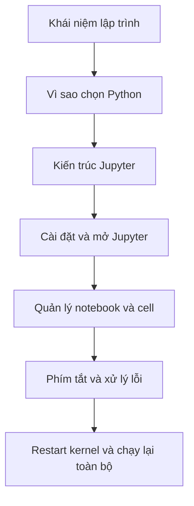

# 02. Giới thiệu lập trình với Python và Jupyter

**Khóa học:** Python for Finance: Investment Fundamentals & Data Analytics  
**Tên module:** Introduction to Programming with Python  
**Số mục nội dung:** 14 (10 bài giảng và 4 bài quiz)

Module giúp người mới làm quen khái niệm lập trình, lựa chọn Python, cài môi trường Anaconda/Jupyter và vận hành notebook: tạo, lưu, dùng phím tắt, đọc lỗi và khởi động lại kernel.

## Mục lục theo thứ tự học

| STT | Bài học / hoạt động | Hình thức |
|---:|---|---|
| 001 | [Jupyter - Introduction](C10-S02-L001-Jupyter-Introduction.md) | Bài giảng |
| 002 | [Programming Explained in 5 Minutes](C10-S02-L002-Programming-Explained.md) | Bài giảng |
| 003 | [Programming Explained in 5 Minutes](C10-S02-L003-Programming-Explained.md) | Bài kiểm tra |
| 004 | [Why Python?](C10-S02-L004-Why-Python.md) | Bài giảng |
| 005 | [Why Python?](C10-S02-L005-Why-Python.md) | Bài kiểm tra |
| 006 | [Why Jupyter?](C10-S02-L006-Why-Jupyter.md) | Bài giảng |
| 007 | [Why Jupyter?](C10-S02-L007-Why-Jupyter.md) | Bài kiểm tra |
| 008 | [Installing Python and Jupyter](C10-S02-L008-Installing-Python-and.md) | Bài giảng |
| 009 | [Intro to Using Jupyter](C10-S02-L009-Intro-to-Using-Jupyter.md) | Bài giảng |
| 010 | [Jupyter - Working with Notebook Files](C10-S02-L010-Jupyter-Working-with.md) | Bài giảng |
| 011 | [Jupyter’s Interface](C10-S02-L011-Jupyter-s-Interface.md) | Bài kiểm tra |
| 012 | [Jupyter - Using Shortcuts](C10-S02-L012-Jupyter-Using-Shortcuts.md) | Bài giảng |
| 013 | [Jupyter - Handling Error Messages](C10-S02-L013-Jupyter-Handling-Error.md) | Bài giảng |
| 014 | [Jupyter - Restarting the Kernel](C10-S02-L014-Jupyter-Restarting-the.md) | Bài giảng |

## Cách học đề xuất

1. Đọc lần lượt theo thứ tự; những bài quiz nằm ngay sau nhóm kiến thức tương ứng.
2. Chạy thử từng đoạn code trong Jupyter và đối chiếu đầu ra.
3. Làm trắc nghiệm trước khi xem đáp án.
4. Cuối module, tạo một notebook có Markdown, Code, phép tính, kết quả; kiểm tra bằng **Restart & Run All**.

## Sơ đồ lộ trình

Mỗi bước cung cấp kỹ năng để thực hiện bước kế tiếp. Người đã có môi trường Python có thể đọc lướt phần cài đặt nhưng vẫn nên kiểm tra cách lưu và chạy lại notebook.

> **Về phạm vi:** Đây là giáo trình hỗ trợ tự biên soạn bằng tiếng Việt. Không phải bản chép nguyên văn video hoặc đề kiểm tra chính thức; độ chi tiết phụ thuộc nội dung bài học được cung cấp.
