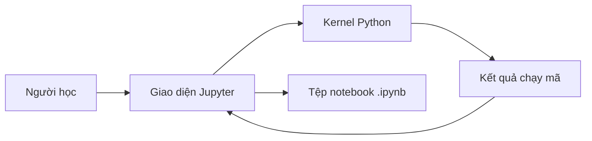

# 01. Jupyter - Introduction — Bài học

**Khóa học:** Python for Finance: Investment Fundamentals & Data Analytics  
**Module 02:** Introduction to Programming with Python  
**Thứ tự:** 001 · **Loại mục:** `VIDEO_LECTURE` · **Thời lượng metadata:** 1.4 phút  
**Khóa học Udemy:** https://www.udemy.com/course/python-for-finance-investment-fundamentals-data-analytics

> **Ghi chú:** Tài liệu tự biên soạn phục vụ học tập bằng tiếng Việt, bám nội dung bài học được cung cấp. Các phần luyện tập là tự soạn và không đại diện cho đề kiểm tra gốc trên Udemy.

## 1. Tổng quan

Trước khi phân tích dữ liệu bằng Python, người học cần một môi trường để nhập lệnh, chạy chương trình và quan sát kết quả. **Jupyter Notebook** đáp ứng nhu cầu này bằng cách tổ chức công việc thành những ô (*cell*) trong một tệp notebook. Mỗi cell có thể chứa mã hoặc phần diễn giải.

Trong phân tích tài chính, một notebook có thể đặt cạnh nhau giả định tính toán, mã Python, kết quả và nhận xét. Tuy nhiên, Jupyter là **môi trường làm việc**, không phải bản thân ngôn ngữ lập trình Python.

## 2. Mục tiêu học tập

Sau bài này, bạn có thể:

1. Phân biệt Python, Jupyter Notebook và notebook `.ipynb`.
2. Mô tả chuỗi thao tác từ mở Jupyter đến chạy một phép tính.
3. Tự tạo một notebook và kiểm tra kết quả mà không cần người khác thiết lập hộ.
4. Nhận diện các kỹ năng cần thiết trước khi bắt đầu phân tích dữ liệu tài chính bằng mã.

## 3. Ba thành phần cần phân biệt

| Thành phần | Chức năng | Ví dụ |
|---|---|---|
| Python | Ngôn ngữ mô tả các phép tính và quy tắc xử lý | `2 + 3` |
| Jupyter Notebook | Giao diện tương tác để soạn, thực thi và trình bày mã | Mở trình duyệt và tạo notebook |
| Tệp `.ipynb` | Tài liệu lưu cell, kết quả hiển thị và thông tin notebook | `phan_tich_dau_tu.ipynb` |

Notebook không tự chạy mọi phép tính: mã được thực thi bởi một **kernel** — tiến trình chạy ngôn ngữ tương ứng. Giao diện notebook gửi mã tới kernel rồi nhận kết quả để hiển thị.



Sơ đồ minh họa vai trò của giao diện, tiến trình xử lý và tài liệu lưu công việc. Việc nhấn nút chạy chỉ có tác dụng khi kernel đang hoạt động.

## 4. Thực hành mở notebook đầu tiên

1. Khởi động Jupyter Notebook trong môi trường đã cài Python và Jupyter.
2. Tại khu vực quản lý tệp, tạo notebook dùng kernel Python.
3. Trong một **Code cell**, nhập:

```python
so_tien = 1_000_000
lai_suat = 0.05
so_du_cuoi_nam = so_tien * (1 + lai_suat)
so_du_cuoi_nam
```

4. Nhấn `Shift + Enter`. Kết quả kỳ vọng là `1050000.0`, tương ứng ví dụ giả định lãi suất 5% trong một kỳ, chưa xét phí và thuế.
5. Đổi tên notebook thành `jupyter_dau_tien.ipynb` và lưu lại.

Đây là phép tính minh họa để làm quen với công cụ, không phải ước lượng lợi nhuận đầu tư thực tế.

## 5. Lộ trình thao tác nên nắm vững

- **Viết được lệnh**: phân tích vấn đề thành các bước rõ ràng và diễn đạt bằng Python.
- **Làm chủ môi trường**: tạo cell, sửa mã, lưu và mở lại tệp.
- **Đọc lỗi**: xác định loại lỗi và dòng gây lỗi thay vì xóa toàn bộ mã.
- **Kiểm soát kernel**: biết khi nào cần chạy lại hoặc khởi động lại phiên làm việc.

## 6. Những nhầm lẫn thường gặp

- Cho rằng cài Python đồng nghĩa với đã có giao diện notebook: đây là các thành phần khác nhau, dù một bản phân phối có thể cài cả hai.
- Cho rằng kết quả nhìn thấy trong notebook luôn phản ánh code hiện tại: kết quả có thể được tạo từ lần chạy trước.
- Viết nhiều cell nhưng không lưu tệp `.ipynb`, dẫn tới khó khôi phục công việc.

## 7. Bài tập tự luyện

Tạo một notebook gồm một ô Markdown ghi tên bài và một ô Code tính `120 * 1.08`. Lưu tệp, đóng notebook rồi mở lại để kiểm tra nội dung. Xác nhận kết quả hiển thị là `129.6` (có thể có sai khác biểu diễn dấu phẩy động rất nhỏ nếu dùng phép tính khác).

## 8. Câu hỏi trắc nghiệm ôn tập

### Câu 1

Điểm khác nhau quan trọng nhất giữa Python và Jupyter là gì?

A. Python là ngôn ngữ; Jupyter là môi trường tương tác.  
B. Python chỉ chạy trên web; Jupyter chỉ chạy ngoại tuyến.  
C. Jupyter là ngôn ngữ còn Python là định dạng file.  
D. Hai tên gọi luôn chỉ cùng một phần mềm.  


**Đáp án:** A.  
**Giải thích:** Python biểu diễn logic xử lý; Jupyter cung cấp môi trường để người dùng làm việc với mã.

### Câu 2

Tệp notebook thường sử dụng phần mở rộng nào?

A. `.pyx`  
B. `.ipynb`  
C. `.xlsx`  
D. `.html5`  


**Đáp án:** B.  
**Giải thích:** Định dạng `.ipynb` lưu cấu trúc các cell của notebook.

### Câu 3

Thành phần nào thực thi câu lệnh Python gửi từ notebook?

A. Tên thư mục  
B. Thanh công cụ  
C. Kernel Python  
D. Trình xem PDF  


**Đáp án:** C.  
**Giải thích:** Kernel chịu trách nhiệm chạy mã và gửi kết quả về giao diện.

### Câu 4

Thao tác nào vừa chạy cell vừa chuyển tới cell tiếp theo?

A. `Esc`  
B. `Ctrl + S`  
C. `A`  
D. `Shift + Enter`  


**Đáp án:** D.  
**Giải thích:** `Shift + Enter` là lối thao tác phổ biến để chạy cell đang chọn.

### Câu 5

Đâu là cách kiểm tra notebook đã thực hiện đúng phép tính?

A. Chạy ví dụ nhỏ và đối chiếu kết quả mong đợi.  
B. Chỉ đổi tên file.  
C. Chỉ chụp ảnh giao diện.  
D. Tắt kernel trước khi chạy.  


**Đáp án:** A.  
**Giải thích:** Kết quả nên được đối chiếu với phép tính biết trước để phát hiện lỗi.

## 9. Tổng kết

Nắm được mối liên hệ giữa Python, Jupyter và kernel giúp bạn tự mở notebook, viết thử một lệnh, xem kết quả và lưu lại công việc.
