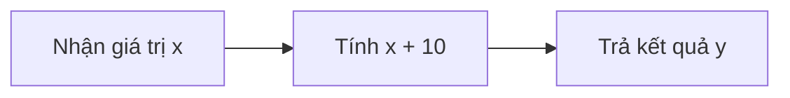

# 02. Programming Explained in 5 Minutes — Bài học

**Khóa học:** Python for Finance: Investment Fundamentals & Data Analytics  
**Module 02:** Introduction to Programming with Python  
**Thứ tự:** 002 · **Loại mục:** `VIDEO_LECTURE` · **Thời lượng metadata:** 5.5 phút  
**Khóa học Udemy:** https://www.udemy.com/course/python-for-finance-investment-fundamentals-data-analytics

> **Ghi chú:** Tài liệu tự biên soạn phục vụ học tập bằng tiếng Việt, bám nội dung bài học được cung cấp. Các phần luyện tập là tự soạn và không đại diện cho đề kiểm tra gốc trên Udemy.

## 1. Lập trình giải quyết vấn đề gì?

Con người có thể mô tả một nhiệm vụ bằng ngôn ngữ tự nhiên; máy tính cần những lệnh được biểu diễn chính xác hơn. **Lập trình** là quá trình chuyển một bài toán thành chuỗi chỉ dẫn được viết bằng ngôn ngữ lập trình để máy tính có thể thực thi.

Một **chương trình** gồm những chỉ dẫn xác định dữ liệu nào được sử dụng, phép xử lý nào được thực hiện và kết quả được tạo ra theo quy tắc gì. Mục tiêu không chỉ là làm cho máy chạy, mà còn là làm cho lời giải đúng, rõ ràng và dễ kiểm tra.

## 2. Mục tiêu học tập

1. Mô tả được mối liên hệ giữa bài toán, thuật toán, mã nguồn và chương trình.
2. Phân biệt lập trình với lĩnh vực khoa học máy tính rộng hơn.
3. Chia một yêu cầu thành dữ liệu đầu vào, bước xử lý và đầu ra.
4. Viết hàm Python đơn giản và đối chiếu kết quả bằng tay.
5. Giải thích vì sao tên biến và cấu trúc mã ảnh hưởng đến khả năng bảo trì.

## 3. Từ yêu cầu đời thường tới chương trình

Giả sử người quản lý muốn một công cụ **cộng thêm 10 vào số được nhập**. Để viết chương trình, trước tiên phải xác định:

- **Đầu vào**: số `x` do người dùng cung cấp.
- **Quy tắc**: cộng thêm 10.
- **Đầu ra**: một số mới `y`.

Quy tắc toán học có thể viết thành:

$$
y = f(x) = x + 10
$$



Đây là một thuật toán cực ngắn: người lập trình đã xác định *đúng việc gì phải làm* trước khi chọn cú pháp cụ thể.

```python
def cong_muoi(x):
    return x + 10

print(cong_muoi(5))    # 15
print(cong_muoi(-3))   # 7
```

Trong ví dụ này, `def` khai báo hàm, `x` là tham số đầu vào, còn `return` gửi giá trị tính được trở lại nơi gọi. Hàm cũng xử lý các số âm mà không cần sửa thuật toán.

## 4. Mã nguồn và cách máy tính thực thi

Máy tính hoạt động dựa trên các trạng thái nhị phân, thường mô tả bằng bit `0` và `1`. Con người không cần trực tiếp ghi một chương trình dài bằng mã máy. Những ngôn ngữ như Python cho phép viết cú pháp ở mức trừu tượng cao hơn; môi trường thực thi sẽ xử lý mã này qua các bước cần thiết để máy có thể chạy.

Khái niệm cần phân biệt:

| Khái niệm | Ý nghĩa |
|---|---|
| Bài toán | Nhu cầu cần giải quyết |
| Thuật toán | Chuỗi bước hữu hạn để giải bài toán |
| Mã nguồn | Cách biểu diễn các bước bằng ngôn ngữ lập trình |
| Chương trình | Tập hợp lệnh và cấu trúc được máy thực thi |
| Khoa học máy tính | Lĩnh vực rộng hơn nghiên cứu tính toán, thuật toán, hệ thống và giới hạn của chúng |

Lập trình là kỹ năng quan trọng trong khoa học máy tính nhưng không đồng nghĩa với toàn bộ ngành này.

## 5. Hai kỹ năng cốt lõi của lập trình viên

### 5.1. Giải quyết vấn đề và phân rã

Một nhiệm vụ lớn thường dễ giải hơn nếu được chia thành những nhiệm vụ nhỏ. Ví dụ, để tính giá trị danh mục, có thể cần nhập số lượng từng tài sản, nhập giá hiện tại, tính giá trị mỗi vị thế rồi cộng tổng. Mỗi bước có thể được kiểm tra độc lập.

### 5.2. Diễn đạt lệnh rõ ràng

Máy tính không tự đoán ý định phía sau một lệnh không đầy đủ. Tên biến như `so_du_dau_ky`, `lai_suat` thường dễ đọc hơn `a`, `b`. Mã có cấu trúc giúp người khác đọc, đánh giá và sửa lỗi, đặc biệt khi chương trình dài hơn vài dòng. Ngay cả khi sử dụng AI để hỗ trợ viết mã, người học vẫn cần hiểu và kiểm tra kết quả.

## 6. Kiểm tra chương trình nhỏ

Dùng hàm `cong_muoi` với ba trường hợp: `x=0` phải ra `10`; `x=-10` phải ra `0`; `x=2.5` phải ra `12.5`. Chú ý đầu vào không phải số, chẳng hạn chuỗi `'5'`, sẽ không thể cộng trực tiếp với số nguyên `10` và có thể sinh `TypeError`.

## 7. Bài tập tự luyện

Viết bằng lời các bước tính số tiền còn lại sau khi trừ một khoản chi. Sau đó chuyển thành hàm `tien_con_lai(so_du, chi_phi)` với hai tham số. Kiểm tra ít nhất hai trường hợp và đặt tên biến có ý nghĩa.

## 8. Câu hỏi trắc nghiệm ôn tập

### Câu 1

Trong lập trình, bước hợp lý nhất trước khi viết cú pháp chi tiết là gì?

A. Chọn màu cho terminal.  
B. Xác định đầu vào, xử lý và đầu ra.  
C. Tối ưu tốc độ ngay từ đầu.  
D. Chép lại một chương trình không liên quan.  


**Đáp án:** B.  
**Giải thích:** Làm rõ yêu cầu và thuật toán giúp tránh viết đúng cú pháp nhưng sai bài toán.

### Câu 2

Với hàm `cong_muoi(4)`, kết quả nhận được là bao nhiêu?

A. 4  
B. 10  
C. 14  
D. 40  


**Đáp án:** C.  
**Giải thích:** Hàm trả về `4 + 10 = 14`.

### Câu 3

Cách hiểu đúng về thuật toán là gì?

A. Tên của ngôn ngữ Python.  
B. Bất kỳ đoạn chú thích nào.  
C. Chỉ là biểu đồ đẹp.  
D. Chuỗi bước để giải quyết một nhiệm vụ.  


**Đáp án:** D.  
**Giải thích:** Thuật toán mô tả cách thực hiện công việc, không phụ thuộc ngôn ngữ cụ thể.

### Câu 4

Vì sao nên dùng tên biến có ý nghĩa?

A. Giúp đọc, rà soát và bảo trì mã.  
B. Luôn làm code chạy nhanh hơn 100 lần.  
C. Thay thế được kiểm thử.  
D. Đảm bảo không có bất kỳ lỗi nào.  


**Đáp án:** A.  
**Giải thích:** Tên biến rõ giúp truyền đạt mục đích của dữ liệu và hạn chế hiểu nhầm.

### Câu 5

Trường hợp nào dễ gây lỗi cho biểu thức `x + 10` trong Python?

A. `x = -2`  
B. `x = "2"`  
C. `x = 0`  
D. `x = 2.5`  


**Đáp án:** B.  
**Giải thích:** Không thể trực tiếp dùng toán tử `+` để cộng chuỗi và số nguyên.

## 9. Tổng kết

Lập trình bắt đầu từ việc làm rõ yêu cầu, chia vấn đề thành các bước, rồi biểu diễn những bước đó bằng mã có thể kiểm chứng.
