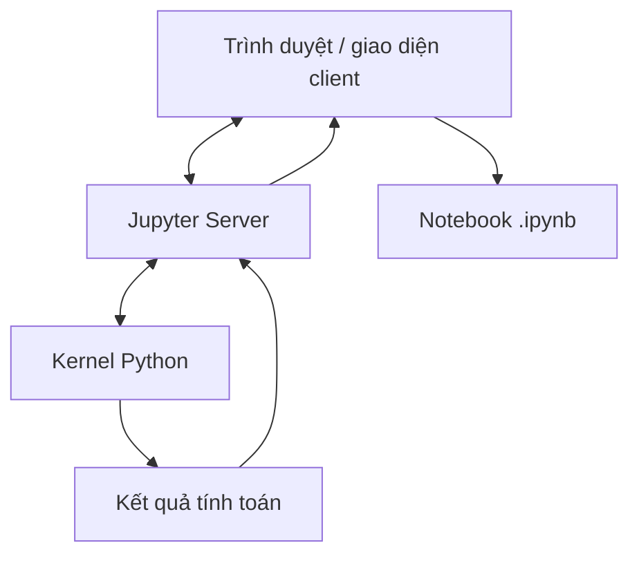

# 06. Why Jupyter? — Bài học

**Khóa học:** Python for Finance: Investment Fundamentals & Data Analytics  
**Module 02:** Introduction to Programming with Python  
**Thứ tự:** 006 · **Loại mục:** `VIDEO_LECTURE` · **Thời lượng metadata:** 3.5 phút  
**Khóa học Udemy:** https://www.udemy.com/course/python-for-finance-investment-fundamentals-data-analytics

> **Ghi chú:** Tài liệu tự biên soạn phục vụ học tập bằng tiếng Việt, bám nội dung bài học được cung cấp. Các phần luyện tập là tự soạn và không đại diện cho đề kiểm tra gốc trên Udemy.

## 1. Jupyter là gì và vì sao cần nó?

Python là ngôn ngữ lập trình; để viết, chạy và quan sát mã, người dùng cần môi trường thực thi và một giao diện tương tác. **Jupyter Notebook** là môi trường cho phép làm việc qua trình duyệt, chia nội dung thành cell và trình bày cùng lúc giải thích, mã, kết quả, hình hoặc biểu đồ.

Cách làm này phù hợp với công việc khám phá dữ liệu và đào tạo: một người khác có thể đọc cả cách tính lẫn kết quả trong cùng tài liệu.

## 2. Mục tiêu học tập

1. Phân biệt **client**, **Jupyter server**, **kernel** và tệp notebook.
2. Giải thích quy trình gửi mã để thực thi và trả kết quả.
3. Nhận diện lợi ích của cell Markdown và Code trong một tài liệu.
4. Tạo notebook giải thích ngắn cho một phép tính.

## 3. Kiến trúc làm việc



- **Client**: giao diện người dùng tương tác, thường chạy trong trình duyệt.
- **Jupyter Server**: kết nối giao diện với môi trường thực thi và quản lý notebook.
- **Kernel**: tiến trình thực thi mã; trong module này chủ yếu là kernel Python.
- **Notebook**: tệp lưu nội dung, các cell và một số đầu ra để có thể mở lại.

Jupyter cũng có thể hỗ trợ kernel của những ngôn ngữ khác như R hoặc Julia nếu đã cài và cấu hình thích hợp. Không nên hiểu rằng mọi notebook có thể đổi ngôn ngữ mà không cần thay mã.

## 4. Notebook khác file Python thuần như thế nào?

| Đặc điểm | Notebook `.ipynb` | Script `.py` |
|---|---|---|
| Cách tổ chức | Nhiều cell chạy tương tác | Mã thường chạy như một chương trình |
| Ghi chú, công thức, kết quả | Dễ trình bày đan xen | Có chú thích; phần kết quả thường tách riêng |
| Phân tích thử nghiệm | Thuận tiện | Vẫn thực hiện được |
| Quy trình tự động lặp lại | Cần kiểm soát trạng thái và thứ tự cell | Thường thuận tiện hơn để tổ chức quy trình rõ ràng |

Notebook hữu ích khi khám phá và giải thích. Script có thể phù hợp hơn khi cần chạy công việc được chuẩn hóa theo lịch trình. Trong dự án thực tế, hai kiểu tệp có thể bổ trợ cho nhau.

## 5. Ví dụ: ghi chú và phép tính trong một notebook

Tạo hai cell theo thứ tự:

**Cell 1 — Markdown:**

```markdown
# Minh họa tăng trưởng một kỳ

Giả sử vốn ban đầu là 500 và tỷ lệ tăng là 4%.
```

**Cell 2 — Code:**

```python
von_ban_dau = 500
ty_le_tang = 0.04
print(von_ban_dau * (1 + ty_le_tang))
```

Đầu ra: `520.0`. Ưu điểm không nằm ở phép nhân đơn giản mà ở khả năng đặt **giả định, phép tính và kết quả** trong một tài liệu dễ chia sẻ.

## 6. Điểm cần lưu ý

- Một tệp `.ipynb` vẫn mở được để đọc nội dung đã lưu, nhưng muốn chạy lại Python phải có kernel phù hợp.
- Kết quả hiển thị có thể là kết quả cũ; không nên coi chúng là bằng chứng rằng mọi cell đã được chạy lại.
- Mã được chạy trong kernel có trạng thái lưu các biến giữa các cell. Thứ tự chạy không nhất thiết trùng thứ tự cell trên màn hình.

## 7. Bài tập thực hành

Tạo notebook chứa một cell Markdown mô tả mục tiêu tính toán, một cell Code tính `300 * 1.03`, và một cell Markdown viết nhận xét về đầu ra. Lưu tệp và mở lại để đảm bảo các phần đều hiển thị.

## 8. Câu hỏi trắc nghiệm ôn tập

### Câu 1

Ai là thành phần chịu trách nhiệm thực thi Python trong Jupyter?

A. Trình duyệt.  
B. Kernel.  
C. Tên notebook.  
D. File Markdown.  


**Đáp án:** B.  
**Giải thích:** Kernel chạy lệnh và trả kết quả cho giao diện.

### Câu 2

Ưu điểm nổi bật của notebook so với một bản ghi mã rời là gì?

A. Bắt buộc phải dùng nhiều ngôn ngữ.  
B. Không bao giờ có lỗi.  
C. Có thể kết hợp ghi chú, code và kết quả trong cùng tài liệu.  
D. Không cần lưu tệp.  


**Đáp án:** C.  
**Giải thích:** Notebook đặc biệt phù hợp trình bày và giải thích quá trình phân tích.

### Câu 3

Jupyter Server đóng vai trò gì?

A. Chỉ là tệp bảng tính.  
B. Chỉ quản lý màn hình ngoài.  
C. Chỉ là tên một thư viện thống kê.  
D. Kết nối giao diện với các kernel và tài nguyên notebook.  


**Đáp án:** D.  
**Giải thích:** Server hỗ trợ tương tác giữa client và kernel.

### Câu 4

Khi nào file `.py` có thể thuận tiện hơn notebook?

A. Khi tổ chức quy trình chạy tự động, nhất quán.  
B. Khi muốn ghi chú bằng Markdown.  
C. Khi cần xem đồ thị trong báo cáo thử nghiệm.  
D. Khi chỉ muốn đổi tên một notebook.  


**Đáp án:** A.  
**Giải thích:** Script thường phù hợp các tác vụ cần chạy lặp lại theo quy trình xác định.

### Câu 5

Rủi ro của việc chạy các cell notebook không theo thứ tự là gì?

A. Notebook tự chuyển thành PDF.  
B. Kết quả có thể phụ thuộc vào biến còn lưu từ lần chạy trước.  
C. Python thay đổi ngôn ngữ.  
D. Mọi giá trị đều tự động bằng 0.  


**Đáp án:** B.  
**Giải thích:** Kernel lưu trạng thái trong phiên, nên thứ tự thực thi ảnh hưởng kết quả.

## 9. Tổng kết

Notebook kết hợp mô tả, code và kết quả trong cùng tài liệu; server và kernel là những thành phần giúp nó thực thi mã.
