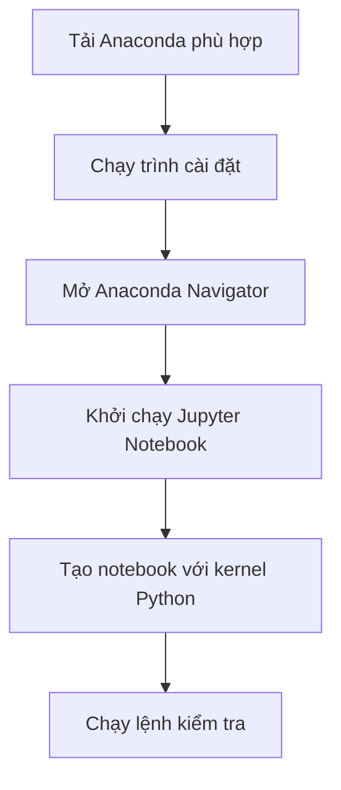

# 08. Installing Python and Jupyter — Bài học

**Khóa học:** Python for Finance: Investment Fundamentals & Data Analytics  
**Module 02:** Introduction to Programming with Python  
**Thứ tự:** 008 · **Loại mục:** `VIDEO_LECTURE` · **Thời lượng metadata:** 3.6 phút  
**Khóa học Udemy:** https://www.udemy.com/course/python-for-finance-investment-fundamentals-data-analytics

> **Ghi chú:** Tài liệu tự biên soạn phục vụ học tập bằng tiếng Việt, bám nội dung bài học được cung cấp. Các phần luyện tập là tự soạn và không đại diện cho đề kiểm tra gốc trên Udemy.

## 1. Tổng quan cài đặt

Để dùng Python trong Jupyter, máy cần có môi trường Python và ứng dụng Jupyter. Một cách thuận tiện cho người mới là cài **Anaconda Distribution**, bản phân phối bao gồm Python, Jupyter và nhiều công cụ làm việc với dữ liệu. Trên Windows, Anaconda Navigator giúp mở các ứng dụng này từ giao diện đồ họa.

Giao diện của website hay trình cài đặt có thể thay đổi theo phiên bản. Các bước dưới đây tập trung vào các quyết định và thao tác chính, không phụ thuộc hoàn toàn vào vị trí từng nút.

## 2. Mục tiêu học tập

1. Xác định được các thành phần cần thiết để chạy Jupyter Notebook.
2. Cài đặt Anaconda cho hệ điều hành phù hợp bằng bản phân phối chính thức.
3. Mở Anaconda Navigator và khởi chạy Jupyter Notebook.
4. Kiểm tra Python và kernel bằng đoạn mã ngắn.
5. Phân biệt lỗi cài đặt với lỗi chạy mã trong notebook.

## 3. Chuẩn bị

- Máy Windows, macOS hoặc Linux có quyền cài phần mềm phù hợp.
- Kết nối mạng để tải trình cài đặt.
- Trình duyệt web để mở Jupyter.
- Dung lượng đĩa phù hợp với bản phân phối dự định cài.

Trang tải Anaconda: [anaconda.com](https://www.anaconda.com/). Chọn phiên bản cá nhân phù hợp và đọc điều kiện sử dụng được công bố tại thời điểm tải. Bài minh họa gốc giới thiệu Windows và trình cài đặt đồ họa 64-bit; quá trình trên macOS hoặc Linux có thể khác ở một số màn hình.

## 4. Quy trình cài đặt bằng Anaconda

### 4.1. Tải và cài bản phân phối

1. Mở trang Anaconda chính thức, tìm mục tải **Anaconda Distribution**.
2. Chọn đúng hệ điều hành và kiến trúc máy. Với Windows 64-bit phổ biến, chọn trình cài đặt đồ họa tương ứng.
3. Mở tệp cài đặt vừa tải; đọc các điều khoản hiển thị.
4. Chọn vị trí cài đặt phù hợp hoặc giữ vị trí mặc định nếu không có yêu cầu đặc biệt.
5. Chỉ chọn những tùy chọn cài đặt được đề xuất và phù hợp cấu hình máy.
6. Hoàn tất quá trình và khởi chạy **Anaconda Navigator**, nếu phiên bản cài đặt cung cấp ứng dụng này.

Tại thời điểm bài minh họa được thực hiện, phần hướng dẫn có nêu Python 3.14. Đây không phải yêu cầu bắt buộc cho toàn bộ module; phiên bản hiển thị trên website và bản tương thích có thể thay đổi.

### 4.2. Mở Jupyter Notebook

Trong Anaconda Navigator, tìm ứng dụng **Jupyter Notebook** và chọn **Launch**. Một cửa sổ hoặc tab trình duyệt sẽ xuất hiện, hiển thị khu vực quản lý tệp của Jupyter. Tùy bản cài đặt, bạn cũng có thể có lối tắt mở Jupyter trực tiếp từ hệ điều hành.



Quy trình hoàn tất không chỉ khi trình cài đặt báo thành công, mà khi notebook thực sự chạy được mã Python.

## 5. Kiểm tra sau cài đặt

Tạo một notebook dùng kernel Python. Trong cell Code, chạy:

```python
import sys
print(sys.version)
print("Jupyter và Python đã hoạt động")
```

`sys.version` cho biết phiên bản Python mà **kernel hiện tại** sử dụng, có thể khác bản Python bạn gọi ở terminal nếu máy có nhiều môi trường.

Có thể kiểm tra bằng phép tính:

```python
print(2 + 3)
```

Kết quả kỳ vọng: `5`.

## 6. Xử lý sự cố ban đầu

| Hiện tượng | Kiểm tra trước tiên |
|---|---|
| Không mở được Navigator | Xác nhận đã cài đặt và chạy đúng ứng dụng |
| Trình duyệt không hiện giao diện | Kiểm tra cửa sổ terminal/ứng dụng đã khởi chạy Jupyter và địa chỉ được cung cấp |
| Không tạo được notebook Python | Kiểm tra kernel Python có sẵn trong môi trường |
| Notebook chạy Python khác dự kiến | In `sys.version` trong chính notebook |
| Khó tìm tệp vừa tạo | Quan sát đường dẫn thư mục đang mở trong giao diện Jupyter |

Không nên xóa thư mục môi trường hoặc chỉnh cấu hình hệ thống ngẫu nhiên khi chưa đọc thông báo lỗi.

## 7. Bài tập thực hành

Tự cài hoặc kiểm tra môi trường đang có, khởi chạy Jupyter, tạo `kiem_tra_cai_dat.ipynb` và lưu kết quả `sys.version` cùng phép tính `5 * 12`. Ghi lại cách bạn khởi động Jupyter để có thể tự thực hiện lần sau.

## 8. Câu hỏi trắc nghiệm ôn tập

### Câu 1

Vì sao Anaconda thuận tiện cho người mới học phân tích dữ liệu?

A. Chỉ cài một trình duyệt.  
B. Cấm sử dụng Python riêng.  
C. Không có công cụ quản lý ứng dụng.  
D. Cung cấp Python, Jupyter và nhiều công cụ trong một bản phân phối.  


**Đáp án:** D.  
**Giải thích:** Anaconda giúp cài đặt nhiều thành phần liên quan cùng lúc.

### Câu 2

Để xem phiên bản Python đang dùng trong notebook, lệnh phù hợp là gì?

A. `import sys; print(sys.version)`  
B. `print("version")`  
C. `reset kernel`  
D. `open anaconda.com`  


**Đáp án:** A.  
**Giải thích:** `sys.version` phản ánh Python của kernel đang chạy.

### Câu 3

Sau khi cài Anaconda trên Windows, ứng dụng đồ họa nào thường giúp mở Jupyter?

A. Paint  
B. Anaconda Navigator  
C. File Explorer luôn tự bật kernel  
D. Word  


**Đáp án:** B.  
**Giải thích:** Navigator cung cấp lối mở những ứng dụng đã được cài.

### Câu 4

Nếu trang tải hiển thị bản khác so với ảnh hướng dẫn, nên làm gì?

A. Hủy học Python.  
B. Tải phần mềm từ nguồn không xác định.  
C. Chọn bản chính thức tương thích với máy và đọc hướng dẫn hiện hành.  
D. Cố cài phiên bản trên ảnh cho mọi máy.  


**Đáp án:** C.  
**Giải thích:** Giao diện và bản phát hành có thể thay đổi.

### Câu 5

Khi đã cài xong nhưng notebook không chạy code, bằng chứng kiểm tra tốt nhất là gì?

A. Biểu tượng desktop xuất hiện.  
B. Đã đổi màu giao diện.  
C. Đã tạo một folder rỗng.  
D. Một cell Python thực thi và trả kết quả mong đợi.  


**Đáp án:** D.  
**Giải thích:** Cài đặt được xác nhận ở mức sử dụng thực tế khi code chạy thành công.

## 9. Tổng kết

Sau khi cài, hãy mở được notebook Python và chạy được một cell kiểm tra. Giao diện cài đặt có thể thay đổi nhưng tiêu chí xác nhận vẫn là môi trường hoạt động đúng.
