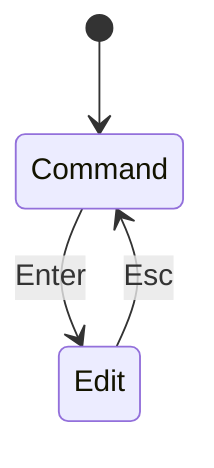

# 12. Jupyter - Using Shortcuts — Bài học

**Khóa học:** Python for Finance: Investment Fundamentals & Data Analytics  
**Module 02:** Introduction to Programming with Python  
**Thứ tự:** 012 · **Loại mục:** `VIDEO_LECTURE` · **Thời lượng metadata:** 7.4 phút  
**Khóa học Udemy:** https://www.udemy.com/course/python-for-finance-investment-fundamentals-data-analytics

> **Ghi chú:** Tài liệu tự biên soạn phục vụ học tập bằng tiếng Việt, bám nội dung bài học được cung cấp. Các phần luyện tập là tự soạn và không đại diện cho đề kiểm tra gốc trên Udemy.

## 1. Tại sao cần phím tắt trong Jupyter?

Jupyter hỗ trợ cả thao tác bằng chuột và bàn phím. Khi thường xuyên viết, chạy, di chuyển hoặc chèn cell, phím tắt giúp giảm thao tác lặp lại. Quan trọng hơn, người học cần hiểu **hai chế độ nhập liệu**: chế độ sửa nội dung cell (*Edit mode*) và chế độ điều khiển cell (*Command mode*).

Các phím tắt dưới đây phổ biến trong **Jupyter Notebook giao diện cổ điển**. Phiên bản Jupyter khác nhau hoặc JupyterLab có thể điều chỉnh hành vi; hãy kiểm tra menu hoặc danh sách Keyboard Shortcuts của ứng dụng nếu phím không hoạt động như mô tả.

## 2. Mục tiêu học tập

1. Phân biệt Edit mode và Command mode.
2. Sử dụng các phím chạy, chèn, xóa và chuyển kiểu cell thông dụng.
3. Tránh xóa nhầm cell khi thao tác nhanh.
4. Kết hợp phím tắt để tạo một notebook có bố cục rõ ràng.

## 3. Hai chế độ điều khiển

- **Edit mode:** con trỏ ở trong cell để nhập hoặc sửa nội dung. Nhấn `Esc` thường trở về Command mode.
- **Command mode:** thao tác ở mức cell như thêm, xóa hoặc đổi loại. Nhấn `Enter` thường chuyển vào Edit mode.

Các phím như `A`, `B`, `M`, `Y` chủ yếu thực hiện lệnh trên cell trong Command mode. Nếu đang ở Edit mode, những phím đó thường chỉ được gõ thành văn bản.

## 4. Bảng phím tắt thông dụng

| Phím | Tác dụng thường gặp | Ghi chú |
|---|---|---|
| `Shift + Enter` | Chạy cell và chuyển tới cell tiếp theo | Có thể tạo cell mới nếu đang ở cuối notebook |
| `Ctrl + Enter` | Chạy cell và giữ vị trí | Thuận tiện khi cần sửa/chạy lại cùng cell |
| `Alt + Enter` | Chạy cell và chèn cell mới bên dưới | Hành vi có thể tùy phiên bản |
| `Esc` | Chuyển từ Edit sang Command mode | Không xóa nội dung |
| `Enter` | Chuyển từ Command sang Edit mode | Đặt con trỏ để soạn cell |
| `A` | Thêm cell phía trên | Command mode |
| `B` | Thêm cell phía dưới | Command mode |
| `D`, `D` | Xóa cell đang chọn | Nhấn `D` hai lần trong Command mode |
| `M` | Chuyển cell sang Markdown | Command mode |
| `Y` | Chuyển cell sang Code | Command mode |

Nếu thao tác xóa nhầm, nên dùng tính năng Undo Delete Cells của phiên bản đang chạy thay vì tiếp tục thao tác không kiểm soát.

## 5. Luyện theo quy trình

1. Tạo notebook mới và chọn một cell.
2. Nhấn `Esc`, sau đó `M` để chuyển thành Markdown. Nhấn `Enter` và viết `# Thực hành phím tắt`.
3. Nhấn `Shift + Enter` để hiển thị tiêu đề.
4. Ở Command mode, nhấn `B` để tạo cell dưới và `Y` để đặt loại Code.
5. Nhập `print(2 ** 3)` và chạy bằng `Ctrl + Enter`; kết quả mong đợi là `8`.
6. Tạo một cell thử nghiệm khác bằng `A`, sau đó dùng `D`, `D` để xóa chính cell thử nghiệm.
7. Lưu notebook sau khi kiểm tra không còn cell không cần thiết.

## 6. Sai sót dễ gặp

- Nhấn `M` hoặc `Y` khi đang sửa code khiến ký tự được nhập vào mã thay vì đổi loại cell.
- Nhấn `D`, `D` trên một cell quan trọng mà chưa lưu.
- Nhầm `Ctrl + Enter` với `Shift + Enter`, khiến con trỏ không chuyển vị trí như mong đợi.
- Áp dụng phím tắt của Jupyter Notebook cổ điển vào một môi trường có ánh xạ khác mà không kiểm tra.

## 7. Bài tập tự luyện

Trong tối đa năm phút, luyện tám thao tác: vào Command mode, vào Edit mode, thêm cell trên, thêm cell dưới, chuyển Markdown, chuyển Code, chạy cell, xóa một cell thử nghiệm. Ghi lại phím nào khác với bản Jupyter bạn đang dùng.

## 8. Câu hỏi trắc nghiệm ôn tập

### Câu 1

Muốn dùng phím `A` để thêm cell phía trên trong giao diện cổ điển, cần ở chế độ nào?

A. Edit mode.  
B. Command mode.  
C. Chỉ khi kernel đã shutdown.  
D. Chỉ khi đang xem HTML.  

**Đáp án:** B.  
**Giải thích:** `A` là thao tác cấp cell trong Command mode.

### Câu 2

Cặp phím nào thường dùng để chuyển Edit mode về Command mode?

A. `Ctrl + P`  
B. `Shift + S`  
C. `Esc`  
D. `F5`  

**Đáp án:** C.  
**Giải thích:** `Esc` thường đưa người dùng trở về chế độ điều khiển cell.

### Câu 3

Trong Command mode cổ điển, `M` dùng để làm gì?

A. Lưu tệp dưới dạng PDF.  
B. Thêm thư mục.  
C. Đóng kernel.  
D. Chuyển cell sang Markdown.  

**Đáp án:** D.  
**Giải thích:** `M` chuyển loại cell thành Markdown.

### Câu 4

Tổ hợp nào chạy cell và chuyển đến cell tiếp theo?

A. `Shift + Enter`  
B. `A`  
C. `Esc`  
D. `D`, `D`  

**Đáp án:** A.  
**Giải thích:** `Shift + Enter` chạy cell đang chọn và chuyển tới cell tiếp theo.

### Câu 5

Để giảm nguy cơ xóa nhầm, nên làm gì trước khi dùng `D`, `D`?

A. Chạy nhiều tab.  
B. Xác nhận cell đã chọn là cell muốn xóa.  
C. Đổi tên notebook ngẫu nhiên.  
D. Tắt luôn Python.  

**Đáp án:** B.  
**Giải thích:** Phím xóa tác động lên cell được chọn trong Command mode.

## 9. Tổng kết

Phím tắt phát huy hiệu quả khi biết mình đang ở Command hay Edit mode. Ưu tiên thao tác chính xác, nhất là khi xóa cell.
