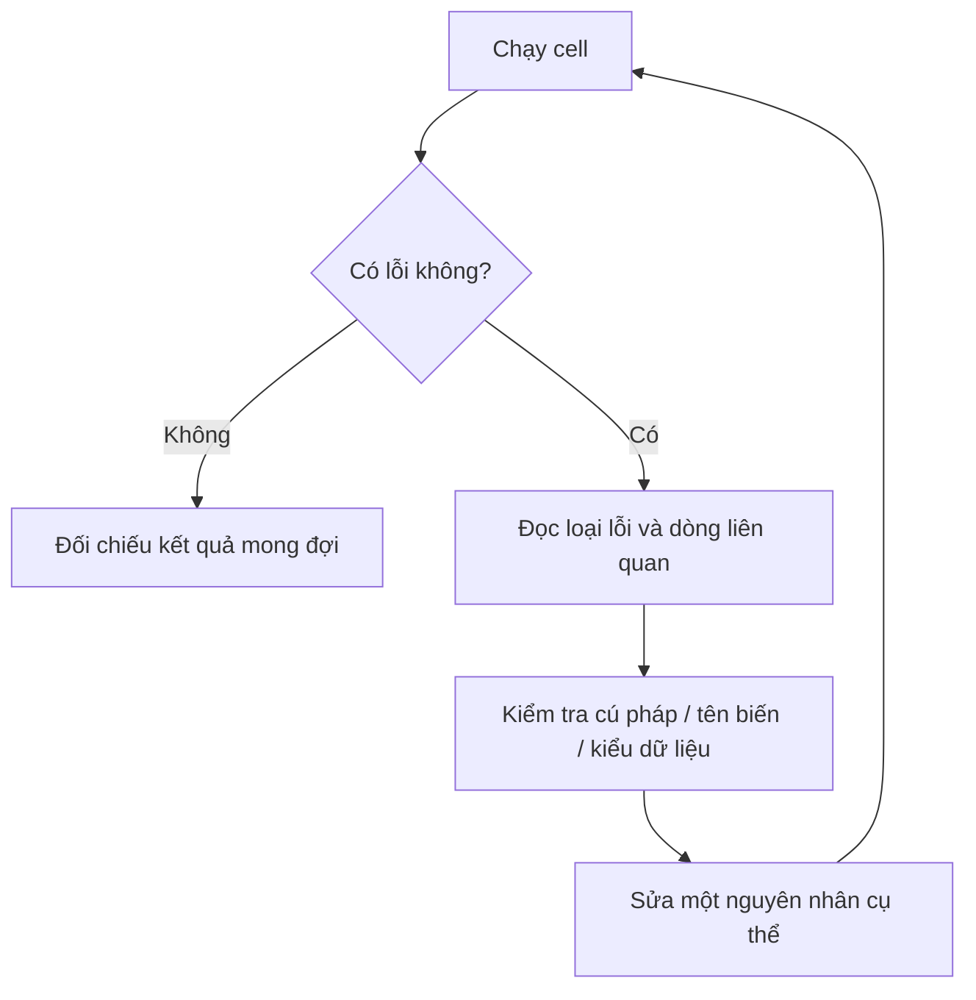

# 13. Jupyter - Handling Error Messages — Bài học

**Khóa học:** Python for Finance: Investment Fundamentals & Data Analytics  
**Module 02:** Introduction to Programming with Python  
**Thứ tự:** 013 · **Loại mục:** `VIDEO_LECTURE` · **Thời lượng metadata:** 5.9 phút  
**Khóa học Udemy:** https://www.udemy.com/course/python-for-finance-investment-fundamentals-data-analytics

> **Ghi chú:** Tài liệu tự biên soạn phục vụ học tập bằng tiếng Việt, bám nội dung bài học được cung cấp. Các phần luyện tập là tự soạn và không đại diện cho đề kiểm tra gốc trên Udemy.

## 1. Thông báo lỗi là công cụ chẩn đoán

Khi Python không thể thực hiện một chỉ dẫn, Jupyter thường hiển thị thông báo lỗi. Thay vì xem đây là thất bại, hãy coi nó là dữ liệu để xác định **lệnh nào gặp vấn đề, loại vấn đề gì và cần sửa ở đâu**.

Phần hiển thị lỗi thường chứa thông tin về ngữ cảnh, vị trí mã và loại ngoại lệ. Với những chương trình nhỏ, điều quan trọng là học đọc dòng báo lỗi cuối và các dòng mã được chỉ ra, sau đó đối chiếu với nguyên nhân thực tế.

## 2. Mục tiêu học tập

1. Đọc được tên lỗi và dòng mã liên quan trong thông báo Python.
2. Phân biệt các tình huống cơ bản gây `SyntaxError`, `NameError`, `TypeError`.
3. Sửa lỗi bằng một thay đổi có thể kiểm tra.
4. Giải thích sự khác biệt giữa lỗi cú pháp và lỗi trong logic tính toán.

## 3. Ba loại lỗi điển hình

### 3.1. `SyntaxError` — sai cú pháp

```python
# Ví dụ cố tình sai, chỉ chạy khi luyện nhận diện lỗi
print("Xin chào"
```

Dòng trên thiếu dấu `)`, nên Python không phân tích được câu lệnh như một cấu trúc hợp lệ. Sửa thành:

```python
print("Xin chào")
```

### 3.2. `NameError` — tên chưa được định nghĩa

```python
# Ví dụ cố tình sai
print(so_du)
```

Nếu kernel chưa có biến `so_du`, Python có thể báo `NameError`. Khai báo trước khi dùng:

```python
so_du = 1000
print(so_du)
```

### 3.3. `TypeError` — phép xử lý không phù hợp kiểu dữ liệu

```python
# Ví dụ cố tình sai
so_luong = "3"
tong = so_luong + 2
```

Giá trị `"3"` là chuỗi, còn `2` là số nguyên. Nếu mục đích là phép cộng số học, cần chuyển kiểu rõ ràng khi dữ liệu hợp lệ:

```python
so_luong = int("3")
tong = so_luong + 2
print(tong)  # 5
```

## 4. Quy trình đọc và sửa lỗi



Quy trình này tránh cách sửa mã tùy tiện. Chỉ sửa một vấn đề tại một thời điểm sẽ giúp nhận ra thay đổi nào giải quyết được lỗi.

## 5. Lỗi chạy mã và lỗi logic

Một chương trình không báo `SyntaxError` hay `TypeError` **chưa chắc đúng**. Ví dụ:

```python
gia_mua = 100
gia_ban = 110
loi_nhuan = gia_mua - gia_ban  # Sai nếu mục tiêu là giá bán - giá mua
print(loi_nhuan)
```

Mã chạy được nhưng trả `-10`, trái với yêu cầu tính chênh lệch `gia_ban - gia_mua = 10`. Đây là **lỗi logic**: phải kiểm chứng kết quả bằng ví dụ tính tay chứ không chờ thông báo lỗi.

## 6. Những điểm dễ mắc phải

- Chỉ đọc loại lỗi mà bỏ qua dòng mã bị chỉ ra.
- Sửa ở cell mới trong khi cell cũ tạo giá trị sai vẫn tồn tại.
- Quên rằng notebook lưu biến từ các cell đã chạy, dẫn tới kết quả phụ thuộc trạng thái trước đó.
- Thấy mã chạy được rồi cho rằng mô hình hay phép tính luôn chính xác.

## 7. Bài tập thực hành

Tạo lần lượt ba lỗi `SyntaxError`, `NameError` và `TypeError` bằng các ví dụ trên. Với mỗi trường hợp, chụp hoặc chép loại lỗi, mô tả nguyên nhân, sửa lỗi rồi xác nhận kết quả. Kết thúc bằng một ví dụ lỗi logic do tự đặt ra.

## 8. Câu hỏi trắc nghiệm ôn tập

### Câu 1

Lỗi nào thường xuất hiện khi dùng tên biến chưa được định nghĩa?

A. `ValueError`  
B. `SyntaxError`  
C. `NameError`  
D. `KeyboardInterrupt`  


**Đáp án:** C.  
**Giải thích:** `NameError` thường báo rằng tên đang tham chiếu chưa tồn tại trong phạm vi sử dụng.

### Câu 2

Đoạn `print("abc"` thiếu dấu đóng thường dẫn đến vấn đề nào?

A. Không có vấn đề.  
B. Tự chạy lại kernel.  
C. `NameError`.  
D. `SyntaxError`.  


**Đáp án:** D.  
**Giải thích:** Dấu ngoặc chưa khép kín làm câu lệnh không đúng cú pháp.

### Câu 3

Vì sao `"3" + 2` gặp lỗi trong Python?

A. Đang cộng chuỗi với số nguyên không tương thích.  
B. Vì 3 là số lẻ.  
C. Vì notebook không lưu được chuỗi.  
D. Vì phải dùng JupyterLab.  


**Đáp án:** A.  
**Giải thích:** `+` không thực hiện cộng số học trực tiếp giữa chuỗi và số nguyên.

### Câu 4

Bước nào hợp lý khi thấy traceback?

A. Xóa hết code ngay.  
B. Đọc loại lỗi, vị trí và kiểm tra nguyên nhân cụ thể.  
C. Đổi máy tính.  
D. Chỉ đổi tên tệp.  


**Đáp án:** B.  
**Giải thích:** Traceback giúp khoanh vùng vấn đề để sửa có cơ sở.

### Câu 5

Vì sao vẫn cần đối chiếu kết quả dù không có thông báo lỗi?

A. Kernel luôn làm tròn sai.  
B. Python không hỗ trợ toán học.  
C. Chương trình có thể có lỗi logic.  
D. Notebook luôn in ra dữ liệu giả.  


**Đáp án:** C.  
**Giải thích:** Lỗi công thức hoặc yêu cầu có thể sinh giá trị sai dù chương trình vẫn thực thi.

## 9. Tổng kết

Đọc lỗi theo loại, vị trí và nguyên nhân giúp sửa mã một cách có phương pháp; đừng quên kiểm tra cả những lỗi logic không tạo traceback.
