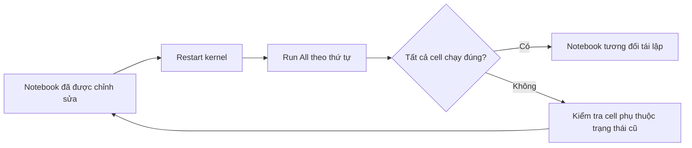

# 14. Jupyter - Restarting the Kernel — Bài học

**Khóa học:** Python for Finance: Investment Fundamentals & Data Analytics  
**Module 02:** Introduction to Programming with Python  
**Thứ tự:** 014 · **Loại mục:** `VIDEO_LECTURE` · **Thời lượng metadata:** 2.0 phút  
**Khóa học Udemy:** https://www.udemy.com/course/python-for-finance-investment-fundamentals-data-analytics

> **Ghi chú:** Tài liệu tự biên soạn phục vụ học tập bằng tiếng Việt, bám nội dung bài học được cung cấp. Các phần luyện tập là tự soạn và không đại diện cho đề kiểm tra gốc trên Udemy.

## 1. Kernel và trạng thái làm việc

Trong Jupyter, **kernel** là tiến trình thực thi mã. Khi chạy một cell tạo biến, biến thường tiếp tục tồn tại trong bộ nhớ kernel để những cell khác sử dụng. Điều này giúp thử nghiệm nhanh nhưng cũng có thể làm notebook cho kết quả khó hiểu nếu các cell được chạy không theo thứ tự trên màn hình.

**Restart Kernel** khởi động lại tiến trình thực thi và xóa các biến, hàm, đối tượng trong bộ nhớ phiên trước. Thao tác này khác với việc xóa tệp `.ipynb` hoặc chỉ xóa kết quả đã hiển thị trên giao diện.

## 2. Mục tiêu học tập

1. Mô tả mối liên hệ giữa kernel và trạng thái biến của notebook.
2. Dự đoán điều xảy ra với một biến sau khi restart.
3. Phân biệt Restart, Run All, Shutdown và lưu notebook.
4. Kiểm tra một notebook có thể chạy lại theo thứ tự từ đầu hay không.

## 3. Ví dụ nhận diện trạng thái kernel

Trong notebook mới, chạy cell thứ nhất:

```python
so_du = 2500
print(so_du)
```

Chạy cell thứ hai:

```python
print(so_du + 100)
```

Đầu ra ở cell thứ hai là `2600`, vì biến `so_du` đã được tạo ở cell trước và kernel vẫn giữ nó. Bây giờ, khởi động lại kernel rồi **chỉ** chạy cell thứ hai. Khi biến chưa được tạo trong phiên mới, Python sẽ báo `NameError`.

Để chạy đúng, thực thi lại cell thứ nhất trước, sau đó cell thứ hai; hoặc dùng thao tác **Restart & Run All** (tên có thể hơi khác theo phiên bản Jupyter).

## 4. Phân biệt các thao tác

| Thao tác | Tác động chính | Có xóa file `.ipynb` không? |
|---|---|---|
| Save | Lưu nội dung notebook | Không |
| Restart Kernel | Tạo lại phiên thực thi, mất biến đang lưu trong RAM | Không |
| Run All | Chạy toàn bộ các cell Code theo thứ tự được hiển thị | Không |
| Restart & Run All | Bắt đầu bằng kernel sạch rồi chạy lại toàn bộ | Không |
| Shutdown Kernel | Dừng tiến trình thực thi của phiên | Không |
| Clear Outputs | Xóa kết quả hiển thị đã lưu trên giao diện/tệp khi lưu | Không |

Việc restart không nhất thiết sửa được mã sai. Nếu có lỗi cú pháp hoặc thiếu đầu vào, chạy lại vẫn có thể gặp lỗi tương tự.

## 5. Vì sao nên thử chạy lại từ đầu?



Thử chạy sạch giúp phát hiện các biến chỉ tồn tại từ những lần thử trước nhưng không được khai báo trong luồng thực hiện hiện tại. Đối với một phân tích có ý nghĩa, còn cần kiểm tra dữ liệu, phiên bản môi trường và kết quả cuối.

## 6. Khi nào nên restart?

- Notebook không phản hồi hoặc kernel có dấu hiệu bất thường; restart có thể giúp làm sạch trạng thái, nhưng không bảo đảm giải quyết mọi trường hợp treo.
- Các cell đã được sửa, xóa hoặc chạy lộn thứ tự, khiến khó xác định giá trị biến hiện tại.
- Trước khi chia sẻ, cần kiểm tra toàn bộ notebook chạy được từ một phiên mới.

Lưu notebook trước thao tác có thể làm gián đoạn công việc. Một số kết quả đang ở bộ nhớ mà chưa lưu sẽ mất khi kernel được khởi động lại.

## 7. Bài tập tự luyện

Tạo biến `x = 12`, chạy cell `x * 3`, restart kernel và chỉ chạy lại cell tính toán; ghi tên lỗi xuất hiện. Tiếp theo, chạy các cell đúng thứ tự và xác nhận kết quả `36`. Cuối cùng sử dụng chức năng chạy lại toàn bộ để kiểm tra tính tái lập.

## 8. Câu hỏi trắc nghiệm ôn tập

### Câu 1

Restart Kernel tác động trực tiếp tới điều gì?

A. Tên file.  
B. Các biến và trạng thái trong bộ nhớ kernel.  
C. Thư mục cha.  
D. Mật khẩu hệ điều hành.  


**Đáp án:** B.  
**Giải thích:** Restart tạo phiên thực thi mới nên xóa trạng thái Python trước đó.

### Câu 2

Sau restart, dùng một biến chưa được khai báo lại thường gây lỗi nào?

A. `SyntaxError` luôn luôn.  
B. `ZeroDivisionError`.  
C. `NameError`.  
D. Không bao giờ lỗi.  


**Đáp án:** C.  
**Giải thích:** Kernel mới chưa biết những biến tạo trong phiên trước.

### Câu 3

Thao tác nào kiểm tra notebook có thể chạy lại từ trạng thái sạch?

A. Chỉ đổi tiêu đề.  
B. Chỉ lưu HTML.  
C. Chỉ xóa kết quả.  
D. Restart & Run All.  


**Đáp án:** D.  
**Giải thích:** Thao tác này loại trạng thái cũ và chạy các cell theo thứ tự.

### Câu 4

Save và Restart khác nhau ở đâu?

A. Save ghi notebook xuống đĩa; Restart đặt lại tiến trình thực thi.  
B. Save tắt kernel; Restart đổi tên notebook.  
C. Hai thao tác giống nhau hoàn toàn.  
D. Restart xóa file khỏi đĩa.  


**Đáp án:** A.  
**Giải thích:** Lưu tệp và khởi động lại tiến trình là hai thao tác khác nhau.

### Câu 5

Tại sao không nên coi restart là cách chữa mọi lỗi?

A. Vì nó xóa tài khoản người dùng.  
B. Vì lỗi cú pháp hoặc đầu vào sai vẫn còn trong mã.  
C. Vì restart tạo mã mới.  
D. Vì restart luôn đổi Python thành R.  


**Đáp án:** B.  
**Giải thích:** Restart chỉ làm sạch phiên, không tự sửa logic hoặc nội dung chương trình.

## 9. Tổng kết

Khởi động lại kernel giúp làm sạch trạng thái, nhưng chỉ chạy lại toàn bộ notebook và kiểm tra kết quả mới đánh giá được tính tái lập của phép tính.
