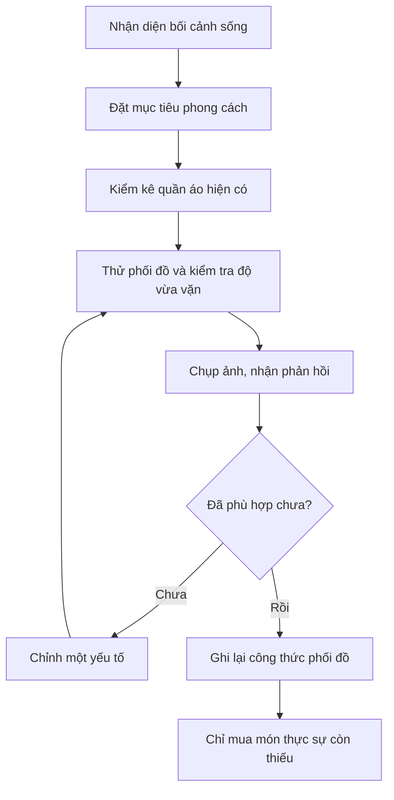

# Bài 001 — Khởi đầu: xây dựng tủ đồ nam thiết yếu

> [!SUMMARY] **Điều quan trọng nhất của bài học**
> Mặc đẹp không bắt đầu từ việc mua thật nhiều quần áo. Điểm khởi đầu là hiểu **mình cần mặc trong hoàn cảnh nào**, **món đồ nào thực sự phù hợp** và **cách tận dụng tủ đồ hiện có** để tạo diện mạo chỉn chu, tự tin.

**Khóa học:** [25 Must-Have Men’s Wardrobe Pieces – Become a Fashion Icon](https://www.udemy.com/course/25-must-have-mens-wardrobe-pieces-become-a-fashion-icon/)  
**Module 01:** Introduction · **Bài 001:** Introduction to the Course · **Loại:** Video lecture · **Thời lượng theo metadata:** 1,8 phút.

> **Lưu ý về phạm vi:** Đây là bài học bổ trợ bằng tiếng Việt, tự biên soạn từ tên chủ đề và kiến thức phổ thông về trang phục nam; **không phải bản chép lời hay nội dung được xác minh từ video Udemy**. Các ví dụ phối đồ bên dưới dùng để minh họa phương pháp, không được coi là danh sách chính thức 25 món đồ của khóa học.

## 1. Tổng quan

Bạn có thể có rất nhiều áo quần nhưng vẫn mất thời gian chọn trang phục mỗi sáng. Nguyên nhân thường không nằm ở số lượng mà ở việc những món đồ đó **khó kết hợp**, **chưa phù hợp với sinh hoạt thực tế** hoặc **không tạo cảm giác thoải mái khi mặc**.

Một **tủ đồ nam thiết yếu** là tập hợp các món quần áo, giày dép và phụ kiện có công năng rõ ràng, phối được thành nhiều bộ trang phục và phù hợp với đời sống của người sở hữu. Không có một danh sách bắt buộc áp dụng y hệt cho tất cả mọi người: người làm văn phòng, sinh viên và người thường xuyên vận động sẽ cần những lựa chọn khác nhau.

*Hình 1. Ngay cả khi chỉ xét áo sơ mi, việc lựa chọn nên dựa trên nhu cầu sử dụng và khả năng kết hợp chứ không phải mua càng nhiều càng tốt. Ảnh: Modern Fellows, CC BY-SA 4.0.*

## 2. Mục tiêu học tập

Sau khi hoàn thành, bạn có thể:

- [ ] Giải thích **tủ đồ thiết yếu** và lý do không nên đánh đồng phong cách với giá tiền hoặc thương hiệu.
- [ ] Xác định ít nhất **ba bối cảnh** bản thân thường mặc đồ và ấn tượng mong muốn trong từng bối cảnh.
- [ ] Đánh giá một bộ đồ theo **độ vừa vặn, màu sắc, chất liệu, sự gọn gàng và mức độ phù hợp hoàn cảnh**.
- [ ] Chọn một món đồ đang sở hữu, thử phối lại và ghi nhận một thay đổi cụ thể.
- [ ] Nêu hai nguyên nhân khiến việc tự đánh giá trang phục dễ thiếu chính xác.

## 3. Thử đoán trước

Trước khi xem nội dung chính, hãy tự trả lời:

1. Giữa một chiếc áo đắt tiền nhưng không vừa người và một chiếc áo bình dân nhưng vừa vặn, món nào thường giúp tổng thể gọn gàng hơn?
2. Nếu ngày thường bạn mặc đi học, đi làm và đi cà phê, những món đồ nào có thể dùng trong ít nhất hai bối cảnh?
3. Bạn có thực sự thiếu quần áo, hay chỉ chưa biết phối các món đã có?

Không cần trả lời hoàn hảo ngay. Hãy dùng câu trả lời làm mốc so sánh sau phần thực hành.

## 4. Kiến thức cốt lõi

### 4.1. Tủ đồ thiết yếu khác tủ đồ nhiều món ở đâu?

Tủ đồ nhiều món chú trọng **số lượng sở hữu**; tủ đồ thiết yếu chú trọng **mức độ sử dụng và khả năng phối hợp**. Một chiếc quần có thể đi cùng nhiều áo và dùng thường xuyên sẽ có giá trị thực tế cao hơn một món bắt mắt nhưng rất hiếm khi mặc.

Khái niệm gần gũi là **capsule wardrobe** (tủ đồ tinh gọn): một nhóm trang phục được lựa chọn có chủ đích để kết hợp linh hoạt. Đây là *một cách tiếp cận*, không phải quy định rằng ai cũng phải có cùng số lượng áo quần.

| Câu hỏi tự kiểm tra | Lựa chọn có tính ứng dụng cao | Lựa chọn cần cân nhắc |
| --- | --- | --- |
| Mặc khi nào? | Phù hợp với hoạt động thường xuyên | Chỉ dùng cho dịp rất hiếm |
| Phối với gì? | Kết hợp được nhiều món đang có | Phải mua thêm nhiều món mới |
| Có vừa không? | Thoải mái, đường vai và độ dài phù hợp | Quá chật, quá rộng hoặc khó cử động |
| Chăm sóc thế nào? | Dễ giặt, giữ gìn theo khả năng của bạn | Cần bảo quản tốn công hơn mức bạn muốn |

### 4.2. Trang phục phải phù hợp bối cảnh

Điều được xem là đẹp trong buổi đi chơi có thể không phù hợp trong một cuộc phỏng vấn. Vì thế, trước khi lựa chọn quần áo, hãy xác định **địa điểm, hoạt động, mức độ trang trọng và điều kiện thời tiết**.

| Bối cảnh | Hướng phối đồ tham khảo | Mục tiêu hình ảnh |
| --- | --- | --- |
| Đi học, gặp bạn bè | Áo thun trơn hoặc polo, quần jeans/chinos, giày sạch | Thoải mái, gần gũi |
| Đi làm hoặc gặp đối tác trong môi trường linh hoạt | Sơ mi hoặc polo, chinos/quần âu, giày tối giản | Chỉn chu, đáng tin cậy |
| Phỏng vấn hoặc sự kiện trang trọng | Sơ mi, quần âu; thêm blazer/suit tùy quy định trang phục | Lịch sự, tôn trọng bối cảnh |

*Hình 2. **Smart casual** kết hợp món lịch sự (sơ mi, áo khoác, giày da) với món đời thường (jeans). Đây là ví dụ tham khảo, không phải công thức cố định. Ảnh: David M Tran, CC BY-SA 3.0.*

*Hình 3. Khi mức độ trang trọng cao hơn, suit và sơ mi có thể phù hợp hơn quần jeans. Tùy sự kiện, quy định trang phục có thể cụ thể hơn ví dụ này. Ảnh: Alamarialaura, CC BY-SA 4.0.*

### 4.3. Năm tiêu chí chọn một món đồ

**1. Độ vừa vặn (fit).** Đây là yếu tố nên kiểm tra đầu tiên. Quan sát đường vai, độ dài tay áo, vòng eo, độ dài ống quần và khả năng cử động. Một món đồ vừa vặn không nhất thiết phải bó sát; nó cần tạo tỷ lệ dễ nhìn và thoải mái.

**2. Màu sắc (color).** Các màu trung tính như trắng, đen, xám, navy hay be thường dễ kết hợp. Tuy vậy, sắc độ phù hợp còn tùy sở thích, độ tương phản với da/tóc và màu sắc của những món bạn đang có. Không có quy tắc màu da nào tuyệt đối áp dụng cho tất cả.

**3. Chất liệu (fabric).** Chọn theo khí hậu và công năng: chất liệu thoáng cho hoạt động hằng ngày ở nơi nóng ẩm; chất liệu có cấu trúc và ít nhăn hơn có thể thuận tiện khi cần vẻ ngoài nghiêm túc. Nên xem cả hướng dẫn giặt và bảo quản.

**4. Sự gọn gàng (grooming).** Áo sạch, ít nhăn; giày được vệ sinh; tóc và tổng thể được chăm chút thường tạo tác động rõ ràng dù không sử dụng hàng đắt tiền.

**5. Tính ứng dụng (versatility).** Hãy ưu tiên món phù hợp với nhiều hoạt động và kết hợp được cùng các món đã có. Một món chỉ dùng cho dịp đặc biệt vẫn có thể cần thiết, nhưng không nên chiếm phần lớn ngân sách khởi đầu.

> [!TIP] **Thứ tự ưu tiên khi mới bắt đầu**
> Kiểm tra **vừa vặn → sạch và gọn → phù hợp hoàn cảnh → dễ phối → phong cách cá nhân** trước khi quan tâm đến giá hay thương hiệu.

### 4.4. Quy trình xây dựng phong cách cá nhân

Sơ đồ trên cho thấy **mua sắm là bước cuối**, không phải bước đầu. Bạn cần hiểu hoàn cảnh của mình, thử các lựa chọn sẵn có rồi mới xác định khoảng trống trong tủ đồ.

### 4.5. Khi nào kết luận về phong cách chưa đáng tin?

Đánh giá trang phục mang tính cá nhân và chịu ảnh hưởng của điều kiện quan sát. Hai trường hợp dễ gây hiểu lầm là:

- **So sánh ảnh trong điều kiện khác nhau:** Ánh sáng, góc máy, tư thế hoặc khoảng cách chụp thay đổi có thể khiến một bộ đồ trông đẹp hoặc xấu hơn thực tế.
- **Thay đổi nhiều yếu tố cùng lúc:** Nếu đổi cả áo, quần, giày và kiểu tóc, bạn khó xác định điều gì đã tạo ra khác biệt.

Ngoài ra, **ý kiến của một người không đại diện cho tất cả mọi người**; lời khen trên mạng không tự động chứng minh món đồ phù hợp với vóc dáng, ngân sách và bối cảnh của bạn.

## 5. Ví dụ thực tế: chuẩn bị trang phục cho buổi gặp mặt

**Tình huống:** Một bạn nam muốn ăn mặc lịch sự hơn khi đi cà phê gặp bạn mới, nhưng chưa muốn mua đồ.

**Tủ đồ hiện có:** Áo thun trắng trơn, sơ mi xanh nhạt, quần jeans xanh đậm, quần chinos màu be và giày sneaker trắng.

**Cách thực hiện:**

1. **Xác định mục tiêu:** Chỉn chu nhưng vẫn thoải mái; không cần suit.
2. **Thử bộ A:** Áo thun trắng + jeans xanh đậm + sneaker trắng.
3. **Thử bộ B:** Sơ mi xanh nhạt + chinos be + cùng đôi sneaker trắng.
4. **So sánh:** Chụp cùng vị trí, ánh sáng và tư thế; kiểm tra vai áo, độ dài quần và sự thuận tiện khi ngồi, đi lại.
5. **Rút kinh nghiệm:** Nếu bộ B phù hợp bối cảnh và tạo cảm giác tự tin hơn, có thể lưu làm công thức đi gặp gỡ. Nếu không, thử điều chỉnh một món thay vì vội mua mới.

**Kết quả cần quan sát:** Bạn xác định được bộ nào phù hợp mục tiêu của *chính mình* và biết lý do lựa chọn, không cần tuyên bố rằng một bộ luôn đẹp hơn bộ còn lại.

## 6. Thực hành: kiểm kê và chọn bộ đồ đầu tiên

**Nhiệm vụ:** Viết **ba mục tiêu phong cách cá nhân** và xây dựng một bộ đồ từ trang phục đang sở hữu.

- [ ] Ghi ba tình huống mặc đồ phổ biến nhất trong tuần.
- [ ] Với mỗi tình huống, ghi một ấn tượng mong muốn (ví dụ: gọn gàng, năng động, lịch sự).
- [ ] Kiểm kê áo, quần, giày có thể dùng ngay; đánh dấu món sạch, vừa và còn tốt.
- [ ] Chọn **một món đồ** làm điểm xuất phát, sau đó phối với ít nhất hai món khác.
- [ ] Chụp ảnh hai cách phối trong điều kiện tương tự.
- [ ] Chỉ chỉnh **một yếu tố** ở lần thử tiếp theo và ghi rõ sự khác biệt.

**Mẫu ghi chép:**

| Bối cảnh | Ấn tượng mong muốn | Món làm điểm xuất phát | Điều thử thay đổi | Nhận xét |
| --- | --- | --- | --- | --- |
| Đi học/đi làm | Gọn gàng | Sơ mi xanh | Đổi jeans sang chinos | … |
| Gặp bạn bè | Thoải mái | Áo thun trắng | Đổi giày | … |
| Dịp trang trọng | Lịch sự | Sơ mi trắng | Thêm áo khoác phù hợp | … |

> [!NOTE]
> Mục tiêu không phải chấm điểm ngoại hình của bạn. Hãy đánh giá xem trang phục có **đúng mục đích, thoải mái, vừa vặn và khiến bạn muốn mặc lại** hay không.

## 7. Những lỗi thường gặp

| Lỗi | Vì sao dễ gặp | Cách khắc phục |
| --- | --- | --- |
| Mua theo xu hướng | Món đang thịnh hành hấp dẫn nhưng có thể ít dùng | Xác định ít nhất hai tình huống sẽ mặc trước khi mua |
| Ưu tiên nhãn hiệu hơn độ vừa | Giá cao tạo cảm giác món đồ chắc chắn phù hợp | Thử trực tiếp; kiểm tra vai, eo, chiều dài và cử động |
| Mua thêm trước khi kiểm kê | Dễ mua trùng hoặc không phối được với đồ sẵn có | Chụp ảnh, phân loại tủ đồ rồi mới lập danh sách cần mua |
| Chỉ soi gương từ một góc | Bỏ sót phần lưng, ống quần hoặc tỷ lệ tổng thể | Kiểm tra chính diện, nghiêng, phía sau và khi vận động |
| Thay cả bộ cùng lúc | Không nhận diện được yếu tố có hiệu quả | Giữ nguyên phần lớn trang phục, chỉnh từng món |

## 8. Câu hỏi ôn tập

### Câu 1

Khi chọn giữa hai chiếc áo có mức giá rất khác nhau, yếu tố nào thường nên kiểm tra trước để tạo tổng thể gọn gàng?

A. Thương hiệu nổi tiếng  
B. Độ vừa vặn và tình trạng sạch, phẳng  
C. Số lượt quảng cáo  
D. Màu nổi bật nhất  

**Đáp án:** B. **Giải thích:** Một chiếc áo phù hợp cơ thể, sạch và gọn thường hữu ích hơn chiếc áo đắt tiền nhưng mặc không vừa; thương hiệu hay độ nổi không bảo đảm hiệu quả.

### Câu 2

Bạn sắp mua quần mới nhưng chưa biết cần kiểu nào. Bước hợp lý nhất là gì?

A. Mua hai mẫu đang bán chạy  
B. Chọn theo bạn bè  
C. Kiểm kê quần đang có và xác định tình huống sử dụng  
D. Chọn mẫu đắt nhất trong ngân sách  

**Đáp án:** C. **Giải thích:** Kiểm kê giúp phát hiện nhu cầu thật và tránh mua trùng; chỉ số bán chạy hoặc ý kiến người khác không phản ánh đầy đủ cuộc sống của bạn.

### Câu 3

Bạn muốn so sánh hai cách phối đồ. Cách nào giúp nhận xét có cơ sở hơn?

A. Chụp ảnh cùng góc máy, ánh sáng và tư thế; hỏi thêm ý kiến người tin cậy  
B. Chụp một ảnh trong tối, một ảnh dưới ánh nắng mạnh  
C. Chỉ nhìn nhãn giá  
D. Không cần thử mặc  

**Đáp án:** A. **Giải thích:** Điều kiện quan sát tương tự giúp hạn chế yếu tố gây nhiễu; ý kiến bổ sung có thể chỉ ra điều bạn chưa để ý.

### Câu 4

Vì sao nên đổi một yếu tố mỗi lần thử phối đồ?

A. Để luôn mặc ít màu  
B. Vì không thể phối nhiều món  
C. Để việc thử kéo dài  
D. Để xác định thay đổi nào thực sự tạo nên khác biệt  

**Đáp án:** D. **Giải thích:** Khi những điều kiện khác gần như giữ nguyên, bạn dễ quan sát tác động của riêng chiếc áo, đôi giày hay kiểu quần vừa đổi.

### Câu 5

Phát biểu nào mô tả đúng mục tiêu của tủ đồ thiết yếu?

A. Càng sở hữu nhiều món càng tốt  
B. Phải mặc giống hệt một người nổi tiếng  
C. Ưu tiên món phù hợp, dễ phối và có công năng rõ ràng trong đời sống  
D. Mọi người phải dùng đúng một danh sách quần áo cố định  

**Đáp án:** C. **Giải thích:** Tủ đồ thiết yếu phục vụ cuộc sống và phong cách của từng người; số lượng, người mẫu tham khảo hoặc danh sách cứng không phải mục tiêu cuối cùng.

## 9. Tổng kết kiến thức

- **Phong cách cá nhân** bắt đầu từ hoàn cảnh và mục tiêu của bạn, không phải từ giá hay số lượng quần áo.
- **Vừa vặn, sạch sẽ, phù hợp bối cảnh và dễ phối** là những tiêu chí nền tảng để chọn món đồ.
- **Thử nghiệm có kiểm soát** (giữ góc chụp tương tự, thay từng yếu tố) giúp rút ra nhận xét đáng tin hơn.
- **Mua sắm nên diễn ra sau khi kiểm kê** và nhận diện chính xác món đang thiếu.

**Bài tập kết thúc:** Lưu lại một ảnh bộ đồ bạn hài lòng, một ảnh phương án thay thế và ba dòng ghi chú: *điều đã thay đổi — lý do — khi nào sẽ mặc lại*.

## 10. Tài liệu và ghi công hình ảnh

1. [Khóa học trên Udemy](https://www.udemy.com/course/25-must-have-mens-wardrobe-pieces-become-a-fashion-icon/) — trang giới thiệu khóa học, không phải nguồn transcript của bài này.
2. [Button down dress shirts for men](https://commons.wikimedia.org/wiki/File:Button_down_dress_shirts_for_men.jpg) — **Modern Fellows**, [CC BY-SA 4.0](https://creativecommons.org/licenses/by-sa/4.0/). Ảnh được sử dụng nguyên bản.
3. [Smart Casual Dress Example](https://commons.wikimedia.org/wiki/File:Smart_Casual_Dress_Example.jpg) — **David M Tran**, [CC BY-SA 3.0](https://creativecommons.org/licenses/by-sa/3.0/). Ảnh được sử dụng nguyên bản.
4. [Formal dresscode](https://commons.wikimedia.org/wiki/File:Formal_dresscode.jpg) — **Alamarialaura**, [CC BY-SA 4.0](https://creativecommons.org/licenses/by-sa/4.0/). Ảnh được sử dụng nguyên bản.

> **Lưu ý khi dùng trên website:** Các ảnh được nhúng bằng URL từ Wikimedia Commons, vì vậy cần có kết nối Internet để hiển thị. Nếu muốn lưu ảnh trong thư mục `assets/` của dự án, hãy tải đúng ảnh gốc từ trang nguồn, giữ phần ghi công và cập nhật đường dẫn Markdown tương ứng.
